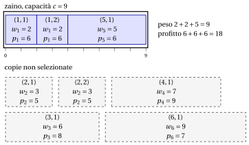

# 2.4 Il problema dello zaino limitato { #sez-sec-kp-BKP }

**Parte 1 · Problemi di ottimizzazione combinatoria · Capitolo 2** · [:material-book-open-variant: Capitolo 2: Problemi di zaino](index.md) · [:material-file-pdf-box: Dispensa, volume 1 (PDF)](../../pdf/dispensa-1-problemi-di-ottimizzazione-combinatoria.pdf) · [:material-pencil: Esercizi: Problemi di zaino](../../esercizi/knapsack.md) · [:material-gesture-tap: App: Forza bruta sul problema dello zaino 0/1](../../laboratorio/zaino-forza-bruta.md)

!!! definizione "Definizione 2.4: problema dello zaino limitato"

    Dati:

    1. uno zaino di <em>capacità</em> $c \in \Z_{\ge 1}$,

    2. un insieme $\mathscr{I} = \{1,2,\dots,n\}$ di $n$ oggetti,

    3. per ogni oggetto $j \in \mathscr{I}$, un <em>profitto</em> $p_j \in \Z_{\ge 1}$, un <em>peso</em> $w_j \in \Z_{\ge 1}$ e un <em>numero di copie disponibili</em> $b_j \in \Z_{\ge 1}$,

    il <strong>problema dello zaino limitato</strong> (BKP) chiede di decidere quante copie di ogni oggetto inserire nello zaino, in modo che il peso totale di tutte le copie selezionate non superi la capacità dello zaino, che nessun oggetto sia preso più volte delle sue copie disponibili e che il profitto totale di tutte le copie selezionate sia massimo.

- Un'<strong>istanza del BKP</strong> è specificata da:

    1. due numeri interi:

        - il numero di oggetti $n \in \Z_{\ge 1}$,

        - la capacità dello zaino $c \in \Z_{\ge 1}$,

    2. tre vettori di numeri interi di lunghezza $n$:

        - $\vet{p} \in \Z_{\ge 1}^n$, che contiene i profitti degli oggetti,

        - $\vet{w} \in \Z_{\ge 1}^n$, che contiene i pesi degli oggetti,

        - $\vet{b} \in \Z_{\ge 1}^n$, che contiene il numero di copie disponibili di ogni oggetto.

- Data un'istanza del BKP, definiamo l'<strong>insieme esteso degli oggetti</strong> come

    \begin{equation*}
    \label{ExtSet}
    \hat{\mathscr{I}}
    =
    \big\{\, (j,k) : j \in \mathscr{I},~ k \in \{1,2,\dots,b_j\} \,\big\}, \tag{2.3}
    \end{equation*}

    dove ogni coppia $(j,k)$ rappresenta la $k$-esima copia disponibile dell'oggetto $j$. La cardinalità dell'insieme esteso degli oggetti è

    $$
    |\hat{\mathscr{I}}| = \sum_{j \in \mathscr{I}} b_j.
    $$

- Una <strong>soluzione ammissibile del BKP</strong> è un sottoinsieme di oggetti

    $$
    S \subseteq \hat{\mathscr{I}}
    $$

    tale che il peso totale degli oggetti selezionati non supera la capacità dello zaino, ossia

    $$
    \sum_{(j,k)\in S} w_j \le c .
    $$

    Di conseguenza, il BKP si può enunciare in modo equivalente come il problema di selezionare un sottoinsieme dell'insieme esteso degli oggetti il cui peso totale rispetta la capacità dello zaino e il cui profitto totale è massimo.

    !!! chiave ""

        Data un'istanza del BKP, il BKP si può enunciare formalmente come:

        \begin{equation*}
        \label{BKP}
        \tilde{S}\in
        \arg\max_{S \subseteq \hat{\mathscr{I}} }
        \left\{~~ \sum_{(j,k) \in S} p_j
        \;:\; \sum_{(j,k) \in S} w_j \le c ~~\right\}. \tag{2.4}
        \end{equation*}

!!! esempio "Esempio 2.3: istanza del BKP"

    Consideriamo uno zaino di capacità $c = 9$ e un insieme $\mathscr{I} = \{1,2,3,4,5,6\}$ di $6$ oggetti ($n = 6$), con i seguenti profitti, pesi e copie disponibili:

    
<table>
    <tr>
    <th>Oggetti</th>
    <th></th>
    <th>\(j = 1\)</th>
    <th>\(j = 2\)</th>
    <th>\(j = 3\)</th>
    <th>\(j = 4\)</th>
    <th>\(j = 5\)</th>
    <th>\(j = 6\)</th>
    </tr>
    <tr>
    <td>Profitti</td>
    <td>\(p_j\)</td>
    <td>\(6\)</td>
    <td>\(5\)</td>
    <td>\(8\)</td>
    <td>\(9\)</td>
    <td>\(6\)</td>
    <td>\(7\)</td>
    </tr>
    <tr>
    <td>Pesi</td>
    <td>\(w_j\)</td>
    <td>\(2\)</td>
    <td>\(3\)</td>
    <td>\(6\)</td>
    <td>\(7\)</td>
    <td>\(5\)</td>
    <td>\(9\)</td>
    </tr>
    <tr>
    <td>Copie disponibili</td>
    <td>\(b_j\)</td>
    <td>\(2\)</td>
    <td>\(2\)</td>
    <td>\(1\)</td>
    <td>\(1\)</td>
    <td>\(1\)</td>
    <td>\(1\)</td>
    </tr>
    </table>

    L'insieme esteso degli oggetti è:

    $$
    \hat{\mathscr{I}} \;=\; \big\{~(1,1),(1,2),\; (2,1),(2,2),\; (3,1),\; (4,1),\; (5,1),\; (6,1) ~\big\}.
    $$

    Ogni copia $(j,k)$ ha profitto $p_j$ e peso $w_j$.

    
<table>
    <tr>
    <th>Etichetta della copia</th>
    <th>1</th>
    <th>2</th>
    <th>3</th>
    <th>4</th>
    <th>5</th>
    <th>6</th>
    <th>7</th>
    <th>8</th>
    </tr>
    <tr>
    <td>\((j,k)\)</td>
    <td>\((1,1)\)</td>
    <td>\((1,2)\)</td>
    <td>\((2,1)\)</td>
    <td>\((2,2)\)</td>
    <td>\((3,1)\)</td>
    <td>\((4,1)\)</td>
    <td>\((5,1)\)</td>
    <td>\((6,1)\)</td>
    </tr>
    <tr>
    <td>Profitto \(p_j\)</td>
    <td>\(6\)</td>
    <td>\(6\)</td>
    <td>\(5\)</td>
    <td>\(5\)</td>
    <td>\(8\)</td>
    <td>\(9\)</td>
    <td>\(6\)</td>
    <td>\(7\)</td>
    </tr>
    <tr>
    <td>Peso \(w_j\)</td>
    <td>\(2\)</td>
    <td>\(2\)</td>
    <td>\(3\)</td>
    <td>\(3\)</td>
    <td>\(6\)</td>
    <td>\(7\)</td>
    <td>\(5\)</td>
    <td>\(9\)</td>
    </tr>
    </table>

    Il disegno mostra una soluzione ottima: le due copie dell'oggetto $1$ e la copia dell'oggetto $5$, con peso $2+2+5=9$ e profitto $6+6+6=18$.

    { .fig loading=lazy  }

## 2.4.1 Ipotesi

- Facciamo le seguenti ipotesi:

    1. Il peso totale di tutte le copie disponibili di tutti gli oggetti supera la capacità dello zaino (altrimenti si potrebbero selezionare tutte le copie). Formalmente:

        $$
        \sum_{j \in \mathscr{I}} b_j \, w_j > c
        $$

    2. Ogni oggetto, da solo, entra nello zaino (altrimenti non può essere selezionato). Formalmente:

        $$
        w_j \le c, \qquad \forall j \in \mathscr{I}
        $$

    3. Il peso totale di tutte le copie disponibili di un singolo oggetto non supera la capacità dello zaino (altrimenti quell'oggetto non potrebbe mai essere preso nel numero massimo di copie consentito). Formalmente:

        $$
        b_j \, w_j \le c, \qquad \forall j \in \mathscr{I}
        $$

---

**Avanti:** [2.5 Il problema dello zaino illimitato](il-problema-dello-zaino-illimitato.md)
