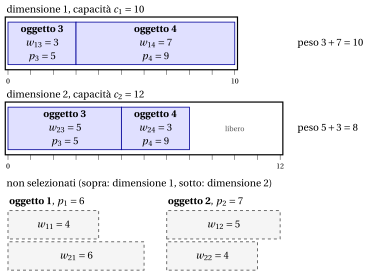

# 2.6 Il problema dello zaino multidimensionale { #sez-sec-kp-MDKP }

**Parte 1 · Problemi di ottimizzazione combinatoria · Capitolo 2** · [:material-book-open-variant: Capitolo 2: Problemi di zaino](index.md) · [:material-file-pdf-box: Dispensa, volume 1 (PDF)](../../pdf/dispensa-1-problemi-di-ottimizzazione-combinatoria.pdf) · [:material-presentation: Slide](../../pdf/slide-knapsack.pdf) · [:material-pencil: Esercizi: Problemi di zaino](../../esercizi/knapsack.md) · [:material-gesture-tap: App: Forza bruta sul problema dello zaino 0/1](../../laboratorio/zaino-forza-bruta.md)

!!! definizione "Definizione 2.6: problema dello zaino multidimensionale"

    Dati:

    1. uno zaino $k$-dimensionale,

    2. per ogni dimensione $d \in \underbrace{\{1,2,\dots,k\}}_{=\mathscr{D}}$, una <em>capacità</em> $c_d \in \Z_{\ge 1}$,

    3. un insieme $\mathscr{I} = \{1,2,\dots,n\}$ di $n$ oggetti,

    4. per ogni oggetto $j \in \mathscr{I}$, un <em>profitto</em> $p_j \in \Z_{\ge 1}$,

    5. per ogni dimensione $d \in \mathscr{D}$ e ogni oggetto $j \in \mathscr{I}$, un <em>peso</em> $w_{dj} \in \Z_{\ge 1}$,

    il <strong>problema dello zaino multidimensionale</strong> (MDKP) chiede di decidere quali oggetti inserire nello zaino, in modo che per ogni dimensione il peso totale degli oggetti selezionati non superi la capacità corrispondente e il profitto totale degli oggetti selezionati sia massimo.

- Un'<strong>istanza dell'MDKP</strong> è specificata da:

    1. due numeri interi:

        - il numero di oggetti $n \in \Z_{\ge 1}$,

        - il numero di dimensioni $k \in \Z_{\ge 1}$,

    2. un vettore di numeri interi di lunghezza $n$:

        - $\vet{p} \in \Z_{\ge 1}^n$, che contiene i profitti degli oggetti,

    3. un vettore di numeri interi di lunghezza $k$:

        - $\vet{c} \in \Z_{\ge 1}^k$, che contiene le capacità dello zaino per ogni dimensione,

    4. una matrice di numeri interi con $k$ righe e $n$ colonne:

        - $\vet{W} \in \Z_{\ge 1}^{k \times n}$, che contiene i pesi degli oggetti per ogni dimensione.

- Una <strong>soluzione ammissibile dell'MDKP</strong> è un sottoinsieme di oggetti

    $$
    S \subseteq \mathscr{I}
    $$

    tale che i vincoli di capacità sono soddisfatti in ogni dimensione, ossia

    $$
    \sum_{j\in S} w_{dj} \le c_d \qquad \forall\, d\in \mathscr{D}.
    $$

    Di conseguenza, l'MDKP si può enunciare in modo equivalente come il problema di selezionare un sottoinsieme di oggetti il cui peso totale rispetta le capacità dello zaino in ogni dimensione e il cui profitto totale è massimo.

    !!! chiave ""

        Data un'istanza dell'MDKP, l'MDKP si può enunciare formalmente come:

        \begin{equation*}
        \label{MDKP}
        \tilde{S}\in \argmax_{S \subseteq \mathscr{I}}
        \left\{~~ \sum_{j \in S} p_j \;\;:\;\; \sum_{j\in S} w_{dj} \le c_d \ \ \forall\, d\in \mathscr{D} ~~\right\}. \tag{2.8}
        \end{equation*}

!!! esempio "Esempio 2.5: istanza dell'MDKP"

    Consideriamo uno zaino $2$-dimensionale ($k=2$) con capacità $c_1 = 10$ e $c_2 = 12$, e un insieme $\mathscr{I} = \{1,2,3,4\}$ di $4$ oggetti ($n = 4$), con i seguenti profitti e pesi:

    
<table>
    <tr>
    <th>Oggetti</th>
    <th></th>
    <th>\(j = 1\)</th>
    <th>\(j = 2\)</th>
    <th>\(j = 3\)</th>
    <th>\(j = 4\)</th>
    </tr>
    <tr>
    <td>Profitti</td>
    <td>\(p_j\)</td>
    <td>\(6\)</td>
    <td>\(7\)</td>
    <td>\(5\)</td>
    <td>\(9\)</td>
    </tr>
    <tr>
    <td>Pesi (dim. \(1\))</td>
    <td>\(w_{1j}\)</td>
    <td>\(4\)</td>
    <td>\(5\)</td>
    <td>\(3\)</td>
    <td>\(7\)</td>
    </tr>
    <tr>
    <td>Pesi (dim. \(2\))</td>
    <td>\(w_{2j}\)</td>
    <td>\(6\)</td>
    <td>\(4\)</td>
    <td>\(5\)</td>
    <td>\(3\)</td>
    </tr>
    </table>

    Il disegno ha una scatola per dimensione, di lunghezza $c_1=10$ e $c_2=12$: un oggetto selezionato occupa un blocco di lunghezza $w_{1j}$ nella prima scatola e uno di lunghezza $w_{2j}$ nella seconda. La soluzione ottima $\{3,4\}$ riempie la prima dimensione e usa $8$ unità della seconda, con profitto $5+9=14$.

    { .fig loading=lazy  }

## 2.6.1 Ipotesi

- Facciamo le seguenti ipotesi:

    1. L'insieme di tutti gli oggetti <em>non</em> entra nello zaino (altrimenti selezionare tutti gli oggetti è ammissibile e ottimo). Formalmente,

        $$
        \exists\, d\in \mathscr{D} \ \text{tale che}\ \sum_{j\in \mathscr{I}} w_{dj} \;>\; c_d .
        $$

    2. Ogni oggetto, da solo, entra nello zaino in ogni dimensione (altrimenti non può mai essere selezionato). Formalmente,

        $$
        w_{dj} \le c_d, \qquad \forall\, d\in \mathscr{D},\ \forall\, j\in \mathscr{I}.
        $$

---

**Avanti:** [2.7 Il problema degli zaini multipli](il-problema-degli-zaini-multipli.md)
