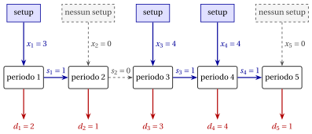

# 8.2 Il problema del lot sizing capacitato { #sez-sec-ls-CLS }

**Parte 1 · Problemi di ottimizzazione combinatoria · Capitolo 8** · [:material-book-open-variant: Capitolo 8: Problemi di lot sizing](index.md) · [:material-file-pdf-box: Dispensa, volume 1 (PDF)](../../pdf/dispensa-1-problemi-di-ottimizzazione-combinatoria.pdf) · [:material-pencil: Esercizi: Problemi di lot sizing](../../esercizi/lot-sizing.md)

!!! definizione "Definizione 8.1: problema del lot sizing capacitato"

    Dati:

    1. un insieme $T = \{1,2,\dots,m\}$ di $m$ <em>periodi di tempo</em>,

    2. per ogni periodo $t \in T$, una <em>domanda</em> $d_t \in \Z_{\ge 1}$ e una <em>capacità</em> $cap_t \in \Z_{\ge 1}$, entrambe misurate in unità di un prodotto,

    3. per ogni periodo $t \in T$, tre costi interi non negativi: il <em>costo di setup</em> $sc_t$, il <em>costo variabile di produzione</em> $vc_t$ per unità prodotta e il <em>costo di mantenimento a scorta</em> $hc_t$ per unità tenuta in scorta alla fine del periodo,

    il <strong>problema del lot sizing capacitato</strong> (CLS) chiede di decidere quanto produrre in ogni periodo, in modo che ogni domanda sia soddisfatta con ciò che si produce e ciò che è in scorta, le capacità siano rispettate, e il costo totale di setup, produzione e mantenimento a scorta sia minimo.

- Un'<strong>istanza del CLS</strong> è specificata da:

    1. un numero intero:

        - il numero di periodi $m \in \Z_{\ge 1}$,

    2. cinque vettori di numeri interi di lunghezza $m$:

        - $\vet{d},\ \vet{cap} \in \Z_{\ge 1}^m$, che contengono domande e capacità,

        - $\vet{sc},\ \vet{vc},\ \vet{hc} \in \Z_{\ge 0}^m$, che contengono i costi.

- Una <strong>soluzione ammissibile del CLS</strong> è un <strong>piano di produzione</strong>, ossia un vettore di quantità intere

    $$
    \vet{x} = (x_1,x_2,\dots,x_m) \in \Z_{\ge 0}^m ,
    $$

    dove $x_t$ è la quantità prodotta nel periodo $t$. La scorta rimasta alla fine del periodo $t$ è

    $$
    s_t(\vet{x}) = \sum_{u=1}^{t} (x_u - d_u),
    $$

    perché la scorta del periodo $t-1$ più la produzione del periodo $t$ deve coprire la domanda del periodo $t$, e ciò che resta è la scorta del periodo $t$. Il piano è <strong>ammissibile</strong> se

    $$
    x_t \le cap_t \quad \text{e} \quad s_t(\vet{x}) \ge 0 \qquad \forall t \in T, \qquad s_m(\vet{x}) = 0.
    $$

- C'è un <strong>setup</strong> nel periodo $t$ quando $x_t > 0$: in questo caso scriviamo $y_t = 1$, e $y_t = 0$ altrimenti. Il <strong>costo</strong> di un piano è

    $$
    c(\vet{x}) = \sum_{t \in T} \bigl( sc_t\, y_t + vc_t\, x_t + hc_t\, s_t(\vet{x}) \bigr).
    $$

    !!! chiave ""

        Data un'istanza del CLS, il CLS si può enunciare formalmente come:

        \begin{equation*}
        \label{CLS}
        \tilde{\vet{x}}
        \in
        \argmin_{\vet{x}}
        \left\{
        c(\vet{x})
        \;:\;
        x_t \le cap_t,~ s_t(\vet{x}) \ge 0,~ \forall t \in T,~ s_m(\vet{x}) = 0,~ \vet{x} \in \Z_{\ge 0}^m
        \right\}. \tag{8.1}
        \end{equation*}

- Indichiamo con $z(I)$ il costo di un piano ottimo $\tilde{\vet{x}}$ dell'istanza $I$.

!!! esempio "Esempio 8.1: istanza del CLS"

    Consideriamo $m=5$ periodi, con i seguenti dati, tutti interi:

    
<table>
    <tr>
    <th>periodo \(t\)</th>
    <th>\(1\)</th>
    <th>\(2\)</th>
    <th>\(3\)</th>
    <th>\(4\)</th>
    <th>\(5\)</th>
    </tr>
    <tr>
    <td>domanda \(d_t\)</td>
    <td>\(2\)</td>
    <td>\(1\)</td>
    <td>\(3\)</td>
    <td>\(4\)</td>
    <td>\(1\)</td>
    </tr>
    <tr>
    <td>capacità \(cap_t\)</td>
    <td>\(4\)</td>
    <td>\(4\)</td>
    <td>\(4\)</td>
    <td>\(4\)</td>
    <td>\(4\)</td>
    </tr>
    <tr>
    <td>costo di setup \(sc_t\)</td>
    <td>\(50\)</td>
    <td>\(50\)</td>
    <td>\(50\)</td>
    <td>\(50\)</td>
    <td>\(50\)</td>
    </tr>
    <tr>
    <td>costo di produzione \(vc_t\)</td>
    <td>\(0\)</td>
    <td>\(0\)</td>
    <td>\(0\)</td>
    <td>\(0\)</td>
    <td>\(0\)</td>
    </tr>
    <tr>
    <td>costo di mantenimento \(hc_t\)</td>
    <td>\(10\)</td>
    <td>\(10\)</td>
    <td>\(10\)</td>
    <td>\(10\)</td>
    <td>\(10\)</td>
    </tr>
    </table>

    La domanda totale è $2+1+3+4+1=11$. Chiamiamo questa istanza del CLS [Esempio 8.1](#box-2-ex-cls5): è l'istanza di riferimento del capitolo.

    Il piano $\vet{x}=(3,0,4,4,0)$ è ammissibile: le scorte sono $s=(1,0,1,1,0)$, tutte non negative, con $s_5=0$, e ogni quantità è al più $4$. Ci sono $3$ setup, nei periodi $1$, $3$ e $4$:

    $$
    c(\vet{x}) = 3\cdot 50 + 10\cdot(1+0+1+1+0) = 150+30=180.
    $$

    Il piano è disegnato qui sotto, periodo per periodo da sinistra a destra: la produzione $x_t$ entra in un periodo dall'alto, attraverso un setup (linea continua) oppure non entra affatto (tratteggio); la scorta $s_t$ passa al periodo successivo; la domanda $d_t$ esce dal periodo verso il basso.

    { .fig loading=lazy  }

    Ogni periodo ha capacità $cap_t=4$, e i tre setup costano $50$ ciascuno.

## 8.2.1 Ipotesi

- Facciamo le seguenti ipotesi:

    1. La scorta è vuota all'inizio e alla fine dell'orizzonte. Lasciare scorta alla fine aggiunge solo costo, quindi nessun piano ottimo ne ha bisogno; una scorta iniziale è una variante del problema (Sezione [8.6](varianti.md#sez-sec-ls-variants)).

    2. Le capacità permettono di soddisfare le domande, periodo dopo periodo (altrimenti non esiste alcun piano ammissibile). Formalmente:

        $$
        \sum_{u=1}^{t} cap_u \ge \sum_{u=1}^{t} d_u, ~~~~ \forall t \in T
        $$

    3. Le quantità sono intere. Con dati interi, una volta fissati i periodi con un setup, ciò che resta è un problema di flusso di costo minimo, che ha una soluzione ottima intera: restringere le quantità agli interi non cambia il costo ottimo.

## 8.3 Contare le soluzioni

- La parte combinatoria della decisione è la scelta dei periodi con un setup: ci sono $2^m$ sottoinsiemi di periodi. Non tutti sono ammissibili, perché i periodi con un setup devono avere capacità sufficiente per produrre tutto.

- Per una data scelta dei periodi di setup possono esistere molti piani di produzione, poiché le quantità si possono distribuire in molti modi: il numero di piani ammissibili è maggiore del numero di scelte di setup ammissibili.

!!! esempio "Esempio 8.2: contare i piani"

    Per l'istanza dell'[Esempio 8.1](#box-2-ex-cls5) ci sono $2^5=32$ sottoinsiemi di periodi. Sia $k_t$ il numero di setup nei periodi $1,\dots,t$: le domande cumulate $2,3,6,10,11$ richiedono, con capacità $4$, almeno un setup nei periodi $1$–$2$, due nei periodi $1$–$3$ e tre nei periodi $1$–$4$. Poiché $d_1>0$ c'è un setup nel periodo $1$, e nei periodi $2,3,4$ servono almeno due setup, di cui uno nei periodi $2$ o $3$:

    $$
    (y_2,y_3,y_4) \in \{(1,1,0),(1,0,1),(0,1,1),(1,1,1)\}.
    $$

    Il periodo $5$ è libero, quindi le scelte di setup ammissibili sono $4\cdot 2=8$ su $32$.

    Per enumerazione, a queste scelte di setup corrispondono $94$ piani ammissibili. I costi di sei di essi sono:

    
<table>
    <tr>
    <th>piano</th>
    <th>costo</th>
    <th>piano</th>
    <th>costo</th>
    <th>piano</th>
    <th>costo</th>
    </tr>
    <tr>
    <td>\((3,0,4,4,0)\)</td>
    <td>\(\mathbf{180}\)</td>
    <td>\((4,0,3,4,0)\)</td>
    <td>\(200\)</td>
    <td>\((2,1,4,4,0)\)</td>
    <td>\(220\)</td>
    </tr>
    <tr>
    <td>\((3,0,3,4,1)\)</td>
    <td>\(210\)</td>
    <td>\((4,0,4,3,0)\)</td>
    <td>\(210\)</td>
    <td>\((2,1,3,4,1)\)</td>
    <td>\(250\)</td>
    </tr>
    </table>

    Il piano $(3,0,4,4,0)$ è l'unico piano ottimo, e $z(I)=180$.

- Senza le capacità la stessa istanza ha $2^{m-1}=16$ piani che producono solo quando la scorta è vuota, e il costo ottimo è $170$: qui la capacità costa $10$.

- Il piano ottimo $(3,0,4,4,0)$ produce nel periodo $4$ con una scorta di $1$ unità, quindi la proprietà di Wagner e Whitin non vale quando le capacità sono vincolanti.

- Il numero di scelte di setup cresce come $2^m$: con $m=52$ settimane supera $4\cdot 10^{15}$.

## 8.4 Un primo piano a mano

- Il piano ammissibile più semplice è il <strong>lot-for-lot</strong>: in ogni periodo produciamo esattamente la domanda di quel periodo. Non c'è scorta, e ci sono $m$ setup; è ammissibile quando ogni domanda rientra nella capacità del suo periodo.

- Un piano si migliora <strong>accorpando</strong>: la domanda di un periodo si produce in un periodo precedente, il che risparmia un setup e costa la scorta delle unità anticipate.

!!! esempio "Esempio 8.3: dal lot-for-lot a un piano migliore"

    Sull'istanza dell'[Esempio 8.1](#box-2-ex-cls5):

    1. il piano lot-for-lot $(2,1,3,4,1)$ ha $5$ setup e nessuna scorta: costo $5\cdot 50=250$;

    2. produrre la domanda del periodo $2$ nel periodo $1$ risparmia un setup ($-50$) e tiene $1$ unità in scorta per un periodo ($+10$): il piano $(3,0,3,4,1)$ costa $210$;

    3. il periodo $4$ non può produrre anche la domanda del periodo $5$, perché $4+1>cap_4=4$; ma il periodo $3$ può anticipare un'unità del periodo $4$, così che il periodo $4$ abbia spazio per la domanda del periodo $5$: il piano $(3,0,4,4,0)$ risparmia un setup ($-50$) e tiene in scorta due unità in più ($+20$).

    Il costo è $210-50+20=180$.

- Abbiamo trovato a mano il piano di costo $180$, ma non sappiamo ancora dire se esista un piano più economico: ci serve un lower bound.

## 8.5 Un lower bound combinatorio

- Sia $D=\sum_{t \in T} d_t$ la domanda totale. Sia $k$ il minimo numero di periodi le cui capacità sommano almeno a $D$, che si trova prendendo i periodi con le capacità più grandi.

!!! teorema "Osservazione 8.2"

    Per ogni istanza del CLS, ogni piano ammissibile ha almeno $k$ setup, e

    $$
    z(I) \;\ge\; \textrm{la somma dei } k \textrm{ costi di setup più piccoli}.
    $$

- Il piano deve produrre $D$ unità nei periodi con un setup, e un periodo senza setup non produce nulla: le capacità dei periodi con un setup sommano almeno a $D$, quindi questi periodi sono almeno $k$.

- I costi di produzione e di mantenimento a scorta sono non negativi: trascurandoli, e pagando solo $k$ setup, i più economici, otteniamo un bound sul costo di ogni piano.

!!! esempio "Esempio 8.4: il bound sull'istanza di riferimento"

    Per l'istanza dell'[Esempio 8.1](#box-2-ex-cls5) abbiamo $D=11$ e tutte le capacità uguali a $4$, quindi $k=\lceil 11/4 \rceil = 3$. Tutti i costi di setup valgono $50$, quindi

    $$
    z(I) \ge 3 \cdot 50 = 150.
    $$

    Insieme ai piani della sezione precedente otteniamo

    $$
    150 \le z(I) \le 180,
    $$

    un gap assoluto di $30$, ossia un gap relativo di $\frac{30}{150}=20\%$. L'enumerazione dei $94$ piani dimostra che $180$ è ottimo.

---

**Avanti:** [8.6 Varianti](varianti.md)
