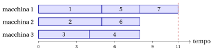

# 7.2 Scheduling su macchine parallele identiche { #sez-sec-pm-PCmax }

**Parte 1 · Problemi di ottimizzazione combinatoria · Capitolo 7** · [:material-book-open-variant: Capitolo 7: Problemi di scheduling](index.md) · [:material-file-pdf-box: Dispensa, volume 1 (PDF)](../../pdf/dispensa-1-problemi-di-ottimizzazione-combinatoria.pdf) · [:material-presentation: Slide](../../pdf/slide-pcmax.pdf) · [:material-pencil: Esercizi: Problemi di scheduling](../../esercizi/pcmax.md)

!!! definizione "Definizione 7.1: Scheduling su macchine parallele identiche"

    Dati:

    1. un insieme di $m$ <em>macchine</em> identiche,

    2. un insieme $\mathscr{J} = \{1,2,\dots,n\}$ di $n$ <em>lavori</em>,

    3. per ogni lavoro $j \in \mathscr{J}$, un <em>tempo di processamento</em> $t_j \in \Z_{\ge 1}$,

    il problema $P\,||\,C_{\max}$ chiede di assegnare ogni lavoro a una macchina, in modo da minimizzare il tempo necessario per completare tutti i lavori, cioè il massimo tempo di processamento totale assegnato a una macchina.

- Il nome $P\,||\,C_{\max}$ deriva dalla notazione a tre campi dei problemi di scheduling (Sezione [7.1.1](index.md#sez-sec-threefield)).

- Un'<strong>istanza di $P\,||\,C_{\max}$</strong> è specificata da:

    1. due numeri interi:

        - il numero di macchine $m \in \Z_{\ge 1}$,

        - il numero di lavori $n \in \Z_{\ge 1}$,

    2. un vettore di numeri interi di lunghezza $n$:

        - $\vet{t} \in \Z_{\ge 1}^n$, che contiene i tempi di processamento.

- Una <strong>soluzione ammissibile di $P\,||\,C_{\max}$</strong> è un assegnamento dei lavori alle macchine, che memorizziamo in un vettore $\mathrm{mach}=(\mathrm{mach}_1,\mathrm{mach}_2,\dots,\mathrm{mach}_n)$:

    $$
    \mathrm{mach}_j = h \quad \Longleftrightarrow \quad \text{il lavoro } j \text{ è assegnato alla macchina } h .
    $$

    L'insieme dei lavori assegnati alla macchina $h$ è $J_h = \{ j \in \mathscr{J} : \mathrm{mach}_j = h\}$, e il suo <strong>carico</strong> è

    $$
    L_h = \sum_{j \in J_h} t_j .
    $$

    Ogni macchina processa i suoi lavori uno dopo l'altro, senza tempi morti, quindi la macchina $h$ completa i suoi lavori all'istante $L_h$. Il <strong>makespan</strong> della soluzione è l'istante di completamento dell'ultimo lavoro,

    $$
    C_{\max} = \max_{h \in \{1,2,\dots,m\}} L_h .
    $$

- L'ordine in cui una macchina processa i suoi lavori non cambia il suo carico: una soluzione è descritta completamente dagli insiemi $J_1,J_2,\dots,J_m$, che formano una partizione di $\mathscr{J}$ (alcuni di essi possono essere vuoti).

    !!! chiave ""

        Data un'istanza di $P\,||\,C_{\max}$, il problema si può enunciare formalmente come:

        \begin{equation*}
        \label{PCmax}
        \min
        \left\{
        \max_{h \in \{1,\dots,m\}} \sum_{j \in J_h} t_j
        \;:\;
        J_1,J_2,\dots,J_m \text{ è una partizione di } \mathscr{J}
        \right\}. \tag{7.1}
        \end{equation*}

- Indichiamo con $z(I)$ il makespan ottimo dell'istanza $I$.

## 7.2.1 Ipotesi

- Facciamo la seguente ipotesi:

    1. Ci sono più lavori che macchine (altrimenti ogni lavoro ha una macchina tutta per sé, e il makespan ottimo è $\max_j t_j$). Formalmente:

        $$
        n > m
        $$

!!! esempio "Esempio 7.1: istanza di $P\,||\,C_{\max}$"

    Consideriamo $m=3$ macchine e un insieme $\mathscr{J}=\{1,2,\dots,7\}$ di $7$ lavori ($n=7$), con i seguenti tempi di processamento:

    $$
    \begin{array}{l|ccccccc}
    \hline  & {j=1} & {j=2} & {j=3} & {j=4} & {j=5} & {j=6} & {j=7} \\[1ex]
    \hline {t_j} & {5} & {5} & {4} & {4} & {3} & {3} & {3} \\
    \hline
    \end{array}
    $$

    Chiamiamo questa istanza [Esempio 7.1](#box-2-ex-pcmax7): è l'istanza di riferimento del capitolo. L'assegnamento $\mathrm{mach}=(1,2,3,3,1,2,1)$ dà $J_1=\{1,5,7\}$, $J_2=\{2,6\}$, $J_3=\{3,4\}$, con carichi $L_1=11$, $L_2=8$, $L_3=8$ e makespan $11$:

    { .fig loading=lazy  }

## 7.3 Contare le soluzioni

- Ogni lavoro può essere assegnato a una qualunque delle $m$ macchine, indipendentemente dagli altri: ci sono $m^n$ assegnamenti $\mathrm{mach}$.

- Le macchine sono identiche, quindi due assegnamenti che differiscono solo per i nomi delle macchine descrivono lo stesso schedule. Gli schedule distinti sono le partizioni di $\mathscr{J}$ in al più $m$ insiemi non vuoti, e il loro numero è

    $$
    \sum_{k=1}^{m} S(n,k),
    $$

    dove $S(n,k)$ è il numero di Stirling di seconda specie, cioè il numero di partizioni di $n$ elementi in esattamente $k$ insiemi non vuoti.

!!! esempio "Esempio 7.2: contare gli schedule"

    Per l'istanza dell'[Esempio 7.1](#box-2-ex-pcmax7) ci sono $3^7=2187$ assegnamenti. I numeri di Stirling sono $S(7,1)=1$, $S(7,2)=63$ e $S(7,3)=301$, quindi gli schedule distinti sono

    $$
    1+63+301=365.
    $$

    Per enumerazione, gli schedule con il makespan minimo, $9$, sono esattamente due:

    $$
    \{1,3\},\{2,4\},\{5,6,7\} \qquad \text{e} \qquad \{1,4\},\{2,3\},\{5,6,7\},
    $$

    che corrispondono a $3!\cdot 2=12$ dei $2187$ assegnamenti. Lo schedule ottimo quindi non è unico.

- La crescita è esponenziale in $n$: con $3$ macchine, $20$ lavori hanno $3^{20} \approx 3.5\cdot 10^9$ assegnamenti, e $30$ lavori ne hanno $3^{30} \approx 2.1\cdot 10^{14}$.

## 7.4 Un primo schedule a mano { #sez-sec-pm-list }

- Un modo semplice per costruire uno schedule è prendere i lavori uno alla volta, nell'ordine $1,2,\dots,n$, e assegnare ogni lavoro alla macchina che in quel momento ha il carico minimo; in caso di pareggio prendiamo la macchina con l'indice minimo.

!!! esempio "Esempio 7.3: assegnare ogni lavoro alla macchina meno carica"

    Sull'istanza dell'[Esempio 7.1](#box-2-ex-pcmax7) i carichi delle tre macchine evolvono come segue:

    
<table>
    <tr>
    <th>lavoro \(j\) (\(t_j\))</th>
    <th>macchina scelta</th>
    <th>carichi \((L_1,L_2,L_3)\)</th>
    </tr>
    <tr>
    <td>\(1\) (\(5\))</td>
    <td>\(1\)</td>
    <td>\((5,0,0)\)</td>
    </tr>
    <tr>
    <td>\(2\) (\(5\))</td>
    <td>\(2\)</td>
    <td>\((5,5,0)\)</td>
    </tr>
    <tr>
    <td>\(3\) (\(4\))</td>
    <td>\(3\)</td>
    <td>\((5,5,4)\)</td>
    </tr>
    <tr>
    <td>\(4\) (\(4\))</td>
    <td>\(3\)</td>
    <td>\((5,5,8)\)</td>
    </tr>
    <tr>
    <td>\(5\) (\(3\))</td>
    <td>\(1\)</td>
    <td>\((8,5,8)\)</td>
    </tr>
    <tr>
    <td>\(6\) (\(3\))</td>
    <td>\(2\)</td>
    <td>\((8,8,8)\)</td>
    </tr>
    <tr>
    <td>\(7\) (\(3\))</td>
    <td>\(1\)</td>
    <td>\((11,8,8)\)</td>
    </tr>
    </table>

    Otteniamo l'assegnamento $\mathrm{mach}=(1,2,3,3,1,2,1)$ dell'esempio, con makespan $11$.

- Quando arriva l'ultimo lavoro tutte le macchine hanno carico $8$: qualunque macchina lo riceva, il carico massimo diventa $8+3=11$.

- Non sappiamo ancora se $11$ è lontano dal makespan ottimo: ci serve un lower bound.

## 7.5 Un lower bound combinatorio { #sez-sec-pm-lb }

!!! teorema "Osservazione 7.2"

    Per ogni istanza di $P\,||\,C_{\max}$, il makespan ottimo $z(I)$ soddisfa

    $$
    z(I) \;\ge\; \max\left\{ \max_{j\in\mathscr{J}} t_j,\;\; \left\lceil \frac{\sum_{j\in\mathscr{J}} t_j}{m} \right\rceil \right\}.
    $$

- La macchina che processa il lavoro più lungo ha carico almeno $\max_j t_j$.

- Gli $m$ carichi sommano a $\sum_j t_j$, quindi il maggiore è almeno pari alla loro media $\frac{1}{m}\sum_j t_j$ e, essendo intero, almeno pari al suo arrotondamento per eccesso.

!!! esempio "Esempio 7.4: il bound sull'istanza di riferimento"

    Sull'istanza dell'[Esempio 7.1](#box-2-ex-pcmax7) il bound è $\max\{5,\lceil 27/3\rceil\}=9$. Insieme allo schedule della Sezione [7.4](#sez-sec-pm-list),

    $$
    9 \le z(I) \le 11.
    $$

    L'assegnamento $\mathrm{mach}=(1,2,1,2,3,3,3)$ dà $J_1=\{1,3\}$, $J_2=\{2,4\}$, $J_3=\{5,6,7\}$, tutti con carico $9$, e makespan $9$:

    { .fig loading=lazy  }

    Raggiunge il lower bound, quindi è ottimo: $z(I)=9$. Le tre macchine finiscono insieme, e non resta alcun tempo morto prima del makespan.

- Il bound non è sempre raggiunto. Con $m=2$ macchine e tre lavori con tempi di processamento $(4,3,3)$ dà $\max\{4,\lceil 10/2\rceil\}=5$, ma lo schedule migliore è $\{1\},\{2,3\}$, con makespan $6$.

## 7.6 Relazione con il problema del bin packing

- Dato un valore $T$, esiste uno schedule con makespan al più $T$ se e solo se i lavori, visti come oggetti di peso $t_j$, possono essere inseriti in $m$ contenitori di capacità $T$: le macchine sono i contenitori e i carichi sono i pesi totali dei pattern di riempimento.

- I due problemi fissano e minimizzano quantità opposte:

    
<table>
    <tr>
    <th></th>
    <th>numero di contenitori / macchine</th>
    <th>capacità / makespan</th>
    </tr>
    <tr>
    <td>BPP</td>
    <td>minimizzato</td>
    <td>fissato (\(c\))</td>
    </tr>
    <tr>
    <td>\(P\,||\,C_{\max}\)</td>
    <td>fissato (\(m\))</td>
    <td>minimizzato</td>
    </tr>
    </table>

- Per questo i due problemi condividono molte idee: diversi algoritmi euristici per uno dei due hanno un corrispondente per l'altro.

## 7.7 Osservazioni

- Nel 1966 R. L. Graham ha dimostrato che qualunque lista di lavori, processata in modo greedy, dà un makespan al più $2-1/m$ volte quello ottimo.

- Nel 1969 ha dimostrato il rapporto migliore $4/3-1/(3m)$ per la lista ordinata per tempo di processamento non crescente (la regola detta LPT).

## 7.8 Errori tipici

!!! attenzione "Attenzione"

    - <strong>Contare $m^n$ schedule diversi.</strong> Le macchine sono identiche: rinominarle dà lo stesso schedule, quindi gli schedule distinti sono le partizioni dei lavori in al più $m$ insiemi.

    - <strong>Confondere makespan e carico totale.</strong> Il makespan è il carico <u>massimo</u> di una macchina, non la somma dei tempi di processamento e non il carico medio.

    - <strong>Dimenticare l'arrotondamento per eccesso.</strong> I tempi di processamento sono interi, e quindi anche il makespan: il carico medio $27/3$ si arrotonda per eccesso quando non è intero.

    - <strong>Supporre che il bound sia raggiunto.</strong> Il bound della Sezione [7.5](#sez-sec-pm-lb) è un bound duale: uno schedule con quel makespan può non esistere, come mostra l'istanza $(4,3,3)$ su due macchine.

    - <strong>Credere che lo schedule ottimo sia unico.</strong> L'istanza dell'[Esempio 7.1](#box-2-ex-pcmax7) ha due schedule ottimi e dodici assegnamenti ottimi.

## 7.9 In sintesi

!!! chiave "In sintesi"

    - Il problema $P\,||\,C_{\max}$ chiede di assegnare lavori a macchine identiche minimizzando il carico massimo, il makespan; una soluzione è una partizione dei lavori in al più $m$ insiemi.

    - Ci sono $m^n$ assegnamenti, ma solo $\sum_{k=1}^{m} S(n,k)$ schedule distinti.

    - Dare ogni lavoro alla macchina meno carica costruisce rapidamente uno schedule; il massimo fra il lavoro più lungo e il carico medio arrotondato è un lower bound sul makespan ottimo.

    - Quando uno schedule raggiunge il lower bound è ottimo; altrimenti il gap resta aperto.

    - Il problema è lo speculare del bin packing: qui il numero di macchine è fissato e la capacità è minimizzata.

    <strong>Quadro dei bound dell'istanza di $P\,||\,C_{\max}$</strong> (minimizzazione: il lower bound è un bound duale, l'upper bound è il makespan di uno schedule):

    
<table>
    <tr>
    <th>Capitolo</th>
    <th>Lower bound</th>
    <th>Upper bound</th>
    <th>Da</th>
    </tr>
    <tr>
    <td>Questo capitolo</td>
    <td>\(9\)</td>
    <td>\(11\)</td>
    <td>lavoro più lungo e carico medio; macchina meno carica</td>
    </tr>
    <tr>
    <td>Questo capitolo, schedule migliorato</td>
    <td>\(9\)</td>
    <td>\(9\)</td>
    <td>\(J_1=\{1,3\}\), \(J_2=\{2,4\}\), \(J_3=\{5,6,7\}\)</td>
    </tr>
    </table>

---

**Esercizi su questo capitolo:** [:material-pencil: Problemi di scheduling](../../esercizi/pcmax.md)

---

**Approfondimento:** [:material-view-list: che cosa fa il corso su questo problema](../../catalogo/scheduling-on-identical-parallel-machines.md)

