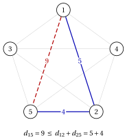

# 6.6 Varianti: TSP metrico e TSP asimmetrico { #sez-sec-tsp-variants }

**Parte 1 · Problemi di ottimizzazione combinatoria · Capitolo 6** · [:material-book-open-variant: Capitolo 6: Problemi di routing](index.md) · [:material-file-pdf-box: Dispensa, volume 1 (PDF)](../../pdf/dispensa-1-problemi-di-ottimizzazione-combinatoria.pdf) · [:material-pencil: Esercizi: Problemi di routing](../../esercizi/tsp.md)

## 6.6.1 Il problema del commesso viaggiatore metrico

!!! definizione "Definizione 6.4: TSP metrico"

    Un'istanza del TSP è <strong>metrica</strong> se le sue distanze soddisfano la <strong>disuguaglianza triangolare</strong>

    $$
    d_{ij} \le d_{ik} + d_{kj}
    \qquad \text{per ogni terna di città distinte } i,j,k \in \mathscr{V}.
    $$

    Il <strong>problema del commesso viaggiatore metrico</strong> (TSP metrico) è il TSP ristretto alle istanze metriche.

- La disuguaglianza triangolare dice che andare direttamente da $i$ a $j$ non è mai più lungo che passare per una terza città $k$.

- L'istanza dell'[Esempio 6.1](il-problema-del-commesso-viaggiatore.md#box-2-ex-tsp5) è metrica: tutte le $5\cdot4\cdot3=60$ disuguaglianze triangolari valgono, alcune all'uguaglianza, per esempio $d_{15}=9=d_{12}+d_{25}=5+4$. Nel disegno, l'arco diretto $\{1,5\}$ (tratteggiato) è lungo quanto il cammino da $1$ a $5$ che passa per la città $2$.

{ .fig loading=lazy  }

- Le istanze ottenute da punti nel piano, con $d_{ij}$ uguale alla distanza euclidea fra i punti, sono metriche (quando le distanze non sono arrotondate).

- Diversi algoritmi euristici per il TSP si comportano bene, e alcuni di essi hanno una garanzia di prestazione, solo sulle istanze metriche.

## 6.6.2 Il problema del commesso viaggiatore asimmetrico

!!! definizione "Definizione 6.5: Problema del commesso viaggiatore asimmetrico"

    Dati:

    1. un insieme $\mathscr{V} = \{1,2,\dots,n\}$ di $n$ <em>città</em>,

    2. per ogni coppia ordinata di città distinte $i,j \in \mathscr{V}$, una <em>distanza</em> $d_{ij} \in \Z_{\ge 1}$ dalla città $i$ alla città $j$, dove $d_{ij}$ può differire da $d_{ji}$,

    il <strong>problema del commesso viaggiatore asimmetrico</strong> (ATSP) chiede di trovare un percorso chiuso che parte da una città, visita ogni altra città esattamente una volta e ritorna alla città di partenza, in modo che la distanza totale percorsa sia minima.

- Le distanze asimmetriche nascono, per esempio, quando si percorrono strade a senso unico o in salita e in discesa.

- La definizione di giro e della sua lunghezza $L(\sigma)$ non cambia, ma ora il verso conta: un giro e lo stesso giro percorso all'indietro sono soluzioni diverse.

- Il TSP è il caso particolare dell'ATSP in cui $d_{ij}=d_{ji}$ per ogni $i,j$.

- Un'istanza dell'ATSP ha $\frac{n!}{n}=(n-1)!$ giri distinti, il doppio del conteggio della [Proposizione 6.2](il-problema-del-commesso-viaggiatore.md#box-3-prop-tsp-count): la città di partenza continua a non cambiare il giro, ma il verso sì, quindi non dividiamo per $2$.

- L'istanza dell'[Esempio 6.1](il-problema-del-commesso-viaggiatore.md#box-2-ex-tsp5), letta come istanza dell'ATSP, ha $4!=24$ giri invece di $12$.

## 6.7 Osservazioni

- L'istanza più grande risolta all'ottimo, pla85900, ha $85\,900$ punti che vengono da un problema di progettazione di chip. È stata risolta nel 2005–2006 con il codice Concorde; il giro ottimo, di lunghezza $142\,382\,641$, è stato certificato nel 2009 da Applegate, Bixby, Chvátal, Cook, Espinoza, Goycoolea e Helsgaun.

- Sulle mappe stradali di paesi reali, il record del 2025 è l'istanza korea81998, con $81\,998$ bar della Corea del Sud.

- Il TSP è fortemente NP-difficile ([Capitolo 1 «Problemi di ottimizzazione combinatoria»](../combinatorial-optimization/index.md)). Christofides (1976) ha dato un algoritmo di approssimazione con rapporto $\frac32$ per il TSP metrico.

## 6.8 Errori tipici

!!! attenzione "Attenzione"

    - <strong>Contare $n!$ giri.</strong> La città di partenza non cambia il giro e, nel caso simmetrico, nemmeno il verso: il numero di giri è $(n-1)!/2$.

    - <strong>Dimenticare l'arco di ritorno.</strong> La lunghezza di un giro comprende l'ultima distanza $d_{\sigma_n \sigma_1}$, dall'ultima città di nuovo alla prima.

    - <strong>Scambiare due cicli per un giro.</strong> Due cicli disgiunti che insieme visitano ogni città una volta non sono un giro: un giro è un unico ciclo attraverso tutte le città.

    - <strong>Leggere il bound come un giro.</strong> Il valore $17$ del bound dei due archi più corti non è la lunghezza di un giro; dice solo che nessun giro è più corto.

    - <strong>Usare la disuguaglianza triangolare senza verificarla.</strong> Le garanzie degli algoritmi euristici valgono solo per le istanze metriche.

## 6.9 In sintesi

!!! chiave "In sintesi"

    - Il TSP chiede un percorso chiuso più corto attraverso tutte le città; una soluzione è un ordinamento ciclico delle città, detto giro.

    - Un'istanza simmetrica con $n$ città ha $(n-1)!/2$ giri, una asimmetrica $(n-1)!$; elencarli è possibile solo per $n$ molto piccolo.

    - La nearest neighbour rule dà rapidamente un giro, senza garanzie; i due archi più corti di ogni città danno un lower bound sulla lunghezza ottima.

    - Il TSP metrico, con la disuguaglianza triangolare, è il caso in cui esistono garanzie di approssimazione.

    <strong>Cruscotto dell'istanza del TSP</strong> (minimizzazione: il lower bound è un bound duale, l'upper bound è la lunghezza di un giro):

    
<table>
    <tr>
    <th>Capitolo</th>
    <th>Lower bound</th>
    <th>Upper bound</th>
    <th>Da</th>
    </tr>
    <tr>
    <td>Questo capitolo</td>
    <td>\(17\)</td>
    <td>\(25\)</td>
    <td>due archi più corti; nearest neighbour dalla città \(1\)</td>
    </tr>
    <tr>
    <td>Questo capitolo, enumerazione</td>
    <td>\(18\)</td>
    <td>\(18\)</td>
    <td>i \(12\) giri</td>
    </tr>
    </table>

---

**Esercizi su questo capitolo:** [:material-pencil: Problemi di routing](../../esercizi/tsp.md)

---

**Approfondimento:** [:material-view-list: che cosa fa il corso su questo problema](../../catalogo/travelling-salesman-problem.md)

