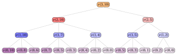

# PD per il problema dello zaino limitato

**Parte 3 · Programmazione dinamica · Capitolo 19** · [:material-file-pdf-box: Dispensa, volume 3 (PDF)](../pdf/dispensa-3-programmazione-dinamica.pdf) · [:material-presentation: Slide](../pdf/slide-dp-bounded-knapsack.pdf) · [:material-pencil: Esercizi: Zaino limitato (BKP)](../esercizi/dp-bounded-knapsack.md) · [:material-gesture-tap: App: Tabelle della PD per i problemi di zaino](../laboratorio/tabella-pd-zaino.md)

!!! nota "Prerequisiti"

    - Da questo modulo, i capitoli [«PD per il problema dello zaino 0/1»](dp-knapsack/index.md) e [«PD per il problema dello zaino illimitato»](dp-unbounded-knapsack/index.md): la ricorrenza $v(j,k)$ del problema dello zaino 0/1 (KP) e del problema dello zaino illimitato (UKP) su oggetti e capacità, e la ricostruzione di una soluzione.

    - Da questo modulo, il capitolo [«Principi della programmazione dinamica»](dp-principles.md): sottostruttura ottima, sottoproblemi sovrapposti, casi base.

    - Dal modulo <em>Algoritmi</em>: [le convenzioni dello pseudocodice (Capitolo 2)](https://fabiofurini.github.io/algoritmi/algoritmi-di-base/02-pseudocodice/) e [la dimensione dell'input (Capitolo 11)](https://fabiofurini.github.io/algoritmi/analisi/11-dimensione-input/).

!!! chiave "Obiettivi"

    Al termine di questo capitolo saremo in grado di:

    - spiegare perché il KP ($b_j=1$) e l'UKP ($b_j\ge\lfloor c/w_j\rfloor$) sono casi particolari del BKP, e scriverne la ricorrenza;

    - eseguire a mano l'algoritmo di PD, provando ogni numero ammissibile $d$ di copie di ciascun tipo di oggetto;

    - riempire la matrice $s$ dei numeri di copie e ricostruire da essa una soluzione ottima;

    - contare i passi dell'algoritmo di PD e dire quando $\Theta(nc\,b_{\max})$ è stretto.

Il problema di questo capitolo è il [problema dello zaino limitato (BKP)](../problemi-di-ottimizzazione-combinatoria/knapsack/il-problema-dello-zaino-limitato.md): la sua definizione e le sue ipotesi sono nella sua pagina.

## 19.1 Istanze e soluzioni ammissibili

!!! esempio "Esempio 19.1: Istanza del BKP"

    Consideriamo uno zaino di capacità $c=10$ e $3$ tipi di oggetto, con i seguenti profitti, pesi e limiti:

    $$
    \begin{array}{l|rrr}
    \hline  & {j=1} & {j=2} & {j=3} \\
    \hline {p_j} & 6 & 10 & 12 \\
    {w_j} & 2 & 3 & 5 \\
    {b_j} & 2 & 2 & 1 \\
    \hline
    \end{array}
    $$

    Chiamiamo questa istanza del BKP [Esempio 19.1](#box-1-texbkpex1).

!!! chiave ""

    La differenza principale rispetto al problema dello zaino 0/1 (KP) è che ogni tipo di oggetto può essere selezionato più di una volta: la variabile $x_j$ non è più binaria, ma è limitata da $b_j$. Il BKP si riduce al KP quando $b_j=1$ per ogni tipo di oggetto $j$, e al problema dello zaino illimitato (UKP) quando ogni limite $b_j$ è abbastanza grande da non essere vincolante.

- Il numero di vettori possibili $(x_1,x_2,\dots,x_n)$, con $x_j \in \{0,1,\dots,b_j\}$ per ogni tipo di oggetto $j$, è

    $$
    \prod_{j=1}^{n}(b_j+1).
    $$

    Alcuni di questi vettori possono non rispettare la capacità dello zaino. Quindi il numero di soluzioni ammissibili è al più $\prod_{j=1}^{n}(b_j+1)$, una quantità che cresce esponenzialmente con $n$. Enumerare tutte le soluzioni possibili diventa rapidamente impraticabile al crescere di $n$.

### 19.1.1 Codifica delle soluzioni ammissibili

!!! chiave ""

    Una <em>soluzione ammissibile</em> del BKP è una scelta del numero di copie di ciascun tipo di oggetto che rispetta sia i limiti $b_j$ sia la capacità $c$ dello zaino.

- Una soluzione ammissibile del BKP si può descrivere con il vettore intero

    $$
    (x_1,x_2,\dots,x_n)
    $$

    dove ogni componente ha il seguente significato:

    $$
    x_j = \text{numero di copie selezionate del tipo di oggetto } j \text{}, \qquad \forall j \in \{1,2,\dots,n\}, \quad 0 \le x_j \le b_j.
    $$

    Poiché la soluzione è ammissibile, il peso totale degli oggetti selezionati non deve superare la capacità dello zaino:

    $$
    \sum_{j=1}^{n} w_j x_j \le c.
    $$

    Il profitto totale di una soluzione ammissibile è

    $$
    \sum_{j=1}^{n} p_j x_j.
    $$

## 19.2 Un algoritmo di PD

- <u>Passo 1</u>: calcolo del valore ottimo

    !!! formula ""

        Per ogni $j \in \{0,1,\dots,n\}$ e $k \in \{0,1,\dots,c\}$, sia $v(j,k)$ il valore ottimo della sottoistanza del BKP data da:

        1. uno zaino di capacità $k$,

        2. un insieme $\{1,2,\dots,j\}$ di tipi di oggetto disponibili,

        3. per ogni tipo di oggetto $h \in \{1,2,\dots,j\}$, un profitto $p_h$, un peso $w_h$ e un limite $b_h$.

        La formula ricorsiva per calcolare $v(j,k)$ è la seguente:

        \begin{equation*}
        \label{eq:bkp}
        v(j,k)= \left\{ \begin{array}{ll}
        0 & \textrm{se $j=0$ o $k=0$,}                                                                                            \\[2ex]
        \displaystyle \max_{d \,\in\, \{0,1,\dots,\min\{b_j,\lfloor k/w_j\rfloor\}\}} \bigg\{ d\,p_j + v(j-1,k-d\,w_j) \bigg\} & \begin{array}[t]{@{}l@{}}\textrm{se $1\le j \le n$}\\ \textrm{e $1 \le k \le c$.}\end{array}
        \end{array} \right. \tag{19.1}
        \end{equation*}

    - Il processo di decomposizione ricorsiva della formula $\eqref{eq:bkp}$ genera al più $b_j+1$ <strong>sottoproblemi indipendenti</strong>, corrispondenti ai possibili numeri $d \in \{0,1,\dots,\min\{b_j,\lfloor k/w_j\rfloor\}\}$ di copie del tipo di oggetto $j$ inserite in uno zaino di capacità $k$, usando solo i tipi di oggetto $1,2,\dots,j$.

    - I casi base sono $v(0,k)=0$, perché nessun tipo di oggetto è disponibile, e $v(j,0)=0$, perché non c'è capacità disponibile.

    - Il valore ottimo $v(j,k)$ si ottiene provando ogni numero ammissibile $d$ di copie del tipo di oggetto $j$ e scegliendo quello che massimizza la somma $d\,p_j+v(j-1,k-d\,w_j)$ del profitto delle $d$ copie e del valore ottimo del sottoproblema residuo, ristretto ai tipi di oggetto $1,2,\dots,j-1$.

    - Quindi una soluzione ottima della sottoistanza con capacità $k$ e tipi di oggetto disponibili $\{1,2,\dots,j\}$ si costruisce combinando il numero $d$ scelto di copie del tipo di oggetto $j$ con una soluzione ottima del corrispondente sottoproblema residuo.

        $\rightsquigarrow$ <strong>Sottostruttura ottima verificata!</strong>

    - Scelte diverse del numero di copie di un tipo di oggetto, fatte eventualmente per valori diversi di $j$ e $k$, possono portare allo stesso sottoproblema, e quindi lo stesso valore $v(j,k)$ può dover essere calcolato più volte durante la valutazione ricorsiva della formula $\eqref{eq:bkp}$.

        $\rightsquigarrow$ <strong>Sottoproblemi sovrapposti verificati!</strong>

    - Un <strong>primo metodo</strong> per calcolare il valore ottimo $v(n,c)$ dell'istanza del BKP è l'<strong>approccio top-down</strong>. Il metodo parte dalla chiamata con $j=n$ e $k=c$ e valuta ricorsivamente la formula $\eqref{eq:bkp}$: ogni chiamata considera il tipo di oggetto $j$ e ne prova ogni numero ammissibile $d$ di copie, finché non resta alcun tipo di oggetto o la capacità residua è uguale a $0$.

    - L'<strong>albero di ricorsione</strong> della funzione $v$ ha un nodo per ogni chiamata ricorsiva, etichettato con la chiamata che rappresenta. La radice rappresenta la chiamata iniziale. I figli di un nodo rappresentano le chiamate ricorsive effettuate da quella chiamata. Le foglie rappresentano i casi base.

        

        !!! esempio "Esempio 19.2: Albero di ricorsione"

            Consideriamo l'istanza del BKP dell'[Esempio 19.1](#box-1-texbkpex1). Questo è l'albero di ricorsione dell'approccio top-down per calcolare $v(3,10)$:

            { .fig loading=lazy  }

            La funzione $v$ viene chiamata $22$ volte, e gli stessi sottoproblemi vengono risolti più volte: $v(0,5)$ viene chiamata $2$ volte, $v(0,3)$ viene chiamata $2$ volte, $v(0,2)$ viene chiamata $2$ volte e $v(0,0)$ viene chiamata $2$ volte. Tutte le altre chiamate vengono effettuate una sola volta.

    - Il valore $v(j,k)$ si può calcolare una volta noti i valori $v(j-1,k')$ per ogni capacità residua $k'\le k$. Quindi, fissato $j$, tutti i valori $v(j,k)$ si possono calcolare considerando i valori di capacità $k$ in ordine crescente.

        

        !!! esempio "Esempio 19.3: Calcolo dei valori della funzione $v$"

            Consideriamo l'istanza del BKP dell'[Esempio 19.1](#box-1-texbkpex1), con uno zaino di capacità $c=10$ e i seguenti profitti, pesi e limiti:

            $$
            \begin{array}{l|rrr}
            \hline  & {j=1} & {j=2} & {j=3} \\
            \hline {p_j} & 6 & 10 & 12 \\
            {w_j} & 2 & 3 & 5 \\
            {b_j} & 2 & 2 & 1 \\
            \hline
            \end{array}
            $$

            I valori della funzione $v$ si calcolano come segue:

            - I casi base danno $v(0,k)=0$ per ogni $k \ge 0$.

            - Calcolati i casi base, possiamo calcolare $v(1,4)$, provando $d=0,1,2$ copie del tipo di oggetto $1$ (perché $b_1=2$ e $\lfloor 4/2 \rfloor=2$):

                $$
                v(1,4) = \max\{v(0,4),\; p_1+v(0,2),\; 2p_1+v(0,0)\} = \max\{0,\,6,\,12\} = 12
                $$

            - Possiamo calcolare anche $v(1,10)$, provando $d=0,1,2$ copie (perché $b_1=2$ limita il numero di copie anche se $\lfloor 10/2 \rfloor=5$):

                $$
                v(1,10) = \max\{v(0,10),\; p_1+v(0,8),\; 2p_1+v(0,6)\} = \max\{0,\,6,\,12\} = 12
                $$

            - Allo stesso modo calcoliamo $v(1,7)$, $v(1,5)$ e $v(1,2)$:

                $$
                v(1,7) = \max\{v(0,7),\; p_1+v(0,5),\; 2p_1+v(0,3)\} = \max\{0,\,6,\,12\} = 12
                $$

                $$
                v(1,5) = \max\{v(0,5),\; p_1+v(0,3),\; 2p_1+v(0,1)\} = \max\{0,\,6,\,12\} = 12
                $$

                $$
                v(1,2) = \max\{v(0,2),\; p_1+v(0,0)\} = \max\{0,\,6\} = 6
                $$

            - Calcolati $v(1,5)$ e $v(1,2)$, possiamo calcolare $v(2,5)$, provando $d=0,1$ copie del tipo di oggetto $2$ (perché $b_2=2$ ma $\lfloor 5/3 \rfloor=1$):

                $$
                v(2,5) = \max\{v(1,5),\; p_2+v(1,2)\} = \max\{12,\,10+6\} = 16
                $$

            - Calcolati $v(1,10)$, $v(1,7)$ e $v(1,4)$, possiamo calcolare $v(2,10)$, provando $d=0,1,2$ copie del tipo di oggetto $2$:

                \begin{align*}
                v(2,10) &= \max\{v(1,10),\; p_2+v(1,7),\; 2p_2+v(1,4)\}\\ &= \max\{12,\,10+12,\,20+12\} = 32
                \end{align*}

            - Infine, calcolati $v(2,10)$ e $v(2,5)$, possiamo calcolare $v(3,10)$, provando $d=0,1$ copie del tipo di oggetto $3$ (perché $b_3=1$):

                $$
                v(3,10) = \max\{v(2,10),\; p_3+v(2,5)\} = \max\{32,\,12+16\} = 32
                $$

    - Possiamo evitare di risolvere ripetutamente gli stessi sottoproblemi memorizzando il valore di ciascun sottoproblema appena viene calcolato. I valori sono memorizzati in una <strong>tabella di lookup</strong>.

    - Poiché la soluzione di ogni sottoproblema dipende solo da sottoproblemi con un valore di $j$ minore, possiamo risolvere i sottoproblemi in ordine crescente di $j$ e, per ogni valore fissato di $j$, in ordine crescente di capacità, partendo dai casi base $v(0,k)=0$ e $v(j,0)=0$ fino ad arrivare a $v(n,c)$: questa osservazione porta in modo naturale a un <strong>metodo molto più efficiente</strong> per calcolare il valore ottimo $v(n,c)$ dell'istanza del BKP.

    - Un <strong>secondo metodo</strong> per calcolare il valore ottimo $v(n,c)$ dell'istanza del BKP è l'<strong>approccio bottom-up</strong>. Il metodo parte dai casi base e valuta la formula $\eqref{eq:bkp}$ per valori crescenti di $j \in \{1,2,\dots,n\}$ e $k \in \{0,1,\dots,c\}$: ogni valore $v(j,k)$ si calcola usando valori già calcolati, fino a ottenere il valore $v(n,c)$ dell'istanza del BKP.

        Questo è lo pseudocodice dell'<strong>algoritmo di PD con l'approccio bottom-up</strong>:

        !!! algoritmo "Algoritmo: BKP\_DP"

            

<strong>Input:</strong> Un'istanza del BKP data da \(n\), dai vettori \(p[1..n]\), \(w[1..n]\), \(b[1..n]\) e dalla capacità \(c\)

<strong>Output:</strong> Il valore ottimo dell'istanza del BKP

1<strong>Function</strong> BKP_DP(\(n,p,w,b,c\))

2\(v := \textnormal{new array}[0..n][0..c]\)

3<strong>for</strong> \(k := 0\) <strong>to</strong> \(c\)  <strong>do</strong>

4\(v[0][k] \leftarrow 0\)

5<strong>end</strong>

6<strong>for</strong> \(j := 1\) <strong>to</strong> \(n\)  <strong>do</strong>

7<strong>for</strong> \(k := 0\) <strong>to</strong> \(c\)  <strong>do</strong>

8\(m := 0\)

9<strong>for</strong> \(d := 0\) <strong>to</strong> \(\min\{b[j],\lfloor k/w[j]\rfloor\}\)  <strong>do</strong>

10<strong>if</strong> \(d\,p[j]+v[j-1][k-d\,w[j]] > m\)  <strong>then</strong>

11\(m \leftarrow d\,p[j]+v[j-1][k-d\,w[j]]\)

12<strong>end</strong>

13<strong>end</strong>

14\(v[j][k] \leftarrow m\)

15<strong>end</strong>

16<strong>end</strong>

17<strong>return</strong> \(v[n][c]\)

        - La matrice $v[0..n][0..c]$ è la <strong>tabella di lookup</strong>: memorizza i valori ottimi di tutti i sottoproblemi.

        - Il primo ciclo inizializza i valori $v[0][k]=0$ per tutte le capacità $k \in \{0,1,\dots,c\}$, corrispondenti al caso in cui nessun tipo di oggetto è disponibile.

        - Il ciclo esterno, su $j \in \{1,2,\dots,n\}$, calcola le righe della matrice in ordine crescente di tipo di oggetto.

        - Il ciclo interno, su $k \in \{0,1,\dots,c\}$, calcola il valore ottimo $v[j][k]$ per ogni capacità $k$.

        - Il ciclo più interno, su $d \in \{0,1,\dots,\min\{b[j],\lfloor k/w[j]\rfloor\}\}$, prova ogni numero ammissibile di copie del tipo di oggetto $j$ e conserva in $m$ il valore massimo trovato finora.

        - Al termine del ciclo più interno, $v[j][k] \leftarrow m$ memorizza il valore ottimo $v[j][k]$.

        - Infine, il valore ottimo dell'istanza del BKP viene restituito come $v[n][c]$.

        

        !!! esempio "Esempio 19.4: Esecuzione dell'algoritmo di PD"

            Consideriamo l'istanza del BKP dell'[Esempio 19.1](#box-1-texbkpex1), con uno zaino di capacità $c=10$ e i seguenti profitti, pesi e limiti:

            $$
            \begin{array}{l|rrr}
            \hline  & {j=1} & {j=2} & {j=3} \\
            \hline {p_j} & 6 & 10 & 12 \\
            {w_j} & 2 & 3 & 5 \\
            {b_j} & 2 & 2 & 1 \\
            \hline
            \end{array}
            $$

            Per ogni passo dell'algoritmo di PD, la tabella riporta i valori di $j$ e $k$, la cella $v[j][k]$ e l'operazione eseguita.

            
<table>
            <tr>
            <th>\(j\)</th>
            <th>\(k\)</th>
            <th>\(v[j][k]\)</th>
            <th>Azione</th>
            </tr>
            <tr>
            <td>\(0\)</td>
            <td>\(0\)</td>
            <td>\(0\)</td>
            <td>\(v[0][0]\leftarrow 0\)</td>
            </tr>
            <tr>
            <td>\(0\)</td>
            <td>\(1\)</td>
            <td>\(0\)</td>
            <td>\(v[0][1]\leftarrow 0\)</td>
            </tr>
            <tr>
            <td>\(0\)</td>
            <td>\(2\)</td>
            <td>\(0\)</td>
            <td>\(v[0][2]\leftarrow 0\)</td>
            </tr>
            <tr>
            <td>\(0\)</td>
            <td>\(3\)</td>
            <td>\(0\)</td>
            <td>\(v[0][3]\leftarrow 0\)</td>
            </tr>
            <tr>
            <td>\(0\)</td>
            <td>\(4\)</td>
            <td>\(0\)</td>
            <td>\(v[0][4]\leftarrow 0\)</td>
            </tr>
            <tr>
            <td>\(0\)</td>
            <td>\(5\)</td>
            <td>\(0\)</td>
            <td>\(v[0][5]\leftarrow 0\)</td>
            </tr>
            <tr>
            <td>\(0\)</td>
            <td>\(6\)</td>
            <td>\(0\)</td>
            <td>\(v[0][6]\leftarrow 0\)</td>
            </tr>
            <tr>
            <td>\(0\)</td>
            <td>\(7\)</td>
            <td>\(0\)</td>
            <td>\(v[0][7]\leftarrow 0\)</td>
            </tr>
            <tr>
            <td>\(0\)</td>
            <td>\(8\)</td>
            <td>\(0\)</td>
            <td>\(v[0][8]\leftarrow 0\)</td>
            </tr>
            <tr>
            <td>\(0\)</td>
            <td>\(9\)</td>
            <td>\(0\)</td>
            <td>\(v[0][9]\leftarrow 0\)</td>
            </tr>
            <tr>
            <td>\(0\)</td>
            <td>\(10\)</td>
            <td>\(0\)</td>
            <td>\(v[0][10]\leftarrow 0\)</td>
            </tr>
            <tr>
            <td>\(1\)</td>
            <td>\(0\)</td>
            <td>\(0\)</td>
            <td>\(\max\{v[0][0]\}=0\)</td>
            </tr>
            <tr>
            <td>\(1\)</td>
            <td>\(1\)</td>
            <td>\(0\)</td>
            <td>\(\max\{v[0][1]\}=0\)</td>
            </tr>
            <tr>
            <td>\(1\)</td>
            <td>\(2\)</td>
            <td>\(6\)</td>
            <td>\(\max\{v[0][2],\,p[1]{+}v[0][0]\}=\max\{0,6{+}0\}=6\)</td>
            </tr>
            <tr>
            <td>\(1\)</td>
            <td>\(3\)</td>
            <td>\(6\)</td>
            <td>\(\max\{v[0][3],\,p[1]{+}v[0][1]\}=\max\{0,6{+}0\}=6\)</td>
            </tr>
            <tr>
            <td>\(1\)</td>
            <td>\(4\)</td>
            <td>\(12\)</td>
            <td>\(\max\{v[0][4],\,p[1]{+}v[0][2],\,2p[1]{+}v[0][0]\}=\max\{0,6,12\}=12\)</td>
            </tr>
            <tr>
            <td>\(1\)</td>
            <td>\(5\)</td>
            <td>\(12\)</td>
            <td>\(\max\{v[0][5],\,p[1]{+}v[0][3],\,2p[1]{+}v[0][1]\}=\max\{0,6,12\}=12\)</td>
            </tr>
            <tr>
            <td>\(1\)</td>
            <td>\(6\)</td>
            <td>\(12\)</td>
            <td>\(\max\{v[0][6],\,p[1]{+}v[0][4],\,2p[1]{+}v[0][2]\}=\max\{0,6,12\}=12\)</td>
            </tr>
            <tr>
            <td>\(1\)</td>
            <td>\(7\)</td>
            <td>\(12\)</td>
            <td>\(\max\{v[0][7],\,p[1]{+}v[0][5],\,2p[1]{+}v[0][3]\}=\max\{0,6,12\}=12\)</td>
            </tr>
            <tr>
            <td>\(1\)</td>
            <td>\(8\)</td>
            <td>\(12\)</td>
            <td>\(\max\{v[0][8],\,p[1]{+}v[0][6],\,2p[1]{+}v[0][4]\}=\max\{0,6,12\}=12\)</td>
            </tr>
            <tr>
            <td>\(1\)</td>
            <td>\(9\)</td>
            <td>\(12\)</td>
            <td>\(\max\{v[0][9],\,p[1]{+}v[0][7],\,2p[1]{+}v[0][5]\}=\max\{0,6,12\}=12\)</td>
            </tr>
            <tr>
            <td>\(1\)</td>
            <td>\(10\)</td>
            <td>\(12\)</td>
            <td>\(\max\{v[0][10],\,p[1]{+}v[0][8],\,2p[1]{+}v[0][6]\}=\max\{0,6,12\}=12\)</td>
            </tr>
            </table>

            
<table>
            <tr>
            <th>\(j\)</th>
            <th>\(k\)</th>
            <th>\(v[j][k]\)</th>
            <th>Azione</th>
            </tr>
            <tr>
            <td>\(2\)</td>
            <td>\(0\)</td>
            <td>\(0\)</td>
            <td>\(\max\{v[1][0]\}=0\)</td>
            </tr>
            <tr>
            <td>\(2\)</td>
            <td>\(1\)</td>
            <td>\(0\)</td>
            <td>\(\max\{v[1][1]\}=0\)</td>
            </tr>
            <tr>
            <td>\(2\)</td>
            <td>\(2\)</td>
            <td>\(6\)</td>
            <td>\(\max\{v[1][2]\}=6\)</td>
            </tr>
            <tr>
            <td>\(2\)</td>
            <td>\(3\)</td>
            <td>\(10\)</td>
            <td>\(\max\{v[1][3],\,p[2]{+}v[1][0]\}=\max\{6,10{+}0\}=10\)</td>
            </tr>
            <tr>
            <td>\(2\)</td>
            <td>\(4\)</td>
            <td>\(12\)</td>
            <td>\(\max\{v[1][4],\,p[2]{+}v[1][1]\}=\max\{12,10{+}0\}=12\)</td>
            </tr>
            <tr>
            <td>\(2\)</td>
            <td>\(5\)</td>
            <td>\(16\)</td>
            <td>\(\max\{v[1][5],\,p[2]{+}v[1][2]\}=\max\{12,10{+}6\}=16\)</td>
            </tr>
            <tr>
            <td>\(2\)</td>
            <td>\(6\)</td>
            <td>\(20\)</td>
            <td>\(\max\{v[1][6],\,p[2]{+}v[1][3],\,2p[2]{+}v[1][0]\}=\max\{12,16,20\}=20\)</td>
            </tr>
            <tr>
            <td>\(2\)</td>
            <td>\(7\)</td>
            <td>\(22\)</td>
            <td>\(\max\{v[1][7],\,p[2]{+}v[1][4],\,2p[2]{+}v[1][1]\}=\max\{12,22,20\}=22\)</td>
            </tr>
            <tr>
            <td>\(2\)</td>
            <td>\(8\)</td>
            <td>\(26\)</td>
            <td>\(\max\{v[1][8],\,p[2]{+}v[1][5],\,2p[2]{+}v[1][2]\}=\max\{12,22,26\}=26\)</td>
            </tr>
            <tr>
            <td>\(2\)</td>
            <td>\(9\)</td>
            <td>\(26\)</td>
            <td>\(\max\{v[1][9],\,p[2]{+}v[1][6],\,2p[2]{+}v[1][3]\}=\max\{12,22,26\}=26\)</td>
            </tr>
            <tr>
            <td>\(2\)</td>
            <td>\(10\)</td>
            <td>\(32\)</td>
            <td>\(\max\{v[1][10],\,p[2]{+}v[1][7],\,2p[2]{+}v[1][4]\}=\max\{12,22,32\}=32\)</td>
            </tr>
            <tr>
            <td>\(3\)</td>
            <td>\(0\)</td>
            <td>\(0\)</td>
            <td>\(\max\{v[2][0]\}=0\)</td>
            </tr>
            <tr>
            <td>\(3\)</td>
            <td>\(1\)</td>
            <td>\(0\)</td>
            <td>\(\max\{v[2][1]\}=0\)</td>
            </tr>
            <tr>
            <td>\(3\)</td>
            <td>\(2\)</td>
            <td>\(6\)</td>
            <td>\(\max\{v[2][2]\}=6\)</td>
            </tr>
            <tr>
            <td>\(3\)</td>
            <td>\(3\)</td>
            <td>\(10\)</td>
            <td>\(\max\{v[2][3]\}=10\)</td>
            </tr>
            <tr>
            <td>\(3\)</td>
            <td>\(4\)</td>
            <td>\(12\)</td>
            <td>\(\max\{v[2][4]\}=12\)</td>
            </tr>
            <tr>
            <td>\(3\)</td>
            <td>\(5\)</td>
            <td>\(16\)</td>
            <td>\(\max\{v[2][5],\,p[3]{+}v[2][0]\}=\max\{16,12{+}0\}=16\)</td>
            </tr>
            <tr>
            <td>\(3\)</td>
            <td>\(6\)</td>
            <td>\(20\)</td>
            <td>\(\max\{v[2][6],\,p[3]{+}v[2][1]\}=\max\{20,12{+}0\}=20\)</td>
            </tr>
            <tr>
            <td>\(3\)</td>
            <td>\(7\)</td>
            <td>\(22\)</td>
            <td>\(\max\{v[2][7],\,p[3]{+}v[2][2]\}=\max\{22,12{+}6\}=22\)</td>
            </tr>
            <tr>
            <td>\(3\)</td>
            <td>\(8\)</td>
            <td>\(26\)</td>
            <td>\(\max\{v[2][8],\,p[3]{+}v[2][3]\}=\max\{26,12{+}10\}=26\)</td>
            </tr>
            <tr>
            <td>\(3\)</td>
            <td>\(9\)</td>
            <td>\(26\)</td>
            <td>\(\max\{v[2][9],\,p[3]{+}v[2][4]\}=\max\{26,12{+}12\}=26\)</td>
            </tr>
            <tr>
            <td>\(3\)</td>
            <td>\(10\)</td>
            <td>\(32\)</td>
            <td>\(\max\{v[2][10],\,p[3]{+}v[2][5]\}=\max\{32,12{+}16\}=32\)</td>
            </tr>
            </table>

            Questa è la matrice $v$ dopo l'esecuzione dell'algoritmo di PD:

            $$
            \begin{array}{l|rrrrrrrrrrr}
            \hline {v[j][k]} & {k=0} & {k=1} & {k=2} & {k=3} & {k=4} & {k=5} & {k=6} & {k=7} & {k=8} & {k=9} & {k=10} \\
            \hline {j=0} & 0 & 0 & 0 & 0 & 0 & 0 & 0 & 0 & 0 & 0 & 0 \\
            {j=1} & 0 & 0 & 6 & 6 & 12 & 12 & 12 & 12 & 12 & 12 & 12 \\
            {j=2} & 0 & 0 & 6 & 10 & 12 & 16 & 20 & 22 & 26 & 26 & 32 \\
            {j=3} & 0 & 0 & 6 & 10 & 12 & 16 & 20 & 22 & 26 & 26 & 32 \\
            \hline
            \end{array}
            $$

    - Dopo l'esecuzione dell'algoritmo di PD, la matrice $v$ contiene il valore ottimo $v[j][k]$ per ogni tipo di oggetto $j \in \{0,1,\dots,n\}$ e ogni valore di capacità $k \in \{0,1,\dots,c\}$.

- <u>Passo 2</u>: calcolo di una soluzione ottima

    - Per calcolare una soluzione ottima, cioè il vettore intero $(x_1,x_2,\dots,x_n)$, è necessario memorizzare alcune informazioni aggiuntive.

    - Per ogni tipo di oggetto $j$ e valore di capacità $k$, oltre al valore ottimo $v[j][k]$, memorizziamo $s[j][k]$, il numero di copie del tipo di oggetto $j$ selezionate in una soluzione ottima del sottoproblema ristretto ai tipi di oggetto $\{1,2,\dots,j\}$ e alla capacità $k$.

    - Più precisamente, $s[j][k]$ è uguale al valore $d$ che massimizza il membro destro della formula $\eqref{eq:bkp}$ nel calcolo di $v[j][k]$.

        Questo è lo pseudocodice dell'<strong>algoritmo di PD con l'approccio bottom-up</strong>, con la memorizzazione delle informazioni necessarie a costruire una soluzione ottima:

        !!! algoritmo "Algoritmo: BKP\_DP\_InfoSol"

            

<strong>Input:</strong> Un'istanza del BKP data da \(n\), dai vettori \(p[1..n]\), \(w[1..n]\), \(b[1..n]\) e dalla capacità \(c\)

<strong>Output:</strong> Il valore ottimo dell'istanza del BKP e la matrice dei numeri di copie \(s[0..n][0..c]\)

1<strong>Function</strong> BKP_DP_InfoSol(\(n,p,w,b,c\))

2\(v := \textnormal{new array}[0..n][0..c]\); \(s := \textnormal{new array}[0..n][0..c]\)

3<strong>for</strong> \(k := 0\) <strong>to</strong> \(c\) <strong>do</strong>

4\(v[0][k] \leftarrow 0\); \(s[0][k] \leftarrow 0\)

5<strong>end</strong>

6<strong>for</strong> \(j := 1\) <strong>to</strong> \(n\) <strong>do</strong>

7<strong>for</strong> \(k := 0\) <strong>to</strong> \(c\) <strong>do</strong>

8\(m := 0\); \(t := 0\)

9<strong>for</strong> \(d := 0\) <strong>to</strong> \(\min\{b[j],\lfloor k/w[j]\rfloor\}\) <strong>do</strong>

10<strong>if</strong> \(d\,p[j]+v[j-1][k-d\,w[j]] > m\) <strong>then</strong>

11\(m \leftarrow d\,p[j]+v[j-1][k-d\,w[j]]\); \(t \leftarrow d\)

12<strong>end</strong>

13<strong>end</strong>

14\(v[j][k] \leftarrow m\); \(s[j][k] \leftarrow t\)

15<strong>end</strong>

16<strong>end</strong>

17<strong>return</strong> \(v[n][c], s\)

        - L'algoritmo di PD usa la variabile temporanea aggiuntiva $t$ per tenere traccia della decisione presa quando $m$ viene aggiornato. Se vengono selezionate $d$ copie del tipo di oggetto $j$, $t \leftarrow d$ memorizza questa decisione. Al termine del ciclo più interno, $s[j][k]\leftarrow t$ memorizza il numero di copie del tipo di oggetto $j$ usate, insieme al valore ottimo $v[j][k]\leftarrow m$.

        

        !!! esempio "Esempio 19.5: Calcolo delle informazioni aggiuntive"

            Consideriamo l'istanza del BKP dell'[Esempio 19.1](#box-1-texbkpex1), con uno zaino di capacità $c=10$ e i seguenti profitti, pesi e limiti:

            $$
            \begin{array}{l|rrr}
            \hline  & {j=1} & {j=2} & {j=3} \\
            \hline {p_j} & 6 & 10 & 12 \\
            {w_j} & 2 & 3 & 5 \\
            {b_j} & 2 & 2 & 1 \\
            \hline
            \end{array}
            $$

            Per ogni cella con $j\ge 1$ la tabella riporta i valori $d\,p[j]+v[j-1][k-d\,w[j]]$ per $d=0,1,\dots,\min\{b[j],\lfloor k/w[j]\rfloor\}$, in quest'ordine, e il numero $t$ di copie memorizzato in $s[j][k]$. In caso di pareggio si conserva il $d$ minimo, perché $m$ viene aggiornato solo quando il valore è strettamente maggiore. La riga $j=0$ è $s[0][k]=0$ per ogni $k$.

            
<table>
            <tr>
            <th>\(j\)</th>
            <th>\(k\)</th>
            <th>\(s[j][k]\)</th>
            <th>Valori per \(d=0,1,\dots\)</th>
            </tr>
            <tr>
            <td>\(1\)</td>
            <td>\(0\)</td>
            <td>\(0\)</td>
            <td>\(0\)</td>
            </tr>
            <tr>
            <td>\(1\)</td>
            <td>\(1\)</td>
            <td>\(0\)</td>
            <td>\(0\)</td>
            </tr>
            <tr>
            <td>\(1\)</td>
            <td>\(2\)</td>
            <td>\(1\)</td>
            <td>\(0,\,6\)</td>
            </tr>
            <tr>
            <td>\(1\)</td>
            <td>\(3\)</td>
            <td>\(1\)</td>
            <td>\(0,\,6\)</td>
            </tr>
            <tr>
            <td>\(1\)</td>
            <td>\(4\)</td>
            <td>\(2\)</td>
            <td>\(0,\,6,\,12\)</td>
            </tr>
            <tr>
            <td>\(1\)</td>
            <td>\(5\)</td>
            <td>\(2\)</td>
            <td>\(0,\,6,\,12\)</td>
            </tr>
            <tr>
            <td>\(1\)</td>
            <td>\(6\)</td>
            <td>\(2\)</td>
            <td>\(0,\,6,\,12\)</td>
            </tr>
            <tr>
            <td>\(1\)</td>
            <td>\(7\)</td>
            <td>\(2\)</td>
            <td>\(0,\,6,\,12\)</td>
            </tr>
            <tr>
            <td>\(1\)</td>
            <td>\(8\)</td>
            <td>\(2\)</td>
            <td>\(0,\,6,\,12\)</td>
            </tr>
            <tr>
            <td>\(1\)</td>
            <td>\(9\)</td>
            <td>\(2\)</td>
            <td>\(0,\,6,\,12\)</td>
            </tr>
            <tr>
            <td>\(1\)</td>
            <td>\(10\)</td>
            <td>\(2\)</td>
            <td>\(0,\,6,\,12\)</td>
            </tr>
            <tr>
            <td>\(2\)</td>
            <td>\(0\)</td>
            <td>\(0\)</td>
            <td>\(0\)</td>
            </tr>
            <tr>
            <td>\(2\)</td>
            <td>\(1\)</td>
            <td>\(0\)</td>
            <td>\(0\)</td>
            </tr>
            <tr>
            <td>\(2\)</td>
            <td>\(2\)</td>
            <td>\(0\)</td>
            <td>\(6\)</td>
            </tr>
            <tr>
            <td>\(2\)</td>
            <td>\(3\)</td>
            <td>\(1\)</td>
            <td>\(6,\,10\)</td>
            </tr>
            <tr>
            <td>\(2\)</td>
            <td>\(4\)</td>
            <td>\(0\)</td>
            <td>\(12,\,10\)</td>
            </tr>
            <tr>
            <td>\(2\)</td>
            <td>\(5\)</td>
            <td>\(1\)</td>
            <td>\(12,\,16\)</td>
            </tr>
            <tr>
            <td>\(2\)</td>
            <td>\(6\)</td>
            <td>\(2\)</td>
            <td>\(12,\,16,\,20\)</td>
            </tr>
            <tr>
            <td>\(2\)</td>
            <td>\(7\)</td>
            <td>\(1\)</td>
            <td>\(12,\,22,\,20\)</td>
            </tr>
            <tr>
            <td>\(2\)</td>
            <td>\(8\)</td>
            <td>\(2\)</td>
            <td>\(12,\,22,\,26\)</td>
            </tr>
            <tr>
            <td>\(2\)</td>
            <td>\(9\)</td>
            <td>\(2\)</td>
            <td>\(12,\,22,\,26\)</td>
            </tr>
            <tr>
            <td>\(2\)</td>
            <td>\(10\)</td>
            <td>\(2\)</td>
            <td>\(12,\,22,\,32\)</td>
            </tr>
            <tr>
            <td>\(3\)</td>
            <td>\(0\)</td>
            <td>\(0\)</td>
            <td>\(0\)</td>
            </tr>
            <tr>
            <td>\(3\)</td>
            <td>\(1\)</td>
            <td>\(0\)</td>
            <td>\(0\)</td>
            </tr>
            <tr>
            <td>\(3\)</td>
            <td>\(2\)</td>
            <td>\(0\)</td>
            <td>\(6\)</td>
            </tr>
            <tr>
            <td>\(3\)</td>
            <td>\(3\)</td>
            <td>\(0\)</td>
            <td>\(10\)</td>
            </tr>
            <tr>
            <td>\(3\)</td>
            <td>\(4\)</td>
            <td>\(0\)</td>
            <td>\(12\)</td>
            </tr>
            <tr>
            <td>\(3\)</td>
            <td>\(5\)</td>
            <td>\(0\)</td>
            <td>\(16,\,12\)</td>
            </tr>
            <tr>
            <td>\(3\)</td>
            <td>\(6\)</td>
            <td>\(0\)</td>
            <td>\(20,\,12\)</td>
            </tr>
            <tr>
            <td>\(3\)</td>
            <td>\(7\)</td>
            <td>\(0\)</td>
            <td>\(22,\,18\)</td>
            </tr>
            <tr>
            <td>\(3\)</td>
            <td>\(8\)</td>
            <td>\(0\)</td>
            <td>\(26,\,22\)</td>
            </tr>
            <tr>
            <td>\(3\)</td>
            <td>\(9\)</td>
            <td>\(0\)</td>
            <td>\(26,\,24\)</td>
            </tr>
            <tr>
            <td>\(3\)</td>
            <td>\(10\)</td>
            <td>\(0\)</td>
            <td>\(32,\,28\)</td>
            </tr>
            </table>

            Questa è la matrice $s$ dopo l'esecuzione dell'algoritmo di PD:

            $$
            \begin{array}{l|rrrrrrrrrrr}
            \hline {s[j][k]} & {k=0} & {k=1} & {k=2} & {k=3} & {k=4} & {k=5} & {k=6} & {k=7} & {k=8} & {k=9} & {k=10} \\
            \hline {j=0} & 0 & 0 & 0 & 0 & 0 & 0 & 0 & 0 & 0 & 0 & 0 \\
            {j=1} & 0 & 0 & 1 & 1 & 2 & 2 & 2 & 2 & 2 & 2 & 2 \\
            {j=2} & 0 & 0 & 0 & 1 & 0 & 1 & 2 & 1 & 2 & 2 & 2 \\
            {j=3} & 0 & 0 & 0 & 0 & 0 & 0 & 0 & 0 & 0 & 0 & 0 \\
            \hline
            \end{array}
            $$

            Per esempio, $s[1][4]=2$ perché la formula $\eqref{eq:bkp}$ seleziona $d=2$ copie del tipo di oggetto $1$ nel calcolo di $v[1][4]=12$, e $s[2][10]=2$ perché vengono selezionate $d=2$ copie del tipo di oggetto $2$ nel calcolo di $v[2][10]=32$. Poiché $s[3][10]=0$, nella soluzione ottima dell'istanza originale non si usa alcuna copia del tipo di oggetto $3$.

    - Calcolata la matrice $s$, si può ricostruire una soluzione ottima scorrendo i tipi di oggetto da $j=n$ fino a $j=1$, partendo dalla capacità $k=c$ e da $x_j=0$ per ogni $j \in \{1,2,\dots,n\}$:

        $$
        x_j \leftarrow s[j][k], \qquad k \leftarrow k - s[j][k]\,w_j.
        $$

        Si ottiene così il vettore $(x_1,x_2,\dots,x_n)$, in cui ogni componente $x_j$ è il numero di copie del tipo di oggetto $j$ in una soluzione ottima.

        !!! algoritmo "Algoritmo: BKP\_Reconstruct"

            

<strong>Input:</strong> Il numero \(n\) di tipi di oggetto, la capacità \(c\) dello zaino, il vettore \(w[1..n]\) dei pesi e la matrice \(s[0..n][0..c]\)

<strong>Output:</strong> Una soluzione ottima dell'istanza del BKP

1<strong>Function</strong> BKP_Reconstruct(\(n,c,w,s\))

2\(x := \textnormal{new array}[1..n]\)

3\(k := c\)

4<strong>for</strong> \(j := n\) <strong>downto</strong> \(1\) <strong>do</strong>

5\(x[j] \leftarrow s[j][k]\)

6\(k \leftarrow k-x[j]\,w[j]\)

7<strong>end</strong>

8<strong>return</strong> \(x\)

        

        !!! esempio "Esempio 19.6: Calcolo di una soluzione ottima"

            Dopo l'esecuzione dell'algoritmo di PD sull'istanza dell'[Esempio 19.1](#box-1-texbkpex1), abbiamo la seguente matrice $s$:

            $$
            \begin{array}{l|rrrrrrrrrrr}
            \hline {s[j][k]} & {k=0} & {k=1} & {k=2} & {k=3} & {k=4} & {k=5} & {k=6} & {k=7} & {k=8} & {k=9} & {k=10} \\
            \hline {j=0} & 0 & 0 & 0 & 0 & 0 & 0 & 0 & 0 & 0 & 0 & 0 \\
            {j=1} & 0 & 0 & 1 & 1 & 2 & 2 & 2 & 2 & 2 & 2 & 2 \\
            {j=2} & 0 & 0 & 0 & 1 & 0 & 1 & 2 & 1 & 2 & 2 & 2 \\
            {j=3} & 0 & 0 & 0 & 0 & 0 & 0 & 0 & 0 & 0 & 0 & 0 \\
            \hline
            \end{array}
            $$

            Possiamo ricostruire una soluzione ottima partendo da $j=3$ e $k=10$ come segue:

            
<table>
            <tr>
            <th>Iterazione</th>
            <th>\(j\)</th>
            <th>\(k\)</th>
            <th>\(s[j][k]\)</th>
            <th>\(x[1]\)</th>
            <th>\(x[2]\)</th>
            <th>\(x[3]\)</th>
            <th>Azione</th>
            </tr>
            <tr>
            <td>\(-\)</td>
            <td>\(-\)</td>
            <td>\(-\)</td>
            <td>\(-\)</td>
            <td>0</td>
            <td>0</td>
            <td>0</td>
            <td>\(k=10\)</td>
            </tr>
            <tr>
            <td>\(1\)</td>
            <td>\(3\)</td>
            <td>\(10\)</td>
            <td>\(0\)</td>
            <td>0</td>
            <td>0</td>
            <td class="cella-blu">0</td>
            <td>\(x[3]\leftarrow 0\), \(k=10\)</td>
            </tr>
            <tr>
            <td>\(2\)</td>
            <td>\(2\)</td>
            <td>\(10\)</td>
            <td>\(2\)</td>
            <td>0</td>
            <td class="cella-blu">2</td>
            <td>0</td>
            <td>\(x[2]\leftarrow 2\), \(k\leftarrow 10-2\cdot3=4\)</td>
            </tr>
            <tr>
            <td>\(3\)</td>
            <td>\(1\)</td>
            <td>\(4\)</td>
            <td>\(2\)</td>
            <td class="cella-blu">2</td>
            <td>2</td>
            <td>0</td>
            <td>\(x[1]\leftarrow 2\), \(k\leftarrow 4-2\cdot2=0\)</td>
            </tr>
            </table>

            Quindi il vettore

            $$
            (2,2,0)
            $$

            è una soluzione ottima. Il peso totale corrispondente è $2\cdot2+2\cdot3=4+6=10=c$. Il valore ottimo corrispondente è $v(3,10)=32$.

### 19.2.1 Numero di passi

- Sia $b_{\max}=\max\{b[j]: j \in \{1,\dots,n\}\}$, e indichiamo con $S(n,c,b_{\max})$ il numero di passi eseguiti da <code>BKP\_DP</code> nel caso peggiore, dove $n$ è il numero di tipi di oggetto e $c$ è la capacità dello zaino. Calcoliamo $S(n,c,b_{\max})$ contando quante volte vengono eseguite le righe dello pseudocodice di <code>BKP\_DP</code>.

- Per ogni coppia $(j,k)$ il ciclo più interno su $d$ esegue $\min\{b_j,\lfloor k/w_j\rfloor\}+1$ iterazioni, cioè al più $b_{\max}+1$. Contiamo $b_{\max}+1$ iterazioni per ogni coppia $(j,k)$ e supponiamo che la condizione alla riga [10](#box-11-bkpbu-h) sia vera a ogni iterazione, così che $S(n,c,b_{\max})$ sia un upper bound sul numero di passi. Il numero di esecuzioni delle righe rilevanti è, al più:

    - La riga [2](#box-4-bkpbu-a) viene eseguita $1$ volta.

    - La riga [3](#box-5-bkpbu-b) viene eseguita $c+1$ volte.

    - La riga [4](#box-6-bkpbu-c) viene eseguita $c+1$ volte.

    - La riga [6](#box-7-bkpbu-d) viene eseguita $n$ volte.

    - La riga [7](#box-8-bkpbu-e) viene eseguita $n(c+1)$ volte.

    - La riga [8](#box-9-bkpbu-f) viene eseguita $n(c+1)$ volte.

    - La riga [9](#box-10-bkpbu-g) viene eseguita al più $n(c+1)(b_{\max}+1)$ volte.

    - La riga [10](#box-11-bkpbu-h) viene eseguita al più $n(c+1)(b_{\max}+1)$ volte.

    - La riga [11](#box-12-bkpbu-i) viene eseguita al più $n(c+1)(b_{\max}+1)$ volte.

    - La riga [14](#box-13-bkpbu-j) viene eseguita $n(c+1)$ volte.

    - La riga [17](#box-14-bkpbu-k) viene eseguita $1$ volta.

    Quindi il numero totale di passi nel caso peggiore è

    $$
    1+(c+1)+(c+1)+n+n(c+1)+n(c+1)+3n(c+1)(b_{\max}+1)+n(c+1)+1.
    $$

    Pertanto,

    $$
    S(n,c,b_{\max})=3n(c+1)(b_{\max}+1)+3n(c+1)+n+2c+4.
    $$

    Di conseguenza,

    $$
    S(n,c,b_{\max})=\Theta(nc\,b_{\max}).
    $$

    Infatti,

    $$
    \begin{split}
    &\lim_{n,c,b_{\max}\to\infty}
    \frac{3n(c+1)(b_{\max}+1)+3n(c+1)+n+2c+4}{nc\,b_{\max}}\\
    &=\lim_{n,c,b_{\max}\to\infty}
    \left(
    \frac{3(c+1)(b_{\max}+1)}{c\,b_{\max}}
    +\frac{3(c+1)}{c\,b_{\max}}
    +\frac{1}{c\,b_{\max}}
    +\frac{2}{n\,b_{\max}}
    +\frac{4}{nc\,b_{\max}}
    \right)\\
    &=3\in\mathbb{R}_{>0}.
    \end{split}
    $$

    !!! chiave ""

        L'algoritmo di PD esegue

        $$
        S(n,c,b_{\max})=\Theta(nc\,b_{\max})
        $$

        passi nel caso peggiore.

- La versione <code>BKP\_DP\_InfoSol</code> memorizza la matrice aggiuntiva $s$ ed esegue solo un numero costante di operazioni in più negli stessi cicli. Quindi il suo numero di passi resta $\Theta(nc\,b_{\max})$.

- Sostituire ogni limite $b_j$ con $\min\{b_j,\lfloor c/w_j\rfloor\}$ non cambia il problema, quindi possiamo supporre $b_{\max}\le c$. Sotto questa ipotesi il bound $\Theta(nc\,b_{\max})$ è stretto: è raggiunto dalle istanze in cui tutti i pesi sono uguali a $1$ e tutti i limiti sono uguali a $b_{\max}$. Infatti il ciclo più interno esegue allora $\sum_{k=0}^{c}(\min\{b_{\max},k\}+1)\ge (c+1)\,b_{\max}/2$ iterazioni per ogni tipo di oggetto.

## 19.3 Errori tipici

!!! attenzione "Attenzione"

    - <strong>Provare più di $b_j$ copie.</strong> Il numero di copie del tipo di oggetto $j$ varia in $\{0,1,\dots,\min\{b_j,\lfloor k/w_j\rfloor\}\}$: contano sia il limite sia la capacità.

    - <strong>Ricostruire con l'aggiornamento sbagliato.</strong> Dopo aver letto $s[j][k]$ la capacità diminuisce di $s[j][k]\,w_j$, non di $w_j$, e l'indice del tipo di oggetto diminuisce sempre di uno.

    - <strong>Contare i passi con $b_{\max}$ per ogni cella.</strong> Il ciclo più interno ha $\min\{b_j,\lfloor k/w_j\rfloor\}+1$ iterazioni, quindi $b_{\max}+1$ è solo un upper bound.

    - <strong>Risolvere i pareggi in modo incoerente.</strong> L'algoritmo di PD aggiorna $m$ solo con un valore strettamente maggiore, quindi $s[j][k]$ conserva il numero minimo di copie che raggiunge il massimo.

## 19.4 In sintesi

!!! chiave "In sintesi"

    - Il BKP generalizza sia il KP ($b_j=1$) sia l'UKP ($b_j=\lfloor c/w_j\rfloor$); la ricorrenza prova ogni numero $d$ di copie del tipo di oggetto $j$.

    - La matrice $v(j,k)$ si riempie in $\Theta(nc\,b_{\max})$ passi, un numero pseudo-polinomiale.

    - La matrice $s$ memorizza il numero di copie di ciascun tipo di oggetto, e una soluzione ottima si legge all'indietro a partire da $(n,c)$.

    - Sostituire $b_j$ con $\min\{b_j,\lfloor c/w_j\rfloor\}$ lascia invariato il problema e dà $b_{\max}\le c$.

    <strong>Quadro riassuntivo dell'esempio del BKP.</strong> [Esempio 19.1](#box-1-texbkpex1) ($c=10$, tre tipi di oggetto):

    
<table>
    <tr>
    <th>Metodo</th>
    <th>Lower bound</th>
    <th>Upper bound</th>
    <th>Origine</th>
    </tr>
    <tr>
    <td>Algoritmo di PD</td>
    <td>\(32\)</td>
    <td>\(32\)</td>
    <td>valore ottimo, soluzione \((2,2,0)\)</td>
    </tr>
    </table>

---

**Esercizi su questo capitolo:** [:material-pencil: Zaino limitato (BKP)](../esercizi/dp-bounded-knapsack.md)

<!-- laboratorio-interattivo: sezione generata da interattivi.py -->

:material-flask-outline: **Nel laboratorio interattivo:** [Tabelle della PD per i problemi di zaino](../laboratorio/tabella-pd-zaino.md#voce=bkp).