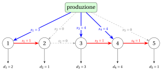

# PD per il problema del lot sizing capacitato

**Parte 3 · Programmazione dinamica · Capitolo 26** · [:material-file-pdf-box: Dispensa, volume 3 (PDF)](../pdf/dispensa-3-programmazione-dinamica.pdf) · [:material-presentation: Slide](../pdf/slide-dp-capacitated-lot-sizing.pdf) · [:material-pencil: Esercizi: Lot sizing capacitato (CLS)](../esercizi/dp-capacitated-lot-sizing.md)

!!! nota "Prerequisiti"

    - Da questo modulo, il capitolo [«PD per il problema di lot sizing senza capacità»](dp-lot-sizing/index.md): le domande totali $D_{j,t}$, la codifica di un piano di produzione e la sua rete, la proprietà zero-inventory ordering, e l'istanza del suo Esempio 25.1.

    - Da questo modulo, i capitoli [«Problemi di lot sizing»](../problemi-di-ottimizzazione-combinatoria/lot-sizing/il-problema-del-lot-sizing-capacitato.md) e [«Formulazioni dei problemi di lot sizing»](../formulazioni/lot-sizing-formulations/index.md): il problema capacitato, la sua istanza di riferimento, e il suo modello PLI con le variabili $x_t$, $s_t$, $y_t$.

    - Da questo modulo, il capitolo [«Principi della programmazione dinamica»](dp-principles.md): ricorrenza, casi base, tabella di lookup e ricostruzione di una soluzione.

    - Dal modulo <em>Algoritmi</em>: [lo pseudocodice (Capitolo 2)](https://fabiofurini.github.io/algoritmi/algoritmi-di-base/02-pseudocodice/), e [la dimensione dell'input (Capitolo 11)](https://fabiofurini.github.io/algoritmi/analisi/11-dimensione-input/).

!!! nota "Dove eravamo"

    - <strong>Come problema e come modello</strong>: il problema di lot sizing capacitato e le sue formulazioni PLI (Capitolo 8 [«Problemi di lot sizing»](../problemi-di-ottimizzazione-combinatoria/lot-sizing/index.md) e Capitolo 15 [«Formulazioni dei problemi di lot sizing»](../formulazioni/lot-sizing-formulations/index.md)).

    - <strong>Come tabella, senza capacità</strong>: l'algoritmo di PD di Wagner e Whitin del Capitolo 25 «PD per il problema di lot sizing senza capacità», sui lotti di produzione, in $\Theta(m^2)$ passi.

    - <strong>Ora, con le capacità</strong>: un algoritmo di PD sulle coppie (periodo, scorta), che è pseudo-polinomiale.

!!! chiave "Obiettivi"

    Al termine di questo capitolo saremo in grado di:

    - spiegare su un esempio perché la proprietà zero-inventory ordering non vale con le capacità;

    - scrivere la ricorrenza $v(t,k)$ sulle coppie (periodo, scorta finale), con i suoi casi base;

    - eseguire a mano l'algoritmo di PD, riempire le matrici ${v}$ e ${r}$, e ricostruire un piano ottimo;

    - contare i passi dell'algoritmo di PD, e spiegare perché è pseudo-polinomiale;

    - enunciare la proprietà più debole che vale quando la capacità è la stessa in tutti i periodi.

Il problema di questo capitolo è il [problema di lot sizing capacitato (CLS)](../problemi-di-ottimizzazione-combinatoria/lot-sizing/il-problema-del-lot-sizing-capacitato.md): la sua definizione e le sue ipotesi sono nella sua pagina.

## 26.1 Notazione, modello e soluzioni ammissibili

- Come nel [Capitolo 25 «PD per il problema di lot sizing senza capacità»](dp-lot-sizing/index.md), per ogni $j,t \in T$ indichiamo con

    $$
    D_{j,t}=\sum_{k=j}^{t} d_k
    $$

    la domanda totale dei periodi $j,j+1,\dots,t$, con $D_{j,t}=0$ se $j>t$.

- Il modello PLI è il modello $\mathrm{ILP}_{\mathrm{CLSP}}$ del [Capitolo 15 «Formulazioni dei problemi di lot sizing»](../formulazioni/lot-sizing-formulations/index.md), con il valore di big-M $\min\{cap_t, D_{t,m}\}$ del periodo $t$: è il modello $\mathrm{ILP}_{\mathrm{ULS}}$ con i vincoli aggiuntivi $x_t\le cap_t$, per ogni $t\in T$.

- Una soluzione ammissibile si codifica con lo stesso vettore $(x_1,x_2,\dots,x_m)$ dell'ULS, con le scorte $s_t=\sum_{j=1}^{t} x_j-D_{1,t}$, e con il requisito aggiuntivo $x_t \le cap_t$ per ogni $t\in T$.

- La <strong>proprietà zero-inventory ordering non vale</strong> per il CLS: un periodo può dover produrre mentre ci sono ancora unità in scorta, perché la capacità non permette di produrre tutto nel periodo in cui sarebbe più economico.

- La proprietà, e l'algoritmo di PD sui lotti di produzione che si basa su di essa, sono quelli del [Capitolo 25 «PD per il problema di lot sizing senza capacità»](dp-lot-sizing/index.md).

!!! esempio "Esempio 26.1: lot sizing capacitato"

    Consideriamo l'istanza senza capacità dell'Esempio 25.1 del [Capitolo 25 «PD per il problema di lot sizing senza capacità»](dp-lot-sizing/index.md), misurata in unità di $10$ prodotti (quindi il costo di mantenimento è $10$ per unità), con una capacità costante di $4$ unità per periodo:

    $$
    \begin{array}{l|rrrrr}
    \hline {t} & {1} & {2} & {3} & {4} & {5} \\
    \hline {d_t} & {2} & {1} & {3} & {4} & {1} \\
    {sc_t} & {50} & {50} & {50} & {50} & {50} \\
    {vc_t} & {0} & {0} & {0} & {0} & {0} \\
    {hc_t} & {10} & {10} & {10} & {10} & {10} \\
    {cap_t} & {4} & {4} & {4} & {4} & {4} \\
    \hline
    \end{array}
    $$

    Chiamiamo questa istanza del CLS [Esempio 26.1](#box-1-texcls1): è l'istanza di riferimento del Capitolo 8 [«Problemi di lot sizing»](../problemi-di-ottimizzazione-combinatoria/lot-sizing/index.md). La soluzione ottima dell'istanza senza capacità, in unità di $10$, è il vettore $(3,\allowbreak 0,\allowbreak 8,\allowbreak 0,\allowbreak 0)$, di costo $170$: non è ammissibile per l'[Esempio 26.1](#box-1-texcls1), poiché il periodo $3$ produce più di $4$ unità.

## 26.2 Un algoritmo di PD per il CLS

### 26.2.1 Passo 1 e Passo 2

- <u>Passo 1</u>: calcolo del valore ottimo

- Per ogni periodo $t\in\{1,\dots,m\}$, la <strong>funzione di costo di produzione</strong> del periodo $t$ è

    $$
    f_t(x)= \left\{ \begin{array}{ll}
    0 & \textrm{se $x=0$,}\\[1ex]
    sc_t+vc_t\,x & \textrm{se $x\in\{1,2,\dots,cap_t\}$.}
    \end{array} \right.
    $$

    La scorta alla fine del periodo $t$ non supera mai la domanda $D_{t+1,m}$ dei periodi successivi, poiché la scorta deve essere vuota alla fine del periodo $m$.

    !!! formula ""

        Per ogni $t \in \{1,2,\dots,m\}$ e $k \in \{0,1,\dots,D_{t+1,m}\}$, sia $v(t,k)$ il valore ottimo della sottoistanza del CLS data da:

        1. un insieme $\{1,2,\dots,t\}$ di $t$ periodi di tempo,

        2. per ogni periodo $j \in \{1,2,\dots,t\}$, una domanda $d_j$,

        3. per ogni periodo $j \in \{1,2,\dots,t\}$, un costo di setup $sc_j$, un costo variabile di produzione $vc_j$ e un costo di mantenimento a scorta $hc_j$,

        4. per ogni periodo $j \in \{1,2,\dots,t\}$, una capacità $cap_j$,

        5. una scorta uguale a $k$ alla fine del periodo $t$.

        La formula ricorsiva per calcolare $v(t,k)$ è la seguente:

        \begin{equation*}
        \label{eq:cls}
        v(t,k)= \left\{ \begin{array}{ll}
        \begin{array}[t]{@{}l@{}}\displaystyle \min \bigg\{ v(t-1,k+d_t-x) + f_t(x) : x \in X_t(k)\bigg\}\\ {}+ hc_t\,k\end{array} & \textrm{se $1\le t \le m$,}\\[2ex]
        0 & \textrm{se $t=0$ e $k=0$,}\\[2ex]
        +\infty & \textrm{se $t=0$ e $k>0$,}
        \end{array} \right. \tag{26.1}
        \end{equation*}

        dove $X_t(k)=\{0,1,\dots,\min\{cap_t,\,k+d_t\}\}$ è l'insieme delle possibili produzioni del periodo $t$.

    - La coppia $(t,k)$ è lo <strong>stato</strong>: l'ultimo periodo della sottoistanza e la scorta alla sua fine. Per $t=m$ e $k=0$ otteniamo l'istanza del CLS stessa, quindi il suo valore ottimo è $v(m,0)$.

    - Il processo di decomposizione ricorsiva della formula $\eqref{eq:cls}$ genera al più $cap_t+1$ <strong>sottoproblemi indipendenti</strong>, ciascuno corrispondente a una possibile scelta della produzione $x$ dell'ultimo periodo $t$.

    - Se si producono $x$ unità nel periodo $t$ e alla sua fine restano $k$ unità, la scorta alla fine del periodo $t-1$ è $k+d_t-x$: il sottoproblema residuo è la sottoistanza del CLS con i periodi $\{1,\dots,t-1\}$ e scorta finale $k+d_t-x$.

    - La produzione $x$ è al più $cap_t$, e al più $k+d_t$ perché la scorta alla fine del periodo $t-1$ non può essere negativa. Inoltre $k+d_t-x\le D_{t+1,m}+d_t=D_{t,m}$, quindi il sottoproblema residuo è uno stato.

    - Il caso base è $v(0,0)=0$: nessun periodo, nessuna scorta, nessun costo.

    - Per $k>0$ poniamo $v(0,k)=+\infty$: la scorta iniziale è vuota, quindi nessuna soluzione ammissibile ha una scorta positiva prima del periodo $1$. Il valore $+\infty$ esclude questo caso, e si propaga a ogni stato che non si può raggiungere entro le capacità, con la convenzione $+\infty+a=+\infty$.

    - Il valore ottimo $v(t,k)$ si ottiene provando tutte le possibili produzioni $x$ del periodo $t$ e scegliendo quella che minimizza la somma $v(t-1,k+d_t-x)+f_t(x)$ del valore ottimo del sottoproblema residuo e del costo di produzione del periodo $t$; il costo di mantenimento $hc_t\,k$ della scorta finale non dipende da $x$.

    - Quindi, una soluzione ottima della sottoistanza dello stato $(t,k)$ si costruisce combinando la produzione scelta del periodo $t$ con una soluzione ottima del sottoproblema residuo dello stato $(t-1,k+d_t-x)$.

        $\rightsquigarrow$ <strong>Sottostruttura ottima verificata!</strong>

    - Sequenze diverse di decisioni di produzione possono portare allo stesso stato. Per esempio, nell'[Esempio 26.1](#box-1-texcls1), partendo dallo stato $(5,0)$, le decisioni $x_5=0$ e $x_4=4$ portano allo stato $(3,1)$, e le decisioni $x_5=1$ e $x_4=3$ portano allo stesso stato $(3,1)$.

    - Quindi lo stesso valore $v(t,k)$ può dover essere calcolato più volte durante la valutazione ricorsiva della formula $\eqref{eq:cls}$.

        $\rightsquigarrow$ <strong>Sottoproblemi sovrapposti verificati!</strong>

    - Un <strong>primo metodo</strong> per calcolare il valore ottimo $v(m,0)$ dell'istanza del CLS è l'<strong>approccio top-down</strong>. Il metodo parte dalla chiamata con $(t,k)=(m,0)$ e valuta ricorsivamente la formula $\eqref{eq:cls}$: ogni chiamata per uno stato $(t,k)$ genera ulteriori chiamate per gli stati $(t-1,k+d_t-x)$, per ogni $x \in \{0,\dots,\min\{cap_t,k+d_t\}\}$, finché non si raggiunge uno dei casi base $v(0,k)$.

    - Il valore $v(t,k)$ si può calcolare una volta noti i valori $v(t-1,k')$ per ogni $k'\in\{0,\dots,D_{t,m}\}$.

    - Possiamo evitare di risolvere ripetutamente gli stessi sottoproblemi memorizzando il valore di ciascun sottoproblema non appena viene calcolato, in una <strong>tabella di lookup</strong>: la matrice ${v}[0..m][0..D_{1,m}]$, la cui cella ${v}[t][k]$ contiene $v(t,k)$ per $k\le D_{t+1,m}$ (le altre celle non si usano).

    - Un <strong>secondo metodo</strong> per calcolare il valore ottimo $v(m,0)$ dell'istanza del CLS è l'<strong>approccio bottom-up</strong>. Il metodo parte dai casi base $v(0,0)=0$ e $v(0,k)=+\infty$ per ogni $k\in\{1,\dots,D_{1,m}\}$.

    - Valuta la formula $\eqref{eq:cls}$ per valori crescenti di $t\in\{1,\dots,m\}$ e, per ogni $t$ fissato, per $k \in \{0,1,\dots,D_{t+1,m}\}$: ogni valore $v(t,k)$ usa valori già calcolati della riga $t-1$, finché non si ottiene $v(m,0)$.

        Questo è lo pseudocodice dell'<strong>algoritmo di PD con l'approccio bottom-up</strong>:

        !!! algoritmo "Algoritmo: DP\_CLS"

            

<strong>Input:</strong> Un'istanza del CLS data dal numero \(m\) di periodi e dai vettori \(d[1..m]\), \(sc[1..m]\), \(vc[1..m]\), \(hc[1..m]\), \(cap[1..m]\)

<strong>Output:</strong> Il valore ottimo

1<strong>Function</strong> DP_CLS(\(m,d,sc,vc,hc,cap\))

2\({R} := \textnormal{new array}[0..m]\)

3\({R}[m] \leftarrow 0\)

4<strong>for</strong> \(t := m-1\) <strong>downto</strong> \(0\)  <strong>do</strong>

5\({R}[t] \leftarrow {R}[t+1] + d[t+1]\)

6<strong>end</strong>

7\({v} := \textnormal{new array}[0..m][0..{R}[0]]\)

8\({v}[0][0] \leftarrow 0\)

9<strong>for</strong> \(k := 1\) <strong>to</strong> \({R}[0]\)  <strong>do</strong>

10\({v}[0][k] \leftarrow +\infty\)

11<strong>end</strong>

12<strong>for</strong> \(t := 1\) <strong>to</strong> \(m\)  <strong>do</strong>

13<strong>for</strong> \(k := 0\) <strong>to</strong> \({R}[t]\)  <strong>do</strong>

14\(\mathit{b} := +\infty\)

15<strong>for</strong> \(x := 0\) <strong>to</strong> \(\min\{cap[t],\,k+d[t]\}\)  <strong>do</strong>

16<strong>if</strong> \({v}[t-1][k+d[t]-x] + f_t(x) + hc[t]\cdot k < \mathit{b}\)  <strong>then</strong>

17\(\mathit{b} \leftarrow {v}[t-1][k+d[t]-x] + f_t(x) + hc[t]\cdot k\)

18<strong>end</strong>

19<strong>end</strong>

20\({v}[t][k] \leftarrow \mathit{b}\)

21<strong>end</strong>

22<strong>end</strong>

23<strong>return</strong> \({v}[m][0]\)

        - Il vettore ${R}[0..m]$ contiene le domande residue ${R}[t]=D_{t+1,m}$, calcolate all'indietro a partire da ${R}[m]=0$: gli stati del periodo $t$ sono le coppie $(t,k)$ con $k\le {R}[t]$.

        - La matrice ${v}$ è la <strong>tabella di lookup</strong>. L'inizializzazione pone ${v}[0][0]=0$ e ${v}[0][k]=+\infty$ per ogni $k\in\{1,\dots,{R}[0]\}$, poiché la scorta iniziale è vuota.

        - Il ciclo esterno, su $t \in \{1,2,\dots,m\}$, considera i periodi in ordine crescente, e il secondo ciclo, su $k\in\{0,\dots,{R}[t]\}$, considera tutte le scorte finali del periodo $t$.

        - Il ciclo interno, sulla produzione $x$ del periodo $t$, mantiene in $\mathit{b}$ il valore minimo ${v}[t-1][k+d[t]-x]+f_t(x)+hc[t]\cdot k$; il valore $f_t(x)$ è $0$ per $x=0$ e $sc[t]+vc[t]\cdot x$ altrimenti. Se tutti i candidati valgono $+\infty$, il confronto non è mai vero e ${v}[t][k]=+\infty$: lo stato $(t,k)$ non si può raggiungere entro le capacità.

        - Infine, viene restituito il valore ottimo ${v}[m][0]$ dell'istanza del CLS.

        

        !!! esempio "Esempio 26.2: esecuzione dell'algoritmo di PD"

            Consideriamo l'istanza del CLS dell'[Esempio 26.1](#box-1-texcls1):

            $$
            \begin{array}{l|rrrrr}
            \hline {t} & {1} & {2} & {3} & {4} & {5} \\
            \hline {d_t} & {2} & {1} & {3} & {4} & {1} \\
            {sc_t} & {50} & {50} & {50} & {50} & {50} \\
            {vc_t} & {0} & {0} & {0} & {0} & {0} \\
            {hc_t} & {10} & {10} & {10} & {10} & {10} \\
            {cap_t} & {4} & {4} & {4} & {4} & {4} \\
            \hline
            \end{array}
            $$

            Le domande residue sono $({R}[0],\dots,{R}[5])=(11,\allowbreak 9,\allowbreak 8,\allowbreak 5,\allowbreak 1,\allowbreak 0)$.

            Per ogni passo dell'algoritmo di PD, la tabella riporta i valori di $t$ e $k$, la cella ${v}[t][k]$ e l'operazione eseguita. I candidati del minimo sono elencati per $x=0,1,\dots,\min\{cap_t,k+d_t\}$.

            
<table>
            <tr>
            <th>\(t\)</th>
            <th>\(k\)</th>
            <th>\({v}[t][k]\)</th>
            <th>Azione</th>
            </tr>
            <tr>
            <td>\(0\)</td>
            <td>\(0\)</td>
            <td>\(0\)</td>
            <td>\({v}[0][0]\leftarrow 0\)</td>
            </tr>
            <tr>
            <td>\(0\)</td>
            <td>\(1\)</td>
            <td>\(+\infty\)</td>
            <td>\({v}[0][1]\leftarrow +\infty\)</td>
            </tr>
            <tr>
            <td>\(0\)</td>
            <td>\(2\)</td>
            <td>\(+\infty\)</td>
            <td>\({v}[0][2]\leftarrow +\infty\)</td>
            </tr>
            <tr>
            <td>\(0\)</td>
            <td>\(3\)</td>
            <td>\(+\infty\)</td>
            <td>\({v}[0][3]\leftarrow +\infty\)</td>
            </tr>
            <tr>
            <td>\(0\)</td>
            <td>\(4\)</td>
            <td>\(+\infty\)</td>
            <td>\({v}[0][4]\leftarrow +\infty\)</td>
            </tr>
            <tr>
            <td>\(0\)</td>
            <td>\(5\)</td>
            <td>\(+\infty\)</td>
            <td>\({v}[0][5]\leftarrow +\infty\)</td>
            </tr>
            <tr>
            <td>\(0\)</td>
            <td>\(6\)</td>
            <td>\(+\infty\)</td>
            <td>\({v}[0][6]\leftarrow +\infty\)</td>
            </tr>
            <tr>
            <td>\(0\)</td>
            <td>\(7\)</td>
            <td>\(+\infty\)</td>
            <td>\({v}[0][7]\leftarrow +\infty\)</td>
            </tr>
            <tr>
            <td>\(0\)</td>
            <td>\(8\)</td>
            <td>\(+\infty\)</td>
            <td>\({v}[0][8]\leftarrow +\infty\)</td>
            </tr>
            <tr>
            <td>\(0\)</td>
            <td>\(9\)</td>
            <td>\(+\infty\)</td>
            <td>\({v}[0][9]\leftarrow +\infty\)</td>
            </tr>
            <tr>
            <td>\(0\)</td>
            <td>\(10\)</td>
            <td>\(+\infty\)</td>
            <td>\({v}[0][10]\leftarrow +\infty\)</td>
            </tr>
            <tr>
            <td>\(0\)</td>
            <td>\(11\)</td>
            <td>\(+\infty\)</td>
            <td>\({v}[0][11]\leftarrow +\infty\)</td>
            </tr>
            <tr>
            <td>\(1\)</td>
            <td>\(0\)</td>
            <td>\(50\)</td>
            <td>\(\min\{{v}[0][2]{+}f_{1}(0),\allowbreak {v}[0][1]{+}f_{1}(1),\allowbreak {v}[0][0]{+}f_{1}(2)\}{+}hc_{1}\cdot 0\) \(=\min\{+\infty,\allowbreak +\infty,\allowbreak 0{+}50\}{+}10\cdot 0=50\)</td>
            </tr>
            <tr>
            <td>\(1\)</td>
            <td>\(1\)</td>
            <td>\(60\)</td>
            <td>\(\min\{{v}[0][3]{+}f_{1}(0),\allowbreak {v}[0][2]{+}f_{1}(1),\allowbreak {v}[0][1]{+}f_{1}(2),\allowbreak {v}[0][0]{+}f_{1}(3)\}{+}hc_{1}\cdot 1\) \(=\min\{+\infty,\allowbreak +\infty,\allowbreak +\infty,\allowbreak 0{+}50\}{+}10\cdot 1=60\)</td>
            </tr>
            <tr>
            <td>\(1\)</td>
            <td>\(2\)</td>
            <td>\(70\)</td>
            <td>\(\min\{{v}[0][4]{+}f_{1}(0),\allowbreak {v}[0][3]{+}f_{1}(1),\allowbreak {v}[0][2]{+}f_{1}(2),\allowbreak {v}[0][1]{+}f_{1}(3),\allowbreak {v}[0][0]{+}f_{1}(4)\}{+}hc_{1}\cdot 2\) \(=\min\{+\infty,\allowbreak +\infty,\allowbreak +\infty,\allowbreak +\infty,\allowbreak 0{+}50\}{+}10\cdot 2=70\)</td>
            </tr>
            <tr>
            <td>\(1\)</td>
            <td>\(3\)</td>
            <td>\(+\infty\)</td>
            <td>i candidati usano le celle \({v}[0][1],\dots,{v}[0][5]\), che valgono tutte \(+\infty\): \({v}[1][3]\leftarrow +\infty\)</td>
            </tr>
            <tr>
            <td>\(1\)</td>
            <td>\(4\)</td>
            <td>\(+\infty\)</td>
            <td>i candidati usano le celle \({v}[0][2],\dots,{v}[0][6]\), che valgono tutte \(+\infty\): \({v}[1][4]\leftarrow +\infty\)</td>
            </tr>
            <tr>
            <td>\(1\)</td>
            <td>\(5\)</td>
            <td>\(+\infty\)</td>
            <td>i candidati usano le celle \({v}[0][3],\dots,{v}[0][7]\), che valgono tutte \(+\infty\): \({v}[1][5]\leftarrow +\infty\)</td>
            </tr>
            <tr>
            <td>\(1\)</td>
            <td>\(6\)</td>
            <td>\(+\infty\)</td>
            <td>i candidati usano le celle \({v}[0][4],\dots,{v}[0][8]\), che valgono tutte \(+\infty\): \({v}[1][6]\leftarrow +\infty\)</td>
            </tr>
            <tr>
            <td>\(1\)</td>
            <td>\(7\)</td>
            <td>\(+\infty\)</td>
            <td>i candidati usano le celle \({v}[0][5],\dots,{v}[0][9]\), che valgono tutte \(+\infty\): \({v}[1][7]\leftarrow +\infty\)</td>
            </tr>
            <tr>
            <td>\(1\)</td>
            <td>\(8\)</td>
            <td>\(+\infty\)</td>
            <td>i candidati usano le celle \({v}[0][6],\dots,{v}[0][10]\), che valgono tutte \(+\infty\): \({v}[1][8]\leftarrow +\infty\)</td>
            </tr>
            <tr>
            <td>\(1\)</td>
            <td>\(9\)</td>
            <td>\(+\infty\)</td>
            <td>i candidati usano le celle \({v}[0][7],\dots,{v}[0][11]\), che valgono tutte \(+\infty\): \({v}[1][9]\leftarrow +\infty\)</td>
            </tr>
            <tr>
            <td>\(2\)</td>
            <td>\(0\)</td>
            <td>\(60\)</td>
            <td>\(\min\{{v}[1][1]{+}f_{2}(0),\allowbreak {v}[1][0]{+}f_{2}(1)\}{+}hc_{2}\cdot 0\) \(=\min\{60{+}0,\allowbreak 50{+}50\}{+}10\cdot 0=60\)</td>
            </tr>
            <tr>
            <td>\(2\)</td>
            <td>\(1\)</td>
            <td>\(80\)</td>
            <td>\(\min\{{v}[1][2]{+}f_{2}(0),\allowbreak {v}[1][1]{+}f_{2}(1),\allowbreak {v}[1][0]{+}f_{2}(2)\}{+}hc_{2}\cdot 1\) \(=\min\{70{+}0,\allowbreak 60{+}50,\allowbreak 50{+}50\}{+}10\cdot 1=80\)</td>
            </tr>
            <tr>
            <td>\(2\)</td>
            <td>\(2\)</td>
            <td>\(120\)</td>
            <td>\(\min\{{v}[1][3]{+}f_{2}(0),\allowbreak {v}[1][2]{+}f_{2}(1),\allowbreak {v}[1][1]{+}f_{2}(2),\allowbreak {v}[1][0]{+}f_{2}(3)\}{+}hc_{2}\cdot 2\) \(=\min\{+\infty,\allowbreak 70{+}50,\allowbreak 60{+}50,\allowbreak 50{+}50\}{+}10\cdot 2=120\)</td>
            </tr>
            <tr>
            <td>\(2\)</td>
            <td>\(3\)</td>
            <td>\(130\)</td>
            <td>\(\min\{{v}[1][4]{+}f_{2}(0),\allowbreak {v}[1][3]{+}f_{2}(1),\allowbreak {v}[1][2]{+}f_{2}(2),\allowbreak {v}[1][1]{+}f_{2}(3),\allowbreak {v}[1][0]{+}f_{2}(4)\}{+}hc_{2}\cdot 3\) \(=\min\{+\infty,\allowbreak +\infty,\allowbreak 70{+}50,\allowbreak 60{+}50,\allowbreak 50{+}50\}{+}10\cdot 3=130\)</td>
            </tr>
            <tr>
            <td>\(2\)</td>
            <td>\(4\)</td>
            <td>\(150\)</td>
            <td>\(\min\{{v}[1][5]{+}f_{2}(0),\allowbreak {v}[1][4]{+}f_{2}(1),\allowbreak {v}[1][3]{+}f_{2}(2),\allowbreak {v}[1][2]{+}f_{2}(3),\allowbreak {v}[1][1]{+}f_{2}(4)\}{+}hc_{2}\cdot 4\) \(=\min\{+\infty,\allowbreak +\infty,\allowbreak +\infty,\allowbreak 70{+}50,\allowbreak 60{+}50\}{+}10\cdot 4=150\)</td>
            </tr>
            <tr>
            <td>\(2\)</td>
            <td>\(5\)</td>
            <td>\(170\)</td>
            <td>\(\min\{{v}[1][6]{+}f_{2}(0),\allowbreak {v}[1][5]{+}f_{2}(1),\allowbreak {v}[1][4]{+}f_{2}(2),\allowbreak {v}[1][3]{+}f_{2}(3),\allowbreak {v}[1][2]{+}f_{2}(4)\}{+}hc_{2}\cdot 5\) \(=\min\{+\infty,\allowbreak +\infty,\allowbreak +\infty,\allowbreak +\infty,\allowbreak 70{+}50\}{+}10\cdot 5=170\)</td>
            </tr>
            <tr>
            <td>\(2\)</td>
            <td>\(6\)</td>
            <td>\(+\infty\)</td>
            <td>i candidati usano le celle \({v}[1][3],\dots,{v}[1][7]\), che valgono tutte \(+\infty\): \({v}[2][6]\leftarrow +\infty\)</td>
            </tr>
            <tr>
            <td>\(2\)</td>
            <td>\(7\)</td>
            <td>\(+\infty\)</td>
            <td>i candidati usano le celle \({v}[1][4],\dots,{v}[1][8]\), che valgono tutte \(+\infty\): \({v}[2][7]\leftarrow +\infty\)</td>
            </tr>
            <tr>
            <td>\(2\)</td>
            <td>\(8\)</td>
            <td>\(+\infty\)</td>
            <td>i candidati usano le celle \({v}[1][5],\dots,{v}[1][9]\), che valgono tutte \(+\infty\): \({v}[2][8]\leftarrow +\infty\)</td>
            </tr>
            <tr>
            <td>\(3\)</td>
            <td>\(0\)</td>
            <td>\(110\)</td>
            <td>\(\min\{{v}[2][3]{+}f_{3}(0),\allowbreak {v}[2][2]{+}f_{3}(1),\allowbreak {v}[2][1]{+}f_{3}(2),\allowbreak {v}[2][0]{+}f_{3}(3)\}{+}hc_{3}\cdot 0\) \(=\min\{130{+}0,\allowbreak 120{+}50,\allowbreak 80{+}50,\allowbreak 60{+}50\}{+}10\cdot 0=110\)</td>
            </tr>
            <tr>
            <td>\(3\)</td>
            <td>\(1\)</td>
            <td>\(120\)</td>
            <td>\(\min\{{v}[2][4]{+}f_{3}(0),\allowbreak {v}[2][3]{+}f_{3}(1),\allowbreak {v}[2][2]{+}f_{3}(2),\allowbreak {v}[2][1]{+}f_{3}(3),\allowbreak {v}[2][0]{+}f_{3}(4)\}{+}hc_{3}\cdot 1\) \(=\min\{150{+}0,\allowbreak 130{+}50,\allowbreak 120{+}50,\allowbreak 80{+}50,\allowbreak 60{+}50\}{+}10\cdot 1=120\)</td>
            </tr>
            <tr>
            <td>\(3\)</td>
            <td>\(2\)</td>
            <td>\(150\)</td>
            <td>\(\min\{{v}[2][5]{+}f_{3}(0),\allowbreak {v}[2][4]{+}f_{3}(1),\allowbreak {v}[2][3]{+}f_{3}(2),\allowbreak {v}[2][2]{+}f_{3}(3),\allowbreak {v}[2][1]{+}f_{3}(4)\}{+}hc_{3}\cdot 2\) \(=\min\{170{+}0,\allowbreak 150{+}50,\allowbreak 130{+}50,\allowbreak 120{+}50,\allowbreak 80{+}50\}{+}10\cdot 2=150\)</td>
            </tr>
            <tr>
            <td>\(3\)</td>
            <td>\(3\)</td>
            <td>\(200\)</td>
            <td>\(\min\{{v}[2][6]{+}f_{3}(0),\allowbreak {v}[2][5]{+}f_{3}(1),\allowbreak {v}[2][4]{+}f_{3}(2),\allowbreak {v}[2][3]{+}f_{3}(3),\allowbreak {v}[2][2]{+}f_{3}(4)\}{+}hc_{3}\cdot 3\) \(=\min\{+\infty,\allowbreak 170{+}50,\allowbreak 150{+}50,\allowbreak 130{+}50,\allowbreak 120{+}50\}{+}10\cdot 3=200\)</td>
            </tr>
            <tr>
            <td>\(3\)</td>
            <td>\(4\)</td>
            <td>\(220\)</td>
            <td>\(\min\{{v}[2][7]{+}f_{3}(0),\allowbreak {v}[2][6]{+}f_{3}(1),\allowbreak {v}[2][5]{+}f_{3}(2),\allowbreak {v}[2][4]{+}f_{3}(3),\allowbreak {v}[2][3]{+}f_{3}(4)\}{+}hc_{3}\cdot 4\) \(=\min\{+\infty,\allowbreak +\infty,\allowbreak 170{+}50,\allowbreak 150{+}50,\allowbreak 130{+}50\}{+}10\cdot 4=220\)</td>
            </tr>
            <tr>
            <td>\(3\)</td>
            <td>\(5\)</td>
            <td>\(250\)</td>
            <td>\(\min\{{v}[2][8]{+}f_{3}(0),\allowbreak {v}[2][7]{+}f_{3}(1),\allowbreak {v}[2][6]{+}f_{3}(2),\allowbreak {v}[2][5]{+}f_{3}(3),\allowbreak {v}[2][4]{+}f_{3}(4)\}{+}hc_{3}\cdot 5\) \(=\min\{+\infty,\allowbreak +\infty,\allowbreak +\infty,\allowbreak 170{+}50,\allowbreak 150{+}50\}{+}10\cdot 5=250\)</td>
            </tr>
            <tr>
            <td>\(4\)</td>
            <td>\(0\)</td>
            <td>\(160\)</td>
            <td>\(\min\{{v}[3][4]{+}f_{4}(0),\allowbreak {v}[3][3]{+}f_{4}(1),\allowbreak {v}[3][2]{+}f_{4}(2),\allowbreak {v}[3][1]{+}f_{4}(3),\allowbreak {v}[3][0]{+}f_{4}(4)\}{+}hc_{4}\cdot 0\) \(=\min\{220{+}0,\allowbreak 200{+}50,\allowbreak 150{+}50,\allowbreak 120{+}50,\allowbreak 110{+}50\}{+}10\cdot 0=160\)</td>
            </tr>
            <tr>
            <td>\(4\)</td>
            <td>\(1\)</td>
            <td>\(180\)</td>
            <td>\(\min\{{v}[3][5]{+}f_{4}(0),\allowbreak {v}[3][4]{+}f_{4}(1),\allowbreak {v}[3][3]{+}f_{4}(2),\allowbreak {v}[3][2]{+}f_{4}(3),\allowbreak {v}[3][1]{+}f_{4}(4)\}{+}hc_{4}\cdot 1\) \(=\min\{250{+}0,\allowbreak 220{+}50,\allowbreak 200{+}50,\allowbreak 150{+}50,\allowbreak 120{+}50\}{+}10\cdot 1=180\)</td>
            </tr>
            <tr>
            <td>\(5\)</td>
            <td>\(0\)</td>
            <td>\(180\)</td>
            <td>\(\min\{{v}[4][1]{+}f_{5}(0),\allowbreak {v}[4][0]{+}f_{5}(1)\}{+}hc_{5}\cdot 0\) \(=\min\{180{+}0,\allowbreak 160{+}50\}{+}10\cdot 0=180\)</td>
            </tr>
            </table>

            Questa è la matrice ${v}$ dopo l'esecuzione dell'algoritmo di PD (un punto indica una coppia $(t,k)$ con $k>D_{t+1,m}$, che non è uno stato):

            $$
            \begin{array}{l|rrrrrrrrrrrr}
            \hline {{v}[t][k]} & {0} & {1} & {2} & {3} & {4} & {5} & {6} & {7} & {8} & {9} & {10} & {11} \\
            \hline {t=0} & {0} & {+\infty} & {+\infty} & {+\infty} & {+\infty} & {+\infty} & {+\infty} & {+\infty} & {+\infty} & {+\infty} & {+\infty} & {+\infty} \\
            {t=1} & {50} & {60} & {70} & {+\infty} & {+\infty} & {+\infty} & {+\infty} & {+\infty} & {+\infty} & {+\infty} & {\cdot} & {\cdot} \\
            {t=2} & {60} & {80} & {120} & {130} & {150} & {170} & {+\infty} & {+\infty} & {+\infty} & {\cdot} & {\cdot} & {\cdot} \\
            {t=3} & {110} & {120} & {150} & {200} & {220} & {250} & {\cdot} & {\cdot} & {\cdot} & {\cdot} & {\cdot} & {\cdot} \\
            {t=4} & {160} & {180} & {\cdot} & {\cdot} & {\cdot} & {\cdot} & {\cdot} & {\cdot} & {\cdot} & {\cdot} & {\cdot} & {\cdot} \\
            {t=5} & {180} & {\cdot} & {\cdot} & {\cdot} & {\cdot} & {\cdot} & {\cdot} & {\cdot} & {\cdot} & {\cdot} & {\cdot} & {\cdot} \\
            \hline
            \end{array}
            $$

            Il valore ottimo dell'istanza del CLS è ${v}[5][0]=180$.

    - Dopo l'esecuzione dell'algoritmo di PD, la matrice ${v}$ contiene il valore ottimo ${v}[t][k]$ di ogni stato $(t,k)$.

- <u>Passo 2</u>: calcolo di una soluzione ottima

    - Per calcolare una soluzione ottima è necessario memorizzare alcune informazioni aggiuntive.

    - Per ogni stato $(t,k)$, oltre al valore ottimo ${v}[t][k]$, memorizziamo ${r}[t][k]$, la produzione del periodo $t$ in una soluzione ottima della sottoistanza dello stato $(t,k)$; per gli stati con valore $+\infty$ memorizziamo $0$.

    - Partendo da $(t,k)=(m,0)$, il valore ${r}[t][k]$ dà la produzione del periodo $t$; la scorta alla fine del periodo $t-1$ è allora $k+d_t-{r}[t][k]$, e la stessa regola si può applicare di nuovo al periodo $t-1$, e così via, fino a $t=0$.

        Questo è lo pseudocodice dell'<strong>algoritmo di PD con l'approccio bottom-up</strong> con la memorizzazione delle informazioni necessarie per calcolare una soluzione ottima:

        !!! algoritmo "Algoritmo: DP\_CLS\_InfoSol"

            

<strong>Input:</strong> Un'istanza del CLS data dal numero \(m\) di periodi e dai vettori \(d[1..m]\), \(sc[1..m]\), \(vc[1..m]\), \(hc[1..m]\), \(cap[1..m]\)

<strong>Output:</strong> Il valore ottimo e la matrice delle informazioni \({r}[0..m][0..D_{1,m}]\)

1<strong>Function</strong> DP_CLS_InfoSol(\(m,d,sc,vc,hc,cap\))

2\({R} := \textnormal{new array}[0..m]\)

3\({R}[m] \leftarrow 0\)

4<strong>for</strong> \(t := m-1\) <strong>downto</strong> \(0\) <strong>do</strong>

5\({R}[t] \leftarrow {R}[t+1] + d[t+1]\)

6<strong>end</strong>

7\({v} := \textnormal{new array}[0..m][0..{R}[0]]\)

8\({r} := \textnormal{new array}[0..m][0..{R}[0]]\)

9\({v}[0][0] \leftarrow 0\)

10\({r}[0][0] \leftarrow 0\)

11<strong>for</strong> \(k := 1\) <strong>to</strong> \({R}[0]\) <strong>do</strong>

12\({v}[0][k] \leftarrow +\infty\)

13\({r}[0][k] \leftarrow 0\)

14<strong>end</strong>

15<strong>for</strong> \(t := 1\) <strong>to</strong> \(m\) <strong>do</strong>

16<strong>for</strong> \(k := 0\) <strong>to</strong> \({R}[t]\) <strong>do</strong>

17\(\mathit{b} := +\infty\)

18\(\mathit{a} := 0\)

19<strong>for</strong> \(x := 0\) <strong>to</strong> \(\min\{cap[t],\,k+d[t]\}\) <strong>do</strong>

20<strong>if</strong> \({v}[t-1][k+d[t]-x] + f_t(x) + hc[t]\cdot k < \mathit{b}\) <strong>then</strong>

21\(\mathit{b} \leftarrow {v}[t-1][k+d[t]-x] + f_t(x) + hc[t]\cdot k\)

22\(\mathit{a} \leftarrow x\)

23<strong>end</strong>

24<strong>end</strong>

25\({v}[t][k] \leftarrow \mathit{b}\)

26\({r}[t][k] \leftarrow \mathit{a}\)

27<strong>end</strong>

28<strong>end</strong>

29<strong>return</strong> \({v}[m][0], {r}\)

        - L'algoritmo di PD usa la variabile temporanea aggiuntiva $\mathit{a}$ per tenere traccia della decisione presa quando $\mathit{b}$ viene aggiornato: se viene scelta la produzione $x$, $\mathit{a}\leftarrow x$ memorizza questa decisione, e alla fine del ciclo interno ${r}[t][k]\leftarrow\mathit{a}$ la memorizza, insieme al valore ottimo ${v}[t][k]\leftarrow\mathit{b}$. A causa del confronto stretto, in caso di pareggio viene memorizzata la produzione più piccola.

        

        !!! esempio "Esempio 26.3: calcolo delle informazioni aggiuntive"

            Consideriamo l'istanza del CLS dell'[Esempio 26.1](#box-1-texcls1):

            $$
            \begin{array}{l|rrrrr}
            \hline {t} & {1} & {2} & {3} & {4} & {5} \\
            \hline {d_t} & {2} & {1} & {3} & {4} & {1} \\
            {sc_t} & {50} & {50} & {50} & {50} & {50} \\
            {vc_t} & {0} & {0} & {0} & {0} & {0} \\
            {hc_t} & {10} & {10} & {10} & {10} & {10} \\
            {cap_t} & {4} & {4} & {4} & {4} & {4} \\
            \hline
            \end{array}
            $$

            Per ogni passo dell'algoritmo di PD, la tabella riporta i valori di $t$ e $k$, la cella ${r}[t][k]$ e la produzione $x$ per cui il minimo della riga corrispondente dell'[Esempio 26.2](#box-18-texclsbu) viene raggiunto per primo.

            
<table>
            <tr>
            <th>\(t\)</th>
            <th>\(k\)</th>
            <th>\({r}[t][k]\)</th>
            <th>Azione</th>
            </tr>
            <tr>
            <td>\(0\)</td>
            <td>\(0\)</td>
            <td>0</td>
            <td>\({r}[0][0]\leftarrow 0\)</td>
            </tr>
            <tr>
            <td>\(0\)</td>
            <td>\(1\)</td>
            <td>0</td>
            <td>\({r}[0][1]\leftarrow 0\)</td>
            </tr>
            <tr>
            <td>\(0\)</td>
            <td>\(2\)</td>
            <td>0</td>
            <td>\({r}[0][2]\leftarrow 0\)</td>
            </tr>
            <tr>
            <td>\(0\)</td>
            <td>\(3\)</td>
            <td>0</td>
            <td>\({r}[0][3]\leftarrow 0\)</td>
            </tr>
            <tr>
            <td>\(0\)</td>
            <td>\(4\)</td>
            <td>0</td>
            <td>\({r}[0][4]\leftarrow 0\)</td>
            </tr>
            <tr>
            <td>\(0\)</td>
            <td>\(5\)</td>
            <td>0</td>
            <td>\({r}[0][5]\leftarrow 0\)</td>
            </tr>
            <tr>
            <td>\(0\)</td>
            <td>\(6\)</td>
            <td>0</td>
            <td>\({r}[0][6]\leftarrow 0\)</td>
            </tr>
            <tr>
            <td>\(0\)</td>
            <td>\(7\)</td>
            <td>0</td>
            <td>\({r}[0][7]\leftarrow 0\)</td>
            </tr>
            <tr>
            <td>\(0\)</td>
            <td>\(8\)</td>
            <td>0</td>
            <td>\({r}[0][8]\leftarrow 0\)</td>
            </tr>
            <tr>
            <td>\(0\)</td>
            <td>\(9\)</td>
            <td>0</td>
            <td>\({r}[0][9]\leftarrow 0\)</td>
            </tr>
            <tr>
            <td>\(0\)</td>
            <td>\(10\)</td>
            <td>0</td>
            <td>\({r}[0][10]\leftarrow 0\)</td>
            </tr>
            <tr>
            <td>\(0\)</td>
            <td>\(11\)</td>
            <td>0</td>
            <td>\({r}[0][11]\leftarrow 0\)</td>
            </tr>
            <tr>
            <td>\(1\)</td>
            <td>\(0\)</td>
            <td>\(2\)</td>
            <td>primo minimo in \(x=2\), ossia \({v}[0][0]{+}f_{1}(2){+}hc_{1}\cdot 0=0{+}50{+}0=50\): \({r}[1][0]\leftarrow 2\)</td>
            </tr>
            <tr>
            <td>\(1\)</td>
            <td>\(1\)</td>
            <td>\(3\)</td>
            <td>primo minimo in \(x=3\), ossia \({v}[0][0]{+}f_{1}(3){+}hc_{1}\cdot 1=0{+}50{+}10=60\): \({r}[1][1]\leftarrow 3\)</td>
            </tr>
            <tr>
            <td>\(1\)</td>
            <td>\(2\)</td>
            <td>\(4\)</td>
            <td>primo minimo in \(x=4\), ossia \({v}[0][0]{+}f_{1}(4){+}hc_{1}\cdot 2=0{+}50{+}20=70\): \({r}[1][2]\leftarrow 4\)</td>
            </tr>
            <tr>
            <td>\(1\)</td>
            <td>\(3\)</td>
            <td>\(0\)</td>
            <td>tutti i candidati valgono \(+\infty\): \({r}[1][3]\leftarrow 0\)</td>
            </tr>
            <tr>
            <td>\(1\)</td>
            <td>\(4\)</td>
            <td>\(0\)</td>
            <td>tutti i candidati valgono \(+\infty\): \({r}[1][4]\leftarrow 0\)</td>
            </tr>
            <tr>
            <td>\(1\)</td>
            <td>\(5\)</td>
            <td>\(0\)</td>
            <td>tutti i candidati valgono \(+\infty\): \({r}[1][5]\leftarrow 0\)</td>
            </tr>
            <tr>
            <td>\(1\)</td>
            <td>\(6\)</td>
            <td>\(0\)</td>
            <td>tutti i candidati valgono \(+\infty\): \({r}[1][6]\leftarrow 0\)</td>
            </tr>
            <tr>
            <td>\(1\)</td>
            <td>\(7\)</td>
            <td>\(0\)</td>
            <td>tutti i candidati valgono \(+\infty\): \({r}[1][7]\leftarrow 0\)</td>
            </tr>
            <tr>
            <td>\(1\)</td>
            <td>\(8\)</td>
            <td>\(0\)</td>
            <td>tutti i candidati valgono \(+\infty\): \({r}[1][8]\leftarrow 0\)</td>
            </tr>
            <tr>
            <td>\(1\)</td>
            <td>\(9\)</td>
            <td>\(0\)</td>
            <td>tutti i candidati valgono \(+\infty\): \({r}[1][9]\leftarrow 0\)</td>
            </tr>
            <tr>
            <td>\(2\)</td>
            <td>\(0\)</td>
            <td>\(0\)</td>
            <td>primo minimo in \(x=0\), ossia \({v}[1][1]{+}f_{2}(0){+}hc_{2}\cdot 0=60{+}0{+}0=60\): \({r}[2][0]\leftarrow 0\)</td>
            </tr>
            <tr>
            <td>\(2\)</td>
            <td>\(1\)</td>
            <td>\(0\)</td>
            <td>primo minimo in \(x=0\), ossia \({v}[1][2]{+}f_{2}(0){+}hc_{2}\cdot 1=70{+}0{+}10=80\): \({r}[2][1]\leftarrow 0\)</td>
            </tr>
            <tr>
            <td>\(2\)</td>
            <td>\(2\)</td>
            <td>\(3\)</td>
            <td>primo minimo in \(x=3\), ossia \({v}[1][0]{+}f_{2}(3){+}hc_{2}\cdot 2=50{+}50{+}20=120\): \({r}[2][2]\leftarrow 3\)</td>
            </tr>
            <tr>
            <td>\(2\)</td>
            <td>\(3\)</td>
            <td>\(4\)</td>
            <td>primo minimo in \(x=4\), ossia \({v}[1][0]{+}f_{2}(4){+}hc_{2}\cdot 3=50{+}50{+}30=130\): \({r}[2][3]\leftarrow 4\)</td>
            </tr>
            <tr>
            <td>\(2\)</td>
            <td>\(4\)</td>
            <td>\(4\)</td>
            <td>primo minimo in \(x=4\), ossia \({v}[1][1]{+}f_{2}(4){+}hc_{2}\cdot 4=60{+}50{+}40=150\): \({r}[2][4]\leftarrow 4\)</td>
            </tr>
            <tr>
            <td>\(2\)</td>
            <td>\(5\)</td>
            <td>\(4\)</td>
            <td>primo minimo in \(x=4\), ossia \({v}[1][2]{+}f_{2}(4){+}hc_{2}\cdot 5=70{+}50{+}50=170\): \({r}[2][5]\leftarrow 4\)</td>
            </tr>
            <tr>
            <td>\(2\)</td>
            <td>\(6\)</td>
            <td>\(0\)</td>
            <td>tutti i candidati valgono \(+\infty\): \({r}[2][6]\leftarrow 0\)</td>
            </tr>
            <tr>
            <td>\(2\)</td>
            <td>\(7\)</td>
            <td>\(0\)</td>
            <td>tutti i candidati valgono \(+\infty\): \({r}[2][7]\leftarrow 0\)</td>
            </tr>
            <tr>
            <td>\(2\)</td>
            <td>\(8\)</td>
            <td>\(0\)</td>
            <td>tutti i candidati valgono \(+\infty\): \({r}[2][8]\leftarrow 0\)</td>
            </tr>
            <tr>
            <td>\(3\)</td>
            <td>\(0\)</td>
            <td>\(3\)</td>
            <td>primo minimo in \(x=3\), ossia \({v}[2][0]{+}f_{3}(3){+}hc_{3}\cdot 0=60{+}50{+}0=110\): \({r}[3][0]\leftarrow 3\)</td>
            </tr>
            <tr>
            <td>\(3\)</td>
            <td>\(1\)</td>
            <td>\(4\)</td>
            <td>primo minimo in \(x=4\), ossia \({v}[2][0]{+}f_{3}(4){+}hc_{3}\cdot 1=60{+}50{+}10=120\): \({r}[3][1]\leftarrow 4\)</td>
            </tr>
            <tr>
            <td>\(3\)</td>
            <td>\(2\)</td>
            <td>\(4\)</td>
            <td>primo minimo in \(x=4\), ossia \({v}[2][1]{+}f_{3}(4){+}hc_{3}\cdot 2=80{+}50{+}20=150\): \({r}[3][2]\leftarrow 4\)</td>
            </tr>
            <tr>
            <td>\(3\)</td>
            <td>\(3\)</td>
            <td>\(4\)</td>
            <td>primo minimo in \(x=4\), ossia \({v}[2][2]{+}f_{3}(4){+}hc_{3}\cdot 3=120{+}50{+}30=200\): \({r}[3][3]\leftarrow 4\)</td>
            </tr>
            <tr>
            <td>\(3\)</td>
            <td>\(4\)</td>
            <td>\(4\)</td>
            <td>primo minimo in \(x=4\), ossia \({v}[2][3]{+}f_{3}(4){+}hc_{3}\cdot 4=130{+}50{+}40=220\): \({r}[3][4]\leftarrow 4\)</td>
            </tr>
            <tr>
            <td>\(3\)</td>
            <td>\(5\)</td>
            <td>\(4\)</td>
            <td>primo minimo in \(x=4\), ossia \({v}[2][4]{+}f_{3}(4){+}hc_{3}\cdot 5=150{+}50{+}50=250\): \({r}[3][5]\leftarrow 4\)</td>
            </tr>
            <tr>
            <td>\(4\)</td>
            <td>\(0\)</td>
            <td>\(4\)</td>
            <td>primo minimo in \(x=4\), ossia \({v}[3][0]{+}f_{4}(4){+}hc_{4}\cdot 0=110{+}50{+}0=160\): \({r}[4][0]\leftarrow 4\)</td>
            </tr>
            <tr>
            <td>\(4\)</td>
            <td>\(1\)</td>
            <td>\(4\)</td>
            <td>primo minimo in \(x=4\), ossia \({v}[3][1]{+}f_{4}(4){+}hc_{4}\cdot 1=120{+}50{+}10=180\): \({r}[4][1]\leftarrow 4\)</td>
            </tr>
            <tr>
            <td>\(5\)</td>
            <td>\(0\)</td>
            <td>\(0\)</td>
            <td>primo minimo in \(x=0\), ossia \({v}[4][1]{+}f_{5}(0){+}hc_{5}\cdot 0=180{+}0{+}0=180\): \({r}[5][0]\leftarrow 0\)</td>
            </tr>
            </table>

            Questa è la matrice ${r}$ dopo l'esecuzione dell'algoritmo di PD:

            $$
            \begin{array}{l|rrrrrrrrrrrr}
            \hline {{r}[t][k]} & {0} & {1} & {2} & {3} & {4} & {5} & {6} & {7} & {8} & {9} & {10} & {11} \\
            \hline {t=0} & {0} & {0} & {0} & {0} & {0} & {0} & {0} & {0} & {0} & {0} & {0} & {0} \\
            {t=1} & {2} & {3} & {4} & {0} & {0} & {0} & {0} & {0} & {0} & {0} & {\cdot} & {\cdot} \\
            {t=2} & {0} & {0} & {3} & {4} & {4} & {4} & {0} & {0} & {0} & {\cdot} & {\cdot} & {\cdot} \\
            {t=3} & {3} & {4} & {4} & {4} & {4} & {4} & {\cdot} & {\cdot} & {\cdot} & {\cdot} & {\cdot} & {\cdot} \\
            {t=4} & {4} & {4} & {\cdot} & {\cdot} & {\cdot} & {\cdot} & {\cdot} & {\cdot} & {\cdot} & {\cdot} & {\cdot} & {\cdot} \\
            {t=5} & {0} & {\cdot} & {\cdot} & {\cdot} & {\cdot} & {\cdot} & {\cdot} & {\cdot} & {\cdot} & {\cdot} & {\cdot} & {\cdot} \\
            \hline
            \end{array}
            $$

    - Una volta calcolata la matrice ${r}$, si può calcolare una soluzione ottima dell'istanza del CLS applicando la regola seguente per $t=m,m-1,\dots,1$, a partire da $k=0$:

        $$
        x_t \leftarrow {r}[t][k],
        \qquad
        k \leftarrow k+d_t-x_t.
        $$

        Si ottiene il vettore $(x_1,x_2,\dots,x_m)$, in cui ogni componente $x_t$ è il numero di unità prodotte nel periodo $t$ in una soluzione ottima.

    - Il seguente pseudocodice implementa il calcolo di una soluzione ottima, data la matrice ${r}$.

        !!! algoritmo "Algoritmo: DP\_CLS\_SolComputation"

            

<strong>Input:</strong> Il numero \(m\) di periodi e le domande \(d[1..m]\) dell'istanza del CLS, e la matrice \({r}[0..m][0..D_{1,m}]\)

<strong>Output:</strong> Una soluzione ottima dell'istanza del CLS

1<strong>Function</strong> DP_CLS_SolComputation(\(m,d,{r}\))

2\(x := \textnormal{new array}[1..m]\)

3\(k := 0\)

4<strong>for</strong> \(t := m\) <strong>downto</strong> \(1\) <strong>do</strong>

5\(x[t] \leftarrow {r}[t][k]\)

6\(k \leftarrow k + d[t] - x[t]\)

7<strong>end</strong>

8<strong>return</strong> \(x\)

        

        !!! esempio "Esempio 26.4: calcolo di una soluzione ottima"

            Dopo l'esecuzione dell'algoritmo di PD sull'istanza dell'[Esempio 26.1](#box-1-texcls1), abbiamo la matrice ${r}$ dell'[Esempio 26.3](#box-19-texclsbuinfo). Possiamo calcolare una soluzione ottima come segue:

            
<table>
            <tr>
            <th>Iterazione</th>
            <th>\(t\)</th>
            <th>\(k\)</th>
            <th>\({r}[t][k]\)</th>
            <th>\(x[1]\)</th>
            <th>\(x[2]\)</th>
            <th>\(x[3]\)</th>
            <th>\(x[4]\)</th>
            <th>\(x[5]\)</th>
            <th>\(k\leftarrow k+d[t]-x[t]\)</th>
            </tr>
            <tr>
            <td>\(-\)</td>
            <td>\(-\)</td>
            <td>\(-\)</td>
            <td>\(-\)</td>
            <td>0</td>
            <td>0</td>
            <td>0</td>
            <td>0</td>
            <td>0</td>
            <td>\(t=5\), \(k=0\)</td>
            </tr>
            <tr>
            <td>\(1\)</td>
            <td>\(5\)</td>
            <td>\(0\)</td>
            <td>\(0\)</td>
            <td>0</td>
            <td>0</td>
            <td>0</td>
            <td>0</td>
            <td class="cella-blu">0</td>
            <td>\(k=0+1-0=1\)</td>
            </tr>
            <tr>
            <td>\(2\)</td>
            <td>\(4\)</td>
            <td>\(1\)</td>
            <td>\(4\)</td>
            <td>0</td>
            <td>0</td>
            <td>0</td>
            <td class="cella-blu">4</td>
            <td>0</td>
            <td>\(k=1+4-4=1\)</td>
            </tr>
            <tr>
            <td>\(3\)</td>
            <td>\(3\)</td>
            <td>\(1\)</td>
            <td>\(4\)</td>
            <td>0</td>
            <td>0</td>
            <td class="cella-blu">4</td>
            <td>4</td>
            <td>0</td>
            <td>\(k=1+3-4=0\)</td>
            </tr>
            <tr>
            <td>\(4\)</td>
            <td>\(2\)</td>
            <td>\(0\)</td>
            <td>\(0\)</td>
            <td>0</td>
            <td class="cella-blu">0</td>
            <td>4</td>
            <td>4</td>
            <td>0</td>
            <td>\(k=0+1-0=1\)</td>
            </tr>
            <tr>
            <td>\(5\)</td>
            <td>\(1\)</td>
            <td>\(1\)</td>
            <td>\(3\)</td>
            <td class="cella-blu">3</td>
            <td>0</td>
            <td>4</td>
            <td>4</td>
            <td>0</td>
            <td>\(k=1+2-3=0\)</td>
            </tr>
            </table>

            Una soluzione ottima è il vettore:

            $$
            (3,\allowbreak 0,\allowbreak 4,\allowbreak 4,\allowbreak 0)
            $$

            I setup sono nei periodi $1$, $3$, $4$, le scorte sono $(s_1,\dots,s_{5})=(1,\allowbreak 0,\allowbreak 1,\allowbreak 1,\allowbreak 0)$, e il costo totale è (non c'è costo variabile di produzione)

            $$
            \underbrace{50+50+50}_{\text{setup}}+\underbrace{10\cdot 1+10\cdot 0+10\cdot 1+10\cdot 1+10\cdot 0}_{\text{mantenimento}}=150+30=180.
            $$

            Il valore ottimo corrispondente è ${v}[5][0]=180$, lo stesso valore dato da Gurobi sul modello $\mathrm{ILP}_{\mathrm{CLSP}}$; la capacità costa $180-170$ rispetto all'istanza senza capacità. La rete della soluzione è:

            { .fig loading=lazy  }

            Il periodo $4$ produce anche se alla fine del periodo $3$ c'è un'unità in scorta: la soluzione non ha la proprietà zero-inventory ordering (ed è l'unica soluzione ottima con quantità intere).

### 26.2.2 Numero di passi

- Indichiamo con $S(m,D,C)$ il numero di passi eseguiti da DP\_CLS nel caso peggiore, dove $m$ è il numero di periodi, $D=D_{1,m}$ è la domanda totale e $C=\max_{t\in T} cap_t$ è la capacità più grande. Per ogni $t\ge 1$ abbiamo ${R}[t]+1\le D$ (poiché $d_1\ge 1$), e il ciclo interno ha al più $C+1$ iterazioni. Nel caso peggiore, la condizione della riga [16](#box-14-cl-m) è sempre vera. Il numero di esecuzioni delle righe è:

    - Le righe [2](#box-2-cl-a), [3](#box-3-cl-b), [7](#box-6-cl-e) e [8](#box-7-cl-f) vengono eseguite $1$ volta ciascuna.

    - Le righe [4](#box-4-cl-c) e [5](#box-5-cl-d) vengono eseguite $m$ volte ciascuna.

    - Le righe [9](#box-8-cl-g) e [10](#box-9-cl-h) vengono eseguite $D$ volte ciascuna.

    - La riga [12](#box-10-cl-i) viene eseguita $m$ volte.

    - Le righe [13](#box-11-cl-j), [14](#box-12-cl-k) e [20](#box-16-cl-o) vengono eseguite $\displaystyle\sum_{t=1}^{m}({R}[t]+1)\le mD$ volte ciascuna.

    - Le righe [15](#box-13-cl-l), [16](#box-14-cl-m) e [17](#box-15-cl-n) vengono eseguite al più $mD(C+1)$ volte ciascuna.

    - La riga [23](#box-17-cl-p) viene eseguita $1$ volta.

    Quindi,

    $$
    S(m,D,C)\le 5+3m+2D+3mD+3mD(C+1)=5+3m+2D+6mD+3mDC,
    $$

    e di conseguenza

    $$
    S(m,D,C)=O(mDC).
    $$

    !!! chiave ""

        L'algoritmo di PD esegue

        $$
        S(m,D,C)=O(m\,D\,C)
        $$

        passi nel caso peggiore. Il numero di passi dipende dai valori $D$ e $C$, non solo dal numero $m$ di periodi: l'algoritmo di PD è <strong>pseudo-polinomiale</strong>.

- DP\_CLS\_InfoSol aggiunge solo un numero costante di operazioni dentro gli stessi cicli, quindi il suo numero di passi ha lo stesso ordine di crescita.

- <em>Esempio.</em> Consideriamo l'istanza capacitata con $6$ periodi, domande $(50,\allowbreak 30,\allowbreak 10,\allowbreak 10,\allowbreak 40,\allowbreak 10)$, costo di setup $40$, costo di mantenimento $1$ e capacità $80$. Misurata in unità di $10$, ha $35$ stati con $t\ge 1$.

- L'algoritmo di PD dà il valore ottimo $160$, con il piano di produzione $(50,\allowbreak 50,\allowbreak 0,\allowbreak 0,\allowbreak 50,\allowbreak 0)$ (nelle unità originali): lo stesso valore dato da Gurobi sul modello $\mathrm{ILP}_{\mathrm{CLSP}}$.

### 26.2.3 Il caso a capacità costante

- Con capacità $cap_t$ generali il CLS è NP-difficile, quindi non ci si aspetta un algoritmo polinomiale e l'algoritmo di PD pseudo-polinomiale è un metodo esatto naturale per piccoli valori di $D$ e $C$.

- Quando la capacità è la stessa in tutti i periodi, $cap_t=C$ per ogni $t\in T$, il CLS si può risolvere in tempo polinomiale, perché la proprietà zero-inventory ordering è sostituita da una più debole:

!!! chiave ""

    Se $cap_t=C$ per ogni $t\in T$, esiste una soluzione ottima in cui, fra due periodi consecutivi con scorta vuota, al più un periodo produce una quantità strettamente compresa fra $0$ e $C$; tutti gli altri periodi producono $0$ o $C$.

- Il CLS a capacità costante ha la sua [pagina nel catalogo dei problemi](../catalogo/capacitated-lot-sizing-with-constant-capacity.md).

- L'[Esempio 26.1](#box-1-texcls1) ha capacità costante $C=4$. La sua soluzione ottima $(3,\allowbreak 0,\allowbreak 4,\allowbreak 4,\allowbreak 0)$ ha scorte $(1,\allowbreak 0,\allowbreak 1,\allowbreak 1,\allowbreak 0)$, vuote alla fine dei periodi $0$, $2$ e $5$.

- Nei periodi $1$–$2$ solo il periodo $1$ produce una quantità strettamente compresa fra $0$ e $4$, e nei periodi $3$–$5$ ogni periodo produce $0$ o $4$, come afferma la proprietà.

## 26.3 Errori tipici

!!! attenzione "Attenzione"

    - <strong>Applicare la proprietà zero-inventory ordering con le capacità.</strong> Con le capacità un periodo può produrre mentre ci sono unità in scorta: nell'[Esempio 26.1](#box-1-texcls1) l'unico piano ottimo viola la proprietà.

    - <strong>Dimenticare i casi base con valore $+\infty$.</strong> La scorta iniziale è vuota, quindi $v(0,k)=+\infty$ per $k>0$; questo valore marca ogni stato che non si può raggiungere entro le capacità.

    - <strong>Ammettere una scorta troppo grande.</strong> Alla fine del periodo $t$ la scorta è al più $D_{t+1,m}$, poiché deve essere vuota alla fine del periodo $m$: le altre coppie $(t,k)$ non sono stati.

    - <strong>Mettere il costo di mantenimento dentro la scelta.</strong> Il costo $hc_t\,k$ della scorta finale si paga nello stato $(t,k)$ qualunque sia la produzione $x$: si aggiunge fuori dal minimo.

    - <strong>Chiamare polinomiale $O(mDC)$.</strong> Il tempo di calcolo contiene la domanda totale $D$ e la capacità più grande $C$, che sono numeri dell'input: l'algoritmo di PD è pseudo-polinomiale.

## 26.4 In sintesi

!!! chiave "In sintesi"

    - Con le capacità la proprietà zero-inventory ordering non vale: un periodo può produrre mentre ci sono unità in scorta, e l'algoritmo di PD sui lotti di produzione non si applica.

    - Lo stato è la coppia $(t,k)$ del periodo e della scorta finale, con $k\le D_{t+1,m}$; la ricorrenza $v(t,k)$ sceglie la produzione $x$ del periodo $t$, e il valore ottimo è $v(m,0)$.

    - La matrice ${r}$ delle produzioni scelte, letta all'indietro a partire dallo stato $(m,0)$, dà un piano ottimo.

    - L'algoritmo di PD richiede $O(mDC)$ passi, quindi è pseudo-polinomiale.

    - Con una capacità costante vale una proprietà più debole, e il problema è polinomiale; con capacità generali è NP-difficile.

    <strong>Quadro riassuntivo dell'esempio.</strong>

    
<table>
    <tr>
    <th>Istanza</th>
    <th>Lower bound</th>
    <th>Upper bound</th>
    <th>Origine</th>
    </tr>
    <tr>
    <td><a href="#box-1-texcls1">Esempio 26.1</a> (capacitata, \(C=4\))</td>
    <td>\(180\)</td>
    <td>\(180\)</td>
    <td>PD su (periodo, scorta)</td>
    </tr>
    </table>

---

**Esercizi su questo capitolo:** [:material-pencil: Lot sizing capacitato (CLS)](../esercizi/dp-capacitated-lot-sizing.md)
