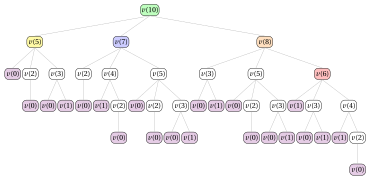

# PD per il problema del cambio monete

**Parte 3 · Programmazione dinamica · Capitolo 27** · [:material-file-pdf-box: Dispensa, volume 3 (PDF)](../pdf/dispensa-3-programmazione-dinamica.pdf) · [:material-pencil: Esercizi: Cambio monete (CCP)](../esercizi/dp-coin-change.md)

!!! nota "Prerequisiti"

    - Da questo modulo, il capitolo [«PD per il problema dello zaino illimitato»](dp-unbounded-knapsack/index.md): disponibilità illimitata di ogni tipo di oggetto e ricostruzione di una soluzione.

    - Da questo modulo, il capitolo [«Principi della programmazione dinamica»](dp-principles.md): sottostruttura ottima, sottoproblemi sovrapposti, casi base.

    - Dal modulo <em>Algoritmi</em>: [convenzioni dello pseudocodice (Capitolo 2)](https://fabiofurini.github.io/algoritmi/algoritmi-di-base/02-pseudocodice/) e [la dimensione dell'input (Capitolo 11)](https://fabiofurini.github.io/algoritmi/analisi/11-dimensione-input/).

!!! chiave "Obiettivi"

    Alla fine di questo capitolo saremo in grado di:

    - spiegare perché il CCP chiede un importo esatto e perché un'istanza può essere inammissibile;

    - scrivere la ricorrenza $v(k)$ con il valore $+\infty$ per gli importi che non si possono restituire;

    - eseguire a mano l'algoritmo di PD, seguendo i confronti con il miglior valore corrente $m$;

    - ricostruire una soluzione ottima come vettore $(x_1,\dots,x_n)$ quando l'istanza è ammissibile;

    - contare i passi dell'algoritmo di PD.

Il problema di questo capitolo è il [problema del resto (CCP)](../catalogo/coin-change-problem.md): la sua definizione è nella sua pagina.

## 27.1 Istanze e soluzioni ammissibili

!!! esempio "Esempio 27.1: Istanza del CCP"

    Consideriamo un resto $c=10$ da restituire e $n=3$ tagli di moneta:

    $$
    w = (2,3,5).
    $$

    Chiamiamo questa istanza del CCP [Esempio 27.1](#box-1-texccpex1).

!!! chiave ""

    A differenza del problema dello zaino 0/1 (KP), dove il peso totale degli oggetti scelti non deve superare la capacità, il CCP richiede che il valore totale delle monete scelte sia <em>esattamente uguale</em> a $c$. Inoltre, poiché ogni taglio è disponibile in quantità illimitata, il numero di monete di un dato taglio usate in una soluzione non è limitato a priori.

### 27.1.1 Codifica delle soluzioni ammissibili

!!! chiave ""

    Una <em>soluzione ammissibile</em> del CCP è una scelta del numero di monete di ogni taglio il cui valore totale sia esattamente uguale al resto $c$.

- Una soluzione ammissibile del CCP si può descrivere con il vettore intero

    $$
    (x_1,x_2,\dots,x_n)
    $$

    dove ogni componente ha il seguente significato:

    $$
    x_j = \text{numero di monete del taglio } j \text{ usate}, \qquad \forall j \in \{1,2,\dots,n\}, \quad x_j \in \Z_{\ge 0}.
    $$

    Poiché la soluzione è ammissibile, il valore totale delle monete scelte deve essere esattamente uguale a $c$:

    $$
    \sum_{j=1}^{n} w_j x_j = c.
    $$

    Il numero totale di monete di una soluzione ammissibile è

    $$
    \sum_{j=1}^{n} x_j.
    $$

- Poiché $\sum_{j=1}^{n} w_j x_j = c$, ogni componente $x_j$ di una soluzione ammissibile soddisfa $x_j \le \lfloor c/w_j \rfloor$. Quindi il numero di soluzioni ammissibili è finito, ma cresce rapidamente con $c$ e $n$, ed enumerarle tutte per trovare quella con meno monete diventa presto impraticabile.

## 27.2 Un algoritmo di PD

- <u>Passo 1</u>: calcolo del valore ottimo

    !!! formula ""

        Per ogni $k \in \{0,1,\dots,c\}$, sia $v(k)$ il valore ottimo della sottoistanza del CCP data da:

        1. un resto intero $k$ da restituire,

        2. lo stesso insieme $\{1,2,\dots,n\}$ di tagli, ciascuno disponibile in quantità illimitata.

        La formula ricorsiva per calcolare $v(k)$ è la seguente:

        \begin{equation*}
        \label{eq:ccp}
        v(k)= \left\{ \begin{array}{ll}
        0                                                                 & \textrm{se $k=0$,}                                              \\[2ex]
        +\infty                                                          & \textrm{se $k\ge 1$ e $w_j>k$ per ogni $j\in\{1,2,\dots,n\}$,} \\[2ex]
        \displaystyle \min_{j \,:\, w_j \,\le\, k} \big\{ 1 + v(k-w_j) \big\} & \textrm{se $k\ge 1$ e $w_j\le k$ per qualche $j\in\{1,2,\dots,n\}$.}
        \end{array} \right. \tag{27.1}
        \end{equation*}

    - Il processo di decomposizione ricorsiva della formula $\eqref{eq:ccp}$ genera al più $n$ <strong>sottoproblemi indipendenti</strong>, corrispondenti alle possibili scelte di un taglio $j$, con $w_j\le k$, usato come una delle monete che restituiscono il resto $k$.

    - Il caso base è $v(0)=0$, perché per restituire un resto nullo non serve alcuna moneta, e $v(k)=+\infty$ se nessun taglio è abbastanza piccolo da essere usato, perché in questo caso il resto $k$ non si può restituire affatto.

    - Il valore ottimo $v(k)$ si ottiene provando ogni taglio $j$ con $w_j\le k$ e scegliendo quello che minimizza la somma $1+v(k-w_j)$ della singola moneta del taglio $j$ e del valore ottimo del sottoproblema residuo, che restituisce il resto rimanente $k-w_j$.

    - Quindi una soluzione ottima per la sottoistanza con resto $k$ si costruisce combinando la moneta scelta, del taglio $j$, con una soluzione ottima del sottoproblema residuo corrispondente, che restituisce il resto $k-w_j$.

        $\rightsquigarrow$ <strong>Sottostruttura ottima verificata!</strong>

    - Scelte diverse del taglio usato come prima moneta, eventualmente fatte per valori diversi di $k$, possono portare allo stesso resto residuo; quindi lo stesso valore $v(k)$ può dover essere calcolato più volte durante la valutazione ricorsiva della formula $\eqref{eq:ccp}$.

        $\rightsquigarrow$ <strong>Sottoproblemi sovrapposti verificati!</strong>

    - Un <strong>primo metodo</strong> per calcolare il valore ottimo $v(c)$ dell'istanza del CCP è l'<strong>approccio top-down</strong>. Il metodo parte dalla chiamata con $k=c$ e valuta ricorsivamente la formula $\eqref{eq:ccp}$: ogni chiamata prova ogni taglio $j$ con $w_j\le k$, finché il resto vale $0$ o nessun taglio è abbastanza piccolo da essere usato.

    - L'<strong>albero di ricorsione</strong> della funzione $v$ ha un nodo per ogni chiamata ricorsiva, etichettato con la chiamata che rappresenta. La radice rappresenta la chiamata iniziale. I figli di un nodo rappresentano le chiamate ricorsive fatte da quella chiamata. Le foglie rappresentano i casi base.

        

        !!! esempio "Esempio 27.2: Albero di ricorsione"

            Consideriamo l'istanza del CCP dell'[Esempio 27.1](#box-1-texccpex1). Questo è l'albero di ricorsione dell'approccio top-down per calcolare $v(10)$:

            { .fig loading=lazy  }

            La funzione $v$ viene chiamata $42$ volte, e gli stessi sottoproblemi vengono risolti più volte: $v(0)$ viene chiamata $14$ volte, $v(1)$ $8$ volte, $v(2)$ $6$ volte, $v(3)$ $5$ volte, $v(4)$ $2$ volte e $v(5)$ $3$ volte. Tutte le altre chiamate vengono fatte una sola volta.

    - Il valore $v(k)$ si può calcolare una volta noti i valori $v(k')$ per ogni resto minore $k'<k$. Quindi tutti i valori $v(k)$ si possono calcolare considerando il resto $k$ in ordine crescente.

        

        !!! esempio "Esempio 27.3: Calcolo dei valori della funzione $v$"

            Consideriamo l'istanza del CCP dell'[Esempio 27.1](#box-1-texccpex1), con resto $c=10$ da restituire e tagli $w=(2,3,5)$.

            I valori della funzione $v$ si calcolano come segue:

            - Il caso base dà $v(0)=0$.

            - Calcolato $v(0)$, possiamo calcolare $v(1)$: poiché nessun taglio soddisfa $w_j\le 1$, otteniamo

                $$
                v(1) = +\infty.
                $$

            - Calcolato $v(0)$, possiamo calcolare $v(2)$:

                $$
                v(2) = 1+v(0) = 1+0 = 1.
                $$

            - Calcolati $v(0)$ e $v(1)$, possiamo calcolare $v(3)$:

                $$
                v(3) = \min\{1+v(1),\,1+v(0)\} = \min\{1+\infty,\,1+0\} = 1.
                $$

            - Calcolati $v(1)$ e $v(2)$, possiamo calcolare $v(4)$, provando ogni taglio $j$ con $w_j\le 4$:

                $$
                v(4) = \min\{1+v(2),\,1+v(1)\} = \min\{1+1,\,1+\infty\} = 2.
                $$

            - Calcolati $v(0)$, $v(2)$ e $v(3)$, possiamo calcolare $v(5)$:

                $$
                v(5) = \min\{1+v(3),\,1+v(2),\,1+v(0)\} = \min\{1+1,\,1+1,\,1+0\} = 1.
                $$

            - Calcolati $v(1)$, $v(3)$ e $v(4)$, possiamo calcolare $v(6)$:

                $$
                v(6) = \min\{1+v(4),\,1+v(3),\,1+v(1)\} = \min\{1+2,\,1+1,\,1+\infty\} = 2.
                $$

            - Calcolati $v(2)$, $v(4)$ e $v(5)$, possiamo calcolare $v(7)$, provando ogni taglio $j$ con $w_j\le 7$:

                $$
                v(7) = \min\{1+v(5),\,1+v(4),\,1+v(2)\} = \min\{1+1,\,1+2,\,1+1\} = 2.
                $$

                Qui i tagli $w_1=2$ e $w_3=5$ sono in pareggio: entrambi danno valore $2$. Poiché l'algoritmo bottom-up aggiorna il valore ottimo solo quando trova un valore strettamente minore, viene registrato il primo taglio che raggiunge il minimo, $w_1=2$.

            - Calcolati $v(3)$, $v(5)$ e $v(6)$, possiamo calcolare $v(8)$:

                $$
                v(8) = \min\{1+v(6),\,1+v(5),\,1+v(3)\} = \min\{1+2,\,1+1,\,1+1\} = 2.
                $$

            - Infine, calcolati $v(5)$, $v(7)$ e $v(8)$, possiamo calcolare $v(10)$, provando ogni taglio $j$ con $w_j\le 10$:

                $$
                v(10) = \min\{1+v(8),\,1+v(7),\,1+v(5)\} = \min\{1+2,\,1+2,\,1+1\} = 2.
                $$

    - Possiamo evitare di risolvere ripetutamente gli stessi sottoproblemi memorizzando il valore di ogni sottoproblema appena calcolato. I valori si memorizzano in una <strong>tabella di lookup</strong>.

    - Poiché la soluzione di ogni sottoproblema dipende solo dai sottoproblemi con un resto minore, possiamo risolvere i sottoproblemi in ordine crescente di $k$, partendo dal caso base $v(0)=0$ fino ad arrivare a $v(c)$.

    - Questa osservazione porta in modo naturale a un <strong>metodo molto più efficiente</strong> per calcolare il valore ottimo $v(c)$ dell'istanza del CCP.

    - Un <strong>secondo metodo</strong> per calcolare il valore ottimo $v(c)$ dell'istanza del CCP è l'<strong>approccio bottom-up</strong>. Il metodo parte dal caso base e valuta la formula $\eqref{eq:ccp}$ per valori crescenti di $k \in \{1,2,\dots,c\}$: ogni valore $v(k)$ si calcola con valori già calcolati, fino a ottenere il valore $v(c)$ dell'istanza del CCP.

        Questo è lo pseudocodice dell'<strong>algoritmo di PD con l'approccio bottom-up</strong>:

        !!! algoritmo "Algoritmo: CCP\_DP"

            

<strong>Input:</strong> Un'istanza del CCP data da \(n\), dall'array \(w[1..n]\) dei tagli e dal resto \(c\)

<strong>Output:</strong> Il valore ottimo

1<strong>Function</strong> CCP_DP(\(n,w,c\))

2\(v := \textnormal{new array}[0..c]\)

3\(v[0] \leftarrow 0\)

4<strong>for</strong> \(k := 1\) <strong>to</strong> \(c\)  <strong>do</strong>

5\(m := +\infty\)

6<strong>for</strong> \(j := 1\) <strong>to</strong> \(n\)  <strong>do</strong>

7<strong>if</strong> \(w[j]\le k\)  e \(1+v[k-w[j]] < m\)  <strong>then</strong>

8\(m \leftarrow 1+v[k-w[j]]\)

9<strong>end</strong>

10<strong>end</strong>

11\(v[k] \leftarrow m\)

12<strong>end</strong>

13<strong>return</strong> \(v[c]\)

        - L'array $v[0..c]$ è la <strong>tabella di lookup</strong>: memorizza i valori ottimi di tutti i sottoproblemi.

        - L'istruzione $v[0] \leftarrow 0$ inizializza il caso base, corrispondente a un resto nullo.

        - Il ciclo esterno, su $k \in \{1,2,\dots,c\}$, calcola le componenti dell'array in ordine crescente di resto.

        - Il ciclo interno, su $j \in \{1,2,\dots,n\}$, prova ogni taglio e tiene in $m$ il valore minimo trovato finora; $m$ è inizializzato a $+\infty$, così $v[k]$ resta $+\infty$ se non si trova alcun taglio $j$ con $w[j]\le k$.

        - Alla fine del ciclo interno, $v[k] \leftarrow m$ memorizza il valore ottimo $v[k]$.

        - Infine, l'algoritmo restituisce il valore ottimo dell'istanza del CCP, $v[c]$.

        

        !!! esempio "Esempio 27.4: Esecuzione dell'algoritmo di PD"

            Consideriamo l'istanza del CCP dell'[Esempio 27.1](#box-1-texccpex1), con resto $c=10$ da restituire e tagli $w=(2,3,5)$.

            Per ogni passo dell'algoritmo di PD, la tabella riporta i valori di $k$ e $j$, la cella $v[k]$, il valore corrente di $m$ e il confronto eseguito. La cella di $m$ è evidenziata in <mark>rosso</mark> quando viene aggiornata; la cella di $v[k]$ è evidenziata in <mark>blu</mark> quando viene assegnata.

            
<table>
            <tr>
            <th>\(k\)</th>
            <th>\(j\)</th>
            <th>\(v[k]\)</th>
            <th>\(m\)</th>
            <th>Azione</th>
            </tr>
            <tr>
            <td>\(-\)</td>
            <td>\(-\)</td>
            <td class="cella-blu">0</td>
            <td>\(-\)</td>
            <td>\(v[0]\leftarrow 0\)</td>
            </tr>
            <tr>
            <td></td>
            <td>\(-\)</td>
            <td>\(-\)</td>
            <td>\(+\infty\)</td>
            <td>\(m := +\infty\)</td>
            </tr>
            <tr>
            <td>1</td>
            <td>1</td>
            <td>\(-\)</td>
            <td>\(+\infty\)</td>
            <td>\(w[1]=2>1\): si salta</td>
            </tr>
            <tr>
            <td></td>
            <td>2</td>
            <td>\(-\)</td>
            <td>\(+\infty\)</td>
            <td>\(w[2]=3>1\): si salta</td>
            </tr>
            <tr>
            <td></td>
            <td>3</td>
            <td>\(-\)</td>
            <td>\(+\infty\)</td>
            <td>\(w[3]=5>1\): si salta</td>
            </tr>
            <tr>
            <td></td>
            <td>\(-\)</td>
            <td class="cella-blu">\(+\infty\)</td>
            <td>\(+\infty\)</td>
            <td>\(v[1]\leftarrow m=+\infty\)</td>
            </tr>
            <tr>
            <td></td>
            <td>\(-\)</td>
            <td>\(-\)</td>
            <td>\(+\infty\)</td>
            <td>\(m := +\infty\)</td>
            </tr>
            <tr>
            <td>2</td>
            <td>1</td>
            <td>\(-\)</td>
            <td class="cella-rossa">\(1\)</td>
            <td>\(1{+}v[0]=1<m\): \(m\leftarrow 1\)</td>
            </tr>
            <tr>
            <td></td>
            <td>2</td>
            <td>\(-\)</td>
            <td>\(1\)</td>
            <td>\(w[2]=3>2\): si salta</td>
            </tr>
            <tr>
            <td></td>
            <td>3</td>
            <td>\(-\)</td>
            <td>\(1\)</td>
            <td>\(w[3]=5>2\): si salta</td>
            </tr>
            <tr>
            <td></td>
            <td>\(-\)</td>
            <td class="cella-blu">\(1\)</td>
            <td>\(1\)</td>
            <td>\(v[2]\leftarrow m=1\)</td>
            </tr>
            <tr>
            <td></td>
            <td>\(-\)</td>
            <td>\(-\)</td>
            <td>\(+\infty\)</td>
            <td>\(m := +\infty\)</td>
            </tr>
            <tr>
            <td>3</td>
            <td>1</td>
            <td>\(-\)</td>
            <td>\(+\infty\)</td>
            <td>\(1{+}v[1]=+\infty\not<m=+\infty\): nessun aggiornamento</td>
            </tr>
            <tr>
            <td></td>
            <td>2</td>
            <td>\(-\)</td>
            <td class="cella-rossa">\(1\)</td>
            <td>\(1{+}v[0]=1<m\): \(m\leftarrow 1\)</td>
            </tr>
            <tr>
            <td></td>
            <td>3</td>
            <td>\(-\)</td>
            <td>\(1\)</td>
            <td>\(w[3]=5>3\): si salta</td>
            </tr>
            <tr>
            <td></td>
            <td>\(-\)</td>
            <td class="cella-blu">\(1\)</td>
            <td>\(1\)</td>
            <td>\(v[3]\leftarrow m=1\)</td>
            </tr>
            <tr>
            <td></td>
            <td>\(-\)</td>
            <td>\(-\)</td>
            <td>\(+\infty\)</td>
            <td>\(m := +\infty\)</td>
            </tr>
            <tr>
            <td>4</td>
            <td>1</td>
            <td>\(-\)</td>
            <td class="cella-rossa">\(2\)</td>
            <td>\(1{+}v[2]=2<m\): \(m\leftarrow 2\)</td>
            </tr>
            <tr>
            <td></td>
            <td>2</td>
            <td>\(-\)</td>
            <td>\(2\)</td>
            <td>\(1{+}v[1]=+\infty\not<m=2\): nessun aggiornamento</td>
            </tr>
            <tr>
            <td></td>
            <td>3</td>
            <td>\(-\)</td>
            <td>\(2\)</td>
            <td>\(w[3]=5>4\): si salta</td>
            </tr>
            <tr>
            <td></td>
            <td>\(-\)</td>
            <td class="cella-blu">\(2\)</td>
            <td>\(2\)</td>
            <td>\(v[4]\leftarrow m=2\)</td>
            </tr>
            <tr>
            <td></td>
            <td>\(-\)</td>
            <td>\(-\)</td>
            <td>\(+\infty\)</td>
            <td>\(m := +\infty\)</td>
            </tr>
            <tr>
            <td>5</td>
            <td>1</td>
            <td>\(-\)</td>
            <td class="cella-rossa">\(2\)</td>
            <td>\(1{+}v[3]=2<m\): \(m\leftarrow 2\)</td>
            </tr>
            <tr>
            <td></td>
            <td>2</td>
            <td>\(-\)</td>
            <td>\(2\)</td>
            <td>\(1{+}v[2]=2\not<m=2\): nessun aggiornamento</td>
            </tr>
            <tr>
            <td></td>
            <td>3</td>
            <td>\(-\)</td>
            <td class="cella-rossa">\(1\)</td>
            <td>\(1{+}v[0]=1<m\): \(m\leftarrow 1\)</td>
            </tr>
            <tr>
            <td></td>
            <td>\(-\)</td>
            <td class="cella-blu">\(1\)</td>
            <td>\(1\)</td>
            <td>\(v[5]\leftarrow m=1\)</td>
            </tr>
            <tr>
            <td></td>
            <td>\(-\)</td>
            <td>\(-\)</td>
            <td>\(+\infty\)</td>
            <td>\(m := +\infty\)</td>
            </tr>
            <tr>
            <td>6</td>
            <td>1</td>
            <td>\(-\)</td>
            <td class="cella-rossa">\(3\)</td>
            <td>\(1{+}v[4]=3<m\): \(m\leftarrow 3\)</td>
            </tr>
            <tr>
            <td></td>
            <td>2</td>
            <td>\(-\)</td>
            <td class="cella-rossa">\(2\)</td>
            <td>\(1{+}v[3]=2<m\): \(m\leftarrow 2\)</td>
            </tr>
            <tr>
            <td></td>
            <td>3</td>
            <td>\(-\)</td>
            <td>\(2\)</td>
            <td>\(1{+}v[1]=+\infty\not<m=2\): nessun aggiornamento</td>
            </tr>
            <tr>
            <td></td>
            <td>\(-\)</td>
            <td class="cella-blu">\(2\)</td>
            <td>\(2\)</td>
            <td>\(v[6]\leftarrow m=2\)</td>
            </tr>
            <tr>
            <td></td>
            <td>\(-\)</td>
            <td>\(-\)</td>
            <td>\(+\infty\)</td>
            <td>\(m := +\infty\)</td>
            </tr>
            <tr>
            <td>7</td>
            <td>1</td>
            <td>\(-\)</td>
            <td class="cella-rossa">\(2\)</td>
            <td>\(1{+}v[5]=2<m\): \(m\leftarrow 2\)</td>
            </tr>
            <tr>
            <td></td>
            <td>2</td>
            <td>\(-\)</td>
            <td>\(2\)</td>
            <td>\(1{+}v[4]=3\not<m=2\): nessun aggiornamento</td>
            </tr>
            <tr>
            <td></td>
            <td>3</td>
            <td>\(-\)</td>
            <td>\(2\)</td>
            <td>\(1{+}v[2]=2\not<m=2\): nessun aggiornamento</td>
            </tr>
            <tr>
            <td></td>
            <td>\(-\)</td>
            <td class="cella-blu">\(2\)</td>
            <td>\(2\)</td>
            <td>\(v[7]\leftarrow m=2\)</td>
            </tr>
            <tr>
            <td></td>
            <td>\(-\)</td>
            <td>\(-\)</td>
            <td>\(+\infty\)</td>
            <td>\(m := +\infty\)</td>
            </tr>
            <tr>
            <td>8</td>
            <td>1</td>
            <td>\(-\)</td>
            <td class="cella-rossa">\(3\)</td>
            <td>\(1{+}v[6]=3<m\): \(m\leftarrow 3\)</td>
            </tr>
            <tr>
            <td></td>
            <td>2</td>
            <td>\(-\)</td>
            <td class="cella-rossa">\(2\)</td>
            <td>\(1{+}v[5]=2<m\): \(m\leftarrow 2\)</td>
            </tr>
            <tr>
            <td></td>
            <td>3</td>
            <td>\(-\)</td>
            <td>\(2\)</td>
            <td>\(1{+}v[3]=2\not<m=2\): nessun aggiornamento</td>
            </tr>
            <tr>
            <td></td>
            <td>\(-\)</td>
            <td class="cella-blu">\(2\)</td>
            <td>\(2\)</td>
            <td>\(v[8]\leftarrow m=2\)</td>
            </tr>
            <tr>
            <td></td>
            <td>\(-\)</td>
            <td>\(-\)</td>
            <td>\(+\infty\)</td>
            <td>\(m := +\infty\)</td>
            </tr>
            <tr>
            <td>9</td>
            <td>1</td>
            <td>\(-\)</td>
            <td class="cella-rossa">\(3\)</td>
            <td>\(1{+}v[7]=3<m\): \(m\leftarrow 3\)</td>
            </tr>
            <tr>
            <td></td>
            <td>2</td>
            <td>\(-\)</td>
            <td>\(3\)</td>
            <td>\(1{+}v[6]=3\not<m=3\): nessun aggiornamento</td>
            </tr>
            <tr>
            <td></td>
            <td>3</td>
            <td>\(-\)</td>
            <td>\(3\)</td>
            <td>\(1{+}v[4]=3\not<m=3\): nessun aggiornamento</td>
            </tr>
            <tr>
            <td></td>
            <td>\(-\)</td>
            <td class="cella-blu">\(3\)</td>
            <td>\(3\)</td>
            <td>\(v[9]\leftarrow m=3\)</td>
            </tr>
            <tr>
            <td></td>
            <td>\(-\)</td>
            <td>\(-\)</td>
            <td>\(+\infty\)</td>
            <td>\(m := +\infty\)</td>
            </tr>
            <tr>
            <td>10</td>
            <td>1</td>
            <td>\(-\)</td>
            <td class="cella-rossa">\(3\)</td>
            <td>\(1{+}v[8]=3<m\): \(m\leftarrow 3\)</td>
            </tr>
            <tr>
            <td></td>
            <td>2</td>
            <td>\(-\)</td>
            <td>\(3\)</td>
            <td>\(1{+}v[7]=3\not<m=3\): nessun aggiornamento</td>
            </tr>
            <tr>
            <td></td>
            <td>3</td>
            <td>\(-\)</td>
            <td class="cella-rossa">\(2\)</td>
            <td>\(1{+}v[5]=2<m\): \(m\leftarrow 2\)</td>
            </tr>
            <tr>
            <td></td>
            <td>\(-\)</td>
            <td class="cella-blu">\(2\)</td>
            <td>\(2\)</td>
            <td>\(v[10]\leftarrow m=2\)</td>
            </tr>
            </table>

            Questo è l'array $v$ dopo l'esecuzione dell'algoritmo di PD:

            $$
            \begin{array}{l|rrrrrrrrrrr}
            \hline {k} & 0 & 1 & 2 & 3 & 4 & 5 & 6 & 7 & 8 & 9 & 10 \\
            \hline {v[k]} & 0 & {+\infty} & 1 & 1 & 2 & 1 & 2 & 2 & 2 & 3 & 2 \\
            \hline
            \end{array}
            $$

    - Dopo l'esecuzione dell'algoritmo di PD, l'array $v$ contiene il valore ottimo $v[k]$ per ogni resto $k \in \{0,1,\dots,c\}$, dove $v[c]$ è il numero minimo di monete necessarie per restituire il resto $c$.

- <u>Passo 2</u>: calcolo di una soluzione ottima

    - Per calcolare una soluzione ottima, cioè il vettore intero $(x_1,x_2,\dots,x_n)$, è necessario memorizzare alcune informazioni aggiuntive.

    - Per ogni resto $k$, oltre al valore ottimo $v[k]$, memorizziamo $s[k]$, l'indice del taglio della moneta usata per ottenere il valore ottimo $v[k]$ nella formula $\eqref{eq:ccp}$.

    - Più precisamente, $s[k]$ è uguale all'indice $j$ del taglio $w_j$ che minimizza il membro destro della formula $\eqref{eq:ccp}$ nel calcolo di $v[k]$.

        Questo è lo pseudocodice dell'<strong>algoritmo di PD con l'approccio bottom-up</strong>, con la memorizzazione delle informazioni necessarie per costruire una soluzione ottima:

        !!! algoritmo "Algoritmo: CCP\_DP\_InfoSol"

            

<strong>Input:</strong> Un'istanza del CCP data da \(n\), dall'array \(w[1..n]\) dei tagli e dal resto \(c\)

<strong>Output:</strong> Il valore ottimo e l'array \(s[0..c]\) degli indici dei tagli usati

1<strong>Function</strong> CCP_DP_InfoSol(\(n,w,c\))

2\(v := \textnormal{new array}[0..c]\); \(s := \textnormal{new array}[0..c]\)

3\(v[0] \leftarrow 0\); \(s[0] \leftarrow 0\)

4<strong>for</strong> \(k := 1\) <strong>to</strong> \(c\) <strong>do</strong>

5\(m := +\infty\); \(t := 0\)

6<strong>for</strong> \(j := 1\) <strong>to</strong> \(n\) <strong>do</strong>

7<strong>if</strong> \(w[j]\le k\)  e \(1+v[k-w[j]] < m\) <strong>then</strong>

8\(m \leftarrow 1+v[k-w[j]]\); \(t \leftarrow j\)

9<strong>end</strong>

10<strong>end</strong>

11\(v[k] \leftarrow m\); \(s[k] \leftarrow t\)

12<strong>end</strong>

13<strong>return</strong> \(v[c], s\)

        - L'algoritmo di PD usa la variabile temporanea aggiuntiva $t$ per tenere traccia della decisione presa quando $m$ viene aggiornato. Se si usa il taglio $w[j]$, $t \leftarrow j$ ne memorizza l'indice. Alla fine del ciclo interno, $s[k]\leftarrow t$ memorizza l'indice del taglio della moneta usata, insieme al valore ottimo $v[k]\leftarrow m$.

        

        !!! esempio "Esempio 27.5: Calcolo delle informazioni aggiuntive"

            Consideriamo l'istanza del CCP dell'[Esempio 27.1](#box-1-texccpex1), con resto $c=10$ da restituire e tagli $w=(2,3,5)$.

            Questo è l'array $s$ dopo l'esecuzione dell'algoritmo di PD:

            $$
            \begin{array}{l|rrrrrrrrrrr}
            \hline {k} & 0 & 1 & 2 & 3 & 4 & 5 & 6 & 7 & 8 & 9 & 10 \\
            \hline {s[k]} & 0 & 0 & 1 & 2 & 1 & 3 & 2 & 1 & 2 & 1 & 3 \\
            \hline
            \end{array}
            $$

            Per esempio, $s[5]=3$ perché la formula $\eqref{eq:ccp}$ sceglie il taglio $w_3=5$ nel calcolo di $v[5]=1$, e $s[10]=3$ perché il taglio $w_3=5$ viene scelto anche nel calcolo di $v[10]=2$. La componente $s[1]$ resta indefinita ($0$, per convenzione), perché $v[1]=+\infty$ è inammissibile.

    - Calcolato l'array $s$, e purché $v[c]<+\infty$, si può ricostruire una soluzione ottima usando ripetutamente una moneta del taglio $s[k]$ e passando al resto residuo $k-w_{s[k]}$, partendo da $k=c$ e da $x_j=0$ per ogni $j \in \{1,2,\dots,n\}$, finché $k=0$:

        $$
        x_{s[k]} \leftarrow x_{s[k]}+1, \qquad k \leftarrow k - w_{s[k]}.
        $$

        Si ottiene così il vettore $(x_1,x_2,\dots,x_n)$, dove ogni componente $x_j$ è il numero di monete del taglio $j$ in una soluzione ottima.

    - La condizione $v[c]<+\infty$ è necessaria: se $v[c]=+\infty$ l'istanza è inammissibile, $s[c]=0$ e non c'è alcuna soluzione da ricostruire. Se $v[c]<+\infty$, allora $s[k]\ge 1$ per ogni resto $k$ visitato dalla procedura.

        !!! algoritmo "Algoritmo: CCP\_Reconstruct"

            

<strong>Input:</strong> Il numero \(n\) di tagli, l'array \(w[1..n]\), il resto \(c\) con \(v[c]<+\infty\) e l'array \(s[0..c]\)

<strong>Output:</strong> Una soluzione ottima

1<strong>Function</strong> CCP_Reconstruct(\(n,w,c,s\))

2\(x := \textnormal{new array}[1..n]\)

3<strong>for</strong> \(j := 1\) <strong>to</strong> \(n\) <strong>do</strong>

4\(x[j] \leftarrow 0\)

5<strong>end</strong>

6\(k := c\)

7<strong>while</strong> \(k>0\) <strong>do</strong>

8\(x[s[k]] \leftarrow x[s[k]]+1\)

9\(k \leftarrow k-w[s[k]]\)

10<strong>end</strong>

11<strong>return</strong> \(x\)

        

        !!! esempio "Esempio 27.6: Calcolo di una soluzione ottima"

            Dopo l'esecuzione dell'algoritmo di PD sull'istanza dell'[Esempio 27.1](#box-1-texccpex1), abbiamo il seguente array $s$:

            $$
            \begin{array}{l|rrrrrrrrrrr}
            \hline {k} & 0 & 1 & 2 & 3 & 4 & 5 & 6 & 7 & 8 & 9 & 10 \\
            \hline {s[k]} & 0 & 0 & 1 & 2 & 1 & 3 & 2 & 1 & 2 & 1 & 3 \\
            \hline
            \end{array}
            $$

            Possiamo ricostruire una soluzione ottima partendo da $k=10$ come segue:

            
<table>
            <tr>
            <th>Iterazione</th>
            <th>\(k\)</th>
            <th>\(s[k]\)</th>
            <th>\(x[1]\)</th>
            <th>\(x[2]\)</th>
            <th>\(x[3]\)</th>
            <th>\(k \leftarrow k-w_{s[k]}\)</th>
            </tr>
            <tr>
            <td>\(-\)</td>
            <td>\(-\)</td>
            <td>\(-\)</td>
            <td>0</td>
            <td>0</td>
            <td>0</td>
            <td>\(k=10\)</td>
            </tr>
            <tr>
            <td>\(1\)</td>
            <td>\(10\)</td>
            <td>\(3\)</td>
            <td>0</td>
            <td>0</td>
            <td class="cella-blu">1</td>
            <td>\(k=10-5=5\)</td>
            </tr>
            <tr>
            <td>\(2\)</td>
            <td>\(5\)</td>
            <td>\(3\)</td>
            <td>0</td>
            <td>0</td>
            <td class="cella-blu">2</td>
            <td>\(k=5-5=0\)</td>
            </tr>
            </table>

            Quindi il vettore

            $$
            (0,0,2)
            $$

            è una soluzione ottima: usa due monete del taglio $w_3=5$. Il valore totale corrispondente è $2\cdot5=10=c$. Il valore ottimo corrispondente è $v(10)=2$.

### 27.2.1 Numero di passi

- Sia $S(n,c)$ il numero di passi eseguiti da <code>CCP\_DP</code> nel caso peggiore, dove $n$ è il numero di tagli e $c$ è il resto. Calcoliamo $S(n,c)$ contando quante volte vengono eseguite le righe dello pseudocodice di <code>CCP\_DP</code>.

- Nel caso peggiore, la condizione alla riga [7](#box-9-ccpbu-f) è vera a ogni iterazione del ciclo interno, e quindi la riga [8](#box-10-ccpbu-g) viene eseguita tante volte quanto la riga [7](#box-9-ccpbu-f). Il numero di esecuzioni delle righe rilevanti è:

    - Riga [2](#box-4-ccpbu-a) viene eseguita $1$ volta.

    - Riga [3](#box-5-ccpbu-b) viene eseguita $1$ volta.

    - Riga [4](#box-6-ccpbu-c) viene eseguita $c$ volte.

    - Riga [5](#box-7-ccpbu-d) viene eseguita $c$ volte.

    - Riga [6](#box-8-ccpbu-e) viene eseguita $cn$ volte.

    - Riga [7](#box-9-ccpbu-f) viene eseguita $cn$ volte.

    - Riga [8](#box-10-ccpbu-g) viene eseguita $cn$ volte.

    - Riga [11](#box-11-ccpbu-h) viene eseguita $c$ volte.

    - Riga [13](#box-12-ccpbu-i) viene eseguita $1$ volta.

    Quindi il numero totale di passi nel caso peggiore è

    $$
    1+1+c+c+cn+cn+cn+c+1.
    $$

    Quindi

    $$
    S(n,c)=3+3c+3cn.
    $$

    Quindi

    $$
    S(n,c)=\Theta(nc).
    $$

    Infatti,

    $$
    \lim_{n,c\to\infty}
    \frac{3cn+3c+3}{nc}
    =
    \lim_{n,c\to\infty}
    \left(3+\frac{3}{n}+\frac{3}{nc}\right)
    =
    3\in\mathbb{R}_{>0}.
    $$

    !!! chiave ""

        L'algoritmo di PD esegue

        $$
        S(n,c)=\Theta(nc)
        $$

        passi nel caso peggiore.

- La versione <code>CCP\_DP\_InfoSol</code> memorizza l'array aggiuntivo $s$ ed esegue solo un numero costante di operazioni in più dentro gli stessi cicli. Quindi il suo numero di passi resta $\Theta(nc)$.

## 27.3 Errori tipici

!!! attenzione "Attenzione"

    - <strong>Usare $0$ invece di $+\infty$.</strong> Un importo che non si può restituire ha $v(k)=+\infty$; con il valore $0$ l'algoritmo di PD affermerebbe che non serve alcuna moneta.

    - <strong>Ricostruire un'istanza inammissibile.</strong> Se $v[c]=+\infty$ allora $s[c]=0$, e la ricostruzione leggerebbe $x[0]$ e $w[0]$, fuori dagli array: bisogna prima controllare che $v[c]<+\infty$.

    - <strong>Memorizzare il valore della moneta invece del suo indice.</strong> Il vettore $x$ è indicizzato dai tagli: $s[k]$ memorizza l'indice $j$, e il valore della moneta è $w_{s[k]}$.

    - <strong>Confondere il CCP con l'UKP.</strong> Il CCP chiede esattamente $c$ e minimizza il numero di monete; l'UKP chiede al più $c$ e massimizza il profitto.

## 27.4 In sintesi

!!! chiave "In sintesi"

    - Il CCP chiede il numero minimo di monete il cui valore totale sia esattamente $c$; l'istanza è inammissibile quando $v(c)=+\infty$.

    - La ricorrenza $v(k)=\min_{j:\,w_j\le k}\{1+v(k-w_j)\}$ si calcola bottom-up in $\Theta(nc)$ passi, un numero pseudo-polinomiale.

    - Una soluzione ottima si legge a ritroso a partire da $s[c]$, l'indice del taglio della prima moneta scelta per l'importo $c$, e solo se $v[c]<+\infty$.

    <strong>Quadro riassuntivo dell'esempio del CCP.</strong> [Esempio 27.1](#box-1-texccpex1) ($c=10$, $w=(2,3,5)$):

    
<table>
    <tr>
    <th>Metodo</th>
    <th>Lower bound</th>
    <th>Upper bound</th>
    <th>Origine</th>
    </tr>
    <tr>
    <td>Algoritmo di PD</td>
    <td>\(2\)</td>
    <td>\(2\)</td>
    <td>numero minimo di monete, soluzione \((0,0,2)\)</td>
    </tr>
    </table>

---

**Esercizi su questo capitolo:** [:material-pencil: Cambio monete (CCP)](../esercizi/dp-coin-change.md)
