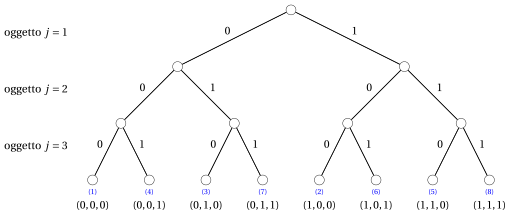
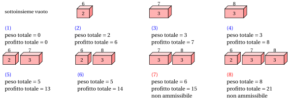

# PD per il problema dello zaino 0/1

**Parte 3 · Programmazione dinamica · Capitolo 17** · [:material-file-pdf-box: Dispensa, volume 3 (PDF)](../../pdf/dispensa-3-programmazione-dinamica.pdf) · [:material-pencil: Esercizi: Zaino 0/1 (KP)](../../esercizi/dp-knapsack.md) · [:material-gesture-tap: App: Tabelle della PD per i problemi di zaino](../../laboratorio/tabella-pd-zaino.md)

!!! nota "Prerequisiti"

    - Da questo modulo, il capitolo [«Principi della programmazione dinamica»](../dp-principles.md): sottostruttura ottima, sottoproblemi sovrapposti, relazioni di ricorrenza, casi base e approcci top-down e bottom-up.

    - Da questo modulo, il capitolo [«Problemi di zaino»](../../problemi-di-ottimizzazione-combinatoria/knapsack/index.md): il problema dello zaino 0/1 (KP), la codifica binaria di una soluzione e i $2^n$ sottoinsiemi di oggetti.

    - Dal modulo <em>Algoritmi</em>: come si legge lo [pseudocodice (Capitolo 2)](https://fabiofurini.github.io/algoritmi/algoritmi-di-base/02-pseudocodice/) e [la dimensione dell'input di un algoritmo (Capitolo 11)](https://fabiofurini.github.io/algoritmi/analisi/11-dimensione-input/) (serve a spiegare perché $\Theta(nc)$ è pseudopolinomiale).

!!! nota "Dove eravamo"

    - <strong>Come problema</strong>: il KP, le sue istanze e i $2^n$ sottoinsiemi (capitolo [«Problemi di zaino»](../../problemi-di-ottimizzazione-combinatoria/knapsack/index.md)).

    - <strong>Come modello</strong>: il modello PLI, il suo rilassamento lineare e i bound duali (capitolo [«Formulazioni dei problemi di zaino»](../../formulazioni/knapsack-formulations/index.md)).

    - <strong>Ora, come tabella</strong>: l'algoritmo di PD calcola esattamente il valore ottimo, senza modello e senza solver.

!!! chiave "Obiettivi"

    Al termine di questo capitolo saremo in grado di:

    - scrivere la ricorrenza $v(j,k)$ del KP, spiegare perché è corretta e calcolare a mano la tabella con l'approccio top-down, con l'approccio bottom-up e con un solo vettore;

    - ricostruire una soluzione ottima dalla matrice ${s}$ delle decisioni;

    - contare i passi dell'algoritmo di PD e spiegare perché $\Theta(nc)$ è pseudopolinomiale e non polinomiale;

    - descrivere gli stati $(w,p)$, scartare quelli dominati ed eseguire l'algoritmo di PD su liste di stati;

    - scambiare i ruoli di profitti e pesi e calcolare il valore ottimo dalla tabella $u(j,q)$.

Il problema di questo capitolo è il [problema dello zaino 0/1 (KP)](../../problemi-di-ottimizzazione-combinatoria/knapsack/il-problema-dello-zaino-0-1.md): la sua definizione e le sue ipotesi sono nella sua pagina.

## 17.1 Istanze e soluzioni ammissibili

!!! esempio "Esempio 17.1: Istanza del KP"

    Consideriamo uno zaino di capacità $c = 5$ e un insieme $\{1,2,3\}$ di $3$ oggetti ($n = 3$), con i seguenti profitti e pesi:

    $$
    \begin{array}{l|rrr}
    \hline  & {j = 1} & {j = 2} & {j = 3} \\
    \hline {p_j} & {6} & {7} & {8} \\
    {w_j} & {2} & {3} & {3} \\
    \hline
    \end{array}
    $$

    Chiamiamo questa istanza del KP [Esempio 17.1](#box-1-texexpbox1).

!!! chiave ""

    Il numero di possibili sottoinsiemi di oggetti è $2^n$ poiché, per ogni oggetto, possiamo scegliere in modo indipendente se inserirlo o no nello zaino. Alcuni sottoinsiemi possono non rispettare la capacità dello zaino. Di conseguenza, il numero di soluzioni ammissibili è al più $2^n$.

- Il numero di possibili soluzioni del KP cresce esponenzialmente con il numero $n$ di oggetti. Pertanto, l'enumerazione di tutte le possibili soluzioni diventa presto impraticabile al crescere di $n$.

### 17.1.1 Codifica delle soluzioni ammissibili

!!! chiave ""

    Una <em>soluzione ammissibile</em> del KP è un sottoinsieme di oggetti il cui peso totale non supera la capacità dello zaino.

- Una soluzione ammissibile del KP si può descrivere con il vettore binario

    $$
    (x_1,x_2,\dots,x_n)
    $$

    dove ogni componente ha il seguente significato:

    $$
    x_j =
    \left\{
    \begin{array}{ll}
    1 & \textrm{se l'oggetto } j \textrm{ è selezionato,}\\[1ex]
    0 & \textrm{altrimenti,}
    \end{array}
    \right.
    \qquad \forall j \in \{1,2,\dots,n\}.
    $$

    Poiché la soluzione è ammissibile, il peso totale degli oggetti selezionati non deve superare la capacità dello zaino:

    $$
    \sum_{j=1}^{n} w_j x_j \le c.
    $$

    Il profitto totale di una soluzione ammissibile è

    $$
    \sum_{j=1}^{n} p_j x_j.
    $$

!!! esempio "Esempio 17.2: Enumerazione di tutte le possibili soluzioni del KP"

    Consideriamo l'istanza del KP dell'[Esempio 17.1](#box-1-texexpbox1), con uno zaino di capacità $c=5$ e i seguenti profitti e pesi:

    $$
    \begin{array}{l|rrr}
    \hline  & {j = 1} & {j = 2} & {j = 3} \\
    \hline {p_j} & {6} & {7} & {8} \\
    {w_j} & {2} & {3} & {3} \\
    \hline
    \end{array}
    $$

    Ci sono $2^3 = 8$ possibili sottoinsiemi di oggetti, corrispondenti ai diversi modi di selezionare o non selezionare gli oggetti.

    Nel seguente albero binario ogni livello corrisponde a un oggetto: un arco con etichetta $1$ indica che l'oggetto è selezionato, mentre un arco con etichetta $0$ indica che non è selezionato. Ogni foglia rappresenta un sottoinsieme completo di oggetti e riporta il vettore corrispondente.

    { .fig .ovale loading=lazy style="width:95%" }

    La figura seguente mostra i sottoinsiemi associati alle foglie dell'albero, tramite le etichette $(1),(2),\ldots,(8)$. Per ogni oggetto selezionato, il numero scritto dentro il parallelepipedo è il suo peso, mentre il numero sopra è il suo profitto. La larghezza di ogni parallelepipedo è proporzionale al peso dell'oggetto. I sottoinsiemi il cui peso totale supera la capacità dello zaino sono indicati come non ammissibili.

    { .fig .ovale loading=lazy style="width:100%" }

    
<table>
    <tr>
    <th>Etichetta</th>
    <th>Vettore soluzione</th>
    <th>Peso totale</th>
    <th>Profitto totale</th>
    <th>Ammissibile?</th>
    </tr>
    <tr>
    <td>\((1)\)</td>
    <td>\((0,0,0)\)</td>
    <td>\(0\)</td>
    <td>\(0\)</td>
    <td>sì</td>
    </tr>
    <tr>
    <td>\((2)\)</td>
    <td>\((1,0,0)\)</td>
    <td>\(2\)</td>
    <td>\(6\)</td>
    <td>sì</td>
    </tr>
    <tr>
    <td>\((3)\)</td>
    <td>\((0,1,0)\)</td>
    <td>\(3\)</td>
    <td>\(7\)</td>
    <td>sì</td>
    </tr>
    <tr>
    <td>\((4)\)</td>
    <td>\((0,0,1)\)</td>
    <td>\(3\)</td>
    <td>\(8\)</td>
    <td>sì</td>
    </tr>
    <tr>
    <td>\((5)\)</td>
    <td>\((1,1,0)\)</td>
    <td>\(2+3=5\)</td>
    <td>\(6+7=13\)</td>
    <td>sì</td>
    </tr>
    <tr>
    <td>\((6)\)</td>
    <td>\((1,0,1)\)</td>
    <td>\(2+3=5\)</td>
    <td>\(6+8=14\)</td>
    <td>sì</td>
    </tr>
    <tr>
    <td>\((7)\)</td>
    <td>\((0,1,1)\)</td>
    <td>\(3+3=6\)</td>
    <td>\(7+8=15\)</td>
    <td>no</td>
    </tr>
    <tr>
    <td>\((8)\)</td>
    <td>\((1,1,1)\)</td>
    <td>\(2+3+3=8\)</td>
    <td>\(6+7+8=21\)</td>
    <td>no</td>
    </tr>
    </table>

-   **Panoramica**

    Istanze e soluzioni ammissibili · Codifica delle soluzioni ammissibili

    [:octicons-arrow-right-24: Apri](#171-istanze-e-soluzioni-ammissibili)

-   **17.2 Un primo algoritmo di PD**

    [:octicons-arrow-right-24: Apri](un-primo-algoritmo-di-pd.md)

-   **17.2.2 Un primo algoritmo di PD: Un'implementazione con liste**

    [:octicons-arrow-right-24: Apri](un-primo-algoritmo-di-pd-un-implementazione-con-liste.md)

-   **17.3 Un secondo algoritmo di PD**

    [:octicons-arrow-right-24: Apri](un-secondo-algoritmo-di-pd.md)

-   **17.3.2 Un secondo algoritmo di PD: Un'implementazione con liste**

    [:octicons-arrow-right-24: Apri](un-secondo-algoritmo-di-pd-un-implementazione-con-liste.md)

-   **Errori tipici · In sintesi**

    In sintesi

    [:octicons-arrow-right-24: Apri](errori-tipici.md)

---

**Avanti:** [17.2 Un primo algoritmo di PD](un-primo-algoritmo-di-pd.md)

---

**Esercizi su questo capitolo:** [:material-pencil: Zaino 0/1 (KP)](../../esercizi/dp-knapsack.md)

<!-- laboratorio-interattivo: sezione generata da interattivi.py -->

:material-flask-outline: **Nel laboratorio interattivo:** [Tabelle della PD per i problemi di zaino](../../laboratorio/tabella-pd-zaino.md).