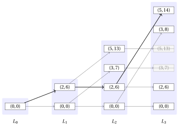

# 17.2.2 Un primo algoritmo di PD: Un'implementazione con liste { #1722-unimplementazione-con-liste }

**Parte 3 · Programmazione dinamica · Capitolo 17** · [:material-book-open-variant: Capitolo 17: Zaino 0/1 (KP)](index.md) · [:material-file-pdf-box: Dispensa, volume 3 (PDF)](../../pdf/dispensa-3-programmazione-dinamica.pdf) · [:material-pencil: Esercizi: Zaino 0/1 (KP)](../../esercizi/dp-knapsack.md) · [:material-gesture-tap: App: Tabelle della PD per i problemi di zaino](../../laboratorio/tabella-pd-zaino.md)

- <u>Passo 1</u>: calcolo del valore ottimo

    - L'algoritmo di PD di questa sezione memorizza un valore per ogni coppia formata da un oggetto e da un valore di capacità, cioè $(n+1)(c+1)$ valori in tutto. Ogni riga della matrice ${v}$ è non decrescente nel valore di capacità e cambia solo in pochi valori di capacità: tutte le altre celle ripetono il valore della cella alla loro sinistra.

    - Questa sottosezione descrive una <strong>diversa implementazione dello stesso algoritmo di PD</strong>. La decomposizione ricorsiva e la sottostruttura ottima sono quelle della formula $\eqref{eq:1}$: cambia la struttura dati.

    - Invece di un'intera riga della matrice, memorizziamo solo le coppie in cui la riga cambia, cioè solo le coppie ottenute effettivamente da un sottoinsieme di oggetti. Queste coppie sono tenute in una lista, una lista per ogni oggetto.

    !!! chiave ""

        Uno <strong>stato</strong> è una coppia $(w,p)$, dove $w$ è il peso totale e $p$ è il profitto totale di un sottoinsieme di oggetti il cui peso totale non supera la capacità $c$ dello zaino.

    - Il sottoinsieme vuoto dà lo stato $(0,0)$. Un sottoinsieme degli oggetti $\{1,2,\dots,j\}$ dà lo stato ottenuto sommando i pesi e i profitti dei suoi oggetti.

    - Due sottoinsiemi diversi possono dare lo stesso stato. In questo caso i due sottoinsiemi sono intercambiabili: occupano lo stesso peso nello zaino e danno lo stesso profitto, quindi basta tenere un solo stato.

    - Più in generale, uno stato si può scartare quando un altro stato è almeno altrettanto buono in entrambe le componenti.

        !!! chiave ""

            Dati due stati $(w,p)$ e $(w',p')$ con $(w,p)\ne(w',p')$, lo stato $(w,p)$ <strong>domina</strong> lo stato $(w',p')$ se

            $$
            w\le w' \qquad \textrm{e} \qquad p\ge p'.
            $$

            Uno stato è <strong>non dominato</strong> se nessun altro stato lo domina.

    - Uno stato dominato si può scartare. Infatti, supponiamo che $(w,p)$ domini $(w',p')$ e sia $S'$ un sottoinsieme degli oggetti rimanenti che si può aggiungere a $(w',p')$ senza superare la capacità.

    - Poiché $w\le w'$, lo stesso sottoinsieme $S'$ si può aggiungere anche a $(w,p)$ e, poiché $p\ge p'$, il profitto totale risultante non è minore. Pertanto nessuna soluzione ottima va persa.

        !!! formula ""

            Per ogni $j \in \{0,1,\dots,n\}$, sia $L_j$ la lista degli stati non dominati della sottoistanza del KP data da:

            1. uno zaino di capacità $c$,

            2. un insieme $\{1,2,\dots,j\}$ di oggetti disponibili,

            3. per ogni oggetto $h \in \{1,2,\dots,j\}$, un profitto $p_h$ e un peso $w_h$.

            Gli stati di $L_j$ sono ordinati per peso strettamente crescente.

            La formula ricorsiva per calcolare $L_j$ è la seguente:

            \begin{equation*}
            \label{eq:4}
            L_j= \left\{ \begin{array}{ll}
            \big\{(0,0)\big\} & \textrm{se $j=0$,}\\[2ex]
            \textrm{nd}\big(L_{j-1}\cup M_j\big) & \textrm{se $1\le j \le n$,}
            \end{array} \right. \tag{17.2}
            \end{equation*}

            dove $\textrm{nd}(S)$ indica la lista degli stati non dominati di un insieme $S$ di stati, e

            $$
            M_j=\big\{\,(w+w_j,\;p+p_j)\;:\;(w,p)\in L_{j-1},\ w+w_j\le c\,\big\}.
            $$

    - Il processo di decomposizione ricorsiva della formula $\eqref{eq:4}$ genera al più $2$ <strong>sottoproblemi indipendenti</strong> per ogni stato di $L_{j-1}$, corrispondenti alla scelta di selezionare o no l'oggetto $j$. Se l'oggetto $j$ non è selezionato, lo stato non cambia e appartiene a $L_{j-1}$. Se l'oggetto $j$ è selezionato, lo stato diventa $(w+w_j,p+p_j)$ e appartiene a $M_j$; questa opzione è disponibile solo quando $w+w_j\le c$.

    - Qui $L_0=\{(0,0)\}$ perché l'unico sottoinsieme di un insieme vuoto di oggetti è il sottoinsieme vuoto.

    - Quindi ogni stato non dominato raggiungibile con gli oggetti $\{1,2,\dots,j\}$ si costruisce combinando la decisione scelta sull'oggetto $j$ con uno stato non dominato raggiungibile con gli oggetti $\{1,2,\dots,j-1\}$.

        $\rightsquigarrow$ <strong>Sottostruttura ottima verificata!</strong>

    - Sottoinsiemi diversi degli oggetti $\{1,2,\dots,j\}$ possono dare lo stesso stato, e uno stato può anche essere dominato da un altro. In entrambi i casi in $L_j$ si tiene un solo stato, e tutti i sottoinsiemi che portano a esso vengono trattati insieme nelle iterazioni successive.

        $\rightsquigarrow$ <strong>Sottoproblemi sovrapposti verificati!</strong>

    - Il valore ottimo dell'istanza del KP è il profitto più grande memorizzato nell'ultima lista.

        !!! chiave ""

            Il valore ottimo dell'istanza del KP è

            \begin{equation*}
            \label{eq:5}
            \max \big\{\, p \;:\; (w,p)\in L_n \,\big\}. \tag{17.3}
            \end{equation*}

    - In una lista di stati non dominati ordinata per peso strettamente crescente, anche i profitti sono strettamente crescenti: se uno stato avesse un peso maggiore di un altro e un profitto non maggiore, sarebbe dominato. Pertanto il massimo della formula $\eqref{eq:5}$ è il profitto dell'ultimo stato di $L_n$.

    - La lista $L_j$ contiene in forma compressa l'informazione della riga $j$ della matrice ${v}$:

        $$
        {v}[j][k]=\max\big\{\,p \;:\; (w,p)\in L_j,\ w\le k\,\big\} \qquad \forall k \in \{0,1,\dots,c\}.
        $$

        Ogni stato $(w,p)$ di $L_j$ indica, con il suo peso, un valore di capacità in cui la riga aumenta, e $p$ è il nuovo valore.

        

        !!! esempio "Esempio 17.9: Le liste di stati"

            Consideriamo l'istanza del KP dell'[Esempio 17.1](index.md#box-1-texexpbox1), con uno zaino di capacità $c=5$ e i seguenti profitti e pesi:

            $$
            \begin{array}{l|rrr}
            \hline  & {j = 1} & {j = 2} & {j = 3} \\
            \hline {p_j} & {6} & {7} & {8} \\
            {w_j} & {2} & {3} & {3} \\
            \hline
            \end{array}
            $$

            Ogni fascia ombreggiata raccoglie gli stati di una lista. Un arco che entra nella fascia di $L_j$ corrisponde alla decisione presa sull'oggetto $j$: un arco orizzontale indica che l'oggetto $j$ non è selezionato, mentre un arco obliquo indica che l'oggetto $j$ è selezionato. Gli archi spessi danno gli stati di una soluzione ottima.

            { .fig loading=lazy  }

            I due stati barrati dell'ultima fascia sono dominati e quindi vengono scartati: $(3,7)$ è dominato da $(3,8)$ e $(5,13)$ è dominato da $(5,14)$. Selezionare l'oggetto $3$ a partire dagli stati $(3,7)$ e $(5,13)$ di $L_2$ darebbe i pesi totali $6$ e $8$, che superano la capacità $c=5$ dello zaino; quindi da questi due stati non esce alcun arco verso gli stati di $M_3$.

    - Le liste si calcolano per valori crescenti di $j \in \{1,2,\dots,n\}$, partendo da $L_0=\{(0,0)\}$: ogni lista $L_j$ si calcola dalla lista $L_{j-1}$, già calcolata, fino a ottenere la lista $L_n$.

    - La lista $L_{j-1}$ e la lista $M_j$ sono entrambe ordinate per peso crescente, perché $M_j$ si ottiene da $L_{j-1}$ aggiungendo lo stesso peso $w_j$ a ogni stato. Pertanto l'unione della formula $\eqref{eq:4}$ si calcola scorrendo contemporaneamente le due liste, come nella fusione di due liste ordinate.

    - Per descrivere l'ordine di scansione usiamo la seguente convenzione.

        !!! chiave ""

            Lo stato $(w,p)$ <strong>precede</strong> lo stato $(w',p')$ se

            $$
            w<w' \qquad \textrm{o} \qquad \textrm{($w=w'$ e $p>p'$)}.
            $$

        - Se gli stati vengono scanditi in quest'ordine, uno stato è non dominato se e solo se il suo profitto è strettamente maggiore del profitto più grande degli stati già scanditi. Infatti, ogni stato già scandito ha un peso non maggiore, e quindi domina lo stato corrente non appena il suo profitto non è minore.

        Questo è lo pseudocodice dell'<strong>algoritmo di PD con liste</strong>:

        !!! algoritmo "Algoritmo: DP\_Lists"

            

<strong>Input:</strong> Un'istanza del KP data dal numero \(n\) di oggetti, dai vettori \(p[1..n]\) e \(w[1..n]\) dei profitti e dei pesi degli oggetti e dalla capacità \(c\) dello zaino

<strong>Output:</strong> Il valore ottimo dell'istanza del KP

1<strong>Function</strong> DP_Lists(\(n,p,w,c\))

2\(L := \textnormal{new list containing the single state } (0,0)\)

3<strong>for</strong> \(j := 1\) <strong>to</strong> \(n\)  <strong>do</strong>

4\(M := \textnormal{new empty list}\)

5<strong>for</strong> \(h := 1\) <strong>to</strong> \(|L|\)  <strong>do</strong>

6<strong>if</strong> \(L[h].w + w[j] \le c\)  <strong>then</strong>

7accodare $(L[h].w + w[j],

8L[h].p + p[j])\(a\)M$

9<strong>end</strong>

10<strong>end</strong>

11\(L \leftarrow \textnormal{\tt Merge}(L,M)\)

12<strong>end</strong>

13<strong>return</strong> \(L[|L|].p\)

        Questo è lo pseudocodice della procedura che fonde due liste e scarta gli stati dominati:

        !!! algoritmo "Algoritmo: Merge"

            

<strong>Input:</strong> Due liste \(L\) e \(M\) di stati, entrambe ordinate per peso crescente

<strong>Output:</strong> La lista degli stati non dominati di \(L\cup M\), ordinata per peso crescente

1<strong>Function</strong> Merge(\(L,M\))

2\(R := \textnormal{new empty list}\)

3\(h := 1\)

4\(k := 1\)

5\(\pi := -1\)

6<strong>while</strong> \(h \le |L|\) <strong>o</strong> \(k \le |M|\)  <strong>do</strong>

7<strong>if</strong> \(k>|M|\) <strong>o</strong> (\(h\le |L|\) <strong>e</strong> \(L[h]\) precede \(M[k]\))  <strong>then</strong>

8\((a,b) \leftarrow L[h]\)

9\(h \leftarrow h+1\)

10<strong>else</strong>

11\((a,b) \leftarrow M[k]\)

12\(k \leftarrow k+1\)

13<strong>end</strong>

14<strong>if</strong> \(b > \pi\)  <strong>then</strong>

15accodare \((a,b)\) a \(R\)

16\(\pi \leftarrow b\)

17<strong>end</strong>

18<strong>end</strong>

19<strong>return</strong> \(R\)

        - La lista $L$ è la <strong>lookup table</strong>: al termine dell'iterazione per l'oggetto $j$, memorizza la lista $L_j$.

        - La lista $L$ si inizializza con il solo stato $(0,0)$, cioè con la lista $L_0$.

        - Il ciclo esterno, sugli oggetti $j \in \{1,2,\dots,n\}$, calcola una lista per ogni oggetto.

        - Il ciclo interno costruisce la lista $M$ degli stati ottenuti selezionando l'oggetto $j$. Uno stato viene aggiunto a $M$ solo quando il peso totale risultante non supera la capacità dello zaino.

        - La procedura <code>Merge</code> scorre contemporaneamente le due liste e tiene uno stato solo quando il suo profitto è strettamente maggiore del profitto più grande già accodato, memorizzato nella variabile ausiliaria $\pi$. Il valore iniziale $\pi=-1$ garantisce che il primo stato scandito venga sempre accodato.

        - Poiché gli stati di $L$ sono ordinati per peso strettamente crescente e profitto strettamente crescente, il profitto più grande è quello dell'ultimo stato. Pertanto l'algoritmo restituisce il valore ottimo dell'istanza del KP, $L[|L|].p$.

        

        !!! esempio "Esempio 17.10: Esecuzione dell'algoritmo di PD"

            Consideriamo l'istanza del KP dell'[Esempio 17.1](index.md#box-1-texexpbox1), con uno zaino di capacità $c=5$ e i seguenti profitti e pesi:

            $$
            \begin{array}{l|rrr}
            \hline  & {j = 1} & {j = 2} & {j = 3} \\
            \hline {p_j} & {6} & {7} & {8} \\
            {w_j} & {2} & {3} & {3} \\
            \hline
            \end{array}
            $$

            Per ogni oggetto $j$, la tabella riporta la lista $M_j$ degli stati ottenuti selezionando l'oggetto $j$ e la lista $L_j$ risultante.

            $$
            \begin{array}{c|l|l}
            \hline {j} & {M_j} & {L_j} \\
            \hline {0} & {-} & {\{(0,0)\}} \\
            {1} & {\{(2,6)\}} & {\{(0,0),(2,6)\}} \\
            {2} & {\{(3,7),(5,13)\}} & {\{(0,0),(2,6),(3,7),(5,13)\}} \\
            {3} & {\{(3,8),(5,14)\}} & {\{(0,0),(2,6),(3,8),(5,14)\}} \\
            \hline
            \end{array}
            $$

            Per ogni stato scandito da <code>Merge</code>, la tabella riporta il valore di $j$, lo stato, la lista da cui è preso e l'operazione eseguita.

            
<table>
            <tr>
            <th>\(j\)</th>
            <th>stato</th>
            <th>da</th>
            <th>Azione</th>
            </tr>
            <tr>
            <td>\(1\)</td>
            <td>\((0,0)\)</td>
            <td>\(L_{0}\)</td>
            <td>\(0>\pi=-1\): accodare</td>
            </tr>
            <tr>
            <td>\(1\)</td>
            <td>\((2,6)\)</td>
            <td>\(M_1\)</td>
            <td>\(6>\pi=0\): accodare</td>
            </tr>
            <tr>
            <td>\(2\)</td>
            <td>\((0,0)\)</td>
            <td>\(L_{1}\)</td>
            <td>\(0>\pi=-1\): accodare</td>
            </tr>
            <tr>
            <td>\(2\)</td>
            <td>\((2,6)\)</td>
            <td>\(L_{1}\)</td>
            <td>\(6>\pi=0\): accodare</td>
            </tr>
            <tr>
            <td>\(2\)</td>
            <td>\((3,7)\)</td>
            <td>\(M_2\)</td>
            <td>\(7>\pi=6\): accodare</td>
            </tr>
            <tr>
            <td>\(2\)</td>
            <td>\((5,13)\)</td>
            <td>\(M_2\)</td>
            <td>\(13>\pi=7\): accodare</td>
            </tr>
            <tr>
            <td>\(3\)</td>
            <td>\((0,0)\)</td>
            <td>\(L_{2}\)</td>
            <td>\(0>\pi=-1\): accodare</td>
            </tr>
            <tr>
            <td>\(3\)</td>
            <td>\((2,6)\)</td>
            <td>\(L_{2}\)</td>
            <td>\(6>\pi=0\): accodare</td>
            </tr>
            <tr>
            <td>\(3\)</td>
            <td>\((3,8)\)</td>
            <td>\(M_3\)</td>
            <td>\(8>\pi=6\): accodare</td>
            </tr>
            <tr>
            <td>\(3\)</td>
            <td>\((3,7)\)</td>
            <td>\(L_{2}\)</td>
            <td>\(7\le\pi=8\): scartare (dominato)</td>
            </tr>
            <tr>
            <td>\(3\)</td>
            <td>\((5,14)\)</td>
            <td>\(M_3\)</td>
            <td>\(14>\pi=8\): accodare</td>
            </tr>
            <tr>
            <td>\(3\)</td>
            <td>\((5,13)\)</td>
            <td>\(L_{2}\)</td>
            <td>\(13\le\pi=14\): scartare (dominato)</td>
            </tr>
            </table>

            L'ultimo stato di $L_3$ è $(5,14)$, e quindi il valore ottimo dell'istanza del KP è $14$.

    - Dopo l'esecuzione dell'algoritmo di PD, la lista $L$ contiene gli stati non dominati $L_n$ dell'istanza del KP, ordinati per peso strettamente crescente e profitto strettamente crescente.

- <u>Passo 2</u>: calcolo di una soluzione ottima

    - Per calcolare una soluzione ottima, cioè il vettore binario $(x_1,x_2,\dots,x_n)$, è necessario memorizzare alcune informazioni aggiuntive. La sola lista $L_n$ dà il valore ottimo, ma non dice quali oggetti producono lo stato che lo raggiunge.

    - Per ogni oggetto $j$ e ogni posizione $h \in \{1,2,\dots,|L_j|\}$, oltre allo stato $L_j[h]$, memorizziamo due valori:

        - ${\sigma}_j[h]$, che è uguale a $1$ se l'oggetto $j$ è selezionato nello stato $L_j[h]$, ed è uguale a $0$ altrimenti;

        - ${\rho}_j[h]$, che è la posizione in $L_{j-1}$ dello stato da cui si ottiene $L_j[h]$.

    - Uno stato preso da $L_{j-1}$ dà ${\sigma}_j[h]=0$, mentre uno stato preso da $M_j$ dà ${\sigma}_j[h]=1$. In entrambi i casi ${\rho}_j[h]$ è la posizione dello stato di $L_{j-1}$ che lo ha generato.

    - L'algoritmo di PD deve anche conservare tutte le liste $L_0,L_1,\dots,L_n$, e non solo l'ultima, perché la ricostruzione le ripercorre all'indietro.

        

        !!! esempio "Esempio 17.11: Calcolo delle informazioni aggiuntive"

            Consideriamo l'istanza del KP dell'[Esempio 17.1](index.md#box-1-texexpbox1). Per ogni oggetto $j$ e ogni posizione $h$, la tabella riporta lo stato $L_j[h]$ e i valori memorizzati ${\sigma}_j[h]$ e ${\rho}_j[h]$.

            $$
            \begin{array}{c|c|c|c|c}
            \hline {j} & {h} & {L_j[h]} & {\sigma_j[h]} & {\rho_j[h]} \\
            \hline {1} & {1} & {(0,0)} & {0} & {1} \\
            {1} & {2} & {(2,6)} & {1} & {1} \\
            \hline {2} & {1} & {(0,0)} & {0} & {1} \\
            {2} & {2} & {(2,6)} & {0} & {2} \\
            {2} & {3} & {(3,7)} & {1} & {1} \\
            {2} & {4} & {(5,13)} & {1} & {2} \\
            \hline {3} & {1} & {(0,0)} & {0} & {1} \\
            {3} & {2} & {(2,6)} & {0} & {2} \\
            {3} & {3} & {(3,8)} & {1} & {1} \\
            {3} & {4} & {(5,14)} & {1} & {2} \\
            \hline
            \end{array}
            $$

            Per esempio, lo stato $L_3[4]=(5,14)$ ha ${\sigma}_3[4]=1$ e ${\rho}_3[4]=2$: si ottiene selezionando l'oggetto $3$ a partire dallo stato $L_2[2]=(2,6)$, poiché $2+w_3=2+3=5$ e $6+p_3=6+8=14$.

    - Calcolati le liste e i valori memorizzati, si ricostruisce una soluzione ottima scorrendo gli oggetti da $j=n$ fino a $j=1$, partendo dall'ultima posizione $h=|L_n|$, che contiene lo stato di profitto più grande:

        $$
        \begin{array}{ll}
        x_j \leftarrow {\sigma}_j[h],\quad h \leftarrow {\rho}_j[h] & \textrm{per $j=n,n-1,\dots,1$.}
        \end{array}
        $$

    - Si ottiene così il vettore $(x_1,x_2,\dots,x_n)$, dove $x_j$ è uguale a $1$ se l'oggetto $j$ è selezionato in una soluzione ottima, e a $0$ altrimenti.

        !!! algoritmo "Algoritmo: DP\_Lists\_Reconstruct"

            

<strong>Input:</strong> Il numero \(n\) di oggetti, le liste \(L_0,L_1,\dots,L_n\) e i valori memorizzati \({\sigma}\) e \({\rho}\)

<strong>Output:</strong> Una soluzione ottima dell'istanza del KP

1<strong>Function</strong> DP_Lists_Reconstruct(\(n,L,\sigma,\rho\))

2\(x := \textnormal{new array}[1..n]\)

3<strong>for</strong> \(j := 1\) <strong>to</strong> \(n\) <strong>do</strong>

4\(x[j] \leftarrow 0\)

5<strong>end</strong>

6\(h := |L_n|\)

7<strong>for</strong> \(j := n\) <strong>to</strong> \(1\) <strong>do</strong>

8\(x[j] \leftarrow {\sigma}_j[h]\)

9\(h \leftarrow {\rho}_j[h]\)

10<strong>end</strong>

11<strong>return</strong> \(x\)

        

        !!! esempio "Esempio 17.12: Calcolo di una soluzione ottima"

            Dopo l'esecuzione dell'algoritmo di PD sull'istanza dell'[Esempio 17.1](index.md#box-1-texexpbox1), l'ultima lista è

            $$
            L_3=\big\{(0,0),(2,6),(3,8),(5,14)\big\}
            $$

            e il valore ottimo è il profitto del suo ultimo stato, cioè $14$.

            Possiamo ricostruire una soluzione ottima partendo da $j=3$ e $h=|L_3|=4$ come segue:

            
<table>
            <tr>
            <th>Iterazione</th>
            <th>\(j\)</th>
            <th>\(h\)</th>
            <th>\(L_j[h]\)</th>
            <th>\({\sigma}_j[h]\)</th>
            <th>\({\rho}_j[h]\)</th>
            <th>\(x[1]\)</th>
            <th>\(x[2]\)</th>
            <th>\(x[3]\)</th>
            <th>Azione</th>
            </tr>
            <tr>
            <td>\(-\)</td>
            <td>\(-\)</td>
            <td>\(-\)</td>
            <td>\(-\)</td>
            <td>\(-\)</td>
            <td>\(-\)</td>
            <td>0</td>
            <td>0</td>
            <td>0</td>
            <td>\(h=4\)</td>
            </tr>
            <tr>
            <td>\(1\)</td>
            <td>\(3\)</td>
            <td>\(4\)</td>
            <td>\((5,14)\)</td>
            <td>\(1\)</td>
            <td>\(2\)</td>
            <td>0</td>
            <td>0</td>
            <td class="cella-blu">1</td>
            <td>\(h\leftarrow 2\)</td>
            </tr>
            <tr>
            <td>\(2\)</td>
            <td>\(2\)</td>
            <td>\(2\)</td>
            <td>\((2,6)\)</td>
            <td>\(0\)</td>
            <td>\(2\)</td>
            <td>0</td>
            <td>0</td>
            <td>1</td>
            <td>\(h\leftarrow 2\)</td>
            </tr>
            <tr>
            <td>\(3\)</td>
            <td>\(1\)</td>
            <td>\(2\)</td>
            <td>\((2,6)\)</td>
            <td>\(1\)</td>
            <td>\(1\)</td>
            <td class="cella-blu">1</td>
            <td>0</td>
            <td>1</td>
            <td>\(h\leftarrow 1\)</td>
            </tr>
            </table>

            Quindi il vettore

            $$
            (1,0,1)
            $$

            è una soluzione ottima. Il valore ottimo corrispondente è $6+8=14$.

## 17.2.3 Numero di passi

- Indichiamo con $S(n,c)$ il numero di passi eseguiti da <code>DP\_Lists</code> nel caso peggiore, dove $n$ è il numero di oggetti e $c$ è la capacità dello zaino.

- Gli stati di una lista hanno pesi strettamente crescenti e ogni peso appartiene a $\{0,1,\dots,c\}$: pertanto $|L_j|\le c+1$ per ogni $j \in \{0,1,\dots,n\}$, e $|M_j|\le|L_{j-1}|$.

- Per ogni oggetto, <code>DP\_Lists</code> scorre una volta $L_{j-1}$ per costruire $M_j$ e poi chiama <code>Merge</code>, che scandisce $|L_{j-1}|+|M_j|\le 2(c+1)$ stati ed esegue un numero costante di operazioni per ciascuno di essi.

- Pertanto il numero di passi eseguiti per ogni oggetto è $\Theta(c)$ nel caso peggiore, e

    $$
    S(n,c)=\Theta(nc).
    $$

- Le tre implementazioni hanno lo stesso ordine di crescita, ma non memorizzano la stessa quantità di informazione. La matrice ${v}$ ha sempre $(n+1)(c+1)$ celle, mentre le liste contengono solo gli stati effettivamente raggiungibili: una lista raggiunge il limite $c+1$ solo quando ogni valore di capacità è il peso totale di un sottoinsieme degli oggetti.

- Sull'istanza del KP dell'[Esempio 17.1](index.md#box-1-texexpbox1) le liste contengono $1$, $2$, $4$ e $4$ stati, contro le $24$ celle della matrice ${v}$.

- La lista $L_j$ soddisfa anche $|L_j|\le 2^j$, poiché gli oggetti $\{1,2,\dots,j\}$ hanno $2^j$ sottoinsiemi. Pertanto

    $$
    |L_j|\le \min\big\{2^j,\,c+1\big\},
    $$

    e il numero di stati resta piccolo finché $j$ è piccolo, qualunque sia la capacità dello zaino.

---

**Avanti:** [17.3 Un secondo algoritmo di PD](un-secondo-algoritmo-di-pd.md)
