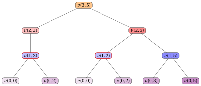

# 17.2 Un primo algoritmo di PD

**Parte 3 · Programmazione dinamica · Capitolo 17** · [:material-book-open-variant: Capitolo 17: Zaino 0/1 (KP)](index.md) · [:material-file-pdf-box: Dispensa, volume 3 (PDF)](../../pdf/dispensa-3-programmazione-dinamica.pdf) · [:material-presentation: Slide (1/2)](../../pdf/slide-dp-knapsack-1.pdf) · [:material-presentation: Slide (2/2)](../../pdf/slide-dp-knapsack-2.pdf) · [:material-pencil: Esercizi: Zaino 0/1 (KP)](../../esercizi/dp-knapsack.md) · [:material-gesture-tap: App: Tabelle della PD per i problemi di zaino](../../laboratorio/tabella-pd-zaino.md)

- <u>Passo 1</u>: calcolo del valore ottimo

    !!! formula ""

        Per ogni $j \in \{0,1,\dots,n\}$ e $k \in \{0,1,\dots,c\}$, sia $v(j,k)$ il valore ottimo della sottoistanza del KP data da:

        1. uno zaino di capacità $k$,

        2. un insieme $\{1,2,\dots,j\}$ di oggetti disponibili,

        3. per ogni oggetto $h \in \{1,2,\dots,j\}$, un profitto $p_h$ e un peso $w_h$.

        La formula ricorsiva per calcolare $v(j,k)$ è la seguente:

        \begin{equation*}
        \label{eq:1}
        v(j,k)= \left\{ \begin{array}{ll}
        0 & \textrm{se $j=0$ o $k=0$,}\\[2ex]
        v(j-1,k) & \textrm{se $1\le j \le n$, $1\le k \le c$ e $w_j>k$,}\\[2ex]
        \begin{array}[t]{@{}l@{}}\displaystyle \max \bigg\{ v(j-1,k),\\ \qquad p_j+v(j-1,k-w_j) \bigg\}\end{array} & \begin{array}[t]{@{}l@{}}\textrm{se $1\le j \le n$,}\\ \textrm{$1\le k \le c$, $w_j\le k$.}\end{array}
        \end{array} \right. \tag{17.1}
        \end{equation*}

    - Il processo di decomposizione ricorsiva della formula $\eqref{eq:1}$ genera al più $2$ <strong>sottoproblemi indipendenti</strong>, corrispondenti alla scelta di selezionare o no l'oggetto $j$ per uno zaino di capacità $k$. Se $w_j>k$, l'oggetto $j$ non può essere selezionato e quindi l'unica opzione ammissibile è non selezionarlo.

    - Qui $v(0,k)=0$ perché nessun oggetto è disponibile e $v(j,0)=0$ perché nessuna capacità è disponibile.

    - Se $w_j\le k$, il valore ottimo $v(j,k)$ si ottiene provando le due opzioni possibili, selezionare o non selezionare l'oggetto $j$, e scegliendo quella che massimizza il profitto. I valori corrispondenti sono, rispettivamente, $p_j+v(j-1,k-w_j)$ e $v(j-1,k)$. Se $w_j>k$, l'oggetto $j$ non può essere selezionato e quindi $v(j,k)=v(j-1,k)$.

    - Quindi una soluzione ottima della sottoistanza con capacità $k$ e oggetti disponibili $\{1,2,\dots,j\}$ si costruisce combinando la decisione scelta sull'oggetto $j$ con una soluzione ottima del corrispondente sottoproblema residuo.

        $\rightsquigarrow$ <strong>Sottostruttura ottima verificata!</strong>

    - Sequenze diverse di decisioni sugli oggetti, prese eventualmente per valori diversi di $j$ e $k$, possono portare allo stesso sottoproblema; quindi lo stesso valore $v(j,k)$ può dover essere calcolato più volte durante la valutazione ricorsiva della formula $\eqref{eq:1}$.

        $\rightsquigarrow$ <strong>Sottoproblemi sovrapposti verificati!</strong>

    - Un <strong>primo metodo</strong> per calcolare il valore ottimo $v(n,c)$ dell'istanza del KP è l'<strong>approccio top-down</strong>.

    - Il metodo parte dalla chiamata con $j=n$ e $k=c$ e valuta ricorsivamente la formula $\eqref{eq:1}$: ogni chiamata considera l'oggetto $j$ e non lo seleziona oppure, se l'oggetto entra nello zaino, considera anche di selezionarlo. La ricorsione si ferma quando non restano oggetti o quando la capacità residua è uguale a $0$.

    - L'<strong>albero di ricorsione</strong> della funzione $v$ ha un nodo per ogni chiamata ricorsiva, etichettato con la chiamata che rappresenta. La radice rappresenta la chiamata iniziale. I figli di un nodo rappresentano le chiamate ricorsive fatte da quella chiamata. Le foglie rappresentano i casi base.

        

        !!! esempio "Esempio 17.3: Albero di ricorsione"

            Consideriamo l'istanza del KP dell'[Esempio 17.1](index.md#box-1-texexpbox1). Questo è l'albero di ricorsione dell'approccio top-down per calcolare $v(3,5)$:

            { .fig loading=lazy  }

            La funzione viene chiamata $12$ volte e lo stesso sottoproblema viene risolto più di una volta: $v(1,2)$ viene chiamata $2$ volte (con il bordo rosso), e così anche $v(0,2)$ e $v(0,0)$.

    - Il valore $v(j,k)$ si può calcolare quando sono noti i valori richiesti dal membro destro della formula $\eqref{eq:1}$. In particolare, ${v}(j-1,k)$ serve quando l'oggetto $j$ non è selezionato e, se $w_j\le k$, ${v}(j-1,k-w_j)$ serve quando l'oggetto $j$ è selezionato.

    - Pertanto, per un valore fissato di $j$, tutti i valori $v(j,k)$ si possono calcolare considerando i valori di capacità $k$ in ordine crescente.

        

        !!! esempio "Esempio 17.4: Calcolo dei valori della funzione $v$"

            Consideriamo l'istanza del KP dell'[Esempio 17.1](index.md#box-1-texexpbox1), con uno zaino di capacità $c=5$ e i seguenti profitti e pesi:

            $$
            \begin{array}{l|rrr}
            \hline  & {j = 1} & {j = 2} & {j = 3} \\
            \hline {p_j} & {6} & {7} & {8} \\
            {w_j} & {2} & {3} & {3} \\
            \hline
            \end{array}
            $$

            I valori della funzione $v$ si calcolano come segue:

            - I casi base danno $v(0,k)=0$ per ogni $k \ge 0$.

            - Calcolati i casi base, possiamo calcolare $v(1,2)$:

                $$
                v(1,2) = \max\{v(0,2),\, v(0,0)+p_1\} = \max\{0,\, 0+6\} = 6
                $$

            - Possiamo calcolare anche $v(1,5)$:

                $$
                v(1,5) = \max\{v(0,5),\, v(0,3)+p_1\} = \max\{0,\, 0+6\} = 6
                $$

            - Poiché $w_2=3 > k=2$, l'oggetto $2$ non entra nello zaino, quindi:

                $$
                v(2,2) = v(1,2) = 6
                $$

            - Calcolati $v(1,2)$ e $v(1,5)$, possiamo calcolare $v(2,5)$:

                $$
                v(2,5) = \max\{v(1,5),\, v(1,2)+p_2\} = \max\{6,\, 6+7\} = 13
                $$

            - Calcolati $v(2,5)$ e $v(2,2)$, possiamo calcolare $v(3,5)$:

                $$
                v(3,5) = \max\{v(2,5),\, v(2,2)+p_3\} = \max\{13,\, 6+8\} = 14
                $$

    - Possiamo evitare di risolvere ripetutamente gli stessi sottoproblemi memorizzando il valore di ogni sottoproblema appena calcolato. I valori sono memorizzati in una <strong>lookup table</strong>.

    - Poiché la soluzione di ogni sottoproblema dipende solo da sottoproblemi con un valore di $j$ più piccolo, possiamo risolvere i sottoproblemi in ordine crescente di $j$ e, per ogni valore fissato di $j$, in ordine crescente di capacità, partendo dai casi base $v(0,k)=0$ e $v(j,0)=0$ fino ad arrivare a $v(n,c)$.

    - Questa osservazione porta in modo naturale a un <strong>metodo molto più efficiente</strong> per calcolare il valore ottimo $v(n,c)$ dell'istanza del KP.

    - Un <strong>secondo metodo</strong> per calcolare il valore ottimo $v(n,c)$ dell'istanza del KP è l'<strong>approccio bottom-up</strong>.

    - Il metodo parte dai casi base e valuta la formula $\eqref{eq:1}$ per valori crescenti di $j \in \{1,2,\dots,n\}$ e $k \in \{0,1,\dots,c\}$: ogni valore $v(j,k)$ si calcola con valori già calcolati, fino a ottenere il valore $v(n,c)$ dell'istanza del KP.

        Questo è lo pseudocodice dell'<strong>algoritmo di PD con l'approccio bottom-up</strong>:

        !!! algoritmo "Algoritmo: DP"

            

<strong>Input:</strong> Un'istanza del KP data dal numero \(n\) di oggetti, dai vettori \(p[1..n]\) e \(w[1..n]\) dei profitti e dei pesi degli oggetti e dalla capacità \(c\) dello zaino

<strong>Output:</strong> Il valore ottimo dell'istanza del KP

1<strong>Function</strong> DP(\(n,p,w,c\))

2\({v} := \textnormal{new array}[0..n][0..c]\)

3<strong>for</strong> \(k := 0\) <strong>to</strong> \(c\)  <strong>do</strong>

4\({v}[0][k] \leftarrow 0\)

5<strong>end</strong>

6<strong>for</strong> \(j := 1\) <strong>to</strong> \(n\)  <strong>do</strong>

7<strong>for</strong> \(k := 0\) <strong>to</strong> \(c\)  <strong>do</strong>

8<strong>if</strong> \(k < w[j]\)  <strong>then</strong>

9\({v}[j][k] \leftarrow {v}[j-1][k]\)

10<strong>else</strong>

11<strong>if</strong> \({v}[j-1][k-w[j]] + p[j] > {v}[j-1][k]\)  <strong>then</strong>

12\({v}[j][k] \leftarrow {v}[j-1][k-w[j]] + p[j]\)

13<strong>else</strong>

14\({v}[j][k] \leftarrow {v}[j-1][k]\)

15<strong>end</strong>

16<strong>end</strong>

17<strong>end</strong>

18<strong>end</strong>

19<strong>return</strong> \({v}[n][c]\)

        - La matrice ${v}[0..n][0..c]$ è la <strong>lookup table</strong>: memorizza i valori ottimi di tutti i sottoproblemi.

        - Il primo ciclo inizializza i valori ${v}[0][k]=0$ per tutte le capacità $k \in \{0,1,\dots,c\}$, corrispondenti al caso in cui nessun oggetto è disponibile.

        - Il ciclo esterno, sugli oggetti $j \in \{1,2,\dots,n\}$, calcola le righe della matrice in ordine crescente di $j$.

        - Il ciclo interno, su $k \in \{0,1,\dots,c\}$, calcola il valore ottimo ${v}[j][k]$ per ogni capacità $k$.

        - Se l'oggetto $j$ non entra nello zaino, allora ${v}[j][k] \leftarrow {v}[j-1][k]$.

        - Altrimenti, l'algoritmo di PD confronta il valore ottenuto non selezionando l'oggetto $j$, cioè ${v}[j-1][k]$, con il valore ottenuto selezionando l'oggetto $j$, cioè $p[j]+{v}[j-1][k-w[j]]$.

        - Infine, l'algoritmo restituisce il valore ottimo dell'istanza del KP, ${v}[n][c]$.

        

        !!! esempio "Esempio 17.5: Esecuzione dell'algoritmo di PD"

            Consideriamo l'istanza del KP dell'[Esempio 17.1](index.md#box-1-texexpbox1), con uno zaino di capacità $c=5$ e i seguenti profitti e pesi:

            $$
            \begin{array}{l|rrr}
            \hline  & {j = 1} & {j = 2} & {j = 3} \\
            \hline {p_j} & {6} & {7} & {8} \\
            {w_j} & {2} & {3} & {3} \\
            \hline
            \end{array}
            $$

            Per ogni passo dell'algoritmo di PD, la tabella riporta i valori di $j$ e $k$, la cella ${v}[j][k]$ e l'operazione eseguita.

            
<table>
            <tr>
            <th>\(j\)</th>
            <th>\(k\)</th>
            <th>\({v}[j][k]\)</th>
            <th>Azione</th>
            </tr>
            <tr>
            <td>\(0\)</td>
            <td>\(0\)</td>
            <td>\(0\)</td>
            <td>\({v}[0][0]\leftarrow 0\)</td>
            </tr>
            <tr>
            <td>\(0\)</td>
            <td>\(1\)</td>
            <td>\(0\)</td>
            <td>\({v}[0][1]\leftarrow 0\)</td>
            </tr>
            <tr>
            <td>\(0\)</td>
            <td>\(2\)</td>
            <td>\(0\)</td>
            <td>\({v}[0][2]\leftarrow 0\)</td>
            </tr>
            <tr>
            <td>\(0\)</td>
            <td>\(3\)</td>
            <td>\(0\)</td>
            <td>\({v}[0][3]\leftarrow 0\)</td>
            </tr>
            <tr>
            <td>\(0\)</td>
            <td>\(4\)</td>
            <td>\(0\)</td>
            <td>\({v}[0][4]\leftarrow 0\)</td>
            </tr>
            <tr>
            <td>\(0\)</td>
            <td>\(5\)</td>
            <td>\(0\)</td>
            <td>\({v}[0][5]\leftarrow 0\)</td>
            </tr>
            <tr>
            <td>\(1\)</td>
            <td>\(0\)</td>
            <td>\(0\)</td>
            <td>\({v}[1][0]\leftarrow {v}[0][0]=0\)</td>
            </tr>
            <tr>
            <td>\(1\)</td>
            <td>\(1\)</td>
            <td>\(0\)</td>
            <td>\({v}[1][1]\leftarrow {v}[0][1]=0\)</td>
            </tr>
            <tr>
            <td>\(1\)</td>
            <td>\(2\)</td>
            <td>\(6\)</td>
            <td>\(\max\{{v}[0][2],p[1]+{v}[0][0]\}=\max\{0,6+0\}=6\)</td>
            </tr>
            <tr>
            <td>\(1\)</td>
            <td>\(3\)</td>
            <td>\(6\)</td>
            <td>\(\max\{{v}[0][3],p[1]+{v}[0][1]\}=\max\{0,6+0\}=6\)</td>
            </tr>
            <tr>
            <td>\(1\)</td>
            <td>\(4\)</td>
            <td>\(6\)</td>
            <td>\(\max\{{v}[0][4],p[1]+{v}[0][2]\}=\max\{0,6+0\}=6\)</td>
            </tr>
            <tr>
            <td>\(1\)</td>
            <td>\(5\)</td>
            <td>\(6\)</td>
            <td>\(\max\{{v}[0][5],p[1]+{v}[0][3]\}=\max\{0,6+0\}=6\)</td>
            </tr>
            <tr>
            <td>\(2\)</td>
            <td>\(0\)</td>
            <td>\(0\)</td>
            <td>\({v}[2][0]\leftarrow {v}[1][0]=0\)</td>
            </tr>
            <tr>
            <td>\(2\)</td>
            <td>\(1\)</td>
            <td>\(0\)</td>
            <td>\({v}[2][1]\leftarrow {v}[1][1]=0\)</td>
            </tr>
            <tr>
            <td>\(2\)</td>
            <td>\(2\)</td>
            <td>\(6\)</td>
            <td>\({v}[2][2]\leftarrow {v}[1][2]=6\)</td>
            </tr>
            <tr>
            <td>\(2\)</td>
            <td>\(3\)</td>
            <td>\(7\)</td>
            <td>\(\max\{{v}[1][3],p[2]+{v}[1][0]\}=\max\{6,7+0\}=7\)</td>
            </tr>
            <tr>
            <td>\(2\)</td>
            <td>\(4\)</td>
            <td>\(7\)</td>
            <td>\(\max\{{v}[1][4],p[2]+{v}[1][1]\}=\max\{6,7+0\}=7\)</td>
            </tr>
            <tr>
            <td>\(2\)</td>
            <td>\(5\)</td>
            <td>\(13\)</td>
            <td>\(\max\{{v}[1][5],p[2]+{v}[1][2]\}=\max\{6,7+6\}=13\)</td>
            </tr>
            <tr>
            <td>\(3\)</td>
            <td>\(0\)</td>
            <td>\(0\)</td>
            <td>\({v}[3][0]\leftarrow {v}[2][0]=0\)</td>
            </tr>
            <tr>
            <td>\(3\)</td>
            <td>\(1\)</td>
            <td>\(0\)</td>
            <td>\({v}[3][1]\leftarrow {v}[2][1]=0\)</td>
            </tr>
            <tr>
            <td>\(3\)</td>
            <td>\(2\)</td>
            <td>\(6\)</td>
            <td>\({v}[3][2]\leftarrow {v}[2][2]=6\)</td>
            </tr>
            <tr>
            <td>\(3\)</td>
            <td>\(3\)</td>
            <td>\(8\)</td>
            <td>\(\max\{{v}[2][3],p[3]+{v}[2][0]\}=\max\{7,8+0\}=8\)</td>
            </tr>
            <tr>
            <td>\(3\)</td>
            <td>\(4\)</td>
            <td>\(8\)</td>
            <td>\(\max\{{v}[2][4],p[3]+{v}[2][1]\}=\max\{7,8+0\}=8\)</td>
            </tr>
            <tr>
            <td>\(3\)</td>
            <td>\(5\)</td>
            <td>\(14\)</td>
            <td>\(\max\{{v}[2][5],p[3]+{v}[2][2]\}=\max\{13,8+6\}=14\)</td>
            </tr>
            </table>

            Dopo l'esecuzione dell'algoritmo di PD, questa è la matrice ${v}$:

            $$
            \begin{array}{l|rrrrrr}
            \hline {{v}[j][k]} & {k=0} & {k=1} & {k=2} & {k=3} & {k=4} & {k=5} \\
            \hline {j=0} & 0 & 0 & 0 & 0 & 0 & 0 \\
            {j=1} & 0 & 0 & 6 & 6 & 6 & 6 \\
            {j=2} & 0 & 0 & 6 & 7 & 7 & 13 \\
            {j=3} & 0 & 0 & 6 & 8 & 8 & 14 \\
            \hline
            \end{array}
            $$

    - Dopo l'esecuzione dell'algoritmo di PD, la matrice ${v}$ contiene il valore ottimo ${v}[j][k]=v(j,k)$ per ogni oggetto $j \in \{0,1,\dots,n\}$ e ogni valore di capacità $k \in \{0,1,\dots,c\}$.

    - L'algoritmo di PD calcola la riga $j$ della matrice ${v}$ usando solo la riga $j-1$. Pertanto, quando serve solo il valore ottimo dell'istanza del KP, non è necessario memorizzare tutta la matrice: basta un solo vettore ${v}[0..c]$, che usa $c+1$ celle invece delle $(n+1)(c+1)$ celle della matrice.

    - Il vettore si inizializza con i casi base ${v}[k]=0$ per ogni $k \in \{0,1,\dots,c\}$, che corrispondono alla riga $j=0$ della matrice. Poi, per ogni oggetto $j \in \{1,2,\dots,n\}$, il vettore viene aggiornato in modo da contenere la riga $j$ della matrice.

    - L'ordine di aggiornamento delle celle è essenziale. Quando la cella ${v}[k]$ viene aggiornata per l'oggetto $j$, il valore ${v}[k-w_j]$ deve essere ancora quello della riga $j-1$, cioè $v(j-1,k-w_j)$.

    - Poiché $k-w_j<k$, questo è garantito se i valori di capacità sono considerati in ordine <strong>decrescente</strong> $k=c,c-1,\dots,w_j$: quando la cella $k$ viene aggiornata, la cella $k-w_j$ non è ancora stata aggiornata nella passata corrente.

    - Se i valori di capacità fossero considerati in ordine crescente, il valore ${v}[k-w_j]$ sarebbe già quello della riga $j$, cioè $v(j,k-w_j)$, e l'oggetto $j$ potrebbe essere selezionato più di una volta, cosa non consentita nel KP.

    - Per ogni valore di capacità $k<w_j$, l'oggetto $j$ non entra nello zaino e quindi ${v}[k]$ deve mantenere il valore $v(j-1,k)$: non si esegue alcun aggiornamento e il ciclo interno può fermarsi a $k=w_j$.

        Questo è lo pseudocodice dell'<strong>algoritmo di PD con un solo vettore</strong>:

        !!! algoritmo "Algoritmo: DP\_Vector"

            

<strong>Input:</strong> Un'istanza del KP data dal numero \(n\) di oggetti, dai vettori \(p[1..n]\) e \(w[1..n]\) dei profitti e dei pesi degli oggetti e dalla capacità \(c\) dello zaino

<strong>Output:</strong> Il valore ottimo dell'istanza del KP

1<strong>Function</strong> DP_Vector(\(n,p,w,c\))

2\({v} := \textnormal{new array}[0..c]\)

3<strong>for</strong> \(k := 0\) <strong>to</strong> \(c\)  <strong>do</strong>

4\({v}[k] \leftarrow 0\)

5<strong>end</strong>

6<strong>for</strong> \(j := 1\) <strong>to</strong> \(n\)  <strong>do</strong>

7<strong>for</strong> \(k := c\) <strong>downto</strong> \(w[j]\)  <strong>do</strong>

8<strong>if</strong> \(p[j] + {v}[k-w[j]] > {v}[k]\)  <strong>then</strong>

9\({v}[k] \leftarrow p[j] + {v}[k-w[j]]\)

10<strong>end</strong>

11<strong>end</strong>

12<strong>end</strong>

13<strong>return</strong> \({v}[c]\)

        - Il vettore ${v}[0..c]$ è la <strong>lookup table</strong>: al termine della passata per l'oggetto $j$, memorizza la riga $j$ della matrice ${v}$ dell'algoritmo di PD.

        - Il primo ciclo inizializza i valori ${v}[k]=0$ per tutte le capacità $k \in \{0,1,\dots,c\}$, corrispondenti al caso in cui nessun oggetto è disponibile.

        - Il ciclo esterno, sugli oggetti $j \in \{1,2,\dots,n\}$, esegue una passata del vettore per ogni oggetto.

        - Il ciclo interno, su $k \in \{w[j],w[j]+1,\dots,c\}$, considera i valori di capacità in ordine decrescente, in modo che le celle che servono ancora con il valore precedente non siano ancora state modificate.

        - La condizione confronta il valore ottenuto non selezionando l'oggetto $j$, cioè il valore corrente ${v}[k]$, con il valore ottenuto selezionando l'oggetto $j$, cioè $p[j]+{v}[k-w[j]]$. La cella viene aggiornata solo quando selezionare l'oggetto $j$ è strettamente migliore.

        - Infine, l'algoritmo restituisce il valore ottimo dell'istanza del KP, ${v}[c]$.

        

        !!! esempio "Esempio 17.6: Esecuzione dell'algoritmo di PD con un solo vettore"

            Consideriamo l'istanza del KP dell'[Esempio 17.1](index.md#box-1-texexpbox1), con uno zaino di capacità $c=5$ e i seguenti profitti e pesi:

            $$
            \begin{array}{l|rrr}
            \hline  & {j = 1} & {j = 2} & {j = 3} \\
            \hline {p_j} & {6} & {7} & {8} \\
            {w_j} & {2} & {3} & {3} \\
            \hline
            \end{array}
            $$

            Il primo ciclo inizializza ${v}[k]=0$ per ogni $k \in \{0,1,\dots,5\}$. Per ogni passo dei due cicli annidati, la tabella riporta i valori di $j$ e $k$, la cella ${v}[k]$ dopo il passo e l'operazione eseguita.

            
<table>
            <tr>
            <th>\(j\)</th>
            <th>\(k\)</th>
            <th>\({v}[k]\)</th>
            <th>Azione</th>
            </tr>
            <tr>
            <td>\(1\)</td>
            <td>\(5\)</td>
            <td>\(6\)</td>
            <td>\(p[1]+{v}[3]=6+0>{v}[5]=0\): \({v}[5]\leftarrow 6\)</td>
            </tr>
            <tr>
            <td>\(1\)</td>
            <td>\(4\)</td>
            <td>\(6\)</td>
            <td>\(p[1]+{v}[2]=6+0>{v}[4]=0\): \({v}[4]\leftarrow 6\)</td>
            </tr>
            <tr>
            <td>\(1\)</td>
            <td>\(3\)</td>
            <td>\(6\)</td>
            <td>\(p[1]+{v}[1]=6+0>{v}[3]=0\): \({v}[3]\leftarrow 6\)</td>
            </tr>
            <tr>
            <td>\(1\)</td>
            <td>\(2\)</td>
            <td>\(6\)</td>
            <td>\(p[1]+{v}[0]=6+0>{v}[2]=0\): \({v}[2]\leftarrow 6\)</td>
            </tr>
            <tr>
            <td>\(2\)</td>
            <td>\(5\)</td>
            <td>\(13\)</td>
            <td>\(p[2]+{v}[2]=7+6>{v}[5]=6\): \({v}[5]\leftarrow 13\)</td>
            </tr>
            <tr>
            <td>\(2\)</td>
            <td>\(4\)</td>
            <td>\(7\)</td>
            <td>\(p[2]+{v}[1]=7+0>{v}[4]=6\): \({v}[4]\leftarrow 7\)</td>
            </tr>
            <tr>
            <td>\(2\)</td>
            <td>\(3\)</td>
            <td>\(7\)</td>
            <td>\(p[2]+{v}[0]=7+0>{v}[3]=6\): \({v}[3]\leftarrow 7\)</td>
            </tr>
            <tr>
            <td>\(3\)</td>
            <td>\(5\)</td>
            <td>\(14\)</td>
            <td>\(p[3]+{v}[2]=8+6>{v}[5]=13\): \({v}[5]\leftarrow 14\)</td>
            </tr>
            <tr>
            <td>\(3\)</td>
            <td>\(4\)</td>
            <td>\(8\)</td>
            <td>\(p[3]+{v}[1]=8+0>{v}[4]=7\): \({v}[4]\leftarrow 8\)</td>
            </tr>
            <tr>
            <td>\(3\)</td>
            <td>\(3\)</td>
            <td>\(8\)</td>
            <td>\(p[3]+{v}[0]=8+0>{v}[3]=7\): \({v}[3]\leftarrow 8\)</td>
            </tr>
            </table>

            Questo è il contenuto del vettore ${v}$ dopo l'inizializzazione e dopo ogni passata del ciclo esterno:

            
<table>
            <tr>
            <td>\({v}[k]\)</td>
            <td>\(0\)</td>
            <td>\(1\)</td>
            <td>\(2\)</td>
            <td>\(3\)</td>
            <td>\(4\)</td>
            <td>\(5\)</td>
            </tr>
            <tr>
            <td>inizializzazione</td>
            <td>0</td>
            <td>0</td>
            <td>0</td>
            <td>0</td>
            <td>0</td>
            <td>0</td>
            </tr>
            <tr>
            <td>passata \(j=1\)</td>
            <td>0</td>
            <td>0</td>
            <td>6</td>
            <td>6</td>
            <td>6</td>
            <td>6</td>
            </tr>
            <tr>
            <td>passata \(j=2\)</td>
            <td>0</td>
            <td>0</td>
            <td>6</td>
            <td>7</td>
            <td>7</td>
            <td>13</td>
            </tr>
            <tr>
            <td>passata \(j=3\)</td>
            <td>0</td>
            <td>0</td>
            <td>6</td>
            <td>8</td>
            <td>8</td>
            <td>14</td>
            </tr>
            </table>

            Ogni passata trasforma il vettore ${v}$ dalla riga $j-1$ nella riga $j$ della matrice ${v}$ riportata nell'[Esempio 17.5](#box-16-texkpbu). Il valore ottimo dell'istanza del KP è ${v}[5]=14$.

    - La versione con un vettore calcola solo il valore ottimo dell'istanza del KP. L'informazione necessaria per costruire una soluzione ottima, descritta nel Passo 2, registra la decisione presa per ogni oggetto $j$ e ogni valore di capacità $k$, e quindi non si può memorizzare in un solo vettore.

- <u>Passo 2</u>: calcolo di una soluzione ottima

    - Per calcolare una soluzione ottima, cioè il vettore binario $(x_1,x_2,\dots,x_n)$, è necessario memorizzare alcune informazioni aggiuntive.

    - Per ogni oggetto $j$ e valore di capacità $k$, oltre al valore ottimo ${v}[j][k]$, memorizziamo ${s}[j][k]$, che indica se l'oggetto $j$ è selezionato in una soluzione ottima del sottoproblema ristretto agli oggetti $\{1,2,\dots,j\}$ e alla capacità $k$.

    - Più precisamente, ${s}[j][k]$ è uguale a $1$ se l'oggetto $j$ è selezionato nel calcolo del valore ${v}[j][k]$, ed è uguale a $0$ altrimenti.

        Questo è lo pseudocodice dell'<strong>algoritmo di PD con l'approccio bottom-up</strong>, con la memorizzazione delle informazioni necessarie per costruire una soluzione ottima:

        !!! algoritmo "Algoritmo: DP\_InfoSol"

            

<strong>Input:</strong> Un'istanza del KP data dal numero \(n\) di oggetti, dai vettori \(p[1..n]\) e \(w[1..n]\) dei profitti e dei pesi degli oggetti e dalla capacità \(c\) dello zaino

<strong>Output:</strong> Il valore ottimo dell'istanza del KP e la matrice delle informazioni binarie \({s}[0..n][0..c]\)

1<strong>Function</strong> DP_InfoSol(\(n,p,w,c\))

2\({v} := \textnormal{new array}[0..n][0..c]\)

3\({s} := \textnormal{new array}[0..n][0..c]\)

4<strong>for</strong> \(k := 0\) <strong>to</strong> \(c\) <strong>do</strong>

5\({v}[0][k] \leftarrow 0\)

6\({s}[0][k] \leftarrow 0\)

7<strong>end</strong>

8<strong>for</strong> \(j := 1\) <strong>to</strong> \(n\) <strong>do</strong>

9<strong>for</strong> \(k := 0\) <strong>to</strong> \(c\) <strong>do</strong>

10<strong>if</strong> \(k < w[j]\) <strong>then</strong>

11\({v}[j][k] \leftarrow {v}[j-1][k]\)

12\({s}[j][k] \leftarrow 0\)

13<strong>else</strong>

14<strong>if</strong> \({v}[j-1][k-w[j]] + p[j] > {v}[j-1][k]\) <strong>then</strong>

15\({v}[j][k] \leftarrow {v}[j-1][k-w[j]] + p[j]\)

16\({s}[j][k] \leftarrow 1\)

17<strong>else</strong>

18\({v}[j][k] \leftarrow {v}[j-1][k]\)

19\({s}[j][k] \leftarrow 0\)

20<strong>end</strong>

21<strong>end</strong>

22<strong>end</strong>

23<strong>end</strong>

24<strong>return</strong> \({v}[n][c], {s}\)

        - L'algoritmo di PD usa la matrice aggiuntiva ${s}$, che registra la decisione presa quando si calcola ${v}[j][k]$. Se l'oggetto $j$ è selezionato, ${s}[j][k]\leftarrow 1$ memorizza questa decisione; altrimenti, ${s}[j][k]\leftarrow 0$ memorizza che l'oggetto $j$ non è selezionato.

        

        !!! esempio "Esempio 17.7: Calcolo delle informazioni aggiuntive"

            Consideriamo l'istanza del KP dell'[Esempio 17.1](index.md#box-1-texexpbox1), con uno zaino di capacità $c=5$ e i seguenti profitti e pesi:

            $$
            \begin{array}{l|rrr}
            \hline  & {j = 1} & {j = 2} & {j = 3} \\
            \hline {p_j} & {6} & {7} & {8} \\
            {w_j} & {2} & {3} & {3} \\
            \hline
            \end{array}
            $$

            Per ogni passo dell'algoritmo di PD, la tabella riporta i valori di $j$ e $k$, la cella ${s}[j][k]$ e l'operazione eseguita.

            
<table>
            <tr>
            <th>\(j\)</th>
            <th>\(k\)</th>
            <th>\({s}[j][k]\)</th>
            <th>Azione</th>
            </tr>
            <tr>
            <td>\(0\)</td>
            <td>\(0\)</td>
            <td>\(0\)</td>
            <td>\({s}[0][0]\leftarrow 0\)</td>
            </tr>
            <tr>
            <td>\(0\)</td>
            <td>\(1\)</td>
            <td>\(0\)</td>
            <td>\({s}[0][1]\leftarrow 0\)</td>
            </tr>
            <tr>
            <td>\(0\)</td>
            <td>\(2\)</td>
            <td>\(0\)</td>
            <td>\({s}[0][2]\leftarrow 0\)</td>
            </tr>
            <tr>
            <td>\(0\)</td>
            <td>\(3\)</td>
            <td>\(0\)</td>
            <td>\({s}[0][3]\leftarrow 0\)</td>
            </tr>
            <tr>
            <td>\(0\)</td>
            <td>\(4\)</td>
            <td>\(0\)</td>
            <td>\({s}[0][4]\leftarrow 0\)</td>
            </tr>
            <tr>
            <td>\(0\)</td>
            <td>\(5\)</td>
            <td>\(0\)</td>
            <td>\({s}[0][5]\leftarrow 0\)</td>
            </tr>
            <tr>
            <td>\(1\)</td>
            <td>\(0\)</td>
            <td>\(0\)</td>
            <td>\(0<2\): \({s}[1][0]\leftarrow 0\)</td>
            </tr>
            <tr>
            <td>\(1\)</td>
            <td>\(1\)</td>
            <td>\(0\)</td>
            <td>\(1<2\): \({s}[1][1]\leftarrow 0\)</td>
            </tr>
            <tr>
            <td>\(1\)</td>
            <td>\(2\)</td>
            <td>\(1\)</td>
            <td>\(p[1]+{v}[0][0]=6+0>{v}[0][2]=0\): \({s}[1][2]\leftarrow 1\)</td>
            </tr>
            <tr>
            <td>\(1\)</td>
            <td>\(3\)</td>
            <td>\(1\)</td>
            <td>\(p[1]+{v}[0][1]=6+0>{v}[0][3]=0\): \({s}[1][3]\leftarrow 1\)</td>
            </tr>
            <tr>
            <td>\(1\)</td>
            <td>\(4\)</td>
            <td>\(1\)</td>
            <td>\(p[1]+{v}[0][2]=6+0>{v}[0][4]=0\): \({s}[1][4]\leftarrow 1\)</td>
            </tr>
            <tr>
            <td>\(1\)</td>
            <td>\(5\)</td>
            <td>\(1\)</td>
            <td>\(p[1]+{v}[0][3]=6+0>{v}[0][5]=0\): \({s}[1][5]\leftarrow 1\)</td>
            </tr>
            <tr>
            <td>\(2\)</td>
            <td>\(0\)</td>
            <td>\(0\)</td>
            <td>\(0<3\): \({s}[2][0]\leftarrow 0\)</td>
            </tr>
            <tr>
            <td>\(2\)</td>
            <td>\(1\)</td>
            <td>\(0\)</td>
            <td>\(1<3\): \({s}[2][1]\leftarrow 0\)</td>
            </tr>
            <tr>
            <td>\(2\)</td>
            <td>\(2\)</td>
            <td>\(0\)</td>
            <td>\(2<3\): \({s}[2][2]\leftarrow 0\)</td>
            </tr>
            <tr>
            <td>\(2\)</td>
            <td>\(3\)</td>
            <td>\(1\)</td>
            <td>\(p[2]+{v}[1][0]=7+0>{v}[1][3]=6\): \({s}[2][3]\leftarrow 1\)</td>
            </tr>
            <tr>
            <td>\(2\)</td>
            <td>\(4\)</td>
            <td>\(1\)</td>
            <td>\(p[2]+{v}[1][1]=7+0>{v}[1][4]=6\): \({s}[2][4]\leftarrow 1\)</td>
            </tr>
            <tr>
            <td>\(2\)</td>
            <td>\(5\)</td>
            <td>\(1\)</td>
            <td>\(p[2]+{v}[1][2]=7+6>{v}[1][5]=6\): \({s}[2][5]\leftarrow 1\)</td>
            </tr>
            <tr>
            <td>\(3\)</td>
            <td>\(0\)</td>
            <td>\(0\)</td>
            <td>\(0<3\): \({s}[3][0]\leftarrow 0\)</td>
            </tr>
            <tr>
            <td>\(3\)</td>
            <td>\(1\)</td>
            <td>\(0\)</td>
            <td>\(1<3\): \({s}[3][1]\leftarrow 0\)</td>
            </tr>
            <tr>
            <td>\(3\)</td>
            <td>\(2\)</td>
            <td>\(0\)</td>
            <td>\(2<3\): \({s}[3][2]\leftarrow 0\)</td>
            </tr>
            <tr>
            <td>\(3\)</td>
            <td>\(3\)</td>
            <td>\(1\)</td>
            <td>\(p[3]+{v}[2][0]=8+0>{v}[2][3]=7\): \({s}[3][3]\leftarrow 1\)</td>
            </tr>
            <tr>
            <td>\(3\)</td>
            <td>\(4\)</td>
            <td>\(1\)</td>
            <td>\(p[3]+{v}[2][1]=8+0>{v}[2][4]=7\): \({s}[3][4]\leftarrow 1\)</td>
            </tr>
            <tr>
            <td>\(3\)</td>
            <td>\(5\)</td>
            <td>\(1\)</td>
            <td>\(p[3]+{v}[2][2]=8+6>{v}[2][5]=13\): \({s}[3][5]\leftarrow 1\)</td>
            </tr>
            </table>

            Questa è la matrice ${s}$ dopo l'esecuzione dell'algoritmo di PD:

            $$
            \begin{array}{l|rrrrrr}
            \hline {{s}[j][k]} & {k=0} & {k=1} & {k=2} & {k=3} & {k=4} & {k=5} \\
            \hline {j=0} & 0 & 0 & 0 & 0 & 0 & 0 \\
            {j=1} & 0 & 0 & 1 & 1 & 1 & 1 \\
            {j=2} & 0 & 0 & 0 & 1 & 1 & 1 \\
            {j=3} & 0 & 0 & 0 & 1 & 1 & 1 \\
            \hline
            \end{array}
            $$

    - Calcolata la matrice ${s}$, si può ricostruire una soluzione ottima scorrendo gli oggetti da $j=n$ fino a $j=1$, partendo dalla capacità $k=c$ e da $x_j=0$ per ogni $j \in \{1,2,\dots,n\}$:

        $$
        \begin{array}{ll}
        x_j \leftarrow 1,\quad k \leftarrow k-w_j & \textrm{se ${s}[j][k]=1$,}\\[1ex]
        x_j \leftarrow 0 & \textrm{se ${s}[j][k]=0$.}
        \end{array}
        $$

    - Si ottiene così il vettore $(x_1,x_2,\dots,x_n)$, dove $x_j$ è uguale a $1$ se l'oggetto $j$ è selezionato in una soluzione ottima, e a $0$ altrimenti.

        !!! algoritmo "Algoritmo: DP\_Reconstruct"

            

<strong>Input:</strong> Il numero \(n\) di oggetti, la capacità \(c\) dello zaino, il vettore \(w[1..n]\) dei pesi degli oggetti e la matrice \({s}[0..n][0..c]\)

<strong>Output:</strong> Una soluzione ottima dell'istanza del KP

1<strong>Function</strong> DP_Reconstruct(\(n,c,w,s\))

2\(x := \textnormal{new array}[1..n]\)

3<strong>for</strong> \(j := 1\) <strong>to</strong> \(n\) <strong>do</strong>

4\(x[j] \leftarrow 0\)

5<strong>end</strong>

6\(k := c\)

7<strong>for</strong> \(j := n\) <strong>downto</strong> \(1\) <strong>do</strong>

8<strong>if</strong> \({s}[j][k] = 1\) <strong>then</strong>

9\(x[j] \leftarrow 1\)

10\(k \leftarrow k-w[j]\)

11<strong>end</strong>

12<strong>end</strong>

13<strong>return</strong> \(x\)

        

        !!! esempio "Esempio 17.8: Calcolo di una soluzione ottima"

            Dopo l'esecuzione dell'algoritmo di PD sull'istanza dell'[Esempio 17.1](index.md#box-1-texexpbox1), abbiamo la seguente matrice ${s}$:

            $$
            \begin{array}{l|rrrrrr}
            \hline {{s}[j][k]} & {k=0} & {k=1} & {k=2} & {k=3} & {k=4} & {k=5} \\
            \hline {j=0} & 0 & 0 & 0 & 0 & 0 & 0 \\
            {j=1} & 0 & 0 & 1 & 1 & 1 & 1 \\
            {j=2} & 0 & 0 & 0 & 1 & 1 & 1 \\
            {j=3} & 0 & 0 & 0 & 1 & 1 & 1 \\
            \hline
            \end{array}
            $$

            Possiamo ricostruire una soluzione ottima partendo da $j=3$ e $k=5$ come segue:

            
<table>
            <tr>
            <th>Iterazione</th>
            <th>\(j\)</th>
            <th>\(k\)</th>
            <th>\({s}[j][k]\)</th>
            <th>\(x[1]\)</th>
            <th>\(x[2]\)</th>
            <th>\(x[3]\)</th>
            <th>Azione</th>
            </tr>
            <tr>
            <td>\(-\)</td>
            <td>\(-\)</td>
            <td>\(-\)</td>
            <td>\(-\)</td>
            <td>0</td>
            <td>0</td>
            <td>0</td>
            <td>\(k=5\)</td>
            </tr>
            <tr>
            <td>\(1\)</td>
            <td>\(3\)</td>
            <td>\(5\)</td>
            <td>\(1\)</td>
            <td>0</td>
            <td>0</td>
            <td class="cella-blu">1</td>
            <td>\(k\leftarrow 5-3=2\)</td>
            </tr>
            <tr>
            <td>\(2\)</td>
            <td>\(2\)</td>
            <td>\(2\)</td>
            <td>\(0\)</td>
            <td>0</td>
            <td>0</td>
            <td>1</td>
            <td>nessun aggiornamento</td>
            </tr>
            <tr>
            <td>\(3\)</td>
            <td>\(1\)</td>
            <td>\(2\)</td>
            <td>\(1\)</td>
            <td class="cella-blu">1</td>
            <td>0</td>
            <td>1</td>
            <td>\(k\leftarrow 2-2=0\)</td>
            </tr>
            </table>

            Quindi il vettore

            $$
            (1,0,1)
            $$

            è una soluzione ottima. Il valore ottimo corrispondente è $6+8=14$.

## 17.2.1 Numero di passi

- Indichiamo con $S(n,c)$ il numero di passi eseguiti da <code>DP</code> nel caso peggiore, dove $n$ è il numero di oggetti e $c$ è la capacità dello zaino. Calcoliamo $S(n,c)$ contando quante volte vengono eseguite le righe dello pseudocodice di <code>DP</code>.

- Nel caso peggiore, la condizione della riga [11](#box-12-kpbu-h) viene verificata ogni volta che l'oggetto entra nello zaino. Poiché i pesi degli oggetti sono interi positivi, questo accade al più $nc$ volte. Il numero di esecuzioni delle righe rilevanti è:

    - La Riga [2](#box-5-kpbu-a) viene eseguita $1$ volta.

    - La Riga [3](#box-6-kpbu-b) viene eseguita $c+1$ volte.

    - La Riga [4](#box-7-kpbu-c) viene eseguita $c+1$ volte.

    - La Riga [6](#box-8-kpbu-d) viene eseguita $n$ volte.

    - La Riga [7](#box-9-kpbu-e) viene eseguita $n(c+1)$ volte.

    - La Riga [8](#box-10-kpbu-f) viene eseguita $n(c+1)$ volte.

    - La Riga [11](#box-12-kpbu-h) viene eseguita al più $nc$ volte.

    - una fra la Riga [9](#box-11-kpbu-g), la Riga [12](#box-13-kpbu-i) e la Riga [14](#box-14-kpbu-j) viene eseguita per ogni coppia $(j,k)$, e quindi queste righe di assegnamento vengono eseguite in tutto $n(c+1)$ volte.

    - La Riga [19](#box-15-kpbu-k) viene eseguita $1$ volta.

    Pertanto, il numero totale di passi nel caso peggiore è

    $$
    1+(c+1)+(c+1)+n+n(c+1)+n(c+1)+nc+n(c+1)+1.
    $$

    Quindi

    $$
    S(n,c)=4nc+4n+2c+4.
    $$

    Dunque

    $$
    S(n,c)=\Theta(nc).
    $$

    Infatti

    $$
    \lim_{n,c\to\infty}
    \frac{4nc+4n+2c+4}{nc}
    =
    \lim_{n,c\to\infty}
    \left(4+\frac{4}{c}+\frac{2}{n}+\frac{4}{nc}\right)
    =
    4\in\mathbb{R}_{>0}.
    $$

    !!! chiave ""

        L'algoritmo di PD esegue

        $$
        S(n,c)=\Theta(nc)
        $$

        passi nel caso peggiore.

- La versione <code>DP\_InfoSol</code> memorizza la matrice aggiuntiva ${s}$ ed esegue solo un numero costante di operazioni in più dentro gli stessi cicli. Pertanto, il suo numero di passi resta $\Theta(nc)$.

- La versione <code>DP\_Vector</code> usa un solo vettore invece della matrice ed esegue gli stessi due cicli annidati, il cui ciclo interno esegue al più $c+1$ iterazioni per ogni oggetto. Pertanto, il suo numero di passi resta $\Theta(nc)$, mentre il numero di celle della lookup table scende da $(n+1)(c+1)$ a $c+1$.

---

**Avanti:** [17.2.2 Un primo algoritmo di PD: Un'implementazione con liste](un-primo-algoritmo-di-pd-un-implementazione-con-liste.md)
