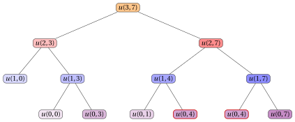

# 17.3 Un secondo algoritmo di PD

**Parte 3 · Programmazione dinamica · Capitolo 17** · [:material-book-open-variant: Capitolo 17: Zaino 0/1 (KP)](index.md) · [:material-file-pdf-box: Dispensa, volume 3 (PDF)](../../pdf/dispensa-3-programmazione-dinamica.pdf) · [:material-pencil: Esercizi: Zaino 0/1 (KP)](../../esercizi/dp-knapsack.md) · [:material-gesture-tap: App: Tabelle della PD per i problemi di zaino](../../laboratorio/tabella-pd-zaino.md)

- <u>Passo 1</u>: calcolo del valore ottimo

    - Nell'algoritmo di PD della sezione precedente, un sottoproblema è identificato da un valore di capacità, e il suo valore ottimo è il massimo profitto totale ottenibile senza superare quella capacità.

    - Nell'algoritmo di PD di questa sezione i ruoli dei profitti e dei pesi sono scambiati: un sottoproblema è identificato da un valore di profitto, e il suo valore ottimo è il minimo peso totale necessario per ottenere esattamente quel profitto.

    - Poiché ogni profitto $p_j$ è un intero positivo e ogni oggetto si può selezionare al più una volta, il profitto totale di una soluzione ammissibile è un intero compreso fra $0$ e il profitto totale di tutti gli oggetti

        $$
        P=\sum_{j=1}^{n} p_j.
        $$

    - Pertanto basta considerare i valori di profitto $q \in \{0,1,\dots,P\}$.

    - Il numero di sottoproblemi di questo algoritmo di PD cresce con il profitto totale $P$. Per tenere piccolo il numero di sottoproblemi, illustriamo l'algoritmo di PD sulla seguente istanza del KP, che ha gli stessi pesi degli oggetti e la stessa capacità dello zaino dell'istanza dell'[Esempio 17.1](index.md#box-1-texexpbox1), e profitti più piccoli.

    

    !!! esempio "Esempio 17.13: Istanza del KP"

        Consideriamo uno zaino di capacità $c = 5$ e un insieme $\{1,2,3\}$ di $3$ oggetti ($n = 3$), con i seguenti profitti e pesi:

        $$
        \begin{array}{l|rrr}
        \hline  & {j = 1} & {j = 2} & {j = 3} \\
        \hline {p_j} & {3} & {3} & {4} \\
        {w_j} & {2} & {3} & {3} \\
        \hline
        \end{array}
        $$

        Chiamiamo questa istanza del KP [Esempio 17.13](#box-54-texkp2instance).

    !!! formula ""

        Per ogni $j \in \{0,1,\dots,n\}$ e $q \in \{0,1,\dots,P\}$, sia $u(j,q)$ il valore ottimo della sottoistanza di peso minimo data da:

        1. un profitto obiettivo $q$,

        2. un insieme $\{1,2,\dots,j\}$ di oggetti disponibili,

        3. per ogni oggetto $h \in \{1,2,\dots,j\}$, un profitto $p_h$ e un peso $w_h$,

        che chiede di selezionare un sottoinsieme degli oggetti disponibili il cui profitto totale sia uguale a $q$, in modo da minimizzare il peso totale degli oggetti selezionati.

        La formula ricorsiva per calcolare $u(j,q)$ è la seguente:

        \begin{equation*}
        \label{eq:2}
        u(j,q)= \left\{ \begin{array}{ll}
        0 & \textrm{se $q=0$,}\\[2ex]
        +\infty & \textrm{se $j=0$ e $1\le q \le P$,}\\[2ex]
        u(j-1,q) & \textrm{se $1\le j \le n$, $1\le q \le P$ e $p_j>q$,}\\[2ex]
        \begin{array}[t]{@{}l@{}}\displaystyle \min \bigg\{ u(j-1,q),\\ \qquad w_j+u(j-1,q-p_j) \bigg\}\end{array} & \begin{array}[t]{@{}l@{}}\textrm{se $1\le j \le n$,}\\ \textrm{$1\le q \le P$, $p_j\le q$.}\end{array}
        \end{array} \right. \tag{17.4}
        \end{equation*}

    - Il processo di decomposizione ricorsiva della formula $\eqref{eq:2}$ genera al più $2$ <strong>sottoproblemi indipendenti</strong>, corrispondenti alla scelta di selezionare o no l'oggetto $j$ per raggiungere il profitto obiettivo $q$. Se $p_j>q$, selezionare l'oggetto $j$ supererebbe il profitto obiettivo e quindi l'unica opzione ammissibile è non selezionarlo.

    - Qui $u(j,0)=0$ perché il sottoinsieme vuoto ha profitto totale $0$ e peso totale $0$. Inoltre, $u(0,q)=+\infty$ per $q\ge 1$: in questo caso nessun oggetto è disponibile, quindi nessun sottoinsieme ha profitto totale uguale a $q$. Il valore $+\infty$ serve a escludere questo caso inammissibile.

    - Se $p_j\le q$, il valore ottimo $u(j,q)$ si ottiene provando le due opzioni possibili, selezionare o non selezionare l'oggetto $j$, e scegliendo quella che minimizza il peso totale. I valori corrispondenti sono, rispettivamente, $w_j+u(j-1,q-p_j)$ e $u(j-1,q)$. Se $p_j>q$, l'oggetto $j$ non può essere selezionato e quindi $u(j,q)=u(j-1,q)$.

    - Quindi un sottoinsieme di peso minimo con profitto totale $q$ e oggetti disponibili $\{1,2,\dots,j\}$ si costruisce combinando la decisione scelta sull'oggetto $j$ con un sottoinsieme di peso minimo del corrispondente sottoproblema residuo.

        $\rightsquigarrow$ <strong>Sottostruttura ottima verificata!</strong>

    - Sequenze diverse di decisioni sugli oggetti, prese eventualmente per valori diversi di $j$ e $q$, possono portare allo stesso sottoproblema; quindi lo stesso valore $u(j,q)$ può dover essere calcolato più volte durante la valutazione ricorsiva della formula $\eqref{eq:2}$.

        $\rightsquigarrow$ <strong>Sottoproblemi sovrapposti verificati!</strong>

    - I valori $u(n,q)$ non danno direttamente il valore ottimo dell'istanza del KP: danno, per ogni profitto obiettivo $q$, il minimo peso totale necessario per ottenerlo. Un sottoinsieme con profitto totale $q$ entra nello zaino se e solo se il suo minimo peso totale non supera la capacità, cioè se e solo se $u(n,q)\le c$.

        !!! chiave ""

            Il valore ottimo dell'istanza del KP è

            \begin{equation*}
            \label{eq:3}
            \max \bigg\{ q \in \{0,1,\dots,P\} \;:\; u(n,q)\le c \bigg\}. \tag{17.5}
            \end{equation*}

        - L'insieme della formula $\eqref{eq:3}$ non è mai vuoto, poiché $u(n,0)=0\le c$, e quindi il massimo è sempre ben definito.

    - Un <strong>primo metodo</strong> per calcolare il valore ottimo dell'istanza del KP è l'<strong>approccio top-down</strong>.

    - Il metodo valuta ricorsivamente la formula $\eqref{eq:2}$, partendo dalla chiamata con $j=n$, per ogni profitto obiettivo $q \in \{0,1,\dots,P\}$: ogni chiamata considera l'oggetto $j$ e non lo seleziona oppure, se il suo profitto non supera il profitto obiettivo, considera anche di selezionarlo. La ricorsione si ferma quando non restano oggetti o quando il profitto obiettivo è uguale a $0$. Infine, si applica la formula $\eqref{eq:3}$ ai valori calcolati.

    - L'<strong>albero di ricorsione</strong> della funzione $u$ ha un nodo per ogni chiamata ricorsiva, etichettato con la chiamata che rappresenta. La radice rappresenta la chiamata iniziale. I figli di un nodo rappresentano le chiamate ricorsive fatte da quella chiamata. Le foglie rappresentano i casi base.

        

        !!! esempio "Esempio 17.14: Albero di ricorsione"

            Consideriamo l'istanza del KP dell'[Esempio 17.13](#box-54-texkp2instance). Questo è l'albero di ricorsione dell'approccio top-down per calcolare $u(3,7)$:

            { .fig loading=lazy  }

            La funzione viene chiamata $13$ volte e lo stesso sottoproblema viene risolto più di una volta: $u(0,4)$ viene chiamata $2$ volte (con il bordo rosso). Inoltre, l'approccio top-down va applicato a ogni profitto obiettivo $q \in \{0,1,\dots,10\}$, e lo stesso sottoproblema viene generato da chiamate iniziali diverse: per esempio, la chiamata iniziale $u(3,3)$ genera le chiamate $u(2,3)$, $u(1,3)$, $u(1,0)$, $u(0,3)$ e $u(0,0)$, già generate dalla chiamata iniziale $u(3,7)$ riportata sopra.

    - Il valore $u(j,q)$ si può calcolare quando sono noti i valori richiesti dal membro destro della formula $\eqref{eq:2}$. In particolare, $u(j-1,q)$ serve quando l'oggetto $j$ non è selezionato e, se $p_j\le q$, $u(j-1,q-p_j)$ serve quando l'oggetto $j$ è selezionato.

    - Pertanto, per un valore fissato di $j$, tutti i valori $u(j,q)$ si possono calcolare considerando i valori di profitto $q$ in ordine crescente.

        

        !!! esempio "Esempio 17.15: Calcolo dei valori della funzione $u$"

            Consideriamo l'istanza del KP dell'[Esempio 17.13](#box-54-texkp2instance), con uno zaino di capacità $c=5$ e i seguenti profitti e pesi:

            $$
            \begin{array}{l|rrr}
            \hline  & {j = 1} & {j = 2} & {j = 3} \\
            \hline {p_j} & {3} & {3} & {4} \\
            {w_j} & {2} & {3} & {3} \\
            \hline
            \end{array}
            $$

            Il profitto totale di tutti gli oggetti è $P=3+3+4=10$. I valori della funzione $u$ si calcolano come segue:

            - I casi base danno $u(0,0)=0$ e $u(0,q)=+\infty$ per ogni $q \ge 1$.

            - Il primo caso della formula $\eqref{eq:2}$ ($q=0$) dà il caso base:

                $$
                u(1,0) = 0
                $$

            - Calcolati i casi base, possiamo calcolare $u(1,3)$:

                $$
                u(1,3) = \min\{u(0,3),\, w_1+u(0,0)\} = \min\{+\infty,\, 2+0\} = 2
                $$

            - Possiamo calcolare anche $u(1,4)$ e $u(1,7)$:

                $$
                u(1,4) = \min\{u(0,4),\, w_1+u(0,1)\} = \min\{+\infty,\, +\infty\} = +\infty
                $$

                $$
                u(1,7) = \min\{u(0,7),\, w_1+u(0,4)\} = \min\{+\infty,\, +\infty\} = +\infty
                $$

            - Calcolati $u(1,3)$ e $u(1,0)$, possiamo calcolare $u(2,3)$:

                $$
                u(2,3) = \min\{u(1,3),\, w_2+u(1,0)\} = \min\{2,\, 3+0\} = 2
                $$

            - Calcolati $u(1,7)$ e $u(1,4)$, possiamo calcolare $u(2,7)$:

                $$
                u(2,7) = \min\{u(1,7),\, w_2+u(1,4)\} = \min\{+\infty,\, +\infty\} = +\infty
                $$

            - Calcolati $u(2,7)$ e $u(2,3)$, possiamo calcolare $u(3,7)$:

                $$
                u(3,7) = \min\{u(2,7),\, w_3+u(2,3)\} = \min\{+\infty,\, 3+2\} = 5
                $$

            - Pertanto un profitto totale di $7$ si può ottenere con un peso totale di $5$, che non supera la capacità $c=5$ dello zaino.

    - Possiamo evitare di risolvere ripetutamente gli stessi sottoproblemi memorizzando il valore di ogni sottoproblema appena calcolato. I valori sono memorizzati in una <strong>lookup table</strong>.

    - Poiché la soluzione di ogni sottoproblema dipende solo da sottoproblemi con un valore di $j$ più piccolo, possiamo risolvere i sottoproblemi in ordine crescente di $j$ e, per ogni valore fissato di $j$, in ordine crescente di profitto obiettivo, partendo dai casi base $u(0,0)=0$, $u(0,q)=+\infty$ per ogni $q \in \{1,2,\dots,P\}$ e $u(j,0)=0$, fino ad arrivare ai valori $u(n,q)$ per ogni $q \in \{0,1,\dots,P\}$.

    - Questa osservazione porta in modo naturale a un <strong>metodo molto più efficiente</strong> per calcolare il valore ottimo dell'istanza del KP.

    - Un <strong>secondo metodo</strong> per calcolare il valore ottimo dell'istanza del KP è l'<strong>approccio bottom-up</strong>.

    - Il metodo parte dai casi base e valuta la formula $\eqref{eq:2}$ per valori crescenti di $j \in \{1,2,\dots,n\}$ e $q \in \{0,1,\dots,P\}$: ogni valore $u(j,q)$ si calcola con valori già calcolati, fino a ottenere tutti i valori $u(n,q)$. Il valore ottimo dell'istanza del KP si ottiene poi applicando la formula $\eqref{eq:3}$.

        Questo è lo pseudocodice dell'<strong>algoritmo di PD con l'approccio bottom-up</strong>:

        !!! algoritmo "Algoritmo: DP2"

            

<strong>Input:</strong> Un'istanza del KP data dal numero \(n\) di oggetti, dai vettori \(p[1..n]\) e \(w[1..n]\) dei profitti e dei pesi degli oggetti e dalla capacità \(c\) dello zaino

<strong>Output:</strong> Il valore ottimo dell'istanza del KP

1<strong>Function</strong> DP2(\(n,p,w,c\))

2\(P := 0\)

3<strong>for</strong> \(j := 1\) <strong>to</strong> \(n\)  <strong>do</strong>

4\(P \leftarrow P + p[j]\)

5<strong>end</strong>

6\({u} := \textnormal{new array}[0..n][0..P]\)

7\({u}[0][0] \leftarrow 0\)

8<strong>for</strong> \(q := 1\) <strong>to</strong> \(P\)  <strong>do</strong>

9\({u}[0][q] \leftarrow +\infty\)

10<strong>end</strong>

11<strong>for</strong> \(j := 1\) <strong>to</strong> \(n\)  <strong>do</strong>

12<strong>for</strong> \(q := 0\) <strong>to</strong> \(P\)  <strong>do</strong>

13<strong>if</strong> \(q < p[j]\)  <strong>then</strong>

14\({u}[j][q] \leftarrow {u}[j-1][q]\)

15<strong>else</strong>

16<strong>if</strong> \(w[j] + {u}[j-1][q-p[j]] < {u}[j-1][q]\)  <strong>then</strong>

17\({u}[j][q] \leftarrow w[j] + {u}[j-1][q-p[j]]\)

18<strong>else</strong>

19\({u}[j][q] \leftarrow {u}[j-1][q]\)

20<strong>end</strong>

21<strong>end</strong>

22<strong>end</strong>

23<strong>end</strong>

24\(z := 0\)

25<strong>for</strong> \(q := 0\) <strong>to</strong> \(P\)  <strong>do</strong>

26<strong>if</strong> \({u}[n][q] \le c\)  <strong>then</strong>

27\(z \leftarrow q\)

28<strong>end</strong>

29<strong>end</strong>

30<strong>return</strong> \(z\)

        - Il primo ciclo calcola il profitto totale $P$ di tutti gli oggetti, che è il più grande profitto obiettivo da considerare.

        - La matrice ${u}[0..n][0..P]$ è la <strong>lookup table</strong>: memorizza i valori ottimi di tutti i sottoproblemi.

        - Il secondo ciclo inizializza i valori ${u}[0][0]=0$ e ${u}[0][q]=+\infty$ per tutti i profitti obiettivo $q \in \{1,2,\dots,P\}$, corrispondenti al caso in cui nessun oggetto è disponibile.

        - Il ciclo esterno, sugli oggetti $j \in \{1,2,\dots,n\}$, calcola le righe della matrice in ordine crescente di $j$.

        - Il ciclo interno, su $q \in \{0,1,\dots,P\}$, calcola il valore ottimo ${u}[j][q]$ per ogni profitto obiettivo $q$.

        - Se il profitto dell'oggetto $j$ supera il profitto obiettivo, allora ${u}[j][q] \leftarrow {u}[j-1][q]$.

        - Altrimenti, l'algoritmo di PD confronta il valore ottenuto non selezionando l'oggetto $j$, cioè ${u}[j-1][q]$, con il valore ottenuto selezionando l'oggetto $j$, cioè $w[j]+{u}[j-1][q-p[j]]$.

        - La variabile ausiliaria $z$ memorizza il più grande profitto obiettivo il cui minimo peso totale non supera la capacità dello zaino. Si inizializza a $0$, che è sempre un profitto obiettivo ammissibile poiché ${u}[n][0]=0\le c$.

        - L'ultimo ciclo scorre i profitti obiettivo in ordine crescente e aggiorna $z$ ogni volta che ${u}[n][q]\le c$, in modo che alla fine $z$ sia il massimo della formula $\eqref{eq:3}$.

        - Infine, l'algoritmo restituisce il valore ottimo dell'istanza del KP, $z$.

        

        !!! esempio "Esempio 17.16: Esecuzione dell'algoritmo di PD"

            Consideriamo l'istanza del KP dell'[Esempio 17.13](#box-54-texkp2instance), con uno zaino di capacità $c=5$ e i seguenti profitti e pesi:

            $$
            \begin{array}{l|rrr}
            \hline  & {j = 1} & {j = 2} & {j = 3} \\
            \hline {p_j} & {3} & {3} & {4} \\
            {w_j} & {2} & {3} & {3} \\
            \hline
            \end{array}
            $$

            Il profitto totale di tutti gli oggetti è $P=3+3+4=10$. Per ogni passo dell'algoritmo di PD, la tabella riporta i valori di $j$ e $q$, la cella ${u}[j][q]$ e l'operazione eseguita.

            
<table>
            <tr>
            <th>\(j\)</th>
            <th>\(q\)</th>
            <th>\({u}[j][q]\)</th>
            <th>Azione</th>
            </tr>
            <tr>
            <td>\(0\)</td>
            <td>\(0\)</td>
            <td>\(0\)</td>
            <td>\({u}[0][0]\leftarrow 0\)</td>
            </tr>
            <tr>
            <td>\(0\)</td>
            <td>\(1\)</td>
            <td>\(+\infty\)</td>
            <td>\({u}[0][1]\leftarrow +\infty\)</td>
            </tr>
            <tr>
            <td>\(0\)</td>
            <td>\(2\)</td>
            <td>\(+\infty\)</td>
            <td>\({u}[0][2]\leftarrow +\infty\)</td>
            </tr>
            <tr>
            <td>\(0\)</td>
            <td>\(3\)</td>
            <td>\(+\infty\)</td>
            <td>\({u}[0][3]\leftarrow +\infty\)</td>
            </tr>
            <tr>
            <td>\(0\)</td>
            <td>\(4\)</td>
            <td>\(+\infty\)</td>
            <td>\({u}[0][4]\leftarrow +\infty\)</td>
            </tr>
            <tr>
            <td>\(0\)</td>
            <td>\(5\)</td>
            <td>\(+\infty\)</td>
            <td>\({u}[0][5]\leftarrow +\infty\)</td>
            </tr>
            <tr>
            <td>\(0\)</td>
            <td>\(6\)</td>
            <td>\(+\infty\)</td>
            <td>\({u}[0][6]\leftarrow +\infty\)</td>
            </tr>
            <tr>
            <td>\(0\)</td>
            <td>\(7\)</td>
            <td>\(+\infty\)</td>
            <td>\({u}[0][7]\leftarrow +\infty\)</td>
            </tr>
            <tr>
            <td>\(0\)</td>
            <td>\(8\)</td>
            <td>\(+\infty\)</td>
            <td>\({u}[0][8]\leftarrow +\infty\)</td>
            </tr>
            <tr>
            <td>\(0\)</td>
            <td>\(9\)</td>
            <td>\(+\infty\)</td>
            <td>\({u}[0][9]\leftarrow +\infty\)</td>
            </tr>
            <tr>
            <td>\(0\)</td>
            <td>\(10\)</td>
            <td>\(+\infty\)</td>
            <td>\({u}[0][10]\leftarrow +\infty\)</td>
            </tr>
            <tr>
            <td>\(1\)</td>
            <td>\(0\)</td>
            <td>\(0\)</td>
            <td>\({u}[1][0]\leftarrow {u}[0][0]=0\)</td>
            </tr>
            <tr>
            <td>\(1\)</td>
            <td>\(1\)</td>
            <td>\(+\infty\)</td>
            <td>\({u}[1][1]\leftarrow {u}[0][1]=+\infty\)</td>
            </tr>
            <tr>
            <td>\(1\)</td>
            <td>\(2\)</td>
            <td>\(+\infty\)</td>
            <td>\({u}[1][2]\leftarrow {u}[0][2]=+\infty\)</td>
            </tr>
            <tr>
            <td>\(1\)</td>
            <td>\(3\)</td>
            <td>\(2\)</td>
            <td>\(\min\{{u}[0][3],w[1]+{u}[0][0]\}=\min\{+\infty,2+0\}=2\)</td>
            </tr>
            <tr>
            <td>\(1\)</td>
            <td>\(4\)</td>
            <td>\(+\infty\)</td>
            <td>\(\min\{{u}[0][4],w[1]+{u}[0][1]\}=\min\{+\infty,+\infty\}=+\infty\)</td>
            </tr>
            <tr>
            <td>\(1\)</td>
            <td>\(5\)</td>
            <td>\(+\infty\)</td>
            <td>\(\min\{{u}[0][5],w[1]+{u}[0][2]\}=\min\{+\infty,+\infty\}=+\infty\)</td>
            </tr>
            <tr>
            <td>\(1\)</td>
            <td>\(6\)</td>
            <td>\(+\infty\)</td>
            <td>\(\min\{{u}[0][6],w[1]+{u}[0][3]\}=\min\{+\infty,+\infty\}=+\infty\)</td>
            </tr>
            <tr>
            <td>\(1\)</td>
            <td>\(7\)</td>
            <td>\(+\infty\)</td>
            <td>\(\min\{{u}[0][7],w[1]+{u}[0][4]\}=\min\{+\infty,+\infty\}=+\infty\)</td>
            </tr>
            <tr>
            <td>\(1\)</td>
            <td>\(8\)</td>
            <td>\(+\infty\)</td>
            <td>\(\min\{{u}[0][8],w[1]+{u}[0][5]\}=\min\{+\infty,+\infty\}=+\infty\)</td>
            </tr>
            <tr>
            <td>\(1\)</td>
            <td>\(9\)</td>
            <td>\(+\infty\)</td>
            <td>\(\min\{{u}[0][9],w[1]+{u}[0][6]\}=\min\{+\infty,+\infty\}=+\infty\)</td>
            </tr>
            <tr>
            <td>\(1\)</td>
            <td>\(10\)</td>
            <td>\(+\infty\)</td>
            <td>\(\min\{{u}[0][10],w[1]+{u}[0][7]\}=\min\{+\infty,+\infty\}=+\infty\)</td>
            </tr>
            <tr>
            <td>\(2\)</td>
            <td>\(0\)</td>
            <td>\(0\)</td>
            <td>\({u}[2][0]\leftarrow {u}[1][0]=0\)</td>
            </tr>
            <tr>
            <td>\(2\)</td>
            <td>\(1\)</td>
            <td>\(+\infty\)</td>
            <td>\({u}[2][1]\leftarrow {u}[1][1]=+\infty\)</td>
            </tr>
            <tr>
            <td>\(2\)</td>
            <td>\(2\)</td>
            <td>\(+\infty\)</td>
            <td>\({u}[2][2]\leftarrow {u}[1][2]=+\infty\)</td>
            </tr>
            <tr>
            <td>\(2\)</td>
            <td>\(3\)</td>
            <td>\(2\)</td>
            <td>\(\min\{{u}[1][3],w[2]+{u}[1][0]\}=\min\{2,3+0\}=2\)</td>
            </tr>
            <tr>
            <td>\(2\)</td>
            <td>\(4\)</td>
            <td>\(+\infty\)</td>
            <td>\(\min\{{u}[1][4],w[2]+{u}[1][1]\}=\min\{+\infty,+\infty\}=+\infty\)</td>
            </tr>
            <tr>
            <td>\(2\)</td>
            <td>\(5\)</td>
            <td>\(+\infty\)</td>
            <td>\(\min\{{u}[1][5],w[2]+{u}[1][2]\}=\min\{+\infty,+\infty\}=+\infty\)</td>
            </tr>
            <tr>
            <td>\(2\)</td>
            <td>\(6\)</td>
            <td>\(5\)</td>
            <td>\(\min\{{u}[1][6],w[2]+{u}[1][3]\}=\min\{+\infty,3+2\}=5\)</td>
            </tr>
            <tr>
            <td>\(2\)</td>
            <td>\(7\)</td>
            <td>\(+\infty\)</td>
            <td>\(\min\{{u}[1][7],w[2]+{u}[1][4]\}=\min\{+\infty,+\infty\}=+\infty\)</td>
            </tr>
            <tr>
            <td>\(2\)</td>
            <td>\(8\)</td>
            <td>\(+\infty\)</td>
            <td>\(\min\{{u}[1][8],w[2]+{u}[1][5]\}=\min\{+\infty,+\infty\}=+\infty\)</td>
            </tr>
            <tr>
            <td>\(2\)</td>
            <td>\(9\)</td>
            <td>\(+\infty\)</td>
            <td>\(\min\{{u}[1][9],w[2]+{u}[1][6]\}=\min\{+\infty,+\infty\}=+\infty\)</td>
            </tr>
            <tr>
            <td>\(2\)</td>
            <td>\(10\)</td>
            <td>\(+\infty\)</td>
            <td>\(\min\{{u}[1][10],w[2]+{u}[1][7]\}=\min\{+\infty,+\infty\}=+\infty\)</td>
            </tr>
            <tr>
            <td>\(3\)</td>
            <td>\(0\)</td>
            <td>\(0\)</td>
            <td>\({u}[3][0]\leftarrow {u}[2][0]=0\)</td>
            </tr>
            <tr>
            <td>\(3\)</td>
            <td>\(1\)</td>
            <td>\(+\infty\)</td>
            <td>\({u}[3][1]\leftarrow {u}[2][1]=+\infty\)</td>
            </tr>
            <tr>
            <td>\(3\)</td>
            <td>\(2\)</td>
            <td>\(+\infty\)</td>
            <td>\({u}[3][2]\leftarrow {u}[2][2]=+\infty\)</td>
            </tr>
            <tr>
            <td>\(3\)</td>
            <td>\(3\)</td>
            <td>\(2\)</td>
            <td>\({u}[3][3]\leftarrow {u}[2][3]=2\)</td>
            </tr>
            <tr>
            <td>\(3\)</td>
            <td>\(4\)</td>
            <td>\(3\)</td>
            <td>\(\min\{{u}[2][4],w[3]+{u}[2][0]\}=\min\{+\infty,3+0\}=3\)</td>
            </tr>
            <tr>
            <td>\(3\)</td>
            <td>\(5\)</td>
            <td>\(+\infty\)</td>
            <td>\(\min\{{u}[2][5],w[3]+{u}[2][1]\}=\min\{+\infty,+\infty\}=+\infty\)</td>
            </tr>
            <tr>
            <td>\(3\)</td>
            <td>\(6\)</td>
            <td>\(5\)</td>
            <td>\(\min\{{u}[2][6],w[3]+{u}[2][2]\}=\min\{5,+\infty\}=5\)</td>
            </tr>
            <tr>
            <td>\(3\)</td>
            <td>\(7\)</td>
            <td>\(5\)</td>
            <td>\(\min\{{u}[2][7],w[3]+{u}[2][3]\}=\min\{+\infty,3+2\}=5\)</td>
            </tr>
            <tr>
            <td>\(3\)</td>
            <td>\(8\)</td>
            <td>\(+\infty\)</td>
            <td>\(\min\{{u}[2][8],w[3]+{u}[2][4]\}=\min\{+\infty,+\infty\}=+\infty\)</td>
            </tr>
            <tr>
            <td>\(3\)</td>
            <td>\(9\)</td>
            <td>\(+\infty\)</td>
            <td>\(\min\{{u}[2][9],w[3]+{u}[2][5]\}=\min\{+\infty,+\infty\}=+\infty\)</td>
            </tr>
            <tr>
            <td>\(3\)</td>
            <td>\(10\)</td>
            <td>\(8\)</td>
            <td>\(\min\{{u}[2][10],w[3]+{u}[2][6]\}=\min\{+\infty,3+5\}=8\)</td>
            </tr>
            </table>

            Dopo l'esecuzione dei due cicli annidati dell'algoritmo di PD, questa è la matrice ${u}$:

            $$
            \begin{array}{l|rrrrrrrrrrr}
            \hline {{u}[j][q]} & {0} & {1} & {2} & {3} & {4} & {5} & {6} & {7} & {8} & {9} & {10} \\
            \hline {j=0} & 0 & {+\infty} & {+\infty} & {+\infty} & {+\infty} & {+\infty} & {+\infty} & {+\infty} & {+\infty} & {+\infty} & {+\infty} \\
            {j=1} & 0 & {+\infty} & {+\infty} & 2 & {+\infty} & {+\infty} & {+\infty} & {+\infty} & {+\infty} & {+\infty} & {+\infty} \\
            {j=2} & 0 & {+\infty} & {+\infty} & 2 & {+\infty} & {+\infty} & 5 & {+\infty} & {+\infty} & {+\infty} & {+\infty} \\
            {j=3} & 0 & {+\infty} & {+\infty} & 2 & 3 & {+\infty} & 5 & 5 & {+\infty} & {+\infty} & 8 \\
            \hline
            \end{array}
            $$

            L'ultimo ciclo dell'algoritmo di PD scorre l'ultima riga della matrice ${u}$ e tiene il più grande profitto obiettivo il cui minimo peso totale non supera la capacità $c=5$ dello zaino:

            
<table>
            <tr>
            <th>\(q\)</th>
            <th>\({u}[3][q]\)</th>
            <th>Azione</th>
            </tr>
            <tr>
            <td>\(0\)</td>
            <td>\(0\)</td>
            <td>\({u}[3][0]=0\le 5\): \(z\leftarrow 0\)</td>
            </tr>
            <tr>
            <td>\(1\)</td>
            <td>\(+\infty\)</td>
            <td>\({u}[3][1]=+\infty> 5\): nessun aggiornamento</td>
            </tr>
            <tr>
            <td>\(2\)</td>
            <td>\(+\infty\)</td>
            <td>\({u}[3][2]=+\infty> 5\): nessun aggiornamento</td>
            </tr>
            <tr>
            <td>\(3\)</td>
            <td>\(2\)</td>
            <td>\({u}[3][3]=2\le 5\): \(z\leftarrow 3\)</td>
            </tr>
            <tr>
            <td>\(4\)</td>
            <td>\(3\)</td>
            <td>\({u}[3][4]=3\le 5\): \(z\leftarrow 4\)</td>
            </tr>
            <tr>
            <td>\(5\)</td>
            <td>\(+\infty\)</td>
            <td>\({u}[3][5]=+\infty> 5\): nessun aggiornamento</td>
            </tr>
            <tr>
            <td>\(6\)</td>
            <td>\(5\)</td>
            <td>\({u}[3][6]=5\le 5\): \(z\leftarrow 6\)</td>
            </tr>
            <tr>
            <td>\(7\)</td>
            <td>\(5\)</td>
            <td>\({u}[3][7]=5\le 5\): \(z\leftarrow 7\)</td>
            </tr>
            <tr>
            <td>\(8\)</td>
            <td>\(+\infty\)</td>
            <td>\({u}[3][8]=+\infty> 5\): nessun aggiornamento</td>
            </tr>
            <tr>
            <td>\(9\)</td>
            <td>\(+\infty\)</td>
            <td>\({u}[3][9]=+\infty> 5\): nessun aggiornamento</td>
            </tr>
            <tr>
            <td>\(10\)</td>
            <td>\(8\)</td>
            <td>\({u}[3][10]=8> 5\): nessun aggiornamento</td>
            </tr>
            </table>

            Quindi il valore ottimo dell'istanza del KP è $z=7$.

    - Dopo l'esecuzione dell'algoritmo di PD, la matrice ${u}$ contiene il valore ottimo ${u}[j][q]=u(j,q)$ per ogni oggetto $j \in \{0,1,\dots,n\}$ e ogni profitto obiettivo $q \in \{0,1,\dots,P\}$.

    - L'algoritmo di PD calcola la riga $j$ della matrice ${u}$ usando solo la riga $j-1$. Pertanto, quando serve solo il valore ottimo dell'istanza del KP, non è necessario memorizzare tutta la matrice: basta un solo vettore ${u}[0..P]$, che usa $P+1$ celle invece delle $(n+1)(P+1)$ celle della matrice.

    - Il vettore si inizializza con i casi base ${u}[0]=0$ e ${u}[q]=+\infty$ per ogni $q \in \{1,2,\dots,P\}$, che corrispondono alla riga $j=0$ della matrice. Poi, per ogni oggetto $j \in \{1,2,\dots,n\}$, il vettore viene aggiornato in modo da contenere la riga $j$ della matrice.

    - L'ordine di aggiornamento delle celle è essenziale. Quando la cella ${u}[q]$ viene aggiornata per l'oggetto $j$, il valore ${u}[q-p_j]$ deve essere ancora quello della riga $j-1$, cioè $u(j-1,q-p_j)$.

    - Poiché $q-p_j<q$, questo è garantito se i profitti obiettivo sono considerati in ordine <strong>decrescente</strong> $q=P,P-1,\dots,p_j$: quando la cella $q$ viene aggiornata, la cella $q-p_j$ non è ancora stata aggiornata nella passata corrente.

    - Se i profitti obiettivo fossero considerati in ordine crescente, il valore ${u}[q-p_j]$ sarebbe già quello della riga $j$, cioè $u(j,q-p_j)$, e l'oggetto $j$ potrebbe essere selezionato più di una volta, cosa non consentita nel KP.

    - Per ogni profitto obiettivo $q<p_j$, il profitto dell'oggetto $j$ supera il profitto obiettivo e quindi ${u}[q]$ deve mantenere il valore $u(j-1,q)$: non si esegue alcun aggiornamento e il ciclo interno può fermarsi a $q=p_j$.

        Questo è lo pseudocodice dell'<strong>algoritmo di PD con un solo vettore</strong>:

        !!! algoritmo "Algoritmo: DP2\_Vector"

            

<strong>Input:</strong> Un'istanza del KP data dal numero \(n\) di oggetti, dai vettori \(p[1..n]\) e \(w[1..n]\) dei profitti e dei pesi degli oggetti e dalla capacità \(c\) dello zaino

<strong>Output:</strong> Il valore ottimo dell'istanza del KP

1<strong>Function</strong> DP2_Vector(\(n,p,w,c\))

2\(P := 0\)

3<strong>for</strong> \(j := 1\) <strong>to</strong> \(n\)  <strong>do</strong>

4\(P \leftarrow P + p[j]\)

5<strong>end</strong>

6\({u} := \textnormal{new array}[0..P]\)

7\({u}[0] \leftarrow 0\)

8<strong>for</strong> \(q := 1\) <strong>to</strong> \(P\)  <strong>do</strong>

9\({u}[q] \leftarrow +\infty\)

10<strong>end</strong>

11<strong>for</strong> \(j := 1\) <strong>to</strong> \(n\)  <strong>do</strong>

12<strong>for</strong> \(q := P\) <strong>to</strong> \(p[j]\)  <strong>do</strong>

13<strong>if</strong> \(w[j] + {u}[q-p[j]] < {u}[q]\)  <strong>then</strong>

14\({u}[q] \leftarrow w[j] + {u}[q-p[j]]\)

15<strong>end</strong>

16<strong>end</strong>

17<strong>end</strong>

18\(z := 0\)

19<strong>for</strong> \(q := 0\) <strong>to</strong> \(P\)  <strong>do</strong>

20<strong>if</strong> \({u}[q] \le c\)  <strong>then</strong>

21\(z \leftarrow q\)

22<strong>end</strong>

23<strong>end</strong>

24<strong>return</strong> \(z\)

        - Il vettore ${u}[0..P]$ è la <strong>lookup table</strong>: al termine della passata per l'oggetto $j$, memorizza la riga $j$ della matrice ${u}$ dell'algoritmo di PD.

        - Il secondo ciclo inizializza i valori ${u}[0]=0$ e ${u}[q]=+\infty$ per tutti i profitti obiettivo $q \in \{1,2,\dots,P\}$, corrispondenti al caso in cui nessun oggetto è disponibile.

        - Il ciclo esterno, sugli oggetti $j \in \{1,2,\dots,n\}$, esegue una passata del vettore per ogni oggetto.

        - Il ciclo interno, su $q \in \{p[j],p[j]+1,\dots,P\}$, considera i profitti obiettivo in ordine decrescente, in modo che le celle che servono ancora con il valore precedente non siano ancora state modificate.

        - La condizione confronta il valore ottenuto non selezionando l'oggetto $j$, cioè il valore corrente ${u}[q]$, con il valore ottenuto selezionando l'oggetto $j$, cioè $w[j]+{u}[q-p[j]]$. La cella viene aggiornata solo quando selezionare l'oggetto $j$ è strettamente migliore.

        - L'ultimo ciclo scorre il vettore e restituisce il più grande profitto obiettivo il cui minimo peso totale non supera la capacità dello zaino, come nella formula $\eqref{eq:3}$.

        

        !!! esempio "Esempio 17.17: Esecuzione dell'algoritmo di PD con un solo vettore"

            Consideriamo l'istanza del KP dell'[Esempio 17.13](#box-54-texkp2instance), con uno zaino di capacità $c=5$ e i seguenti profitti e pesi:

            $$
            \begin{array}{l|rrr}
            \hline  & {j = 1} & {j = 2} & {j = 3} \\
            \hline {p_j} & {3} & {3} & {4} \\
            {w_j} & {2} & {3} & {3} \\
            \hline
            \end{array}
            $$

            Il profitto totale di tutti gli oggetti è $P=3+3+4=10$ e il secondo ciclo inizializza ${u}[0]=0$ e ${u}[q]=+\infty$ per ogni $q \in \{1,2,\dots,10\}$. Per ogni passo dei due cicli annidati, la tabella riporta i valori di $j$ e $q$, la cella ${u}[q]$ dopo il passo e l'operazione eseguita.

            
<table>
            <tr>
            <th>\(j\)</th>
            <th>\(q\)</th>
            <th>\({u}[q]\)</th>
            <th>Azione</th>
            </tr>
            <tr>
            <td>\(1\)</td>
            <td>\(10\)</td>
            <td>\(+\infty\)</td>
            <td>\(w[1]+{u}[7]=+\infty\ge {u}[10]=+\infty\): nessun aggiornamento</td>
            </tr>
            <tr>
            <td>\(1\)</td>
            <td>\(9\)</td>
            <td>\(+\infty\)</td>
            <td>\(w[1]+{u}[6]=+\infty\ge {u}[9]=+\infty\): nessun aggiornamento</td>
            </tr>
            <tr>
            <td>\(1\)</td>
            <td>\(8\)</td>
            <td>\(+\infty\)</td>
            <td>\(w[1]+{u}[5]=+\infty\ge {u}[8]=+\infty\): nessun aggiornamento</td>
            </tr>
            <tr>
            <td>\(1\)</td>
            <td>\(7\)</td>
            <td>\(+\infty\)</td>
            <td>\(w[1]+{u}[4]=+\infty\ge {u}[7]=+\infty\): nessun aggiornamento</td>
            </tr>
            <tr>
            <td>\(1\)</td>
            <td>\(6\)</td>
            <td>\(+\infty\)</td>
            <td>\(w[1]+{u}[3]=+\infty\ge {u}[6]=+\infty\): nessun aggiornamento</td>
            </tr>
            <tr>
            <td>\(1\)</td>
            <td>\(5\)</td>
            <td>\(+\infty\)</td>
            <td>\(w[1]+{u}[2]=+\infty\ge {u}[5]=+\infty\): nessun aggiornamento</td>
            </tr>
            <tr>
            <td>\(1\)</td>
            <td>\(4\)</td>
            <td>\(+\infty\)</td>
            <td>\(w[1]+{u}[1]=+\infty\ge {u}[4]=+\infty\): nessun aggiornamento</td>
            </tr>
            <tr>
            <td>\(1\)</td>
            <td>\(3\)</td>
            <td>\(2\)</td>
            <td>\(w[1]+{u}[0]=2<{u}[3]=+\infty\): \({u}[3]\leftarrow 2\)</td>
            </tr>
            <tr>
            <td>\(2\)</td>
            <td>\(10\)</td>
            <td>\(+\infty\)</td>
            <td>\(w[2]+{u}[7]=+\infty\ge {u}[10]=+\infty\): nessun aggiornamento</td>
            </tr>
            <tr>
            <td>\(2\)</td>
            <td>\(9\)</td>
            <td>\(+\infty\)</td>
            <td>\(w[2]+{u}[6]=+\infty\ge {u}[9]=+\infty\): nessun aggiornamento</td>
            </tr>
            <tr>
            <td>\(2\)</td>
            <td>\(8\)</td>
            <td>\(+\infty\)</td>
            <td>\(w[2]+{u}[5]=+\infty\ge {u}[8]=+\infty\): nessun aggiornamento</td>
            </tr>
            <tr>
            <td>\(2\)</td>
            <td>\(7\)</td>
            <td>\(+\infty\)</td>
            <td>\(w[2]+{u}[4]=+\infty\ge {u}[7]=+\infty\): nessun aggiornamento</td>
            </tr>
            <tr>
            <td>\(2\)</td>
            <td>\(6\)</td>
            <td>\(5\)</td>
            <td>\(w[2]+{u}[3]=5<{u}[6]=+\infty\): \({u}[6]\leftarrow 5\)</td>
            </tr>
            <tr>
            <td>\(2\)</td>
            <td>\(5\)</td>
            <td>\(+\infty\)</td>
            <td>\(w[2]+{u}[2]=+\infty\ge {u}[5]=+\infty\): nessun aggiornamento</td>
            </tr>
            <tr>
            <td>\(2\)</td>
            <td>\(4\)</td>
            <td>\(+\infty\)</td>
            <td>\(w[2]+{u}[1]=+\infty\ge {u}[4]=+\infty\): nessun aggiornamento</td>
            </tr>
            <tr>
            <td>\(2\)</td>
            <td>\(3\)</td>
            <td>\(2\)</td>
            <td>\(w[2]+{u}[0]=3\ge {u}[3]=2\): nessun aggiornamento</td>
            </tr>
            <tr>
            <td>\(3\)</td>
            <td>\(10\)</td>
            <td>\(8\)</td>
            <td>\(w[3]+{u}[6]=8<{u}[10]=+\infty\): \({u}[10]\leftarrow 8\)</td>
            </tr>
            <tr>
            <td>\(3\)</td>
            <td>\(9\)</td>
            <td>\(+\infty\)</td>
            <td>\(w[3]+{u}[5]=+\infty\ge {u}[9]=+\infty\): nessun aggiornamento</td>
            </tr>
            <tr>
            <td>\(3\)</td>
            <td>\(8\)</td>
            <td>\(+\infty\)</td>
            <td>\(w[3]+{u}[4]=+\infty\ge {u}[8]=+\infty\): nessun aggiornamento</td>
            </tr>
            <tr>
            <td>\(3\)</td>
            <td>\(7\)</td>
            <td>\(5\)</td>
            <td>\(w[3]+{u}[3]=5<{u}[7]=+\infty\): \({u}[7]\leftarrow 5\)</td>
            </tr>
            <tr>
            <td>\(3\)</td>
            <td>\(6\)</td>
            <td>\(5\)</td>
            <td>\(w[3]+{u}[2]=+\infty\ge {u}[6]=5\): nessun aggiornamento</td>
            </tr>
            <tr>
            <td>\(3\)</td>
            <td>\(5\)</td>
            <td>\(+\infty\)</td>
            <td>\(w[3]+{u}[1]=+\infty\ge {u}[5]=+\infty\): nessun aggiornamento</td>
            </tr>
            <tr>
            <td>\(3\)</td>
            <td>\(4\)</td>
            <td>\(3\)</td>
            <td>\(w[3]+{u}[0]=3<{u}[4]=+\infty\): \({u}[4]\leftarrow 3\)</td>
            </tr>
            </table>

            Questo è il contenuto del vettore ${u}$ dopo l'inizializzazione e dopo ogni passata del ciclo esterno:

            
<table>
            <tr>
            <td>\({u}[q]\)</td>
            <td>\(0\)</td>
            <td>\(1\)</td>
            <td>\(2\)</td>
            <td>\(3\)</td>
            <td>\(4\)</td>
            <td>\(5\)</td>
            <td>\(6\)</td>
            <td>\(7\)</td>
            <td>\(8\)</td>
            <td>\(9\)</td>
            <td>\(10\)</td>
            </tr>
            <tr>
            <td>inizializzazione</td>
            <td>0</td>
            <td>\(+\infty\)</td>
            <td>\(+\infty\)</td>
            <td>\(+\infty\)</td>
            <td>\(+\infty\)</td>
            <td>\(+\infty\)</td>
            <td>\(+\infty\)</td>
            <td>\(+\infty\)</td>
            <td>\(+\infty\)</td>
            <td>\(+\infty\)</td>
            <td>\(+\infty\)</td>
            </tr>
            <tr>
            <td>passata \(j=1\)</td>
            <td>0</td>
            <td>\(+\infty\)</td>
            <td>\(+\infty\)</td>
            <td>2</td>
            <td>\(+\infty\)</td>
            <td>\(+\infty\)</td>
            <td>\(+\infty\)</td>
            <td>\(+\infty\)</td>
            <td>\(+\infty\)</td>
            <td>\(+\infty\)</td>
            <td>\(+\infty\)</td>
            </tr>
            <tr>
            <td>passata \(j=2\)</td>
            <td>0</td>
            <td>\(+\infty\)</td>
            <td>\(+\infty\)</td>
            <td>2</td>
            <td>\(+\infty\)</td>
            <td>\(+\infty\)</td>
            <td>5</td>
            <td>\(+\infty\)</td>
            <td>\(+\infty\)</td>
            <td>\(+\infty\)</td>
            <td>\(+\infty\)</td>
            </tr>
            <tr>
            <td>passata \(j=3\)</td>
            <td>0</td>
            <td>\(+\infty\)</td>
            <td>\(+\infty\)</td>
            <td>2</td>
            <td>3</td>
            <td>\(+\infty\)</td>
            <td>5</td>
            <td>5</td>
            <td>\(+\infty\)</td>
            <td>\(+\infty\)</td>
            <td>8</td>
            </tr>
            </table>

            Ogni passata trasforma il vettore ${u}$ dalla riga $j-1$ nella riga $j$ della matrice ${u}$ riportata nell'[Esempio 17.16](#box-76-texkp2bu). L'ultimo ciclo scorre poi il vettore e dà il valore ottimo $z=7$ dell'istanza del KP, come nell'[Esempio 17.16](#box-76-texkp2bu).

    - La versione con un vettore calcola solo il valore ottimo dell'istanza del KP. L'informazione necessaria per costruire una soluzione ottima, descritta nel Passo 2, registra la decisione presa per ogni oggetto $j$ e ogni profitto obiettivo $q$, e quindi non si può memorizzare in un solo vettore.

- <u>Passo 2</u>: calcolo di una soluzione ottima

    - Per calcolare una soluzione ottima, cioè il vettore binario $(x_1,x_2,\dots,x_n)$, è necessario memorizzare alcune informazioni aggiuntive.

    - Per ogni oggetto $j$ e profitto obiettivo $q$, oltre al valore ottimo ${u}[j][q]$, memorizziamo ${s}[j][q]$, che indica se l'oggetto $j$ è selezionato in un sottoinsieme di peso minimo degli oggetti $\{1,2,\dots,j\}$ con profitto totale uguale a $q$.

    - Più precisamente, ${s}[j][q]$ è uguale a $1$ se l'oggetto $j$ è selezionato nel calcolo del valore ${u}[j][q]$, ed è uguale a $0$ altrimenti.

        Questo è lo pseudocodice dell'<strong>algoritmo di PD con l'approccio bottom-up</strong>, con la memorizzazione delle informazioni necessarie per costruire una soluzione ottima:

        !!! algoritmo "Algoritmo: DP2\_InfoSol"

            

<strong>Input:</strong> Un'istanza del KP data dal numero \(n\) di oggetti, dai vettori \(p[1..n]\) e \(w[1..n]\) dei profitti e dei pesi degli oggetti e dalla capacità \(c\) dello zaino

<strong>Output:</strong> Il valore ottimo dell'istanza del KP e la matrice delle informazioni binarie \({s}[0..n][0..P]\)

1<strong>Function</strong> DP2_InfoSol(\(n,p,w,c\))

2\(P := 0\)

3<strong>for</strong> \(j := 1\) <strong>to</strong> \(n\) <strong>do</strong>

4\(P \leftarrow P + p[j]\)

5<strong>end</strong>

6\({u} := \textnormal{new array}[0..n][0..P]\)

7\({s} := \textnormal{new array}[0..n][0..P]\)

8\({u}[0][0] \leftarrow 0\)

9\({s}[0][0] \leftarrow 0\)

10<strong>for</strong> \(q := 1\) <strong>to</strong> \(P\) <strong>do</strong>

11\({u}[0][q] \leftarrow +\infty\)

12\({s}[0][q] \leftarrow 0\)

13<strong>end</strong>

14<strong>for</strong> \(j := 1\) <strong>to</strong> \(n\) <strong>do</strong>

15<strong>for</strong> \(q := 0\) <strong>to</strong> \(P\) <strong>do</strong>

16<strong>if</strong> \(q < p[j]\) <strong>then</strong>

17\({u}[j][q] \leftarrow {u}[j-1][q]\)

18\({s}[j][q] \leftarrow 0\)

19<strong>else</strong>

20<strong>if</strong> \(w[j] + {u}[j-1][q-p[j]] < {u}[j-1][q]\) <strong>then</strong>

21\({u}[j][q] \leftarrow w[j] + {u}[j-1][q-p[j]]\)

22\({s}[j][q] \leftarrow 1\)

23<strong>else</strong>

24\({u}[j][q] \leftarrow {u}[j-1][q]\)

25\({s}[j][q] \leftarrow 0\)

26<strong>end</strong>

27<strong>end</strong>

28<strong>end</strong>

29<strong>end</strong>

30\(z := 0\)

31<strong>for</strong> \(q := 0\) <strong>to</strong> \(P\) <strong>do</strong>

32<strong>if</strong> \({u}[n][q] \le c\) <strong>then</strong>

33\(z \leftarrow q\)

34<strong>end</strong>

35<strong>end</strong>

36<strong>return</strong> \(z, {s}\)

        - L'algoritmo di PD usa la matrice aggiuntiva ${s}$, che registra la decisione presa quando si calcola ${u}[j][q]$. Se l'oggetto $j$ è selezionato, ${s}[j][q]\leftarrow 1$ memorizza questa decisione; altrimenti, ${s}[j][q]\leftarrow 0$ memorizza che l'oggetto $j$ non è selezionato.

        

        !!! esempio "Esempio 17.18: Calcolo delle informazioni aggiuntive"

            Consideriamo l'istanza del KP dell'[Esempio 17.13](#box-54-texkp2instance), con uno zaino di capacità $c=5$ e i seguenti profitti e pesi:

            $$
            \begin{array}{l|rrr}
            \hline  & {j = 1} & {j = 2} & {j = 3} \\
            \hline {p_j} & {3} & {3} & {4} \\
            {w_j} & {2} & {3} & {3} \\
            \hline
            \end{array}
            $$

            Per ogni passo dell'algoritmo di PD, la tabella riporta i valori di $j$ e $q$, la cella ${s}[j][q]$ e l'operazione eseguita.

            
<table>
            <tr>
            <th>\(j\)</th>
            <th>\(q\)</th>
            <th>\({s}[j][q]\)</th>
            <th>Azione</th>
            </tr>
            <tr>
            <td>\(0\)</td>
            <td>\(0\)</td>
            <td>\(0\)</td>
            <td>\({s}[0][0]\leftarrow 0\)</td>
            </tr>
            <tr>
            <td>\(0\)</td>
            <td>\(1\)</td>
            <td>\(0\)</td>
            <td>\({s}[0][1]\leftarrow 0\)</td>
            </tr>
            <tr>
            <td>\(0\)</td>
            <td>\(2\)</td>
            <td>\(0\)</td>
            <td>\({s}[0][2]\leftarrow 0\)</td>
            </tr>
            <tr>
            <td>\(0\)</td>
            <td>\(3\)</td>
            <td>\(0\)</td>
            <td>\({s}[0][3]\leftarrow 0\)</td>
            </tr>
            <tr>
            <td>\(0\)</td>
            <td>\(4\)</td>
            <td>\(0\)</td>
            <td>\({s}[0][4]\leftarrow 0\)</td>
            </tr>
            <tr>
            <td>\(0\)</td>
            <td>\(5\)</td>
            <td>\(0\)</td>
            <td>\({s}[0][5]\leftarrow 0\)</td>
            </tr>
            <tr>
            <td>\(0\)</td>
            <td>\(6\)</td>
            <td>\(0\)</td>
            <td>\({s}[0][6]\leftarrow 0\)</td>
            </tr>
            <tr>
            <td>\(0\)</td>
            <td>\(7\)</td>
            <td>\(0\)</td>
            <td>\({s}[0][7]\leftarrow 0\)</td>
            </tr>
            <tr>
            <td>\(0\)</td>
            <td>\(8\)</td>
            <td>\(0\)</td>
            <td>\({s}[0][8]\leftarrow 0\)</td>
            </tr>
            <tr>
            <td>\(0\)</td>
            <td>\(9\)</td>
            <td>\(0\)</td>
            <td>\({s}[0][9]\leftarrow 0\)</td>
            </tr>
            <tr>
            <td>\(0\)</td>
            <td>\(10\)</td>
            <td>\(0\)</td>
            <td>\({s}[0][10]\leftarrow 0\)</td>
            </tr>
            <tr>
            <td>\(1\)</td>
            <td>\(0\)</td>
            <td>\(0\)</td>
            <td>\(0<3\): \({s}[1][0]\leftarrow 0\)</td>
            </tr>
            <tr>
            <td>\(1\)</td>
            <td>\(1\)</td>
            <td>\(0\)</td>
            <td>\(1<3\): \({s}[1][1]\leftarrow 0\)</td>
            </tr>
            <tr>
            <td>\(1\)</td>
            <td>\(2\)</td>
            <td>\(0\)</td>
            <td>\(2<3\): \({s}[1][2]\leftarrow 0\)</td>
            </tr>
            <tr>
            <td>\(1\)</td>
            <td>\(3\)</td>
            <td>\(1\)</td>
            <td>\(w[1]+{u}[0][0]=2+0 < {u}[0][3]=+\infty\): \({s}[1][3]\leftarrow 1\)</td>
            </tr>
            <tr>
            <td>\(1\)</td>
            <td>\(4\)</td>
            <td>\(0\)</td>
            <td>\(w[1]+{u}[0][1]=+\infty \ge {u}[0][4]=+\infty\): \({s}[1][4]\leftarrow 0\)</td>
            </tr>
            <tr>
            <td>\(1\)</td>
            <td>\(5\)</td>
            <td>\(0\)</td>
            <td>\(w[1]+{u}[0][2]=+\infty \ge {u}[0][5]=+\infty\): \({s}[1][5]\leftarrow 0\)</td>
            </tr>
            <tr>
            <td>\(1\)</td>
            <td>\(6\)</td>
            <td>\(0\)</td>
            <td>\(w[1]+{u}[0][3]=+\infty \ge {u}[0][6]=+\infty\): \({s}[1][6]\leftarrow 0\)</td>
            </tr>
            <tr>
            <td>\(1\)</td>
            <td>\(7\)</td>
            <td>\(0\)</td>
            <td>\(w[1]+{u}[0][4]=+\infty \ge {u}[0][7]=+\infty\): \({s}[1][7]\leftarrow 0\)</td>
            </tr>
            <tr>
            <td>\(1\)</td>
            <td>\(8\)</td>
            <td>\(0\)</td>
            <td>\(w[1]+{u}[0][5]=+\infty \ge {u}[0][8]=+\infty\): \({s}[1][8]\leftarrow 0\)</td>
            </tr>
            <tr>
            <td>\(1\)</td>
            <td>\(9\)</td>
            <td>\(0\)</td>
            <td>\(w[1]+{u}[0][6]=+\infty \ge {u}[0][9]=+\infty\): \({s}[1][9]\leftarrow 0\)</td>
            </tr>
            <tr>
            <td>\(1\)</td>
            <td>\(10\)</td>
            <td>\(0\)</td>
            <td>\(w[1]+{u}[0][7]=+\infty \ge {u}[0][10]=+\infty\): \({s}[1][10]\leftarrow 0\)</td>
            </tr>
            <tr>
            <td>\(2\)</td>
            <td>\(0\)</td>
            <td>\(0\)</td>
            <td>\(0<3\): \({s}[2][0]\leftarrow 0\)</td>
            </tr>
            <tr>
            <td>\(2\)</td>
            <td>\(1\)</td>
            <td>\(0\)</td>
            <td>\(1<3\): \({s}[2][1]\leftarrow 0\)</td>
            </tr>
            <tr>
            <td>\(2\)</td>
            <td>\(2\)</td>
            <td>\(0\)</td>
            <td>\(2<3\): \({s}[2][2]\leftarrow 0\)</td>
            </tr>
            <tr>
            <td>\(2\)</td>
            <td>\(3\)</td>
            <td>\(0\)</td>
            <td>\(w[2]+{u}[1][0]=3+0 \ge {u}[1][3]=2\): \({s}[2][3]\leftarrow 0\)</td>
            </tr>
            <tr>
            <td>\(2\)</td>
            <td>\(4\)</td>
            <td>\(0\)</td>
            <td>\(w[2]+{u}[1][1]=+\infty \ge {u}[1][4]=+\infty\): \({s}[2][4]\leftarrow 0\)</td>
            </tr>
            <tr>
            <td>\(2\)</td>
            <td>\(5\)</td>
            <td>\(0\)</td>
            <td>\(w[2]+{u}[1][2]=+\infty \ge {u}[1][5]=+\infty\): \({s}[2][5]\leftarrow 0\)</td>
            </tr>
            <tr>
            <td>\(2\)</td>
            <td>\(6\)</td>
            <td>\(1\)</td>
            <td>\(w[2]+{u}[1][3]=3+2 < {u}[1][6]=+\infty\): \({s}[2][6]\leftarrow 1\)</td>
            </tr>
            <tr>
            <td>\(2\)</td>
            <td>\(7\)</td>
            <td>\(0\)</td>
            <td>\(w[2]+{u}[1][4]=+\infty \ge {u}[1][7]=+\infty\): \({s}[2][7]\leftarrow 0\)</td>
            </tr>
            <tr>
            <td>\(2\)</td>
            <td>\(8\)</td>
            <td>\(0\)</td>
            <td>\(w[2]+{u}[1][5]=+\infty \ge {u}[1][8]=+\infty\): \({s}[2][8]\leftarrow 0\)</td>
            </tr>
            <tr>
            <td>\(2\)</td>
            <td>\(9\)</td>
            <td>\(0\)</td>
            <td>\(w[2]+{u}[1][6]=+\infty \ge {u}[1][9]=+\infty\): \({s}[2][9]\leftarrow 0\)</td>
            </tr>
            <tr>
            <td>\(2\)</td>
            <td>\(10\)</td>
            <td>\(0\)</td>
            <td>\(w[2]+{u}[1][7]=+\infty \ge {u}[1][10]=+\infty\): \({s}[2][10]\leftarrow 0\)</td>
            </tr>
            <tr>
            <td>\(3\)</td>
            <td>\(0\)</td>
            <td>\(0\)</td>
            <td>\(0<4\): \({s}[3][0]\leftarrow 0\)</td>
            </tr>
            <tr>
            <td>\(3\)</td>
            <td>\(1\)</td>
            <td>\(0\)</td>
            <td>\(1<4\): \({s}[3][1]\leftarrow 0\)</td>
            </tr>
            <tr>
            <td>\(3\)</td>
            <td>\(2\)</td>
            <td>\(0\)</td>
            <td>\(2<4\): \({s}[3][2]\leftarrow 0\)</td>
            </tr>
            <tr>
            <td>\(3\)</td>
            <td>\(3\)</td>
            <td>\(0\)</td>
            <td>\(3<4\): \({s}[3][3]\leftarrow 0\)</td>
            </tr>
            <tr>
            <td>\(3\)</td>
            <td>\(4\)</td>
            <td>\(1\)</td>
            <td>\(w[3]+{u}[2][0]=3+0 < {u}[2][4]=+\infty\): \({s}[3][4]\leftarrow 1\)</td>
            </tr>
            <tr>
            <td>\(3\)</td>
            <td>\(5\)</td>
            <td>\(0\)</td>
            <td>\(w[3]+{u}[2][1]=+\infty \ge {u}[2][5]=+\infty\): \({s}[3][5]\leftarrow 0\)</td>
            </tr>
            <tr>
            <td>\(3\)</td>
            <td>\(6\)</td>
            <td>\(0\)</td>
            <td>\(w[3]+{u}[2][2]=+\infty \ge {u}[2][6]=5\): \({s}[3][6]\leftarrow 0\)</td>
            </tr>
            <tr>
            <td>\(3\)</td>
            <td>\(7\)</td>
            <td>\(1\)</td>
            <td>\(w[3]+{u}[2][3]=3+2 < {u}[2][7]=+\infty\): \({s}[3][7]\leftarrow 1\)</td>
            </tr>
            <tr>
            <td>\(3\)</td>
            <td>\(8\)</td>
            <td>\(0\)</td>
            <td>\(w[3]+{u}[2][4]=+\infty \ge {u}[2][8]=+\infty\): \({s}[3][8]\leftarrow 0\)</td>
            </tr>
            <tr>
            <td>\(3\)</td>
            <td>\(9\)</td>
            <td>\(0\)</td>
            <td>\(w[3]+{u}[2][5]=+\infty \ge {u}[2][9]=+\infty\): \({s}[3][9]\leftarrow 0\)</td>
            </tr>
            <tr>
            <td>\(3\)</td>
            <td>\(10\)</td>
            <td>\(1\)</td>
            <td>\(w[3]+{u}[2][6]=3+5 < {u}[2][10]=+\infty\): \({s}[3][10]\leftarrow 1\)</td>
            </tr>
            </table>

            Questa è la matrice ${s}$ dopo l'esecuzione dell'algoritmo di PD:

            $$
            \begin{array}{l|rrrrrrrrrrr}
            \hline {{s}[j][q]} & {0} & {1} & {2} & {3} & {4} & {5} & {6} & {7} & {8} & {9} & {10} \\
            \hline {j=0} & 0 & 0 & 0 & 0 & 0 & 0 & 0 & 0 & 0 & 0 & 0 \\
            {j=1} & 0 & 0 & 0 & 1 & 0 & 0 & 0 & 0 & 0 & 0 & 0 \\
            {j=2} & 0 & 0 & 0 & 0 & 0 & 0 & 1 & 0 & 0 & 0 & 0 \\
            {j=3} & 0 & 0 & 0 & 0 & 1 & 0 & 0 & 1 & 0 & 0 & 1 \\
            \hline
            \end{array}
            $$

    - Calcolata la matrice ${s}$, si può ricostruire una soluzione ottima scorrendo gli oggetti da $j=n$ fino a $j=1$, partendo dal profitto obiettivo $q=z$ restituito dall'algoritmo di PD e da $x_j=0$ per ogni $j \in \{1,2,\dots,n\}$:

        $$
        \begin{array}{ll}
        x_j \leftarrow 1,\quad q \leftarrow q-p_j & \textrm{se ${s}[j][q]=1$,}\\[1ex]
        x_j \leftarrow 0 & \textrm{se ${s}[j][q]=0$.}
        \end{array}
        $$

    - Si ottiene così il vettore $(x_1,x_2,\dots,x_n)$, dove $x_j$ è uguale a $1$ se l'oggetto $j$ è selezionato in una soluzione ottima, e a $0$ altrimenti.

        !!! algoritmo "Algoritmo: DP2\_Reconstruct"

            

<strong>Input:</strong> Il numero \(n\) di oggetti, il valore ottimo \(z\) dell'istanza del KP, il vettore \(p[1..n]\) dei profitti degli oggetti e la matrice \({s}[0..n][0..P]\)

<strong>Output:</strong> Una soluzione ottima dell'istanza del KP

1<strong>Function</strong> DP2_Reconstruct(\(n,z,p,s\))

2\(x := \textnormal{new array}[1..n]\)

3<strong>for</strong> \(j := 1\) <strong>to</strong> \(n\) <strong>do</strong>

4\(x[j] \leftarrow 0\)

5<strong>end</strong>

6\(q := z\)

7<strong>for</strong> \(j := n\) <strong>downto</strong> \(1\) <strong>do</strong>

8<strong>if</strong> \({s}[j][q] = 1\) <strong>then</strong>

9\(x[j] \leftarrow 1\)

10\(q \leftarrow q-p[j]\)

11<strong>end</strong>

12<strong>end</strong>

13<strong>return</strong> \(x\)

        

        !!! esempio "Esempio 17.19: Calcolo di una soluzione ottima"

            Dopo l'esecuzione dell'algoritmo di PD sull'istanza dell'[Esempio 17.13](#box-54-texkp2instance), il valore ottimo è $z=7$ e abbiamo la seguente matrice ${s}$:

            $$
            \begin{array}{l|rrrrrrrrrrr}
            \hline {{s}[j][q]} & {0} & {1} & {2} & {3} & {4} & {5} & {6} & {7} & {8} & {9} & {10} \\
            \hline {j=0} & 0 & 0 & 0 & 0 & 0 & 0 & 0 & 0 & 0 & 0 & 0 \\
            {j=1} & 0 & 0 & 0 & 1 & 0 & 0 & 0 & 0 & 0 & 0 & 0 \\
            {j=2} & 0 & 0 & 0 & 0 & 0 & 0 & 1 & 0 & 0 & 0 & 0 \\
            {j=3} & 0 & 0 & 0 & 0 & 1 & 0 & 0 & 1 & 0 & 0 & 1 \\
            \hline
            \end{array}
            $$

            Possiamo ricostruire una soluzione ottima partendo da $j=3$ e $q=z=7$ come segue:

            
<table>
            <tr>
            <th>Iterazione</th>
            <th>\(j\)</th>
            <th>\(q\)</th>
            <th>\({s}[j][q]\)</th>
            <th>\(x[1]\)</th>
            <th>\(x[2]\)</th>
            <th>\(x[3]\)</th>
            <th>Azione</th>
            </tr>
            <tr>
            <td>\(-\)</td>
            <td>\(-\)</td>
            <td>\(-\)</td>
            <td>\(-\)</td>
            <td>0</td>
            <td>0</td>
            <td>0</td>
            <td>\(q=7\)</td>
            </tr>
            <tr>
            <td>\(1\)</td>
            <td>\(3\)</td>
            <td>\(7\)</td>
            <td>\(1\)</td>
            <td>0</td>
            <td>0</td>
            <td class="cella-blu">1</td>
            <td>\(q\leftarrow 7-4=3\)</td>
            </tr>
            <tr>
            <td>\(2\)</td>
            <td>\(2\)</td>
            <td>\(3\)</td>
            <td>\(0\)</td>
            <td>0</td>
            <td>0</td>
            <td>1</td>
            <td>nessun aggiornamento</td>
            </tr>
            <tr>
            <td>\(3\)</td>
            <td>\(1\)</td>
            <td>\(3\)</td>
            <td>\(1\)</td>
            <td class="cella-blu">1</td>
            <td>0</td>
            <td>1</td>
            <td>\(q\leftarrow 3-3=0\)</td>
            </tr>
            </table>

            Quindi il vettore

            $$
            (1,0,1)
            $$

            è una soluzione ottima. Il valore ottimo corrispondente è $3+4=7$.

## 17.3.1 Numero di passi

- Indichiamo con $S(n,P)$ il numero di passi eseguiti da <code>DP2</code> nel caso peggiore, dove $n$ è il numero di oggetti e $P=\sum_{j=1}^{n}p_j$ è il profitto totale di tutti gli oggetti. Calcoliamo $S(n,P)$ contando quante volte vengono eseguite le righe dello pseudocodice di <code>DP2</code>.

- La condizione della riga [16](#box-68-kpbu2-l) viene verificata solo quando $q\ge p[j]$, cioè per $P+1-p_j$ profitti obiettivo per ogni oggetto $j$, e quindi $n(P+1)-P$ volte in tutto. Il numero di esecuzioni delle righe rilevanti è:

    - La Riga [2](#box-57-kpbu2-a) viene eseguita $1$ volta.

    - La Riga [3](#box-58-kpbu2-b) viene eseguita $n$ volte.

    - La Riga [4](#box-59-kpbu2-c) viene eseguita $n$ volte.

    - La Riga [6](#box-60-kpbu2-d) viene eseguita $1$ volta.

    - La Riga [7](#box-61-kpbu2-e) viene eseguita $1$ volta.

    - La Riga [8](#box-62-kpbu2-f) viene eseguita $P$ volte.

    - La Riga [9](#box-63-kpbu2-g) viene eseguita $P$ volte.

    - La Riga [11](#box-64-kpbu2-h) viene eseguita $n$ volte.

    - La Riga [12](#box-65-kpbu2-i) viene eseguita $n(P+1)$ volte.

    - La Riga [13](#box-66-kpbu2-j) viene eseguita $n(P+1)$ volte.

    - La Riga [16](#box-68-kpbu2-l) viene eseguita $n(P+1)-P$ volte.

    - una fra la Riga [14](#box-67-kpbu2-k), la Riga [17](#box-69-kpbu2-m) e la Riga [19](#box-70-kpbu2-n) viene eseguita per ogni coppia $(j,q)$, e quindi queste righe di assegnamento vengono eseguite in tutto $n(P+1)$ volte.

    - La Riga [24](#box-71-kpbu2-o) viene eseguita $1$ volta.

    - La Riga [25](#box-72-kpbu2-p) viene eseguita $P+1$ volte.

    - La Riga [26](#box-73-kpbu2-q) viene eseguita $P+1$ volte.

    - La Riga [27](#box-74-kpbu2-r) viene eseguita al più $P+1$ volte.

    - La Riga [30](#box-75-kpbu2-s) viene eseguita $1$ volta.

    Pertanto, il numero totale di passi nel caso peggiore è

    $$
    \begin{split}&1+n+n+1+1+P+P+n+n(P+1)+n(P+1)\\&{}+\big(n(P+1)-P\big)+n(P+1)+1+(P+1)+(P+1)+(P+1)+1.\end{split}
    $$

    Quindi

    $$
    S(n,P)=4nP+7n+4P+8.
    $$

    Dunque

    $$
    S(n,P)=\Theta(nP).
    $$

    Infatti

    $$
    \lim_{n,P\to\infty}
    \frac{4nP+7n+4P+8}{nP}
    =
    \lim_{n,P\to\infty}
    \left(4+\frac{7}{P}+\frac{4}{n}+\frac{8}{nP}\right)
    =
    4\in\mathbb{R}_{>0}.
    $$

    !!! chiave ""

        L'algoritmo di PD esegue

        $$
        S(n,P)=\Theta(nP)
        $$

        passi nel caso peggiore, dove $P=\sum_{j=1}^{n}p_j$.

- La versione <code>DP2\_InfoSol</code> memorizza la matrice aggiuntiva ${s}$ ed esegue solo un numero costante di operazioni in più dentro gli stessi cicli. Pertanto, il suo numero di passi resta $\Theta(nP)$.

- La versione <code>DP2\_Vector</code> usa un solo vettore invece della matrice ed esegue gli stessi due cicli annidati, il cui ciclo interno esegue al più $P+1$ iterazioni per ogni oggetto. Pertanto, il suo numero di passi resta $\Theta(nP)$, mentre il numero di celle della lookup table scende da $(n+1)(P+1)$ a $P+1$.

---

**Avanti:** [17.3.2 Un secondo algoritmo di PD: Un'implementazione con liste](un-secondo-algoritmo-di-pd-un-implementazione-con-liste.md)
