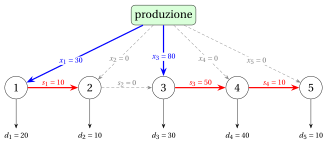

# PD per il problema del lot sizing senza capacità

**Parte 3 · Programmazione dinamica · Capitolo 25** · [:material-file-pdf-box: Dispensa, volume 3 (PDF)](../../pdf/dispensa-3-programmazione-dinamica.pdf) · [:material-presentation: Slide](../../pdf/slide-dp-lot-sizing.pdf) · [:material-pencil: Esercizi: Lot sizing senza capacità (ULS)](../../esercizi/dp-lot-sizing.md) · [:material-gesture-tap: App: Wagner-Whitin per il lot sizing senza capacità](../../laboratorio/wagner-whitin-lot-sizing.md)

!!! nota "Prerequisiti"

    - Da questo modulo, i capitoli [«Problemi di lot sizing»](../../problemi-di-ottimizzazione-combinatoria/lot-sizing/index.md) e [«Formulazioni dei problemi di lot sizing»](../../formulazioni/lot-sizing-formulations/index.md): il problema a un solo prodotto, la sua istanza di riferimento e il suo modello PLI con le variabili $x_t$, $s_t$, $y_t$.

    - Da questo modulo, il capitolo [«Principi della programmazione dinamica»](../dp-principles.md) e gli algoritmi di PD dei capitoli precedenti: ricorrenza, casi base, tabella di lookup e ricostruzione di una soluzione.

    - Dal modulo <em>Algoritmi</em>: [lo pseudocodice (Capitolo 2)](https://fabiofurini.github.io/algoritmi/algoritmi-di-base/02-pseudocodice/) e [la dimensione dell'input (Capitolo 11)](https://fabiofurini.github.io/algoritmi/analisi/11-dimensione-input/).

!!! nota "Dove eravamo"

    - <strong>Come problema e come modello</strong>: il lot sizing a un solo prodotto e le sue formulazioni PLI (Capitolo 8 [«Problemi di lot sizing»](../../problemi-di-ottimizzazione-combinatoria/lot-sizing/index.md) e Capitolo 15 [«Formulazioni dei problemi di lot sizing»](../../formulazioni/lot-sizing-formulations/index.md)).

    - <strong>Ora, come tabella</strong>: l'algoritmo di PD di Wagner e Whitin dà il valore ottimo del problema senza capacità in $\Theta(m^2)$ passi.

!!! chiave "Obiettivi"

    Al termine di questo capitolo saremo in grado di:

    - enunciare la proprietà zero-inventory ordering e dimostrarla con l'argomento di scambio;

    - calcolare il costo $c_{j,t}$ di un lotto di produzione, e la matrice dei costi, in $O(m^2)$ passi;

    - scrivere la ricorrenza $v(t)$ sull'ultimo lotto di produzione, eseguire a mano l'algoritmo di PD e ricostruire un piano ottimo;

    - leggere la ricorrenza come un cammino minimo nella rete dei lotti di produzione;

    - contare i passi dell'algoritmo di PD e mostrare che sono $\Theta(m^2)$.

Il problema di questo capitolo è il [problema di lot sizing senza capacità (ULS)](../../catalogo/uncapacitated-lot-sizing-problem.md): la sua definizione e le sue ipotesi sono nella sua pagina.

## 25.1 Notazione, modello e soluzioni ammissibili

- Per ogni $j,t \in T$, indichiamo con

    $$
    D_{j,t}=\sum_{k=j}^{t} d_k
    $$

    la domanda totale dei periodi $j,j+1,\dots,t$, con $D_{j,t}=0$ se $j>t$.

- Il modello PLI è il modello $\mathrm{ILP}_{\mathrm{ULS}}$ del [Capitolo 15 «Formulazioni dei problemi di lot sizing»](../../formulazioni/lot-sizing-formulations/index.md), sezione «Modelli PLI per le varianti»: il modello $\mathrm{ILP}_{\mathrm{CLSP}}$ senza i vincoli di capacità e con il valore di big-M $D_{t,m}$ del periodo $t$, la domanda totale dei periodi rimanenti. Le sue variabili sono la produzione $x_t$, la scorta $s_t$ alla fine del periodo $t$ e il setup $y_t\in\{0,1\}$, per ogni periodo $t \in T$.

!!! chiave ""

    Richiamiamo il modello $\mathrm{ILP}_{\mathrm{ULS}}$ del problema di lot sizing senza capacità (ULS):

    

    \begin{align*}
    && \min ~~ \sum_{t \in T} \left(sc_t\, y_t + vc_t\, x_t + hc_t\, s_t\right) \label{uls:obj} \tag{25.1a}\\[1ex]
    && \text{soggetto a} \quad s_{t-1} + x_t & = d_t + s_t, & \forall t \in T, \label{uls:bal} \tag{25.1b}\\[1ex]
    && x_t & \le D_{t,m}\, y_t, & \forall t \in T, \label{uls:big} \tag{25.1c}\\[1ex]
    && s_0 = s_m & = 0, \label{uls:end} \tag{25.1d}\\[1ex]
    && x_t & \in \Z_{\ge 0}, & \forall t \in T, \label{uls:domx} \tag{25.1e}\\[1ex]
    && s_t & \in \Z_{\ge 0}, & \forall t \in T, \label{uls:doms} \tag{25.1f}\\[1ex]
    && y_t & \in \{0,1\}, & \forall t \in T. \label{uls:domy} \tag{25.1g}
    \end{align*}

    Questo modello PLI si chiama modello $\mathrm{ILP}_{\mathrm{ULS}}$.

- Descrizione della funzione obiettivo e dei vincoli del modello $\mathrm{ILP}_{\mathrm{ULS}}$:

    - la funzione obiettivo $\eqref{uls:obj}$ minimizza il costo totale di setup, produzione e mantenimento a scorta;

    - i vincoli $\eqref{uls:bal}$ sono i vincoli di bilanciamento del flusso;

    - i vincoli $\eqref{uls:big}$ impongono un setup in ogni periodo con produzione positiva;

    - il vincolo $\eqref{uls:end}$ impone una scorta vuota all'inizio e alla fine dell'orizzonte;

    - infine, i vincoli $\eqref{uls:domx}$–$\eqref{uls:domy}$ definiscono le variabili del modello PLI.

!!! esempio "Esempio 25.1: Lot sizing senza capacità"

    Consideriamo $m=5$ periodi con i seguenti dati:

    $$
    \begin{array}{l|rrrrr}
    \hline {t} & {1} & {2} & {3} & {4} & {5} \\
    \hline {d_t} & {20} & {10} & {30} & {40} & {10} \\
    {sc_t} & {50} & {50} & {50} & {50} & {50} \\
    {vc_t} & {0} & {0} & {0} & {0} & {0} \\
    {hc_t} & {1} & {1} & {1} & {1} & {1} \\
    \hline
    \end{array}
    $$

    Chiamiamo questa istanza dell'ULS [Esempio 25.1](#box-1-texuls1). È l'istanza di riferimento del Capitolo 8 [«Problemi di lot sizing»](../../problemi-di-ottimizzazione-combinatoria/lot-sizing/index.md), contata in singoli pezzi invece che in decine e senza le capacità (costo di setup $50$, costo di mantenimento a scorta $1$, nessun costo variabile di produzione).

### 25.1.1 Codifica delle soluzioni ammissibili

!!! chiave ""

    Una <em>soluzione ammissibile</em> dell'ULS è un piano di produzione che soddisfa la domanda di ogni periodo, partendo e terminando con la scorta vuota.

- Una soluzione ammissibile dell'ULS si può descrivere con un vettore soluzione

    $$
    (x_1,x_2,\dots,x_m)
    $$

    dove ogni componente ha il seguente significato:

    $$
    x_t = \text{numero di unità prodotte nel periodo } t,
    \qquad \forall t \in \{1,2,\dots,m\}.
    $$

    La scorta alla fine del periodo $t$ è determinata dal vettore:

    $$
    s_t=\sum_{j=1}^{t} x_j - D_{1,t},
    \qquad \forall t \in \{1,2,\dots,m\}.
    $$

    Poiché la soluzione è ammissibile, le scorte sono non negative e l'ultima è vuota:

    $$
    s_t \ge 0 \quad \forall t \in \{1,2,\dots,m-1\}, \qquad s_m=0.
    $$

    Nel periodo $t$ si paga un setup se e solo se $x_t>0$. Il costo totale di una soluzione ammissibile è

    $$
    \sum_{t=1,\ x_t>0}^{m} sc_t+\sum_{t=1}^{m} vc_t\, x_t+\sum_{t=1}^{m} hc_t\, s_t.
    $$

!!! esempio "Esempio 25.2: Una soluzione ammissibile"

    Consideriamo l'istanza dell'ULS dell'[Esempio 25.1](#box-1-texuls1). La rete seguente rappresenta la soluzione ammissibile $(30,\allowbreak 0,\allowbreak 80,\allowbreak 0,\allowbreak 0)$: ogni periodo è un nodo, la produzione $x_t$ entra nel nodo $t$, la domanda $d_t$ ne esce, e la scorta $s_t$ scorre dal nodo $t$ al nodo $t+1$. Gli archi spessi portano un flusso positivo.

    { .fig loading=lazy  }

    I setup sono nei periodi $1$, $3$, le scorte sono $(s_1,\dots,s_{5})=(10,\allowbreak 0,\allowbreak 50,\allowbreak 10,\allowbreak 0)$, e il costo totale è (non c'è costo variabile di produzione)

    $$
    \underbrace{50+50}_{\text{setup}}+\underbrace{1\cdot 10+1\cdot 0+1\cdot 50+1\cdot 10+1\cdot 0}_{\text{mantenimento}}=100+70=170.
    $$

- Una quantità prodotta può assumere molti valori, e un'istanza dell'ULS ha un numero enorme di soluzioni ammissibili (infinite, se non si richiede che le quantità siano intere). La proprietà seguente mostra che basta considerarne pochissime.

### 25.1.2 La proprietà zero-inventory ordering

!!! teorema "Teorema 25.1: Zero-inventory ordering (Wagner e Whitin, 1958)"

    Ogni istanza dell'ULS ha una soluzione ottima in cui nessun periodo con produzione positiva inizia con una scorta positiva, cioè

    $$
    s_{t-1}\, x_t = 0 \qquad \forall t \in \{1,2,\dots,m\}.
    $$

- <em>Dimostrazione.</em> Anzitutto, una soluzione ottima esiste: il vettore $(d_1,d_2,\dots,d_m)$ è ammissibile e, per ciascuna delle $2^m$ scelte dell'insieme dei periodi con setup, il problema che resta è un problema LP su un poliedro limitato (poiché $s_m=0$, ogni $x_t$ è compreso fra $0$ e $D_{1,m}$), quindi ha una soluzione ottima ogni volta che è ammissibile.

- Fra tutte le soluzioni ottime, consideriamone una con il <strong>minimo numero di periodi con produzione positiva</strong>, e supponiamo, per assurdo, che esista un periodo $t$ con $x_t>0$ e $s_{t-1}>0$.

- Poiché $s_0=0$ e $s_{t-1}>0$, qualcosa viene prodotto prima del periodo $t$: sia $j<t$ l'ultimo periodo prima di $t$ con $x_j>0$. Nei periodi $j+1,\dots,t-1$ non si produce alcuna unità, quindi la scorta può solo diminuire dal periodo $j$ al periodo $t-1$:

    $$
    s_k \ge s_{t-1} > 0 \qquad \forall k \in \{j,j+1,\dots,t-1\}.
    $$

- Per un numero $\varepsilon$, spostiamo $\varepsilon$ unità di produzione dal periodo $j$ al periodo $t$: sostituiamo $x_j$ con $x_j-\varepsilon$, $x_t$ con $x_t+\varepsilon$ e $s_k$ con $s_k-\varepsilon$ per ogni $k \in \{j,\dots,t-1\}$. Tutti i vincoli di bilanciamento restano soddisfatti, e il nuovo piano è ammissibile per ogni $\varepsilon$ con

    $$
    -x_t \le \varepsilon \le \min\{x_j,\ s_{t-1}\}.
    $$

- Finché $x_j$ e $x_t$ restano positivi, i setup non cambiano e il costo varia di $\varepsilon\,\Delta$, dove

    $$
    \Delta = vc_t - vc_j - \sum_{k=j}^{t-1} hc_k
    $$

    è il costo di produrre un'unità nel periodo $t$ meno il costo di produrla nel periodo $j$ e tenerla a scorta fino al periodo $t$.

- Se $\Delta<0$, un $\varepsilon>0$ piccolo dà una soluzione ammissibile di costo minore, il che contraddice l'ottimalità.

- Se $\Delta\ge 0$, scegliamo $\varepsilon=-x_t$: tutta la produzione del periodo $t$ viene spostata nel periodo $j$, il costo varia di $-x_t\,\Delta \le 0$, e si risparmia il costo di setup $sc_t\ge 0$ del periodo $t$. La nuova soluzione è ottima e ha un periodo con produzione positiva in meno, il che contraddice la scelta della soluzione.

- Quindi un tale periodo $t$ non esiste.  $\square$

!!! chiave ""

    In una soluzione ottima con la proprietà zero-inventory ordering, ogni periodo $j$ con produzione positiva produce esattamente le domande dei periodi $j,j+1,\dots,t$, dove $t+1$ è il periodo successivo con produzione positiva (oppure $t=m$ se non ce n'è uno):

    $$
    x_j = D_{j,t}.
    $$

- Infatti $s_{j-1}=0$ (zero-inventory ordering nel periodo $j$), $s_t=0$ (zero-inventory ordering nel periodo $t+1$, oppure $s_m=0$), e nei periodi $j+1,\dots,t$ non si produce nulla; sommando i vincoli di bilanciamento dei periodi $j,\dots,t$ si ottiene $x_j=D_{j,t}$.

- Il periodo $1$ produce sempre, perché $s_0=0$ e $d_1\ge 1$. Una soluzione con la proprietà zero-inventory ordering è quindi determinata dall'insieme dei suoi periodi di produzione, che contiene il periodo $1$ e un qualsiasi sottoinsieme di $\{2,3,\dots,m\}$.

!!! chiave ""

    Il numero di soluzioni dell'ULS con la proprietà zero-inventory ordering è $2^{m-1}$, perché ogni periodo $t\in\{2,3,\dots,m\}$ può, indipendentemente dagli altri, produrre o no.

- Il numero di queste soluzioni cresce esponenzialmente con il numero $m$ di periodi:

    $$
    2^{m-1}=O(2^m).
    $$

    Quindi enumerarle diventa rapidamente impraticabile al crescere di $m$.

!!! esempio "Esempio 25.3: Enumerazione delle soluzioni con la proprietà zero-inventory ordering"

    Consideriamo l'istanza dell'ULS dell'[Esempio 25.1](#box-1-texuls1):

    $$
    \begin{array}{l|rrrrr}
    \hline {t} & {1} & {2} & {3} & {4} & {5} \\
    \hline {d_t} & {20} & {10} & {30} & {40} & {10} \\
    {sc_t} & {50} & {50} & {50} & {50} & {50} \\
    {vc_t} & {0} & {0} & {0} & {0} & {0} \\
    {hc_t} & {1} & {1} & {1} & {1} & {1} \\
    \hline
    \end{array}
    $$

    Ci sono $2^{5-1}=16$ soluzioni con la proprietà zero-inventory ordering. Per ciascuna di esse, la tabella riporta i periodi di produzione, il vettore soluzione, le scorte e il costo totale, scritto come costo di setup più costo di mantenimento a scorta. I costi ottimi sono evidenziati.

    
<table>
    <tr>
    <th>Etichetta</th>
    <th>Periodi di produzione</th>
    <th>Vettore soluzione</th>
    <th>Scorte \((s_1,\dots,s_{5})\)</th>
    <th>Costo totale</th>
    </tr>
    <tr>
    <td>\((1)\)</td>
    <td>\(\{1\}\)</td>
    <td>\((110,\allowbreak 0,\allowbreak 0,\allowbreak 0,\allowbreak 0)\)</td>
    <td>\((90,\allowbreak 80,\allowbreak 50,\allowbreak 10,\allowbreak 0)\)</td>
    <td>\(50+230=280\)</td>
    </tr>
    <tr>
    <td>\((2)\)</td>
    <td>\(\{1,5\}\)</td>
    <td>\((100,\allowbreak 0,\allowbreak 0,\allowbreak 0,\allowbreak 10)\)</td>
    <td>\((80,\allowbreak 70,\allowbreak 40,\allowbreak 0,\allowbreak 0)\)</td>
    <td>\(100+190=290\)</td>
    </tr>
    <tr>
    <td>\((3)\)</td>
    <td>\(\{1,4\}\)</td>
    <td>\((60,\allowbreak 0,\allowbreak 0,\allowbreak 50,\allowbreak 0)\)</td>
    <td>\((40,\allowbreak 30,\allowbreak 0,\allowbreak 10,\allowbreak 0)\)</td>
    <td>\(100+80=180\)</td>
    </tr>
    <tr>
    <td>\((4)\)</td>
    <td>\(\{1,4,5\}\)</td>
    <td>\((60,\allowbreak 0,\allowbreak 0,\allowbreak 40,\allowbreak 10)\)</td>
    <td>\((40,\allowbreak 30,\allowbreak 0,\allowbreak 0,\allowbreak 0)\)</td>
    <td>\(150+70=220\)</td>
    </tr>
    <tr>
    <td>\((5)\)</td>
    <td>\(\{1,3\}\)</td>
    <td>\((30,\allowbreak 0,\allowbreak 80,\allowbreak 0,\allowbreak 0)\)</td>
    <td>\((10,\allowbreak 0,\allowbreak 50,\allowbreak 10,\allowbreak 0)\)</td>
    <td class="cella-blu">\(100+70=170\)</td>
    </tr>
    <tr>
    <td>\((6)\)</td>
    <td>\(\{1,3,5\}\)</td>
    <td>\((30,\allowbreak 0,\allowbreak 70,\allowbreak 0,\allowbreak 10)\)</td>
    <td>\((10,\allowbreak 0,\allowbreak 40,\allowbreak 0,\allowbreak 0)\)</td>
    <td>\(150+50=200\)</td>
    </tr>
    <tr>
    <td>\((7)\)</td>
    <td>\(\{1,3,4\}\)</td>
    <td>\((30,\allowbreak 0,\allowbreak 30,\allowbreak 50,\allowbreak 0)\)</td>
    <td>\((10,\allowbreak 0,\allowbreak 0,\allowbreak 10,\allowbreak 0)\)</td>
    <td class="cella-blu">\(150+20=170\)</td>
    </tr>
    <tr>
    <td>\((8)\)</td>
    <td>\(\{1,3,4,5\}\)</td>
    <td>\((30,\allowbreak 0,\allowbreak 30,\allowbreak 40,\allowbreak 10)\)</td>
    <td>\((10,\allowbreak 0,\allowbreak 0,\allowbreak 0,\allowbreak 0)\)</td>
    <td>\(200+10=210\)</td>
    </tr>
    <tr>
    <td>\((9)\)</td>
    <td>\(\{1,2\}\)</td>
    <td>\((20,\allowbreak 90,\allowbreak 0,\allowbreak 0,\allowbreak 0)\)</td>
    <td>\((0,\allowbreak 80,\allowbreak 50,\allowbreak 10,\allowbreak 0)\)</td>
    <td>\(100+140=240\)</td>
    </tr>
    <tr>
    <td>\((10)\)</td>
    <td>\(\{1,2,5\}\)</td>
    <td>\((20,\allowbreak 80,\allowbreak 0,\allowbreak 0,\allowbreak 10)\)</td>
    <td>\((0,\allowbreak 70,\allowbreak 40,\allowbreak 0,\allowbreak 0)\)</td>
    <td>\(150+110=260\)</td>
    </tr>
    <tr>
    <td>\((11)\)</td>
    <td>\(\{1,2,4\}\)</td>
    <td>\((20,\allowbreak 40,\allowbreak 0,\allowbreak 50,\allowbreak 0)\)</td>
    <td>\((0,\allowbreak 30,\allowbreak 0,\allowbreak 10,\allowbreak 0)\)</td>
    <td>\(150+40=190\)</td>
    </tr>
    <tr>
    <td>\((12)\)</td>
    <td>\(\{1,2,4,5\}\)</td>
    <td>\((20,\allowbreak 40,\allowbreak 0,\allowbreak 40,\allowbreak 10)\)</td>
    <td>\((0,\allowbreak 30,\allowbreak 0,\allowbreak 0,\allowbreak 0)\)</td>
    <td>\(200+30=230\)</td>
    </tr>
    <tr>
    <td>\((13)\)</td>
    <td>\(\{1,2,3\}\)</td>
    <td>\((20,\allowbreak 10,\allowbreak 80,\allowbreak 0,\allowbreak 0)\)</td>
    <td>\((0,\allowbreak 0,\allowbreak 50,\allowbreak 10,\allowbreak 0)\)</td>
    <td>\(150+60=210\)</td>
    </tr>
    <tr>
    <td>\((14)\)</td>
    <td>\(\{1,2,3,5\}\)</td>
    <td>\((20,\allowbreak 10,\allowbreak 70,\allowbreak 0,\allowbreak 10)\)</td>
    <td>\((0,\allowbreak 0,\allowbreak 40,\allowbreak 0,\allowbreak 0)\)</td>
    <td>\(200+40=240\)</td>
    </tr>
    <tr>
    <td>\((15)\)</td>
    <td>\(\{1,2,3,4\}\)</td>
    <td>\((20,\allowbreak 10,\allowbreak 30,\allowbreak 50,\allowbreak 0)\)</td>
    <td>\((0,\allowbreak 0,\allowbreak 0,\allowbreak 10,\allowbreak 0)\)</td>
    <td>\(200+10=210\)</td>
    </tr>
    <tr>
    <td>\((16)\)</td>
    <td>\(\{1,2,3,4,5\}\)</td>
    <td>\((20,\allowbreak 10,\allowbreak 30,\allowbreak 40,\allowbreak 10)\)</td>
    <td>\((0,\allowbreak 0,\allowbreak 0,\allowbreak 0,\allowbreak 0)\)</td>
    <td>\(250+0=250\)</td>
    </tr>
    </table>

    Il valore ottimo dell'istanza dell'ULS è $170$, raggiunto da $2$ soluzioni: $(5)$ e $(7)$.

-   **Panoramica**

    Notazione, modello e soluzioni ammissibili · Codifica delle soluzioni ammissibili · La proprietà zero-inventory ordering

    [:octicons-arrow-right-24: Apri](#251-notazione-modello-e-soluzioni-ammissibili)

-   **25.2 Un algoritmo di PD per l'ULS**

    [:octicons-arrow-right-24: Apri](un-algoritmo-di-pd-per-l-uls.md)

-   **25.2.2 Un algoritmo di PD per l'ULS: Passo 1 e Passo 2**

    [:octicons-arrow-right-24: Apri](un-algoritmo-di-pd-per-l-uls-passo-1-e-passo-2.md)

-   **Errori tipici · In sintesi**

    In sintesi

    [:octicons-arrow-right-24: Apri](errori-tipici.md)

---

**Avanti:** [25.2 Un algoritmo di PD per l'ULS](un-algoritmo-di-pd-per-l-uls.md)

---

**Esercizi su questo capitolo:** [:material-pencil: Lot sizing senza capacità (ULS)](../../esercizi/dp-lot-sizing.md)

<!-- laboratorio-interattivo: sezione generata da interattivi.py -->

:material-flask-outline: **Nel laboratorio interattivo:** [Wagner-Whitin per il lot sizing senza capacità](../../laboratorio/wagner-whitin-lot-sizing.md).