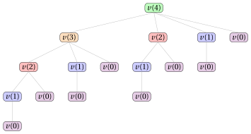

# 25.2.2 Un algoritmo di PD per l'ULS: Passo 1 e Passo 2 { #2522-passo-1-e-passo-2 }

**Parte 3 · Programmazione dinamica · Capitolo 25** · [:material-book-open-variant: Capitolo 25: Lot sizing senza capacità (ULS)](index.md) · [:material-file-pdf-box: Dispensa, volume 3 (PDF)](../../pdf/dispensa-3-programmazione-dinamica.pdf) · [:material-pencil: Esercizi: Lot sizing senza capacità (ULS)](../../esercizi/dp-lot-sizing.md) · [:material-gesture-tap: App: Wagner-Whitin per il lot sizing senza capacità](../../laboratorio/wagner-whitin-lot-sizing.md)

- <u>Passo 1</u>: calcolo del valore ottimo

    !!! formula ""

        Per ogni $t \in \{1,2,\dots,m\}$, sia $v(t)$ il valore ottimo della sottoistanza dell'ULS data da:

        1. un insieme $\{1,2,\dots,t\}$ di $t$ periodi di tempo,

        2. per ogni periodo $j \in \{1,2,\dots,t\}$, una domanda $d_j$,

        3. per ogni periodo $j \in \{1,2,\dots,t\}$, un costo di setup $sc_j$, un costo variabile di produzione $vc_j$ e un costo di mantenimento a scorta $hc_j$.

        La formula ricorsiva per calcolare $v(t)$ è la seguente:

        \begin{equation*}
        \label{eq:ww}
        v(t)= \left\{ \begin{array}{ll}
        \displaystyle \min \bigg\{ v(j-1) + c_{j,t} : j \in \{1,2,\dots,t\}\bigg\} & \textrm{se $1\le t \le m$,}\\[2ex]
        0 & \textrm{se $t=0$.}
        \end{array} \right. \tag{25.3}
        \end{equation*}

    - La sottoistanza con i periodi $\{1,\dots,t\}$ è un'istanza dell'ULS dello stesso tipo: la sua scorta deve essere vuota alla fine del periodo $t$. Qui $v(0)=0$, perché un insieme vuoto di periodi non ha domanda né costo.

    - Il processo di decomposizione ricorsiva della formula $\eqref{eq:ww}$ genera $t$ <strong>sottoproblemi indipendenti</strong>, ciascuno corrispondente a una possibile scelta del periodo $j$ dell'<strong>ultimo lotto di produzione</strong>, che produce le domande dei periodi $j,\dots,t$.

    - Per la proprietà zero-inventory ordering applicata alla sottoistanza, la scorta è vuota alla fine del periodo $j-1$, e il sottoproblema residuo è la sottoistanza dell'ULS con i periodi $\{1,\dots,j-1\}$.

    - Il valore ottimo $v(t)$ si ottiene provando tutti i possibili periodi dell'ultimo lotto di produzione e scegliendo quello che minimizza la somma $v(j-1)+c_{j,t}$ del valore ottimo del sottoproblema residuo e del costo dell'ultimo lotto.

    - Quindi una soluzione ottima per i periodi $\{1,\dots,t\}$ si costruisce combinando l'ultimo lotto di produzione scelto nel periodo $j$ con una soluzione ottima del sottoproblema residuo con i periodi $\{1,\dots,j-1\}$.

        $\rightsquigarrow$ <strong>Sottostruttura ottima verificata!</strong>

    - Scelte diverse dell'ultimo lotto di produzione, fatte eventualmente per valori diversi di $t$, possono portare allo stesso insieme residuo di periodi, e quindi lo stesso valore $v(t)$ può dover essere calcolato più volte durante la valutazione ricorsiva della formula $\eqref{eq:ww}$.

        $\rightsquigarrow$ <strong>Sottoproblemi sovrapposti verificati!</strong>

    - Un <strong>primo metodo</strong> per calcolare il valore ottimo $v(m)$ dell'istanza dell'ULS è l'<strong>approccio top-down</strong>. Il metodo parte dalla chiamata con $t=m$ e valuta ricorsivamente la formula $\eqref{eq:ww}$: ogni chiamata per i periodi $\{1,\dots,t\}$ genera altre chiamate per i periodi $\{1,\dots,j-1\}$, per ogni $j \in \{1,2,\dots,t\}$, finché non si raggiunge il caso base $v(0)$.

    - L'<strong>albero di ricorsione</strong> della funzione $v$ ha un nodo per ogni chiamata ricorsiva, etichettato con la chiamata che rappresenta. La radice rappresenta la chiamata iniziale. I figli di un nodo rappresentano le chiamate ricorsive effettuate da quella chiamata. Le foglie rappresentano i casi base.

        

        !!! esempio "Esempio 25.5: Albero di ricorsione"

            Consideriamo i primi quattro periodi dell'istanza dell'ULS dell'[Esempio 25.1](index.md#box-1-texuls1) (con cinque periodi l'albero ha $32$ nodi). Questo è l'albero di ricorsione dell'approccio top-down per calcolare $v(4)$:

            { .fig loading=lazy  }

            I figli di un nodo $v(t)$ sono ordinati secondo $j\in\{1,\dots,t\}$: il figlio $v(j-1)$ corrisponde a un ultimo lotto di produzione nel periodo $j$. La funzione $v$ viene chiamata $16$ volte, e gli stessi sottoproblemi vengono risolti più volte: $v(2)$ viene chiamata $2$ volte, $v(1)$ viene chiamata $4$ volte e $v(0)$ viene chiamata $8$ volte. Tutte le altre chiamate vengono effettuate una sola volta.

    - Il valore $v(t)$, per un periodo generico $t$, si può calcolare una volta noti i valori $v(j)$ per tutti i periodi minori $j<t$.

        

        !!! esempio "Esempio 25.6: Calcolo dei valori della funzione $v$"

            Consideriamo l'istanza dell'ULS dell'[Esempio 25.1](index.md#box-1-texuls1), con la matrice ${c}$ dei costi dei lotti di produzione:

            $$
            \begin{array}{l|rrrrr}
            \hline {{c}[j][t]} & {t=1} & {t=2} & {t=3} & {t=4} & {t=5} \\
            \hline {j=1} & {50} & {60} & {120} & {240} & {280} \\
            {j=2} & {-} & {50} & {80} & {160} & {190} \\
            {j=3} & {-} & {-} & {50} & {90} & {110} \\
            {j=4} & {-} & {-} & {-} & {50} & {60} \\
            {j=5} & {-} & {-} & {-} & {-} & {50} \\
            \hline
            \end{array}
            $$

            Il valore della funzione $v$ si può calcolare partendo dal caso base $v(0)=0$ e calcolando poi i valori di $v(1)$, $v(2)$, $v(3)$, $v(4)$ e $v(5)$ nell'ordine, come segue:

            - Poiché conosciamo il valore di $v(0)$, possiamo calcolare $v(1)$ come segue:

                $$
                v(1)=v(0)+c_{1,1}=0+50=50
                $$

            - Calcolati $v(1)$ e $v(0)$, possiamo calcolare $v(2)$ come segue:

                \begin{align*}
                v(2)&=\min\{v(0)+c_{1,2},v(1)+c_{2,2}\}\\
                &=\min\{0+60,50+50\}=60
                \end{align*}

            - Calcolati $v(2)$, $v(1)$ e $v(0)$, possiamo calcolare $v(3)$ come segue:

                \begin{align*}
                v(3)&=\min\{v(0)+c_{1,3},v(1)+c_{2,3},v(2)+c_{3,3}\}\\
                &=\min\{0+120,50+80,60+50\}=110
                \end{align*}

            - Calcolati $v(3)$, $v(2)$, $v(1)$ e $v(0)$, possiamo calcolare $v(4)$ come segue:

                \begin{align*}
                v(4)&=\min\{v(0)+c_{1,4},v(1)+c_{2,4},v(2)+c_{3,4},v(3)+c_{4,4}\}\\
                &=\min\{0+240,50+160,60+90,110+50\}=150
                \end{align*}

            - Calcolati $v(4)$, $v(3)$, $v(2)$, $v(1)$ e $v(0)$, possiamo calcolare $v(5)$ come segue:

                \begin{align*}
                v(5)&=\min\{v(0)+c_{1,5},v(1)+c_{2,5},v(2)+c_{3,5},v(3)+c_{4,5},v(4)+c_{5,5}\}\\
                &=\min\{0+280,50+190,60+110,110+60,150+50\}=170
                \end{align*}

    - Possiamo evitare di risolvere ripetutamente gli stessi sottoproblemi memorizzando il valore di ciascun sottoproblema appena viene calcolato. I valori sono memorizzati in una <strong>tabella di lookup</strong>, il vettore ${v}[0..m]$, la cui cella ${v}[t]$ contiene $v(t)$.

    - Poiché la soluzione di un sottoproblema con valore $v(t)$ dipende solo dai sottoproblemi con valori $v(j-1)$, con $j-1<t$, possiamo risolvere i sottoproblemi per valori crescenti di $t$, partendo dal caso base $v(0)=0$ fino ad arrivare a $v(m)$: questa osservazione porta in modo naturale a un <strong>metodo molto più efficiente</strong> per calcolare il valore ottimo $v(m)$ dell'istanza dell'ULS.

    - Un <strong>secondo metodo</strong> per calcolare il valore ottimo $v(m)$ dell'istanza dell'ULS è l'<strong>approccio bottom-up</strong>. Il metodo parte dal caso base $v(0)=0$ e valuta la formula $\eqref{eq:ww}$ per periodi crescenti $t \in \{1,2,\dots,m\}$: ogni valore $v(t)$ si calcola usando i valori già calcolati $v(0), v(1), \dots, v(t-1)$, fino a ottenere il valore $v(m)$ dell'istanza dell'ULS.

        Questo è lo pseudocodice dell'<strong>algoritmo di PD con l'approccio bottom-up</strong>:

        !!! algoritmo "Algoritmo: DP\_WW"

            

<strong>Input:</strong> Un'istanza dell'ULS data dal numero \(m\) di periodi e dai vettori \(d[1..m]\), \(sc[1..m]\), \(vc[1..m]\), \(hc[1..m]\)

<strong>Output:</strong> Il valore ottimo

1<strong>Function</strong> DP_WW(\(m,d,sc,vc,hc\))

2\({c} := \textnormal{CostMatrix}(m,d,sc,vc,hc)\)

3\({v} := \textnormal{new array}[0..m]\)

4\({v}[0] \leftarrow 0\)

5<strong>for</strong> \(t := 1\) <strong>to</strong> \(m\)  <strong>do</strong>

6\(\mathit{b} := +\infty\)

7<strong>for</strong> \(j := 1\) <strong>to</strong> \(t\)  <strong>do</strong>

8<strong>if</strong> \({v}[j-1] + {c}[j][t] < \mathit{b}\)  <strong>then</strong>

9\(\mathit{b} \leftarrow {v}[j-1] + {c}[j][t]\)

10<strong>end</strong>

11<strong>end</strong>

12\({v}[t] \leftarrow \mathit{b}\)

13<strong>end</strong>

14<strong>return</strong> \({v}[m]\)

        - La matrice ${c}$ contiene i costi dei lotti di produzione, calcolati dall'algoritmo CostMatrix.

        - Il vettore ${v}[0..m]$ è la <strong>tabella di lookup</strong>: memorizza i valori ottimi di tutti i sottoproblemi, con il caso base ${v}[0]=0$.

        - Il ciclo esterno, su $t \in \{1,2,\dots,m\}$, calcola ${v}[t]$ in ordine crescente dell'ultimo periodo.

        - Il ciclo interno, su $j \in \{1,2,\dots,t\}$, valuta tutti i possibili periodi dell'ultimo lotto di produzione e conserva in $\mathit{b}$ il valore minimo ${v}[j-1]+{c}[j][t]$; la variabile $\mathit{b}$ parte da $+\infty$, quindi il primo confronto la aggiorna sempre.

        - Al termine del ciclo interno, ${v}[t] \leftarrow \mathit{b}$ memorizza il valore ottimo ${v}[t]$.

        - Infine, viene restituito il valore ottimo ${v}[m]$ dell'istanza dell'ULS.

        

        !!! esempio "Esempio 25.7: Esecuzione dell'algoritmo di PD"

            Consideriamo l'istanza dell'ULS dell'[Esempio 25.1](index.md#box-1-texuls1), con la matrice ${c}$ dei costi dei lotti di produzione:

            $$
            \begin{array}{l|rrrrr}
            \hline {{c}[j][t]} & {t=1} & {t=2} & {t=3} & {t=4} & {t=5} \\
            \hline {j=1} & {50} & {60} & {120} & {240} & {280} \\
            {j=2} & {-} & {50} & {80} & {160} & {190} \\
            {j=3} & {-} & {-} & {50} & {90} & {110} \\
            {j=4} & {-} & {-} & {-} & {50} & {60} \\
            {j=5} & {-} & {-} & {-} & {-} & {50} \\
            \hline
            \end{array}
            $$

            Per ogni passo dell'algoritmo di PD, la tabella riporta i valori di $t$ e $j$, il valore corrente di $\mathit{b}$ e la cella ${v}[t]$. La cella di $\mathit{b}$ è evidenziata in <mark>rosso</mark> quando viene aggiornata; la cella di ${v}[t]$ è evidenziata in <mark>blu</mark> quando viene assegnata.

            
<table>
            <tr>
            <th>\(t\)</th>
            <th>\(j\)</th>
            <th>\({v}[t]\)</th>
            <th>\(\mathit{b}\)</th>
            <th>Azione</th>
            </tr>
            <tr>
            <td>\(-\)</td>
            <td>\(-\)</td>
            <td class="cella-blu">0</td>
            <td>\(-\)</td>
            <td>\({v}[0]\leftarrow 0\)</td>
            </tr>
            <tr>
            <td></td>
            <td>\(-\)</td>
            <td>\(-\)</td>
            <td>\(+\infty\)</td>
            <td>\(\mathit{b}\leftarrow +\infty\)</td>
            </tr>
            <tr>
            <td>1</td>
            <td>1</td>
            <td>\(-\)</td>
            <td class="cella-rossa">50</td>
            <td>\({v}[0]{+}{c}[1][1]=0{+}50=50<+\infty\): \(\mathit{b}\leftarrow 50\)</td>
            </tr>
            <tr>
            <td></td>
            <td>\(-\)</td>
            <td class="cella-blu">50</td>
            <td>50</td>
            <td>\({v}[1]\leftarrow \mathit{b}=50\)</td>
            </tr>
            <tr>
            <td></td>
            <td>\(-\)</td>
            <td>\(-\)</td>
            <td>\(+\infty\)</td>
            <td>\(\mathit{b}\leftarrow +\infty\)</td>
            </tr>
            <tr>
            <td>2</td>
            <td>1</td>
            <td>\(-\)</td>
            <td class="cella-rossa">60</td>
            <td>\({v}[0]{+}{c}[1][2]=0{+}60=60<+\infty\): \(\mathit{b}\leftarrow 60\)</td>
            </tr>
            <tr>
            <td></td>
            <td>2</td>
            <td>\(-\)</td>
            <td>60</td>
            <td>\({v}[1]{+}{c}[2][2]=50{+}50=100>60\): nessun aggiornamento</td>
            </tr>
            <tr>
            <td></td>
            <td>\(-\)</td>
            <td class="cella-blu">60</td>
            <td>60</td>
            <td>\({v}[2]\leftarrow \mathit{b}=60\)</td>
            </tr>
            <tr>
            <td></td>
            <td>\(-\)</td>
            <td>\(-\)</td>
            <td>\(+\infty\)</td>
            <td>\(\mathit{b}\leftarrow +\infty\)</td>
            </tr>
            <tr>
            <td>3</td>
            <td>1</td>
            <td>\(-\)</td>
            <td class="cella-rossa">120</td>
            <td>\({v}[0]{+}{c}[1][3]=0{+}120=120<+\infty\): \(\mathit{b}\leftarrow 120\)</td>
            </tr>
            <tr>
            <td></td>
            <td>2</td>
            <td>\(-\)</td>
            <td>120</td>
            <td>\({v}[1]{+}{c}[2][3]=50{+}80=130>120\): nessun aggiornamento</td>
            </tr>
            <tr>
            <td></td>
            <td>3</td>
            <td>\(-\)</td>
            <td class="cella-rossa">110</td>
            <td>\({v}[2]{+}{c}[3][3]=60{+}50=110<120\): \(\mathit{b}\leftarrow 110\)</td>
            </tr>
            <tr>
            <td></td>
            <td>\(-\)</td>
            <td class="cella-blu">110</td>
            <td>110</td>
            <td>\({v}[3]\leftarrow \mathit{b}=110\)</td>
            </tr>
            <tr>
            <td></td>
            <td>\(-\)</td>
            <td>\(-\)</td>
            <td>\(+\infty\)</td>
            <td>\(\mathit{b}\leftarrow +\infty\)</td>
            </tr>
            <tr>
            <td>4</td>
            <td>1</td>
            <td>\(-\)</td>
            <td class="cella-rossa">240</td>
            <td>\({v}[0]{+}{c}[1][4]=0{+}240=240<+\infty\): \(\mathit{b}\leftarrow 240\)</td>
            </tr>
            <tr>
            <td></td>
            <td>2</td>
            <td>\(-\)</td>
            <td class="cella-rossa">210</td>
            <td>\({v}[1]{+}{c}[2][4]=50{+}160=210<240\): \(\mathit{b}\leftarrow 210\)</td>
            </tr>
            <tr>
            <td></td>
            <td>3</td>
            <td>\(-\)</td>
            <td class="cella-rossa">150</td>
            <td>\({v}[2]{+}{c}[3][4]=60{+}90=150<210\): \(\mathit{b}\leftarrow 150\)</td>
            </tr>
            <tr>
            <td></td>
            <td>4</td>
            <td>\(-\)</td>
            <td>150</td>
            <td>\({v}[3]{+}{c}[4][4]=110{+}50=160>150\): nessun aggiornamento</td>
            </tr>
            <tr>
            <td></td>
            <td>\(-\)</td>
            <td class="cella-blu">150</td>
            <td>150</td>
            <td>\({v}[4]\leftarrow \mathit{b}=150\)</td>
            </tr>
            <tr>
            <td></td>
            <td>\(-\)</td>
            <td>\(-\)</td>
            <td>\(+\infty\)</td>
            <td>\(\mathit{b}\leftarrow +\infty\)</td>
            </tr>
            <tr>
            <td>5</td>
            <td>1</td>
            <td>\(-\)</td>
            <td class="cella-rossa">280</td>
            <td>\({v}[0]{+}{c}[1][5]=0{+}280=280<+\infty\): \(\mathit{b}\leftarrow 280\)</td>
            </tr>
            <tr>
            <td></td>
            <td>2</td>
            <td>\(-\)</td>
            <td class="cella-rossa">240</td>
            <td>\({v}[1]{+}{c}[2][5]=50{+}190=240<280\): \(\mathit{b}\leftarrow 240\)</td>
            </tr>
            <tr>
            <td></td>
            <td>3</td>
            <td>\(-\)</td>
            <td class="cella-rossa">170</td>
            <td>\({v}[2]{+}{c}[3][5]=60{+}110=170<240\): \(\mathit{b}\leftarrow 170\)</td>
            </tr>
            <tr>
            <td></td>
            <td>4</td>
            <td>\(-\)</td>
            <td>170</td>
            <td>\({v}[3]{+}{c}[4][5]=110{+}60=170=\mathit{b}\): nessun aggiornamento</td>
            </tr>
            <tr>
            <td></td>
            <td>5</td>
            <td>\(-\)</td>
            <td>170</td>
            <td>\({v}[4]{+}{c}[5][5]=150{+}50=200>170\): nessun aggiornamento</td>
            </tr>
            <tr>
            <td></td>
            <td>\(-\)</td>
            <td class="cella-blu">170</td>
            <td>170</td>
            <td>\({v}[5]\leftarrow \mathit{b}=170\)</td>
            </tr>
            </table>

            Questo è il vettore ${v}$ dopo l'esecuzione dell'algoritmo di PD:

            $$
            \begin{array}{c|cccccc}
            \hline  & {t=0} & {t=1} & {t=2} & {t=3} & {t=4} & {t=5} \\
            \hline {{v}[t]} & 0 & 50 & 60 & 110 & 150 & 170 \\
            \hline
            \end{array}
            $$

    - Dopo l'esecuzione dell'algoritmo di PD, il vettore ${v}$ contiene il valore ottimo ${v}[t]$ per ogni insieme di periodi $\{1,\dots,t\}$.

    - <em>Osservazione (cammino minimo).</em> La formula $\eqref{eq:ww}$ calcola un cammino minimo in una rete con nodi $0,1,\dots,m$ e un arco dal nodo $j-1$ al nodo $t$, di costo $c_{j,t}$, per ogni $j\le t$. Il valore $v(t)$ è la lunghezza di un cammino minimo dal nodo $0$ al nodo $t$. È la formulazione a cammino minimo del [Capitolo 15 «Formulazioni dei problemi di lot sizing»](../../formulazioni/lot-sizing-formulations/index.md), senza le capacità: un arco è un lotto di produzione.

- <u>Passo 2</u>: calcolo di una soluzione ottima

    - Per calcolare una soluzione ottima è necessario memorizzare alcune informazioni aggiuntive.

    - Per ogni periodo $t$, oltre al valore ottimo ${v}[t]$, memorizziamo ${r}[t]$, il periodo dell'ultimo lotto di produzione in una soluzione ottima per i periodi $\{1,\dots,t\}$.

    - Partendo da $t=m$, il valore ${r}[t]$ dà il periodo dell'ultimo lotto di produzione, che produce $D_{{r}[t],t}$ unità; i periodi rimanenti sono $\{1,\dots,{r}[t]-1\}$, e la stessa regola si può applicare di nuovo, e così via, finché non resta alcun periodo.

        Questo è lo pseudocodice dell'<strong>algoritmo di PD con l'approccio bottom-up</strong>, con la memorizzazione delle informazioni necessarie a calcolare una soluzione ottima:

        !!! algoritmo "Algoritmo: DP\_WW\_InfoSol"

            

<strong>Input:</strong> Un'istanza dell'ULS data dal numero \(m\) di periodi e dai vettori \(d[1..m]\), \(sc[1..m]\), \(vc[1..m]\), \(hc[1..m]\)

<strong>Output:</strong> Il valore ottimo e il vettore delle informazioni \({r}[1..m]\)

1<strong>Function</strong> DP_WW_InfoSol(\(m,d,sc,vc,hc\))

2\({c} := \textnormal{CostMatrix}(m,d,sc,vc,hc)\)

3\({v} := \textnormal{new array}[0..m]\)

4\({r} := \textnormal{new array}[1..m]\)

5\({v}[0] \leftarrow 0\)

6<strong>for</strong> \(t := 1\) <strong>to</strong> \(m\) <strong>do</strong>

7\(\mathit{b} := +\infty\)

8\(\mathit{a} := 0\)

9<strong>for</strong> \(j := 1\) <strong>to</strong> \(t\) <strong>do</strong>

10<strong>if</strong> \({v}[j-1] + {c}[j][t] < \mathit{b}\) <strong>then</strong>

11\(\mathit{b} \leftarrow {v}[j-1] + {c}[j][t]\)

12\(\mathit{a} \leftarrow j\)

13<strong>end</strong>

14<strong>end</strong>

15\({v}[t] \leftarrow \mathit{b}\)

16\({r}[t] \leftarrow \mathit{a}\)

17<strong>end</strong>

18<strong>return</strong> \({v}[m], {r}\)

        - L'algoritmo di PD usa la variabile temporanea aggiuntiva $\mathit{a}$ per tenere traccia della decisione presa quando $\mathit{b}$ viene aggiornato. Se viene scelto l'ultimo lotto di produzione nel periodo $j$, $\mathit{a}\leftarrow j$ memorizza questa decisione. Al termine del ciclo interno, ${r}[t]\leftarrow \mathit{a}$ memorizza il periodo dell'ultimo lotto di produzione scelto, insieme al valore ottimo ${v}[t]\leftarrow \mathit{b}$.

        - A causa del confronto stretto, in caso di pareggio si memorizza il periodo $j$ minimo.

        

        !!! esempio "Esempio 25.8: Calcolo delle informazioni aggiuntive"

            Consideriamo l'istanza dell'ULS dell'[Esempio 25.1](index.md#box-1-texuls1), con la matrice ${c}$ dei costi dei lotti di produzione:

            $$
            \begin{array}{l|rrrrr}
            \hline {{c}[j][t]} & {t=1} & {t=2} & {t=3} & {t=4} & {t=5} \\
            \hline {j=1} & {50} & {60} & {120} & {240} & {280} \\
            {j=2} & {-} & {50} & {80} & {160} & {190} \\
            {j=3} & {-} & {-} & {50} & {90} & {110} \\
            {j=4} & {-} & {-} & {-} & {50} & {60} \\
            {j=5} & {-} & {-} & {-} & {-} & {50} \\
            \hline
            \end{array}
            $$

            Per ogni passo dell'algoritmo di PD, la tabella riporta i valori di $t$ e $j$, la cella ${r}[t]$, il valore corrente di $\mathit{b}$ e il valore corrente di $\mathit{a}$. La cella di $\mathit{b}$ è evidenziata in <mark>rosso</mark> quando viene aggiornata; la cella di $\mathit{a}$ e la cella di ${r}[t]$ sono evidenziate in <mark>blu</mark> quando vengono aggiornate.

            
<table>
            <tr>
            <th>\(t\)</th>
            <th>\(j\)</th>
            <th>\({r}[t]\)</th>
            <th>\(\mathit{b}\)</th>
            <th>\(\mathit{a}\)</th>
            <th>Azione</th>
            </tr>
            <tr>
            <td>\(-\)</td>
            <td>\(-\)</td>
            <td>\(-\)</td>
            <td>\(-\)</td>
            <td>\(-\)</td>
            <td>Stato iniziale</td>
            </tr>
            <tr>
            <td></td>
            <td>\(-\)</td>
            <td>\(-\)</td>
            <td>\(+\infty\)</td>
            <td>0</td>
            <td>\(\mathit{b}\leftarrow +\infty\), \(\mathit{a}\leftarrow 0\)</td>
            </tr>
            <tr>
            <td>1</td>
            <td>1</td>
            <td>\(-\)</td>
            <td class="cella-rossa">50</td>
            <td class="cella-blu">1</td>
            <td>\({v}[0]{+}{c}[1][1]=0{+}50=50<+\infty\): \(\mathit{b}\leftarrow 50\), \(\mathit{a}\leftarrow 1\)</td>
            </tr>
            <tr>
            <td></td>
            <td>\(-\)</td>
            <td class="cella-blu">1</td>
            <td>50</td>
            <td>1</td>
            <td>\({v}[1]\leftarrow \mathit{b}=50\), \({r}[1]\leftarrow \mathit{a}=1\)</td>
            </tr>
            <tr>
            <td></td>
            <td>\(-\)</td>
            <td>\(-\)</td>
            <td>\(+\infty\)</td>
            <td>0</td>
            <td>\(\mathit{b}\leftarrow +\infty\), \(\mathit{a}\leftarrow 0\)</td>
            </tr>
            <tr>
            <td>2</td>
            <td>1</td>
            <td>\(-\)</td>
            <td class="cella-rossa">60</td>
            <td class="cella-blu">1</td>
            <td>\({v}[0]{+}{c}[1][2]=0{+}60=60<+\infty\): \(\mathit{b}\leftarrow 60\), \(\mathit{a}\leftarrow 1\)</td>
            </tr>
            <tr>
            <td></td>
            <td>2</td>
            <td>\(-\)</td>
            <td>60</td>
            <td>1</td>
            <td>\({v}[1]{+}{c}[2][2]=50{+}50=100>60\): nessun aggiornamento</td>
            </tr>
            <tr>
            <td></td>
            <td>\(-\)</td>
            <td class="cella-blu">1</td>
            <td>60</td>
            <td>1</td>
            <td>\({v}[2]\leftarrow \mathit{b}=60\), \({r}[2]\leftarrow \mathit{a}=1\)</td>
            </tr>
            <tr>
            <td></td>
            <td>\(-\)</td>
            <td>\(-\)</td>
            <td>\(+\infty\)</td>
            <td>0</td>
            <td>\(\mathit{b}\leftarrow +\infty\), \(\mathit{a}\leftarrow 0\)</td>
            </tr>
            <tr>
            <td>3</td>
            <td>1</td>
            <td>\(-\)</td>
            <td class="cella-rossa">120</td>
            <td class="cella-blu">1</td>
            <td>\({v}[0]{+}{c}[1][3]=0{+}120=120<+\infty\): \(\mathit{b}\leftarrow 120\), \(\mathit{a}\leftarrow 1\)</td>
            </tr>
            <tr>
            <td></td>
            <td>2</td>
            <td>\(-\)</td>
            <td>120</td>
            <td>1</td>
            <td>\({v}[1]{+}{c}[2][3]=50{+}80=130>120\): nessun aggiornamento</td>
            </tr>
            <tr>
            <td></td>
            <td>3</td>
            <td>\(-\)</td>
            <td class="cella-rossa">110</td>
            <td class="cella-blu">3</td>
            <td>\({v}[2]{+}{c}[3][3]=60{+}50=110<120\): \(\mathit{b}\leftarrow 110\), \(\mathit{a}\leftarrow 3\)</td>
            </tr>
            <tr>
            <td></td>
            <td>\(-\)</td>
            <td class="cella-blu">3</td>
            <td>110</td>
            <td>3</td>
            <td>\({v}[3]\leftarrow \mathit{b}=110\), \({r}[3]\leftarrow \mathit{a}=3\)</td>
            </tr>
            <tr>
            <td></td>
            <td>\(-\)</td>
            <td>\(-\)</td>
            <td>\(+\infty\)</td>
            <td>0</td>
            <td>\(\mathit{b}\leftarrow +\infty\), \(\mathit{a}\leftarrow 0\)</td>
            </tr>
            <tr>
            <td>4</td>
            <td>1</td>
            <td>\(-\)</td>
            <td class="cella-rossa">240</td>
            <td class="cella-blu">1</td>
            <td>\({v}[0]{+}{c}[1][4]=0{+}240=240<+\infty\): \(\mathit{b}\leftarrow 240\), \(\mathit{a}\leftarrow 1\)</td>
            </tr>
            <tr>
            <td></td>
            <td>2</td>
            <td>\(-\)</td>
            <td class="cella-rossa">210</td>
            <td class="cella-blu">2</td>
            <td>\({v}[1]{+}{c}[2][4]=50{+}160=210<240\): \(\mathit{b}\leftarrow 210\), \(\mathit{a}\leftarrow 2\)</td>
            </tr>
            <tr>
            <td></td>
            <td>3</td>
            <td>\(-\)</td>
            <td class="cella-rossa">150</td>
            <td class="cella-blu">3</td>
            <td>\({v}[2]{+}{c}[3][4]=60{+}90=150<210\): \(\mathit{b}\leftarrow 150\), \(\mathit{a}\leftarrow 3\)</td>
            </tr>
            <tr>
            <td></td>
            <td>4</td>
            <td>\(-\)</td>
            <td>150</td>
            <td>3</td>
            <td>\({v}[3]{+}{c}[4][4]=110{+}50=160>150\): nessun aggiornamento</td>
            </tr>
            <tr>
            <td></td>
            <td>\(-\)</td>
            <td class="cella-blu">3</td>
            <td>150</td>
            <td>3</td>
            <td>\({v}[4]\leftarrow \mathit{b}=150\), \({r}[4]\leftarrow \mathit{a}=3\)</td>
            </tr>
            <tr>
            <td></td>
            <td>\(-\)</td>
            <td>\(-\)</td>
            <td>\(+\infty\)</td>
            <td>0</td>
            <td>\(\mathit{b}\leftarrow +\infty\), \(\mathit{a}\leftarrow 0\)</td>
            </tr>
            <tr>
            <td>5</td>
            <td>1</td>
            <td>\(-\)</td>
            <td class="cella-rossa">280</td>
            <td class="cella-blu">1</td>
            <td>\({v}[0]{+}{c}[1][5]=0{+}280=280<+\infty\): \(\mathit{b}\leftarrow 280\), \(\mathit{a}\leftarrow 1\)</td>
            </tr>
            <tr>
            <td></td>
            <td>2</td>
            <td>\(-\)</td>
            <td class="cella-rossa">240</td>
            <td class="cella-blu">2</td>
            <td>\({v}[1]{+}{c}[2][5]=50{+}190=240<280\): \(\mathit{b}\leftarrow 240\), \(\mathit{a}\leftarrow 2\)</td>
            </tr>
            <tr>
            <td></td>
            <td>3</td>
            <td>\(-\)</td>
            <td class="cella-rossa">170</td>
            <td class="cella-blu">3</td>
            <td>\({v}[2]{+}{c}[3][5]=60{+}110=170<240\): \(\mathit{b}\leftarrow 170\), \(\mathit{a}\leftarrow 3\)</td>
            </tr>
            <tr>
            <td></td>
            <td>4</td>
            <td>\(-\)</td>
            <td>170</td>
            <td>3</td>
            <td>\({v}[3]{+}{c}[4][5]=110{+}60=170=\mathit{b}\): nessun aggiornamento</td>
            </tr>
            <tr>
            <td></td>
            <td>5</td>
            <td>\(-\)</td>
            <td>170</td>
            <td>3</td>
            <td>\({v}[4]{+}{c}[5][5]=150{+}50=200>170\): nessun aggiornamento</td>
            </tr>
            <tr>
            <td></td>
            <td>\(-\)</td>
            <td class="cella-blu">3</td>
            <td>170</td>
            <td>3</td>
            <td>\({v}[5]\leftarrow \mathit{b}=170\), \({r}[5]\leftarrow \mathit{a}=3\)</td>
            </tr>
            </table>

            Questo è il vettore ${r}$ dopo l'esecuzione dell'algoritmo di PD:

            $$
            \begin{array}{c|ccccc}
            \hline  & {t=1} & {t=2} & {t=3} & {t=4} & {t=5} \\
            \hline {{r}[t]} & 1 & 1 & 3 & 3 & 3 \\
            \hline
            \end{array}
            $$

    - Calcolato il vettore ${r}$, si può calcolare una soluzione ottima dell'istanza dell'ULS applicando ripetutamente la regola seguente, partendo da $t=m$ e da $x_j=0$ per ogni $j \in \{1,2,\dots,m\}$:

        $$
        x_{{r}[t]} \leftarrow D_{{r}[t],t},
        \qquad
        t \leftarrow {r}[t]-1,
        $$

        finché $t=0$. Si ottiene così il vettore $(x_1,x_2,\dots,x_m)$, in cui ogni componente $x_j$ è il numero di unità prodotte nel periodo $j$ in una soluzione ottima.

    - Lo pseudocodice seguente implementa il calcolo di una soluzione ottima, dato il vettore ${r}$.

        !!! algoritmo "Algoritmo: DP\_WW\_SolComputation"

            

<strong>Input:</strong> Il numero \(m\) di periodi e le domande \(d[1..m]\) dell'istanza dell'ULS, e il vettore \({r}[1..m]\)

<strong>Output:</strong> Una soluzione ottima dell'istanza dell'ULS

1<strong>Function</strong> DP_WW_SolComputation(\(m,d,{r}\))

2\(x := \textnormal{new array}[1..m]\)

3<strong>for</strong> \(j := 1\) <strong>to</strong> \(m\) <strong>do</strong>

4\(x[j] \leftarrow 0\)

5<strong>end</strong>

6\(t := m\)

7<strong>while</strong> \(t > 0\) <strong>do</strong>

8\(x[{r}[t]] \leftarrow \sum_{k={r}[t]}^{t} d[k]\)

9\(t \leftarrow {r}[t] - 1\)

10<strong>end</strong>

11<strong>return</strong> \(x\)

        

        !!! esempio "Esempio 25.9: Calcolo di una soluzione ottima"

            Dopo l'esecuzione dell'algoritmo di PD sull'istanza dell'[Esempio 25.1](index.md#box-1-texuls1), abbiamo il seguente vettore ${r}$:

            $$
            \begin{array}{c|ccccc}
            \hline  & {t=1} & {t=2} & {t=3} & {t=4} & {t=5} \\
            \hline {{r}[t]} & 1 & 1 & 3 & 3 & 3 \\
            \hline
            \end{array}
            $$

            Possiamo calcolare una soluzione ottima per $m=5$ periodi come segue:

            
<table>
            <tr>
            <th>Iterazione</th>
            <th>\(t\)</th>
            <th>\({r}[t]\)</th>
            <th>\(x[1]\)</th>
            <th>\(x[2]\)</th>
            <th>\(x[3]\)</th>
            <th>\(x[4]\)</th>
            <th>\(x[5]\)</th>
            <th>\(t\leftarrow {r}[t]-1\)</th>
            </tr>
            <tr>
            <td>\(-\)</td>
            <td>\(-\)</td>
            <td>\(-\)</td>
            <td>0</td>
            <td>0</td>
            <td>0</td>
            <td>0</td>
            <td>0</td>
            <td>\(t=5\)</td>
            </tr>
            <tr>
            <td>\(1\)</td>
            <td>\(5\)</td>
            <td>\(3\)</td>
            <td>0</td>
            <td>0</td>
            <td class="cella-blu">80</td>
            <td>0</td>
            <td>0</td>
            <td>\(t=3-1=2\)</td>
            </tr>
            <tr>
            <td>\(2\)</td>
            <td>\(2\)</td>
            <td>\(1\)</td>
            <td class="cella-blu">30</td>
            <td>0</td>
            <td>80</td>
            <td>0</td>
            <td>0</td>
            <td>\(t=1-1=0\)</td>
            </tr>
            </table>

            - $t=5$, ${r}[5]=3$: l'ultimo lotto di produzione dei periodi $1,\dots,5$ è nel periodo $3$ e copre le domande dei periodi $3,\dots,5$, quindi $x[3]\leftarrow d_{3}+d_{4}+d_{5}=30+40+10=80$

            - $t=2$, ${r}[2]=1$: l'ultimo lotto di produzione dei periodi $1,\dots,2$ è nel periodo $1$ e copre le domande dei periodi $1,\dots,2$, quindi $x[1]\leftarrow d_{1}+d_{2}=20+10=30$

            Una soluzione ottima è il vettore:

            $$
            (30,\allowbreak 0,\allowbreak 80,\allowbreak 0,\allowbreak 0)
            $$

            Il valore ottimo corrispondente è ${v}[5]=170$, lo stesso valore ottenuto dall'enumerazione dell'[Esempio 25.3](index.md#box-4-texulsenum) e da Gurobi sul modello $\mathrm{ILP}_{\mathrm{ULS}}$.

    - <em>Osservazione (pareggi).</em> Nel calcolo di ${v}[5]$, il lotto nel periodo $4$ dà lo stesso valore del lotto nel periodo $3$, ma il confronto stretto conserva $j=3$. Scegliendo invece $j=4$ si ottiene l'altra soluzione ottima $(30,\allowbreak 0,\allowbreak 30,\allowbreak 50,\allowbreak 0)$ dell'[Esempio 25.3](index.md#box-4-texulsenum). L'algoritmo di PD restituisce una soluzione ottima, non tutte.

## 25.2.3 Numero di passi

- Indichiamo con $S_c(m)$ il numero di passi eseguiti da CostMatrix nel caso peggiore, dove $m$ è il numero di periodi. Il numero di esecuzioni delle sue righe è:

    - La riga [2](un-algoritmo-di-pd-per-l-uls.md#box-5-cm-a) viene eseguita $1$ volta.

    - Le righe [3](un-algoritmo-di-pd-per-l-uls.md#box-6-cm-b), [4](un-algoritmo-di-pd-per-l-uls.md#box-7-cm-c), [5](un-algoritmo-di-pd-per-l-uls.md#box-8-cm-d) e [6](un-algoritmo-di-pd-per-l-uls.md#box-9-cm-e) vengono eseguite $m$ volte ciascuna.

    - Le righe [7](un-algoritmo-di-pd-per-l-uls.md#box-10-cm-f), [8](un-algoritmo-di-pd-per-l-uls.md#box-11-cm-g), [9](un-algoritmo-di-pd-per-l-uls.md#box-12-cm-h) e [10](un-algoritmo-di-pd-per-l-uls.md#box-13-cm-i) vengono eseguite $\displaystyle\sum_{j=1}^{m}(m-j)=\frac{m(m-1)}{2}$ volte ciascuna.

    - La riga [13](un-algoritmo-di-pd-per-l-uls.md#box-14-cm-j) viene eseguita $1$ volta.

    Quindi

    $$
    S_c(m)=2+4m+4\cdot\frac{m(m-1)}{2}=2m^2+2m+2.
    $$

- Indichiamo con $S(m)$ il numero di passi eseguiti da DP\_WW nel caso peggiore. La riga [2](#box-18-ww-a) esegue CostMatrix, cioè $S_c(m)$ passi. Nel caso peggiore, la condizione alla riga [8](#box-24-ww-g) è vera a ogni iterazione del ciclo interno, e quindi la riga [9](#box-25-ww-h) viene eseguita tante volte quanto la riga [8](#box-24-ww-g). Il numero di esecuzioni delle altre righe è:

    - La riga [3](#box-19-ww-b) viene eseguita $1$ volta.

    - La riga [4](#box-20-ww-c) viene eseguita $1$ volta.

    - La riga [5](#box-21-ww-d) viene eseguita $m$ volte.

    - La riga [6](#box-22-ww-e) viene eseguita $m$ volte.

    - La riga [7](#box-23-ww-f) viene eseguita $\displaystyle\sum_{t=1}^{m}t$ volte.

    - La riga [8](#box-24-ww-g) viene eseguita $\displaystyle\sum_{t=1}^{m}t$ volte.

    - La riga [9](#box-25-ww-h) viene eseguita $\displaystyle\sum_{t=1}^{m}t$ volte.

    - La riga [12](#box-26-ww-i) viene eseguita $m$ volte.

    - La riga [14](#box-27-ww-j) viene eseguita $1$ volta.

    Quindi il numero totale di passi nel caso peggiore è

    $$
    S(m)=S_c(m)+3+3m+3\sum_{t=1}^{m}t
    =2m^2+2m+2+3+3m+3\cdot\frac{m(m+1)}{2}
    =\frac{7m^2+13m+10}{2}.
    $$

    Di conseguenza,

    $$
    S(m)=\Theta(m^2).
    $$

    Infatti,

    $$
    \lim_{m\to\infty}
    \frac{\frac{7m^2+13m+10}{2}}{m^2}
    =
    \lim_{m\to\infty}
    \frac{1}{2}\left(7+\frac{13}{m}+\frac{10}{m^2}\right)
    =
    \frac{7}{2}\in\mathbb{R}_{>0}.
    $$

    !!! chiave ""

        L'algoritmo di PD esegue

        $$
        S(m)=\Theta(m^2)
        $$

        passi nel caso peggiore.

- DP\_WW\_InfoSol aggiunge solo un numero costante di operazioni negli stessi cicli, e quindi il suo numero di passi ha lo stesso ordine di crescita.

---

**Avanti:** [Errori tipici · In sintesi](errori-tipici.md)
