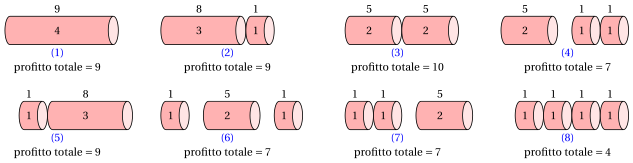

# PD per il problema del taglio delle aste

**Parte 3 · Programmazione dinamica · Capitolo 28** · [:material-file-pdf-box: Dispensa, volume 3 (PDF)](../../pdf/dispensa-3-programmazione-dinamica.pdf) · [:material-presentation: Slide](../../pdf/slide-dp-rod-cutting.pdf) · [:material-pencil: Esercizi: Taglio delle aste (RCP)](../../esercizi/dp-rod-cutting.md)

!!! nota "Prerequisiti"

    - Da questo modulo, il capitolo [«Principi della programmazione dinamica»](../dp-principles.md): sottostruttura ottima, sottoproblemi sovrapposti, relazioni di ricorrenza, casi base e approcci top-down e bottom-up.

    - Da questo modulo, il capitolo [«PD per il problema dello zaino 0/1»](../dp-knapsack/index.md): le coppie (oggetto, capacità) e la ricostruzione di una soluzione, che ritornano qui.

    - Dal modulo <em>Algoritmi</em>: come leggere lo [pseudocodice (Capitolo 2)](https://fabiofurini.github.io/algoritmi/algoritmi-di-base/02-pseudocodice/) e come contare i passi di un algoritmo ([Capitolo 12 «Tempo di esecuzione»](https://fabiofurini.github.io/algoritmi/analisi/12-tempo-esecuzione/)).

!!! chiave "Obiettivi"

    Alla fine di questo capitolo saremo in grado di:

    - enunciare l'RCP, codificare una soluzione come vettore di numeri di pezzi e spiegare perché schemi di taglio e vettori sono oggetti diversi;

    - scrivere la ricorrenza $v(\ell)$ e spiegarla, caso base compreso;

    - eseguire a mano l'algoritmo di PD con l'approccio top-down e con quello bottom-up, e con il miglior valore corrente $m$;

    - ricostruire una soluzione ottima dal vettore ${s}$, per la barra e per ogni barra più corta;

    - scrivere la seconda ricorrenza $v(j,\ell)$ sulle coppie (lunghezza massima dei pezzi, lunghezza della barra) e contare i passi dell'algoritmo di PD.

Il problema di questo capitolo è il [problema del taglio delle barre (RCP)](../../catalogo/rod-cutting-problem.md): la sua definizione è nella sua pagina.

## 28.1 Istanze e soluzioni ammissibili

!!! esempio "Esempio 28.1: Problema del taglio delle barre"

    Consideriamo una barra di lunghezza $n = 4$ e un insieme $\{1,2,3,4\}$ di $4$ possibili lunghezze dei pezzi con i seguenti profitti:

    $$
    \begin{array}{l|rrrrrrr}
    \hline  & {\ell = 1} & {\ell = 2} & {\ell = 3} & {\ell = 4} \\
    \hline {p_\ell} & {1} & {5} & {8} & {9} \\
    \hline
    \end{array}
    $$

    Chiamiamo questa istanza dell'RCP [Esempio 28.1](#box-1-texexpbox1).

!!! chiave ""

    Il numero di possibili soluzioni dell'RCP è $2^{n-1}$, perché possiamo tagliare una barra di lunghezza $n$ in $2^{n-1}$ modi diversi, con una scelta indipendente di tagliare (o no) in ogni possibile posizione di taglio.

- Il numero di possibili soluzioni dell'RCP cresce esponenzialmente con la lunghezza $n$ della barra:

    $$
    2^{n-1} = O(2^n).
    $$

    Quindi enumerare tutte le possibili soluzioni diventa presto impraticabile al crescere di $n$.

### 28.1.1 Codifica delle soluzioni ammissibili

!!! chiave ""

    Una <em>soluzione ammissibile</em> dell'RCP è un modo di tagliare la barra in pezzi, tale che la lunghezza totale dei pezzi sia uguale alla lunghezza della barra.

- Una soluzione ammissibile dell'RCP si può descrivere con un vettore soluzione intero

    $$
    (x_1,x_2,\dots,x_n)
    $$

    dove ogni componente ha il seguente significato:

    $$
    x_\ell = \text{numero di pezzi di lunghezza } \ell,
    \qquad \forall \ell \in \{1,2,\dots,n\};
    $$

    Il numero di pezzi è

    $$
    \sum_{\ell=1}^{n} x_\ell.
    $$

    Poiché la soluzione è ammissibile, la lunghezza totale dei pezzi deve essere uguale alla lunghezza della barra:

    $$
    \sum_{\ell=1}^{n} \ell \, x_\ell = n.
    $$

    Il profitto totale di una soluzione ammissibile è

    $$
    \sum_{\ell=1}^{n} p_\ell x_\ell.
    $$

- Due o più schemi di taglio possono avere la stessa rappresentazione vettoriale: il vettore registra quanti pezzi di ogni lunghezza si ottengono, ma non specifica l'ordine in cui i pezzi vengono tagliati.

- Schemi di taglio con la stessa rappresentazione vettoriale hanno lo stesso profitto totale, perché l'ordine in cui i pezzi vengono tagliati non cambia i pezzi ottenuti e quindi non cambia il profitto totale.

!!! esempio "Esempio 28.2: Enumerazione di tutte le possibili soluzioni dell'RCP"

    Consideriamo l'istanza dell'RCP dell'[Esempio 28.1](#box-1-texexpbox1), con una barra di lunghezza $n = 4$; i profitti associati alle possibili lunghezze dei pezzi sono:

    $$
    \begin{array}{l|rrrrrrr}
    \hline  & {\ell = 1} & {\ell = 2} & {\ell = 3} & {\ell = 4} \\
    \hline {p_\ell} & {1} & {5} & {8} & {9} \\
    \hline
    \end{array}
    $$

    Ci sono $2^{4-1} = 8$ soluzioni ammissibili, corrispondenti ai diversi modi di tagliare la barra.

    Nel seguente albero binario ogni livello corrisponde a una possibile posizione di taglio: un arco con etichetta $1$ indica che la barra viene tagliata a quella lunghezza, mentre un arco con etichetta $0$ indica che non viene tagliata a quella lunghezza. Ogni foglia rappresenta uno schema di taglio completo e riporta il vettore corrispondente.

    { .fig .ovale loading=lazy style="width:100%" }

    La figura seguente mostra tutti i possibili schemi di taglio associati alle foglie dell'albero precedente, tramite le etichette $(1),(2),\dots,(8)$. Per ogni pezzo ottenuto, il numero scritto dentro il pezzo è la sua lunghezza, mentre il numero sopra è il suo profitto.

    { .fig .ovale loading=lazy style="width:100%" }

    
<table>
    <tr>
    <th>Etichetta</th>
    <th>Vettore soluzione</th>
    <th>Numero di pezzi</th>
    <th>Profitto totale</th>
    </tr>
    <tr>
    <td>\((1)\)</td>
    <td>\((0,0,0,1)\)</td>
    <td>\(1\)</td>
    <td>\(9\)</td>
    </tr>
    <tr>
    <td>\((2)\)</td>
    <td>\((1,0,1,0)\)</td>
    <td>\(2\)</td>
    <td>\(8+1=9\)</td>
    </tr>
    <tr>
    <td>\((3)\)</td>
    <td>\((0,2,0,0)\)</td>
    <td>\(2\)</td>
    <td>\(5+5=10\)</td>
    </tr>
    <tr>
    <td>\((4)\)</td>
    <td>\((2,1,0,0)\)</td>
    <td>\(3\)</td>
    <td>\(5+1+1=7\)</td>
    </tr>
    <tr>
    <td>\((5)\)</td>
    <td>\((1,0,1,0)\)</td>
    <td>\(2\)</td>
    <td>\(1+8=9\)</td>
    </tr>
    <tr>
    <td>\((6)\)</td>
    <td>\((2,1,0,0)\)</td>
    <td>\(3\)</td>
    <td>\(1+5+1=7\)</td>
    </tr>
    <tr>
    <td>\((7)\)</td>
    <td>\((2,1,0,0)\)</td>
    <td>\(3\)</td>
    <td>\(1+1+5=7\)</td>
    </tr>
    <tr>
    <td>\((8)\)</td>
    <td>\((4,0,0,0)\)</td>
    <td>\(4\)</td>
    <td>\(1+1+1+1=4\)</td>
    </tr>
    </table>

-   **Panoramica**

    Istanze e soluzioni ammissibili · Codifica delle soluzioni ammissibili

    [:octicons-arrow-right-24: Apri](#281-istanze-e-soluzioni-ammissibili)

-   **28.2 Un primo algoritmo di PD**

    [:octicons-arrow-right-24: Apri](un-primo-algoritmo-di-pd.md)

-   **28.3 Un secondo algoritmo di PD**

    [:octicons-arrow-right-24: Apri](un-secondo-algoritmo-di-pd.md)

-   **Errori tipici · In sintesi**

    In sintesi

    [:octicons-arrow-right-24: Apri](errori-tipici.md)

---

**Avanti:** [28.2 Un primo algoritmo di PD](un-primo-algoritmo-di-pd.md)

---

**Esercizi su questo capitolo:** [:material-pencil: Taglio delle aste (RCP)](../../esercizi/dp-rod-cutting.md)
