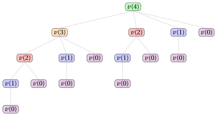

# 28.2 Un primo algoritmo di PD

**Parte 3 · Programmazione dinamica · Capitolo 28** · [:material-book-open-variant: Capitolo 28: Taglio delle aste (RCP)](index.md) · [:material-file-pdf-box: Dispensa, volume 3 (PDF)](../../pdf/dispensa-3-programmazione-dinamica.pdf) · [:material-presentation: Slide](../../pdf/slide-dp-rod-cutting.pdf) · [:material-pencil: Esercizi: Taglio delle aste (RCP)](../../esercizi/dp-rod-cutting.md)

- <u>Passo 1</u>: calcolo del valore ottimo

    !!! formula ""

        Per ogni $\ell \in \{0,1,\dots,n\}$, sia $v(\ell)$ il valore ottimo della sottoistanza dell'RCP data da:

        1. una barra di lunghezza $\ell$,

        2. un insieme $\{1,2,\dots,\ell\}$ di $\ell$ possibili lunghezze dei pezzi,

        3. per ogni lunghezza dei pezzi $j \in \{1,2,\dots,\ell\}$, un profitto $p_j$.

        La formula ricorsiva per calcolare $v(\ell)$ è la seguente:

        \begin{equation*}
        \label{eq:1}
        v(\ell)= \left\{ \begin{array}{ll}
        \displaystyle \max \bigg\{ p_j + v(\ell-j) : j \in \{1,2,\dots,\ell\}\bigg\} & \textrm{se $1\le \ell \le n$,}\\[2ex]
        0 & \textrm{se $\ell=0$.}
        \end{array} \right. \tag{28.1}
        \end{equation*}

    - Il processo di decomposizione ricorsiva della formula $\eqref{eq:1}$ genera $\ell$ <strong>sottoproblemi indipendenti</strong>, ciascuno corrispondente a una possibile scelta di tagliare un primo pezzo di lunghezza $j$ da una barra di lunghezza $\ell$.  Qui $v(0)=0$, perché una barra di lunghezza $0$ non si può tagliare e ha profitto $0$.

    - Il valore ottimo $v(\ell)$ si ottiene provando tutte le possibili lunghezze del primo pezzo e scegliendo quella che massimizza la somma $p_j+v(\ell-j)$ del profitto del primo pezzo e del valore ottimo del sottoproblema residuo.

    - Quindi una soluzione ottima per una barra di lunghezza $\ell$ si costruisce combinando il primo pezzo scelto, di lunghezza $j$, con una soluzione ottima del sottoproblema residuo di lunghezza $\ell-j$.

        $\rightsquigarrow$ <strong>Sottostruttura ottima verificata!</strong>

    - Scelte diverse della lunghezza del primo pezzo, eventualmente fatte per valori diversi di $\ell$, possono portare alla stessa lunghezza residua; quindi lo stesso valore $v(\ell)$ può dover essere calcolato più volte durante la valutazione ricorsiva della formula $\eqref{eq:1}$.

        $\rightsquigarrow$ <strong>Sottoproblemi sovrapposti verificati!</strong>

    - Un <strong>primo metodo</strong> per calcolare il valore ottimo $v(n)$ dell'istanza dell'RCP è l'<strong>approccio top-down</strong>. Il metodo parte dalla chiamata con $\ell=n$ e valuta ricorsivamente la formula $\eqref{eq:1}$: ogni chiamata per una barra di lunghezza $\ell$ genera altre chiamate per barre di lunghezza $\ell-j$, per ogni $j \in \{1,2,\dots,\ell\}$, fino a raggiungere il caso base $v(0)$.

    - L'<strong>albero di ricorsione</strong> della funzione $v$ ha un nodo per ogni chiamata ricorsiva, etichettato con la chiamata che rappresenta. La radice rappresenta la chiamata iniziale. I figli di un nodo rappresentano le chiamate ricorsive fatte da quella chiamata. Le foglie rappresentano i casi base.

        

        !!! esempio "Esempio 28.3: Albero di ricorsione"

            Consideriamo l'istanza dell'RCP dell'[Esempio 28.1](index.md#box-1-texexpbox1). Questo è l'albero di ricorsione dell'approccio top-down per calcolare $v(4)$:

            { .fig loading=lazy  }

            La funzione $v$ viene chiamata $16$ volte, e gli stessi sottoproblemi vengono risolti più volte: $v(2)$ viene chiamata $2$ volte, $v(1)$ viene chiamata $4$ volte e $v(0)$ viene chiamata $8$ volte. Tutte le altre chiamate vengono fatte una sola volta.

    - Il valore $v(\ell)$, per una generica lunghezza della barra $\ell$, si può calcolare una volta noti i valori $v(j)$ per tutte le lunghezze minori $j<\ell$.

        

        !!! esempio "Esempio 28.4: Calcolo dei valori della funzione $v$"

            Consideriamo l'istanza dell'RCP dell'[Esempio 28.1](index.md#box-1-texexpbox1), con una barra di lunghezza $n = 4$; i profitti associati alle possibili lunghezze dei pezzi sono:

            $$
            \begin{array}{l|rrrrrrr}
            \hline  & {\ell = 1} & {\ell = 2} & {\ell = 3} & {\ell = 4} \\
            \hline {p_\ell} & {1} & {5} & {8} & {9} \\
            \hline
            \end{array}
            $$

            Il valore della funzione $v$ si può calcolare partendo dal caso base $v(0)=0$ e calcolando poi, in ordine, i valori di $v(1)$, $v(2)$, $v(3)$ e $v(4)$, come segue:

            - Poiché conosciamo il valore di $v(0)$, possiamo calcolare $v(1)$ come segue:

                $$
                v(1)=p_1 + v(0) = 1 + 0 = 1
                $$

            - Calcolato $v(1)$, possiamo calcolare $v(2)$ come segue:

                $$
                v(2)= \max\{p_1+v(1),p_2+v(0)\} = \max\{1+1,5+0\} = 5
                $$

            - Calcolati $v(2)$ e $v(1)$, possiamo calcolare $v(3)$ come segue:

                $$
                v(3)= \max\{p_1+v(2),p_2+v(1),p_3+v(0)\} = \max\{1+5,5+1,8+0\} = 8
                $$

            - Calcolati $v(3)$, $v(2)$ e $v(1)$, possiamo calcolare $v(4)$ come segue:

                \begin{align*}
                v(4)&= \max\{p_1+v(3),p_2+v(2),p_3+v(1),p_4+v(0)\}\\ &= \max\{1+8,5+5,8+1,9+0\} = 10
                \end{align*}

    - Possiamo evitare di risolvere ripetutamente gli stessi sottoproblemi memorizzando il valore di ogni sottoproblema appena calcolato. I valori si memorizzano in una <strong>tabella di lookup</strong>.

    - Poiché la soluzione di un sottoproblema di valore $v(\ell)$ dipende solo dai sottoproblemi di valore $v(j)$, con $j<\ell$, possiamo risolvere i sottoproblemi per valori crescenti di $\ell$, partendo dal caso base $v(0)=0$ fino ad arrivare a $v(n)$: questa osservazione porta in modo naturale a un <strong>metodo molto più efficiente</strong> per calcolare il valore ottimo $v(n)$ dell'istanza dell'RCP.

    - Un <strong>secondo metodo</strong> per calcolare il valore ottimo $v(n)$ dell'istanza dell'RCP è l'<strong>approccio bottom-up</strong>. Il metodo parte dal caso base $v(0)=0$ e valuta la formula $\eqref{eq:1}$ per lunghezze crescenti della barra $\ell \in \{1,2,\dots,n\}$: ogni valore $v(\ell)$ si calcola con i valori già calcolati $v(0), v(1), \dots, v(\ell-1)$, fino a ottenere il valore $v(n)$ dell'istanza dell'RCP.

        Questo è lo pseudocodice dell'<strong>algoritmo di PD con l'approccio bottom-up</strong>:

        !!! algoritmo "Algoritmo: DP1"

            

<strong>Input:</strong> Un'istanza dell'RCP data dalla lunghezza \(n\) della barra e da un array \(p[1..n]\) dei profitti dei pezzi

<strong>Output:</strong> Il valore ottimo dell'istanza dell'RCP

1<strong>Function</strong> DP1(\(n,p\))

2\({v} := \textnormal{new array}[0..n]\)

3\({v}[0] \leftarrow 0\)

4<strong>for</strong> \(\ell := 1\) <strong>to</strong> \(n\)  <strong>do</strong>

5\(\mathit{m} := 0\)

6<strong>for</strong> \(j := 1\) <strong>to</strong> \(\ell\)  <strong>do</strong>

7<strong>if</strong> \(\mathit{m} < p[j] + {v}[\ell-j]\)  <strong>then</strong>

8\(\mathit{m} \leftarrow p[j] + {v}[\ell-j]\)

9<strong>end</strong>

10<strong>end</strong>

11\({v}[\ell] \leftarrow \mathit{m}\)

12<strong>end</strong>

13<strong>return</strong> \({v}[n]\)

        - Il vettore ${v}[0..n]$ è la <strong>tabella di lookup</strong>: memorizza i valori ottimi di tutti i sottoproblemi, con il caso base ${v}[0]=0$.

        - Il ciclo esterno, su $\ell \in \{1,2,\dots,n\}$, calcola ${v}[\ell]$ in ordine crescente di lunghezza della barra.

        - Il ciclo interno, su $j \in \{1,2,\dots,\ell\}$, valuta tutte le possibili lunghezze del primo pezzo e tiene in $\mathit{m}$ il valore massimo di $p[j]+{v}[\ell-j]$.

        - Alla fine del ciclo interno, ${v}[\ell] \leftarrow \mathit{m}$ memorizza il valore ottimo ${v}[\ell]$.

        - Infine, l'algoritmo restituisce il valore ottimo ${v}[n]$ dell'istanza dell'RCP.

        

        !!! esempio "Esempio 28.5: Esecuzione dell'algoritmo di PD"

            Consideriamo l'istanza dell'RCP dell'[Esempio 28.1](index.md#box-1-texexpbox1), con una barra di lunghezza $n = 4$; i profitti associati alle possibili lunghezze dei pezzi sono:

            $$
            \begin{array}{l|rrrrrrr}
            \hline  & {\ell = 1} & {\ell = 2} & {\ell = 3} & {\ell = 4} \\
            \hline {p_\ell} & {1} & {5} & {8} & {9} \\
            \hline
            \end{array}
            $$

            Per ogni passo dell'algoritmo di PD, la tabella riporta i valori di $\ell$ e $j$, il valore corrente di $\mathit{m}$ e la cella ${v}[\ell]$. La cella di $\mathit{m}$ è evidenziata in <mark>rosso</mark> quando viene aggiornata; la cella di ${v}[\ell]$ è evidenziata in <mark>blu</mark> quando viene assegnata.

            
<table>
            <tr>
            <th>\(\ell\)</th>
            <th>\(j\)</th>
            <th>\({v}[\ell]\)</th>
            <th>\(\mathit{m}\)</th>
            <th>Azione</th>
            </tr>
            <tr>
            <td>\(-\)</td>
            <td>\(-\)</td>
            <td class="cella-blu">0</td>
            <td>\(-\)</td>
            <td>\({v}[0]\leftarrow 0\)</td>
            </tr>
            <tr>
            <td></td>
            <td>\(-\)</td>
            <td>\(-\)</td>
            <td>0</td>
            <td>\(\mathit{m}\leftarrow 0\)</td>
            </tr>
            <tr>
            <td>1</td>
            <td>1</td>
            <td>\(-\)</td>
            <td class="cella-rossa">1</td>
            <td>\(p[1]{+}{v}[0]=1{+}0=1>0\): \(\mathit{m}\leftarrow 1\)</td>
            </tr>
            <tr>
            <td></td>
            <td>\(-\)</td>
            <td class="cella-blu">1</td>
            <td>1</td>
            <td>\({v}[1]\leftarrow \mathit{m}=1\)</td>
            </tr>
            <tr>
            <td></td>
            <td>\(-\)</td>
            <td>\(-\)</td>
            <td>0</td>
            <td>\(\mathit{m}\leftarrow 0\)</td>
            </tr>
            <tr>
            <td>2</td>
            <td>1</td>
            <td>\(-\)</td>
            <td class="cella-rossa">2</td>
            <td>\(p[1]{+}{v}[1]=1{+}1=2>0\): \(\mathit{m}\leftarrow 2\)</td>
            </tr>
            <tr>
            <td></td>
            <td>2</td>
            <td>\(-\)</td>
            <td class="cella-rossa">5</td>
            <td>\(p[2]{+}{v}[0]=5{+}0=5>2\): \(\mathit{m}\leftarrow 5\)</td>
            </tr>
            <tr>
            <td></td>
            <td>\(-\)</td>
            <td class="cella-blu">5</td>
            <td>5</td>
            <td>\({v}[2]\leftarrow \mathit{m}=5\)</td>
            </tr>
            <tr>
            <td></td>
            <td>\(-\)</td>
            <td>\(-\)</td>
            <td>0</td>
            <td>\(\mathit{m}\leftarrow 0\)</td>
            </tr>
            <tr>
            <td>3</td>
            <td>1</td>
            <td>\(-\)</td>
            <td class="cella-rossa">6</td>
            <td>\(p[1]{+}{v}[2]=1{+}5=6>0\): \(\mathit{m}\leftarrow 6\)</td>
            </tr>
            <tr>
            <td></td>
            <td>2</td>
            <td>\(-\)</td>
            <td>6</td>
            <td>\(p[2]{+}{v}[1]=5{+}1=6=\mathit{m}\): nessun aggiornamento</td>
            </tr>
            <tr>
            <td></td>
            <td>3</td>
            <td>\(-\)</td>
            <td class="cella-rossa">8</td>
            <td>\(p[3]{+}{v}[0]=8{+}0=8>6\): \(\mathit{m}\leftarrow 8\)</td>
            </tr>
            <tr>
            <td></td>
            <td>\(-\)</td>
            <td class="cella-blu">8</td>
            <td>8</td>
            <td>\({v}[3]\leftarrow \mathit{m}=8\)</td>
            </tr>
            <tr>
            <td></td>
            <td>\(-\)</td>
            <td>\(-\)</td>
            <td>0</td>
            <td>\(\mathit{m}\leftarrow 0\)</td>
            </tr>
            <tr>
            <td>4</td>
            <td>1</td>
            <td>\(-\)</td>
            <td class="cella-rossa">9</td>
            <td>\(p[1]{+}{v}[3]=1{+}8=9>0\): \(\mathit{m}\leftarrow 9\)</td>
            </tr>
            <tr>
            <td></td>
            <td>2</td>
            <td>\(-\)</td>
            <td class="cella-rossa">10</td>
            <td>\(p[2]{+}{v}[2]=5{+}5=10>9\): \(\mathit{m}\leftarrow 10\)</td>
            </tr>
            <tr>
            <td></td>
            <td>3</td>
            <td>\(-\)</td>
            <td>10</td>
            <td>\(p[3]{+}{v}[1]=8{+}1=9<10\): nessun aggiornamento</td>
            </tr>
            <tr>
            <td></td>
            <td>4</td>
            <td>\(-\)</td>
            <td>10</td>
            <td>\(p[4]{+}{v}[0]=9{+}0=9<10\): nessun aggiornamento</td>
            </tr>
            <tr>
            <td></td>
            <td>\(-\)</td>
            <td class="cella-blu">10</td>
            <td>10</td>
            <td>\({v}[4]\leftarrow \mathit{m}=10\)</td>
            </tr>
            </table>

            Questo è il vettore ${v}$ dopo l'esecuzione dell'algoritmo di PD:

            $$
            \begin{array}{c|ccccc}
            \hline  & {\ell = 0} & {\ell=1} & {\ell=2} & {\ell=3} & {\ell=4} \\
            \hline {{v}[\ell]} & 0 & 1 & 5 & 8 & 10 \\
            \hline
            \end{array}
            $$

    - Dopo l'esecuzione dell'algoritmo di PD, il vettore ${v}$ contiene il valore ottimo ${v}[\ell]$ per ogni lunghezza della barra.

- <u>Passo 2</u>: calcolo di una soluzione ottima

    - Per calcolare una soluzione ottima è necessario memorizzare alcune informazioni aggiuntive.

    - Per ogni lunghezza della barra $\ell$, oltre al valore ottimo ${v}[\ell]$, memorizziamo ${s}[\ell]$, la lunghezza del primo pezzo da tagliare in una soluzione ottima per una barra di lunghezza $\ell$.

    - Partendo da $\ell=n$, il valore ${s}[\ell]$ dà la lunghezza del primo pezzo da tagliare; la barra rimanente ha lunghezza $\ell-{s}[\ell]$, e la stessa regola si può applicare di nuovo, e così via, finché la lunghezza residua arriva a $0$.

        Questo è lo pseudocodice dell'<strong>algoritmo di PD con l'approccio bottom-up</strong>, con la memorizzazione delle informazioni necessarie per calcolare una soluzione ottima:

        !!! algoritmo "Algoritmo: DP1\_InfoSol"

            

<strong>Input:</strong> Un'istanza dell'RCP data dalla lunghezza \(n\) della barra e da un array \(p[1..n]\) dei profitti dei pezzi

<strong>Output:</strong> Il valore ottimo dell'istanza dell'RCP e il vettore di informazioni \({s}[1..n]\)

1<strong>Function</strong> DP1_InfoSol(\(n,p\))

2\({v} := \textnormal{new array}[0..n]\)

3\({s} := \textnormal{new array}[1..n]\)

4\({v}[0] \leftarrow 0\)

5<strong>for</strong> \(\ell := 1\) <strong>to</strong> \(n\) <strong>do</strong>

6\(\mathit{m} := 0\)

7\(\mathit{t} := 0\)

8<strong>for</strong> \(j := 1\) <strong>to</strong> \(\ell\) <strong>do</strong>

9<strong>if</strong> \(\mathit{m} < p[j] + {v}[\ell-j]\) <strong>then</strong>

10\(\mathit{m} \leftarrow p[j] + {v}[\ell-j]\)

11\(\mathit{t} \leftarrow j\)

12<strong>end</strong>

13<strong>end</strong>

14\({v}[\ell] \leftarrow \mathit{m}\)

15\({s}[\ell] \leftarrow \mathit{t}\)

16<strong>end</strong>

17<strong>return</strong> \({v}[n], {s}\)

        - L'algoritmo di PD usa la variabile temporanea aggiuntiva $\mathit{t}$ per tenere traccia della decisione presa quando $\mathit{m}$ viene aggiornato. Se si sceglie un primo pezzo di lunghezza $j$, $\mathit{t}\leftarrow j$ memorizza questa decisione. Alla fine del ciclo interno, ${s}[\ell]\leftarrow \mathit{t}$ memorizza la lunghezza del primo pezzo scelto, insieme al valore ottimo ${v}[\ell]\leftarrow \mathit{m}$.

        

        !!! esempio "Esempio 28.6: Calcolo delle informazioni aggiuntive"

            Consideriamo l'istanza dell'RCP dell'[Esempio 28.1](index.md#box-1-texexpbox1), con una barra di lunghezza $n = 4$; i profitti associati alle possibili lunghezze dei pezzi sono:

            $$
            \begin{array}{l|rrrrrrr}
            \hline  & {\ell = 1} & {\ell = 2} & {\ell = 3} & {\ell = 4} \\
            \hline {p_\ell} & {1} & {5} & {8} & {9} \\
            \hline
            \end{array}
            $$

            Per ogni passo dell'algoritmo di PD, la tabella riporta i valori di $\ell$ e $j$, la cella ${s}[\ell]$, il valore corrente di $\mathit{m}$ e il valore corrente di $\mathit{t}$. La cella di $\mathit{m}$ è evidenziata in <mark>rosso</mark> quando viene aggiornata; la cella di $\mathit{t}$ e la cella di ${s}[\ell]$ sono evidenziate in <mark>blu</mark> quando vengono aggiornate.

            
<table>
            <tr>
            <th>\(\ell\)</th>
            <th>\(j\)</th>
            <th>\({s}[\ell]\)</th>
            <th>\(\mathit{m}\)</th>
            <th>\(\mathit{t}\)</th>
            <th>Azione</th>
            </tr>
            <tr>
            <td>\(-\)</td>
            <td>\(-\)</td>
            <td>\(-\)</td>
            <td>\(-\)</td>
            <td>\(-\)</td>
            <td>Stato iniziale</td>
            </tr>
            <tr>
            <td></td>
            <td>\(-\)</td>
            <td>\(-\)</td>
            <td>0</td>
            <td>0</td>
            <td>\(\mathit{m}\leftarrow 0\), \(\mathit{t}\leftarrow 0\)</td>
            </tr>
            <tr>
            <td>1</td>
            <td>1</td>
            <td>\(-\)</td>
            <td class="cella-rossa">1</td>
            <td class="cella-blu">1</td>
            <td>\(1{+}0=1>0\): \(\mathit{m}\leftarrow 1\), \(\mathit{t}\leftarrow 1\)</td>
            </tr>
            <tr>
            <td></td>
            <td>\(-\)</td>
            <td class="cella-blu">1</td>
            <td>1</td>
            <td>1</td>
            <td>\({v}[1]\leftarrow \mathit{m}=1\), \({s}[1]\leftarrow \mathit{t}=1\)</td>
            </tr>
            <tr>
            <td></td>
            <td>\(-\)</td>
            <td>\(-\)</td>
            <td>0</td>
            <td>0</td>
            <td>\(\mathit{m}\leftarrow 0\), \(\mathit{t}\leftarrow 0\)</td>
            </tr>
            <tr>
            <td>2</td>
            <td>1</td>
            <td>\(-\)</td>
            <td class="cella-rossa">2</td>
            <td class="cella-blu">1</td>
            <td>\(1{+}1=2>0\): \(\mathit{m}\leftarrow 2\), \(\mathit{t}\leftarrow 1\)</td>
            </tr>
            <tr>
            <td></td>
            <td>2</td>
            <td>\(-\)</td>
            <td class="cella-rossa">5</td>
            <td class="cella-blu">2</td>
            <td>\(5{+}0=5>2\): \(\mathit{m}\leftarrow 5\), \(\mathit{t}\leftarrow 2\)</td>
            </tr>
            <tr>
            <td></td>
            <td>\(-\)</td>
            <td class="cella-blu">2</td>
            <td>5</td>
            <td>2</td>
            <td>\({v}[2]\leftarrow \mathit{m}=5\), \({s}[2]\leftarrow \mathit{t}=2\)</td>
            </tr>
            <tr>
            <td></td>
            <td>\(-\)</td>
            <td>\(-\)</td>
            <td>0</td>
            <td>0</td>
            <td>\(\mathit{m}\leftarrow 0\), \(\mathit{t}\leftarrow 0\)</td>
            </tr>
            <tr>
            <td>3</td>
            <td>1</td>
            <td>\(-\)</td>
            <td class="cella-rossa">6</td>
            <td class="cella-blu">1</td>
            <td>\(1{+}5=6>0\): \(\mathit{m}\leftarrow 6\), \(\mathit{t}\leftarrow 1\)</td>
            </tr>
            <tr>
            <td></td>
            <td>2</td>
            <td>\(-\)</td>
            <td>6</td>
            <td>1</td>
            <td>\(5{+}1=6=\mathit{m}\): nessun aggiornamento</td>
            </tr>
            <tr>
            <td></td>
            <td>3</td>
            <td>\(-\)</td>
            <td class="cella-rossa">8</td>
            <td class="cella-blu">3</td>
            <td>\(8{+}0=8>6\): \(\mathit{m}\leftarrow 8\), \(\mathit{t}\leftarrow 3\)</td>
            </tr>
            <tr>
            <td></td>
            <td>\(-\)</td>
            <td class="cella-blu">3</td>
            <td>8</td>
            <td>3</td>
            <td>\({v}[3]\leftarrow \mathit{m}=8\), \({s}[3]\leftarrow \mathit{t}=3\)</td>
            </tr>
            <tr>
            <td></td>
            <td>\(-\)</td>
            <td>\(-\)</td>
            <td>0</td>
            <td>0</td>
            <td>\(\mathit{m}\leftarrow 0\), \(\mathit{t}\leftarrow 0\)</td>
            </tr>
            <tr>
            <td>4</td>
            <td>1</td>
            <td>\(-\)</td>
            <td class="cella-rossa">9</td>
            <td class="cella-blu">1</td>
            <td>\(1{+}8=9>0\): \(\mathit{m}\leftarrow 9\), \(\mathit{t}\leftarrow 1\)</td>
            </tr>
            <tr>
            <td></td>
            <td>2</td>
            <td>\(-\)</td>
            <td class="cella-rossa">10</td>
            <td class="cella-blu">2</td>
            <td>\(5{+}5=10>9\): \(\mathit{m}\leftarrow 10\), \(\mathit{t}\leftarrow 2\)</td>
            </tr>
            <tr>
            <td></td>
            <td>3</td>
            <td>\(-\)</td>
            <td>10</td>
            <td>2</td>
            <td>\(8{+}1=9<10\): nessun aggiornamento</td>
            </tr>
            <tr>
            <td></td>
            <td>4</td>
            <td>\(-\)</td>
            <td>10</td>
            <td>2</td>
            <td>\(9{+}0=9<10\): nessun aggiornamento</td>
            </tr>
            <tr>
            <td></td>
            <td>\(-\)</td>
            <td class="cella-blu">2</td>
            <td>10</td>
            <td>2</td>
            <td>\({v}[4]\leftarrow \mathit{m}=10\), \({s}[4]\leftarrow \mathit{t}=2\)</td>
            </tr>
            </table>

            Questo è il vettore ${s}$ dopo l'esecuzione dell'algoritmo di PD:

            $$
            \begin{array}{c|cccc}
            \hline  & {\ell=1} & {\ell=2} & {\ell=3} & {\ell=4} \\
            \hline {{s}[\ell]} & 1 & 2 & 3 & 2 \\
            \hline
            \end{array}
            $$

    - Calcolato il vettore ${s}$, si può calcolare una soluzione ottima dell'istanza dell'RCP applicando ripetutamente la seguente regola, partendo da $j=n$ e da $x_{\ell}=0$ per ogni $\ell \in \{1,2,\dots,n\}$:

        $$
        x_{{s}[j]} \leftarrow x_{{s}[j]}+1,
        \qquad
        j \leftarrow j-{s}[j],
        $$

        finché $j=0$. Si ottiene così il vettore $(x_1,x_2,\dots,x_n)$, dove ogni componente $x_{\ell}$ è il numero di pezzi di lunghezza $\ell$ in una soluzione ottima.

    - Il seguente pseudocodice implementa il calcolo di una soluzione ottima, dato il vettore ${s}$.

        !!! algoritmo "Algoritmo: DP1\_SolComputation"

            

<strong>Input:</strong> La lunghezza \(n\) della barra dell'istanza dell'RCP e il vettore \({s}[1..n]\)

<strong>Output:</strong> Una soluzione ottima dell'istanza dell'RCP

1<strong>Function</strong> DP1_SolComputation(\(n,{s}\))

2\(x := \textnormal{new array}[1..n]\)

3<strong>for</strong> \(\ell := 1\) <strong>to</strong> \(n\) <strong>do</strong>

4\(x[\ell] \leftarrow 0\)

5<strong>end</strong>

6\(j := n\)

7<strong>while</strong> \(j > 0\) <strong>do</strong>

8\(x[{s}[j]] \leftarrow x[{s}[j]]+1\)

9\(j \leftarrow j - {s}[j]\)

10<strong>end</strong>

11<strong>return</strong> \(x\)

        

        !!! esempio "Esempio 28.7: Calcolo di una soluzione ottima"

            Dopo l'esecuzione dell'algoritmo di PD sull'istanza dell'[Esempio 28.1](index.md#box-1-texexpbox1), abbiamo il seguente vettore ${s}$:

            $$
            \begin{array}{l|rrrr}
            \hline  & {\ell=1} & {\ell=2} & {\ell=3} & {\ell=4} \\
            \hline {{s}[\ell]} & 1 & 2 & 3 & 2 \\
            \hline
            \end{array}
            $$

            Possiamo calcolare una soluzione ottima per una barra di lunghezza $n=4$ come segue:

            
<table>
            <tr>
            <th>Iterazione</th>
            <th>\(j\)</th>
            <th>\({s}[j]\)</th>
            <th>\(x[1]\)</th>
            <th>\(x[2]\)</th>
            <th>\(x[3]\)</th>
            <th>\(x[4]\)</th>
            <th>\(j \leftarrow j-{s}[j]\)</th>
            </tr>
            <tr>
            <td>\(-\)</td>
            <td>\(-\)</td>
            <td>\(-\)</td>
            <td>0</td>
            <td>0</td>
            <td>0</td>
            <td>0</td>
            <td>\(j=4\)</td>
            </tr>
            <tr>
            <td>\(1\)</td>
            <td>\(4\)</td>
            <td>\(2\)</td>
            <td>0</td>
            <td class="cella-blu">1</td>
            <td>0</td>
            <td>0</td>
            <td>\(j=4-2=2\)</td>
            </tr>
            <tr>
            <td>\(2\)</td>
            <td>\(2\)</td>
            <td>\(2\)</td>
            <td>0</td>
            <td class="cella-blu">2</td>
            <td>0</td>
            <td>0</td>
            <td>\(j=2-2=0\)</td>
            </tr>
            </table>

            Una soluzione ottima è il vettore:

            $$
            (0,2,0,0)
            $$

    - La stessa procedura di calcolo, basata sul vettore $s$, si può applicare partendo da qualunque lunghezza della barra $\ell$.

        

        !!! esempio "Esempio 28.8: Calcolo di soluzioni ottime per le lunghezze della barra 3 e 2"

            Dopo l'esecuzione dell'algoritmo di PD sull'istanza dell'[Esempio 28.1](index.md#box-1-texexpbox1), abbiamo il seguente vettore ${s}$:

            $$
            \begin{array}{l|rrrr}
            \hline  & {\ell=1} & {\ell=2} & {\ell=3} & {\ell=4} \\
            \hline {{s}[\ell]} & 1 & 2 & 3 & 2 \\
            \hline
            \end{array}
            $$

            Possiamo calcolare una soluzione ottima per una barra di lunghezza $3$ come segue:

            
<table>
            <tr>
            <th>Iterazione</th>
            <th>\(j\)</th>
            <th>\({s}[j]\)</th>
            <th>\(x[1]\)</th>
            <th>\(x[2]\)</th>
            <th>\(x[3]\)</th>
            <th>\(x[4]\)</th>
            <th>\(j \leftarrow j-{s}[j]\)</th>
            </tr>
            <tr>
            <td>\(-\)</td>
            <td>\(-\)</td>
            <td>\(-\)</td>
            <td>0</td>
            <td>0</td>
            <td>0</td>
            <td>0</td>
            <td>\(j=3\)</td>
            </tr>
            <tr>
            <td>\(1\)</td>
            <td>\(3\)</td>
            <td>\(3\)</td>
            <td>0</td>
            <td>0</td>
            <td class="cella-blu">1</td>
            <td>0</td>
            <td>\(j=3-3=0\)</td>
            </tr>
            </table>

            Una soluzione ottima è il vettore:

            $$
            (0,0,1,0)
            $$

            Possiamo calcolare una soluzione ottima per una barra di lunghezza $2$ come segue:

            
<table>
            <tr>
            <th>Iterazione</th>
            <th>\(j\)</th>
            <th>\({s}[j]\)</th>
            <th>\(x[1]\)</th>
            <th>\(x[2]\)</th>
            <th>\(x[3]\)</th>
            <th>\(x[4]\)</th>
            <th>\(j \leftarrow j-{s}[j]\)</th>
            </tr>
            <tr>
            <td>\(-\)</td>
            <td>\(-\)</td>
            <td>\(-\)</td>
            <td>0</td>
            <td>0</td>
            <td>0</td>
            <td>0</td>
            <td>\(j=2\)</td>
            </tr>
            <tr>
            <td>\(1\)</td>
            <td>\(2\)</td>
            <td>\(2\)</td>
            <td>0</td>
            <td class="cella-blu">1</td>
            <td>0</td>
            <td>0</td>
            <td>\(j=2-2=0\)</td>
            </tr>
            </table>

            Una soluzione ottima è il vettore:

            $$
            (0,1,0,0)
            $$

## 28.2.1 Numero di passi

- Sia $S(n)$ il numero di passi eseguiti da <code>DP1</code> nel caso peggiore, dove $n$ è la lunghezza della barra. Calcoliamo $S(n)$ contando quante volte vengono eseguite le Righe [2](#box-5-bu-a)–Riga [13](#box-13-bu-i).

- Nel caso peggiore, la condizione alla riga [7](#box-10-bu-f) è vera a ogni iterazione del ciclo interno, e quindi la riga [8](#box-11-bu-g) viene eseguita tante volte quanto la riga [7](#box-10-bu-f). Il numero di esecuzioni delle righe rilevanti è:

    - Riga [2](#box-5-bu-a) viene eseguita $1$ volta.

    - Riga [3](#box-6-bu-b) viene eseguita $1$ volta.

    - Riga [4](#box-7-bu-c) viene eseguita $n$ volte.

    - Riga [5](#box-8-bu-d) viene eseguita $n$ volte.

    - Riga [6](#box-9-bu-e) viene eseguita $\displaystyle\sum_{\ell=1}^{n}\ell$ volte.

    - Riga [7](#box-10-bu-f) viene eseguita $\displaystyle\sum_{\ell=1}^{n}\ell$ volte.

    - Riga [8](#box-11-bu-g) viene eseguita $\displaystyle\sum_{\ell=1}^{n}\ell$ volte.

    - Riga [11](#box-12-bu-h) viene eseguita $n$ volte.

    - Riga [13](#box-13-bu-i) viene eseguita $1$ volta.

    Quindi il numero totale di passi nel caso peggiore è

    $$
    1+1+n+n+\sum_{\ell=1}^{n}\ell+\sum_{\ell=1}^{n}\ell+\sum_{\ell=1}^{n}\ell+n+1
    =
    3+3n+3\sum_{\ell=1}^{n}\ell.
    $$

    Usando $\sum_{\ell=1}^{n}\ell=\dfrac{n(n+1)}{2}$, otteniamo

    $$
    S(n)=3+3n+3\cdot\frac{n(n+1)}{2}
    =
    \frac{3n^2+9n+6}{2}.
    $$

    Quindi

    $$
    S(n)=\Theta(n^2).
    $$

    Infatti,

    $$
    \lim_{n\to\infty}
    \frac{\frac{3n^2+9n+6}{2}}{n^2}
    =
    \lim_{n\to\infty}
    \frac{1}{2}\left(3+\frac{9}{n}+\frac{6}{n^2}\right)
    =
    \frac{3}{2}\in\mathbb{R}_{>0}.
    $$

    !!! chiave ""

        L'algoritmo di PD esegue

        $$
        S(n)=\Theta(n^2)
        $$

        passi nel caso peggiore.

---

**Avanti:** [28.3 Un secondo algoritmo di PD](un-secondo-algoritmo-di-pd.md)
