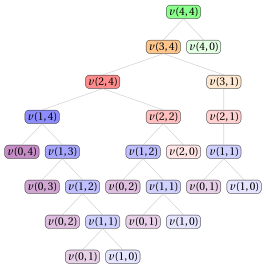

# 28.3 Un secondo algoritmo di PD

**Parte 3 · Programmazione dinamica · Capitolo 28** · [:material-book-open-variant: Capitolo 28: Taglio delle aste (RCP)](index.md) · [:material-file-pdf-box: Dispensa, volume 3 (PDF)](../../pdf/dispensa-3-programmazione-dinamica.pdf) · [:material-presentation: Slide](../../pdf/slide-dp-rod-cutting.pdf) · [:material-pencil: Esercizi: Taglio delle aste (RCP)](../../esercizi/dp-rod-cutting.md)

- <u>Passo 1</u>: calcolo del valore ottimo

    !!! formula ""

        Per ogni $j \in \{0,1,\dots,n\}$ e $\ell \in \{0,1,\dots,n\}$, sia $v(j,\ell)$ il valore ottimo della sottoistanza dell'RCP data da:

        1. una barra di lunghezza $\ell$,

        2. un insieme $\{1,2,\dots,j\}$ di $j$ possibili lunghezze dei pezzi,

        3. per ogni lunghezza dei pezzi $k \in \{1,2,\dots,j\}$, un profitto $p_k$.

        La formula ricorsiva per calcolare $v(j,\ell)$ è la seguente:

        \begin{equation*}
        \label{eq:rcpalt}
        v(j,\ell)= \left\{ \begin{array}{ll}
        \displaystyle \max \bigg\{ v(j-1,\ell),\; p_j + v(j,\ell-j) \bigg\} & \textrm{se $1\le j \le \ell$,}\\[2ex]
        v(j-1,\ell) & \textrm{se $1 \le \ell < j$,}\\[2ex]
        0 & \textrm{se $\ell=0$,}\\[2ex]
        -\infty & \textrm{se $j=0$ e $\ell>0$.}
        \end{array} \right. \tag{28.2}
        \end{equation*}

    - Il processo di decomposizione ricorsiva della formula $\eqref{eq:rcpalt}$ genera al più $2$ <strong>sottoproblemi indipendenti</strong>, corrispondenti alla scelta di tagliare o no un pezzo di lunghezza $j$ da una barra di lunghezza $\ell$. Se $j>\ell$, un pezzo di lunghezza $j$ non si può tagliare dalla barra, e quindi l'unica opzione ammissibile è non tagliarlo.

    - Qui $v(j,0)=0$, perché una barra di lunghezza $0$ non si può tagliare e ha profitto $0$.

    - Inoltre, $v(0,\ell)=-\infty$ per $\ell>0$: in questo caso non è disponibile alcuna lunghezza positiva dei pezzi, quindi non esiste una soluzione ammissibile per una barra di lunghezza positiva. Il valore $-\infty$ serve a escludere questo caso inammissibile.

    - Se $1 \le j \le \ell$, il valore ottimo $v(j,\ell)$ si ottiene provando le due opzioni possibili, tagliare o non tagliare un primo pezzo di lunghezza $j$, e scegliendo quella che massimizza il profitto. I valori corrispondenti sono rispettivamente $p_j+v(j,\ell-j)$ e $v(j-1,\ell)$. Se $1 \le \ell < j$, la lunghezza $j$ non si può usare, e quindi $v(j,\ell)=v(j-1,\ell)$.

    - Quindi una soluzione ottima per una barra di lunghezza $\ell$, con lunghezza massima disponibile dei pezzi $j$, si costruisce combinando la decisione presa sulla lunghezza $j$ con una soluzione ottima del sottoproblema residuo corrispondente.

        $\rightsquigarrow$ <strong>Sottostruttura ottima verificata!</strong>

    - Sequenze diverse di decisioni sulle lunghezze dei pezzi, eventualmente prese per valori diversi di $j$ e $\ell$, possono portare allo stesso sottoproblema; quindi lo stesso valore $v(j,\ell)$ può dover essere calcolato più volte durante la valutazione ricorsiva della formula $\eqref{eq:rcpalt}$.

        $\rightsquigarrow$ <strong>Sottoproblemi sovrapposti verificati!</strong>

    - Un <strong>primo metodo</strong> per calcolare il valore ottimo $v(n,n)$ dell'istanza dell'RCP è l'<strong>approccio top-down</strong>. Il metodo parte dalla chiamata con $(j,\ell)=(n,n)$ e valuta ricorsivamente la formula $\eqref{eq:rcpalt}$: ogni chiamata per una barra di lunghezza $\ell$ e lunghezza massima disponibile dei pezzi $j$ genera altre chiamate, corrispondenti alle decisioni ammissibili sulla lunghezza $j$, fino a raggiungere uno dei casi base $v(j,0)$ o $v(0,\ell)$.

    - L'<strong>albero di ricorsione</strong> della funzione $v$ ha un nodo per ogni chiamata ricorsiva, etichettato con la chiamata che rappresenta. La radice rappresenta la chiamata iniziale. I figli di un nodo rappresentano le chiamate ricorsive fatte da quella chiamata. Le foglie rappresentano i casi base.

        

        !!! esempio "Esempio 28.9: Albero di ricorsione"

            Consideriamo l'istanza dell'RCP dell'[Esempio 28.1](index.md#box-1-texexpbox1). Questo è l'albero di ricorsione dell'approccio top-down per calcolare $v(4,4)$:

            { .fig loading=lazy  }

            La funzione $v$ viene chiamata $25$ volte, e gli stessi sottoproblemi vengono risolti più volte: $v(1,2)$ viene chiamata $2$ volte, $v(0,2)$ viene chiamata $2$ volte, $v(1,1)$ viene chiamata $3$ volte, $v(0,1)$ viene chiamata $3$ volte e $v(1,0)$ viene chiamata $3$ volte. Tutte le altre chiamate vengono fatte una sola volta.

    - Il valore $v(j,\ell)$ si può calcolare una volta noto $v(j-1,\ell)$ e, quando $j\le\ell$, una volta noto anche $v(j,\ell-j)$. Quindi, per un valore fissato di $j$, tutti i valori $v(j,\ell)$ si possono calcolare considerando i valori di $\ell$ in ordine crescente.

    - Partendo dai casi base $v(j,0)=0$ e $v(0,\ell)=-\infty$, i valori della funzione $v$ si possono calcolare riga per riga, passando al valore successivo di $j$ solo dopo aver calcolato tutti i valori $v(j,\ell)$ per il valore corrente di $j$.

        

        !!! esempio "Esempio 28.10: Calcolo dei valori della funzione $v$"

            Consideriamo l'istanza dell'RCP dell'[Esempio 28.1](index.md#box-1-texexpbox1), con una barra di lunghezza $n = 4$; i profitti associati alle possibili lunghezze dei pezzi sono:

            $$
            \begin{array}{l|rrrrrrr}
            \hline  & {\ell = 1} & {\ell = 2} & {\ell = 3} & {\ell = 4} \\
            \hline {p_\ell} & {1} & {5} & {8} & {9} \\
            \hline
            \end{array}
            $$

            I valori della funzione $v$ si calcolano come segue:

            - Per $j=1$ si possono usare solo pezzi di lunghezza $1$. Quindi:

                $$
                v(1,0)=0,
                $$

                $$
                v(1,1)=\max\{v(0,1),p_1+v(1,0)\}=\max\{-\infty,1+0\}=1,
                $$

                $$
                v(1,2)=\max\{v(0,2),p_1+v(1,1)\}=\max\{-\infty,1+1\}=2,
                $$

                $$
                v(1,3)=\max\{v(0,3),p_1+v(1,2)\}=\max\{-\infty,1+2\}=3,
                $$

                $$
                v(1,4)=\max\{v(0,4),p_1+v(1,3)\}=\max\{-\infty,1+3\}=4.
                $$

            - Per $j=2$ si possono usare pezzi di lunghezza $1$ e $2$. Otteniamo:

                $$
                v(2,0)=0,\qquad v(2,1)=v(1,1)=1,
                $$

                $$
                v(2,2)=\max\{v(1,2),p_2+v(2,0)\}=\max\{2,5+0\}=5,
                $$

                $$
                v(2,3)=\max\{v(1,3),p_2+v(2,1)\}=\max\{3,5+1\}=6,
                $$

                $$
                v(2,4)=\max\{v(1,4),p_2+v(2,2)\}=\max\{4,5+5\}=10.
                $$

            - Per $j=3$ si possono usare pezzi di lunghezza $1$, $2$ e $3$. Otteniamo:

                $$
                v(3,0)=0,\qquad v(3,1)=v(2,1)=1,\qquad v(3,2)=v(2,2)=5,
                $$

                $$
                v(3,3)=\max\{v(2,3),p_3+v(3,0)\}=\max\{6,8+0\}=8,
                $$

                $$
                v(3,4)=\max\{v(2,4),p_3+v(3,1)\}=\max\{10,8+1\}=10.
                $$

            - Per $j=4$ sono disponibili tutte le lunghezze dei pezzi. Otteniamo:

                $$
                \begin{gathered}
                v(4,0)=0,\qquad v(4,1)=v(3,1)=1,\\ v(4,2)=v(3,2)=5,\qquad v(4,3)=v(3,3)=8,
                \end{gathered}
                $$

                $$
                v(4,4)=\max\{v(3,4),p_4+v(4,0)\}=\max\{10,9+0\}=10.
                $$

    - Possiamo evitare di risolvere ripetutamente gli stessi sottoproblemi memorizzando il valore di ogni sottoproblema appena calcolato. I valori si memorizzano in una <strong>tabella di lookup</strong>.

    - Poiché la soluzione di ogni sottoproblema dipende solo dai sottoproblemi con un valore minore di $j$, o con lo stesso valore di $j$ e una lunghezza della barra minore, possiamo risolvere i sottoproblemi in ordine crescente di $j$ e, per ogni valore fissato di $j$, in ordine crescente di lunghezza della barra, partendo dai casi base $v(0,0)=0$ e $v(0,\ell)=-\infty$ per ogni $\ell \in \{1,\dots,n\}$ fino ad arrivare a $v(n,n)$.

    - Questa osservazione porta in modo naturale a un <strong>metodo molto più efficiente</strong> per calcolare il valore ottimo $v(n,n)$ dell'istanza dell'RCP.

    - Un <strong>secondo metodo</strong> per calcolare il valore ottimo $v(n,n)$ dell'istanza dell'RCP è l'<strong>approccio bottom-up</strong>. Il metodo parte dai casi base $v(0,0)=0$ e $v(0,\ell)=-\infty$ per ogni $\ell \in \{1,\dots,n\}$ e valuta la formula $\eqref{eq:rcpalt}$ per valori crescenti di $j \in \{1,2,\dots,n\}$ e $\ell \in \{0,1,\dots,n\}$: ogni valore $v(j,\ell)$ si calcola con valori già calcolati, fino a ottenere il valore $v(n,n)$ dell'istanza dell'RCP.

        Questo è lo pseudocodice dell'<strong>algoritmo di PD con l'approccio bottom-up</strong>:

        !!! algoritmo "Algoritmo: DP2"

            

<strong>Input:</strong> Un'istanza dell'RCP data dalla lunghezza \(n\) della barra e da un array \(p[1..n]\) dei profitti dei pezzi

<strong>Output:</strong> Il valore ottimo dell'istanza dell'RCP

1<strong>Function</strong> DP2(\(n,p\))

2\({v} := \textnormal{new array}[0..n][0..n]\)

3\({v}[0][0] \leftarrow 0\)

4<strong>for</strong> \(\ell := 1\) <strong>to</strong> \(n\)  <strong>do</strong>

5\({v}[0][\ell] \leftarrow -\infty\)

6<strong>end</strong>

7<strong>for</strong> \(j := 1\) <strong>to</strong> \(n\)  <strong>do</strong>

8<strong>for</strong> \(\ell := 0\) <strong>to</strong> \(n\)  <strong>do</strong>

9<strong>if</strong> \(j > \ell\)  <strong>then</strong>

10\({v}[j][\ell] \leftarrow {v}[j-1][\ell]\)

11<strong>else</strong>

12<strong>if</strong> \(p[j] + {v}[j][\ell-j] > {v}[j-1][\ell]\)  <strong>then</strong>

13\({v}[j][\ell] \leftarrow p[j] + {v}[j][\ell-j]\)

14<strong>else</strong>

15\({v}[j][\ell] \leftarrow {v}[j-1][\ell]\)

16<strong>end</strong>

17<strong>end</strong>

18<strong>end</strong>

19<strong>end</strong>

20<strong>return</strong> \({v}[n][n]\)

        - La matrice ${v}[0..n][0..n]$ è la <strong>tabella di lookup</strong>: memorizza i valori ottimi di tutti i sottoproblemi.

        - L'inizializzazione pone ${v}[0][0]=0$ e ${v}[0][\ell]=-\infty$ per ogni lunghezza della barra $\ell \in \{1,\dots,n\}$, perché una lunghezza positiva non si può riempire se non è disponibile alcuna lunghezza dei pezzi.

        - Il ciclo esterno, su $j \in \{1,2,\dots,n\}$, considera le lunghezze dei pezzi disponibili in ordine crescente.

        - Il ciclo interno, su $\ell \in \{0,1,\dots,n\}$, calcola il valore migliore per ogni lunghezza della barra usando solo pezzi di lunghezza al più $j$.

        - Se $j>\ell$, la lunghezza $j$ non si può usare, e quindi ${v}[j][\ell] \leftarrow {v}[j-1][\ell]$.

        - Altrimenti, l'algoritmo di PD confronta il valore ottenuto senza usare la lunghezza $j$, cioè ${v}[j-1][\ell]$, con il valore ottenuto usando un pezzo di lunghezza $j$, cioè $p[j]+{v}[j][\ell-j]$.

        - Infine, l'algoritmo restituisce il valore ottimo dell'istanza dell'RCP, ${v}[n][n]$.

        

        !!! esempio "Esempio 28.11: Esecuzione dell'algoritmo di PD"

            Consideriamo l'istanza dell'RCP dell'[Esempio 28.1](index.md#box-1-texexpbox1), con una barra di lunghezza $n = 4$; i profitti associati alle possibili lunghezze dei pezzi sono:

            $$
            \begin{array}{l|rrrrrrr}
            \hline  & {\ell = 1} & {\ell = 2} & {\ell = 3} & {\ell = 4} \\
            \hline {p_\ell} & {1} & {5} & {8} & {9} \\
            \hline
            \end{array}
            $$

            Per ogni passo dell'algoritmo di PD, la tabella riporta i valori di $j$ e $\ell$, la cella ${v}[j][\ell]$ e l'operazione eseguita.

            
<table>
            <tr>
            <th>\(j\)</th>
            <th>\(\ell\)</th>
            <th>\({v}[j][\ell]\)</th>
            <th>Azione</th>
            </tr>
            <tr>
            <td>\(0\)</td>
            <td>\(0\)</td>
            <td>0</td>
            <td>\({v}[0][0]\leftarrow 0\)</td>
            </tr>
            <tr>
            <td>\(0\)</td>
            <td>\(1\)</td>
            <td>\(-\infty\)</td>
            <td>\({v}[0][1]\leftarrow -\infty\)</td>
            </tr>
            <tr>
            <td>\(0\)</td>
            <td>\(2\)</td>
            <td>\(-\infty\)</td>
            <td>\({v}[0][2]\leftarrow -\infty\)</td>
            </tr>
            <tr>
            <td>\(0\)</td>
            <td>\(3\)</td>
            <td>\(-\infty\)</td>
            <td>\({v}[0][3]\leftarrow -\infty\)</td>
            </tr>
            <tr>
            <td>\(0\)</td>
            <td>\(4\)</td>
            <td>\(-\infty\)</td>
            <td>\({v}[0][4]\leftarrow -\infty\)</td>
            </tr>
            <tr>
            <td>\(1\)</td>
            <td>\(0\)</td>
            <td>0</td>
            <td>\({v}[1][0]\leftarrow {v}[0][0]=0\)</td>
            </tr>
            <tr>
            <td>\(1\)</td>
            <td>\(1\)</td>
            <td>1</td>
            <td>\(\max\{{v}[0][1],p[1]+{v}[1][0]\}=\max\{-\infty,1+0\}=1\)</td>
            </tr>
            <tr>
            <td>\(1\)</td>
            <td>\(2\)</td>
            <td>2</td>
            <td>\(\max\{{v}[0][2],p[1]+{v}[1][1]\}=\max\{-\infty,1+1\}=2\)</td>
            </tr>
            <tr>
            <td>\(1\)</td>
            <td>\(3\)</td>
            <td>3</td>
            <td>\(\max\{{v}[0][3],p[1]+{v}[1][2]\}=\max\{-\infty,1+2\}=3\)</td>
            </tr>
            <tr>
            <td>\(1\)</td>
            <td>\(4\)</td>
            <td>4</td>
            <td>\(\max\{{v}[0][4],p[1]+{v}[1][3]\}=\max\{-\infty,1+3\}=4\)</td>
            </tr>
            <tr>
            <td>\(2\)</td>
            <td>\(0\)</td>
            <td>0</td>
            <td>\({v}[2][0]\leftarrow {v}[1][0]=0\)</td>
            </tr>
            <tr>
            <td>\(2\)</td>
            <td>\(1\)</td>
            <td>1</td>
            <td>\(2>1\): \({v}[2][1]\leftarrow {v}[1][1]=1\)</td>
            </tr>
            <tr>
            <td>\(2\)</td>
            <td>\(2\)</td>
            <td>5</td>
            <td>\(\max\{{v}[1][2],p[2]+{v}[2][0]\}=\max\{2,5+0\}=5\)</td>
            </tr>
            <tr>
            <td>\(2\)</td>
            <td>\(3\)</td>
            <td>6</td>
            <td>\(\max\{{v}[1][3],p[2]+{v}[2][1]\}=\max\{3,5+1\}=6\)</td>
            </tr>
            <tr>
            <td>\(2\)</td>
            <td>\(4\)</td>
            <td>10</td>
            <td>\(\max\{{v}[1][4],p[2]+{v}[2][2]\}=\max\{4,5+5\}=10\)</td>
            </tr>
            <tr>
            <td>\(3\)</td>
            <td>\(0\)</td>
            <td>0</td>
            <td>\({v}[3][0]\leftarrow {v}[2][0]=0\)</td>
            </tr>
            <tr>
            <td>\(3\)</td>
            <td>\(1\)</td>
            <td>1</td>
            <td>\(3>1\): \({v}[3][1]\leftarrow {v}[2][1]=1\)</td>
            </tr>
            <tr>
            <td>\(3\)</td>
            <td>\(2\)</td>
            <td>5</td>
            <td>\(3>2\): \({v}[3][2]\leftarrow {v}[2][2]=5\)</td>
            </tr>
            <tr>
            <td>\(3\)</td>
            <td>\(3\)</td>
            <td>8</td>
            <td>\(\max\{{v}[2][3],p[3]+{v}[3][0]\}=\max\{6,8+0\}=8\)</td>
            </tr>
            <tr>
            <td>\(3\)</td>
            <td>\(4\)</td>
            <td>10</td>
            <td>\(\max\{{v}[2][4],p[3]+{v}[3][1]\}=\max\{10,8+1\}=10\)</td>
            </tr>
            <tr>
            <td>\(4\)</td>
            <td>\(0\)</td>
            <td>0</td>
            <td>\({v}[4][0]\leftarrow {v}[3][0]=0\)</td>
            </tr>
            <tr>
            <td>\(4\)</td>
            <td>\(1\)</td>
            <td>1</td>
            <td>\(4>1\): \({v}[4][1]\leftarrow {v}[3][1]=1\)</td>
            </tr>
            <tr>
            <td>\(4\)</td>
            <td>\(2\)</td>
            <td>5</td>
            <td>\(4>2\): \({v}[4][2]\leftarrow {v}[3][2]=5\)</td>
            </tr>
            <tr>
            <td>\(4\)</td>
            <td>\(3\)</td>
            <td>8</td>
            <td>\(4>3\): \({v}[4][3]\leftarrow {v}[3][3]=8\)</td>
            </tr>
            <tr>
            <td>\(4\)</td>
            <td>\(4\)</td>
            <td>10</td>
            <td>\(\max\{{v}[3][4],p[4]+{v}[4][0]\}=\max\{10,9+0\}=10\)</td>
            </tr>
            </table>

            Questa è la matrice ${v}$ dopo l'esecuzione dell'algoritmo di PD:

            $$
            \begin{array}{l|rrrrr}
            \hline {{v}[j][\ell]} & {\ell=0} & {\ell=1} & {\ell=2} & {\ell=3} & {\ell=4} \\
            \hline {j=0} & 0 & {-\infty} & {-\infty} & {-\infty} & {-\infty} \\
            {j=1} & 0 & 1 & 2 & 3 & 4 \\
            {j=2} & 0 & 1 & 5 & 6 & 10 \\
            {j=3} & 0 & 1 & 5 & 8 & 10 \\
            {j=4} & 0 & 1 & 5 & 8 & 10 \\
            \hline
            \end{array}
            $$

    - Dopo l'esecuzione dell'algoritmo di PD, la matrice ${v}$ contiene il valore ottimo ${v}[j][\ell]$ per ogni sottoproblema $(j,\ell)$.

- <u>Passo 2</u>: calcolo di una soluzione ottima

    - Per calcolare una soluzione ottima è necessario memorizzare alcune informazioni aggiuntive.

    - Per ogni valore $j$ della lunghezza massima disponibile dei pezzi e per ogni lunghezza della barra $\ell$, oltre al valore ottimo ${v}[j][\ell]$, memorizziamo ${s}[j][\ell]$, che vale $1$ se si usa un pezzo di lunghezza $j$ e $0$ altrimenti.

    - Partendo da $j=n$ e $\ell=n$, se ${s}[j][\ell]=0$ la lunghezza $j$ non viene usata e $j$ diminuisce di $1$. Se ${s}[j][\ell]=1$, si usa un pezzo di lunghezza $j$ e la lunghezza residua della barra diventa $\ell-j$. La procedura si ferma quando la lunghezza residua arriva a $0$.

        Questo è lo pseudocodice dell'<strong>algoritmo di PD con l'approccio bottom-up</strong>, con la memorizzazione delle informazioni necessarie per calcolare una soluzione ottima:

        !!! algoritmo "Algoritmo: DP2\_InfoSol"

            

<strong>Input:</strong> Un'istanza dell'RCP data dalla lunghezza \(n\) della barra e da un array \(p[1..n]\) dei profitti dei pezzi

<strong>Output:</strong> Il valore ottimo dell'istanza dell'RCP e la matrice di informazioni binarie \({s}[0..n][0..n]\)

1<strong>Function</strong> DP2_InfoSol(\(n,p\))

2\({v} := \textnormal{new array}[0..n][0..n]\)

3\({s} := \textnormal{new array}[0..n][0..n]\)

4\({v}[0][0] \leftarrow 0\)

5\({s}[0][0] \leftarrow 0\)

6<strong>for</strong> \(\ell := 1\) <strong>to</strong> \(n\) <strong>do</strong>

7\({v}[0][\ell] \leftarrow -\infty\)

8\({s}[0][\ell] \leftarrow 0\)

9<strong>end</strong>

10<strong>for</strong> \(j := 1\) <strong>to</strong> \(n\) <strong>do</strong>

11<strong>for</strong> \(\ell := 0\) <strong>to</strong> \(n\) <strong>do</strong>

12<strong>if</strong> \(j > \ell\) <strong>then</strong>

13\({v}[j][\ell] \leftarrow {v}[j-1][\ell]\)

14\({s}[j][\ell] \leftarrow 0\)

15<strong>else</strong>

16<strong>if</strong> \(p[j] + {v}[j][\ell-j] > {v}[j-1][\ell]\) <strong>then</strong>

17\({v}[j][\ell] \leftarrow p[j] + {v}[j][\ell-j]\)

18\({s}[j][\ell] \leftarrow 1\)

19<strong>else</strong>

20\({v}[j][\ell] \leftarrow {v}[j-1][\ell]\)

21\({s}[j][\ell] \leftarrow 0\)

22<strong>end</strong>

23<strong>end</strong>

24<strong>end</strong>

25<strong>end</strong>

26<strong>return</strong> \({v}[n][n], {s}\)

        - L'algoritmo di PD usa la matrice aggiuntiva ${s}$, che tiene traccia della decisione presa quando si calcola ${v}[j][\ell]$. Se si sceglie un pezzo di lunghezza $j$, ${s}[j][\ell]\leftarrow 1$ memorizza questa decisione; altrimenti ${s}[j][\ell]\leftarrow 0$ registra che la lunghezza $j$ non viene usata.

        

        !!! esempio "Esempio 28.12: Calcolo delle informazioni aggiuntive"

            Consideriamo l'istanza dell'RCP dell'[Esempio 28.1](index.md#box-1-texexpbox1), con una barra di lunghezza $n = 4$; i profitti associati alle possibili lunghezze dei pezzi sono:

            $$
            \begin{array}{l|rrrrrrr}
            \hline  & {\ell = 1} & {\ell = 2} & {\ell = 3} & {\ell = 4} \\
            \hline {p_\ell} & {1} & {5} & {8} & {9} \\
            \hline
            \end{array}
            $$

            Per ogni passo dell'algoritmo di PD, la tabella riporta i valori di $j$ e $\ell$, la cella ${s}[j][\ell]$ e l'operazione eseguita.

            
<table>
            <tr>
            <th>\(j\)</th>
            <th>\(\ell\)</th>
            <th>\({s}[j][\ell]\)</th>
            <th>Azione</th>
            </tr>
            <tr>
            <td>\(0\)</td>
            <td>\(0\)</td>
            <td>0</td>
            <td>\({s}[0][0]\leftarrow 0\)</td>
            </tr>
            <tr>
            <td>\(0\)</td>
            <td>\(1\)</td>
            <td>0</td>
            <td>\({s}[0][1]\leftarrow 0\)</td>
            </tr>
            <tr>
            <td>\(0\)</td>
            <td>\(2\)</td>
            <td>0</td>
            <td>\({s}[0][2]\leftarrow 0\)</td>
            </tr>
            <tr>
            <td>\(0\)</td>
            <td>\(3\)</td>
            <td>0</td>
            <td>\({s}[0][3]\leftarrow 0\)</td>
            </tr>
            <tr>
            <td>\(0\)</td>
            <td>\(4\)</td>
            <td>0</td>
            <td>\({s}[0][4]\leftarrow 0\)</td>
            </tr>
            <tr>
            <td>\(1\)</td>
            <td>\(0\)</td>
            <td>0</td>
            <td>\(1>0\): \({s}[1][0]\leftarrow 0\)</td>
            </tr>
            <tr>
            <td>\(1\)</td>
            <td>\(1\)</td>
            <td>1</td>
            <td>\(p[1]+{v}[1][0]=1+0>{v}[0][1]=-\infty\): \({s}[1][1]\leftarrow 1\)</td>
            </tr>
            <tr>
            <td>\(1\)</td>
            <td>\(2\)</td>
            <td>1</td>
            <td>\(p[1]+{v}[1][1]=1+1>{v}[0][2]=-\infty\): \({s}[1][2]\leftarrow 1\)</td>
            </tr>
            <tr>
            <td>\(1\)</td>
            <td>\(3\)</td>
            <td>1</td>
            <td>\(p[1]+{v}[1][2]=1+2>{v}[0][3]=-\infty\): \({s}[1][3]\leftarrow 1\)</td>
            </tr>
            <tr>
            <td>\(1\)</td>
            <td>\(4\)</td>
            <td>1</td>
            <td>\(p[1]+{v}[1][3]=1+3>{v}[0][4]=-\infty\): \({s}[1][4]\leftarrow 1\)</td>
            </tr>
            <tr>
            <td>\(2\)</td>
            <td>\(0\)</td>
            <td>0</td>
            <td>\(2>0\): \({s}[2][0]\leftarrow 0\)</td>
            </tr>
            <tr>
            <td>\(2\)</td>
            <td>\(1\)</td>
            <td>0</td>
            <td>\(2>1\): \({s}[2][1]\leftarrow 0\)</td>
            </tr>
            <tr>
            <td>\(2\)</td>
            <td>\(2\)</td>
            <td>1</td>
            <td>\(p[2]+{v}[2][0]=5+0>{v}[1][2]=2\): \({s}[2][2]\leftarrow 1\)</td>
            </tr>
            <tr>
            <td>\(2\)</td>
            <td>\(3\)</td>
            <td>1</td>
            <td>\(p[2]+{v}[2][1]=5+1>{v}[1][3]=3\): \({s}[2][3]\leftarrow 1\)</td>
            </tr>
            <tr>
            <td>\(2\)</td>
            <td>\(4\)</td>
            <td>1</td>
            <td>\(p[2]+{v}[2][2]=5+5>{v}[1][4]=4\): \({s}[2][4]\leftarrow 1\)</td>
            </tr>
            <tr>
            <td>\(3\)</td>
            <td>\(0\)</td>
            <td>0</td>
            <td>\(3>0\): \({s}[3][0]\leftarrow 0\)</td>
            </tr>
            <tr>
            <td>\(3\)</td>
            <td>\(1\)</td>
            <td>0</td>
            <td>\(3>1\): \({s}[3][1]\leftarrow 0\)</td>
            </tr>
            <tr>
            <td>\(3\)</td>
            <td>\(2\)</td>
            <td>0</td>
            <td>\(3>2\): \({s}[3][2]\leftarrow 0\)</td>
            </tr>
            <tr>
            <td>\(3\)</td>
            <td>\(3\)</td>
            <td>1</td>
            <td>\(p[3]+{v}[3][0]=8+0>{v}[2][3]=6\): \({s}[3][3]\leftarrow 1\)</td>
            </tr>
            <tr>
            <td>\(3\)</td>
            <td>\(4\)</td>
            <td>0</td>
            <td>\(p[3]+{v}[3][1]=8+1\le {v}[2][4]=10\): \({s}[3][4]\leftarrow 0\)</td>
            </tr>
            <tr>
            <td>\(4\)</td>
            <td>\(0\)</td>
            <td>0</td>
            <td>\(4>0\): \({s}[4][0]\leftarrow 0\)</td>
            </tr>
            <tr>
            <td>\(4\)</td>
            <td>\(1\)</td>
            <td>0</td>
            <td>\(4>1\): \({s}[4][1]\leftarrow 0\)</td>
            </tr>
            <tr>
            <td>\(4\)</td>
            <td>\(2\)</td>
            <td>0</td>
            <td>\(4>2\): \({s}[4][2]\leftarrow 0\)</td>
            </tr>
            <tr>
            <td>\(4\)</td>
            <td>\(3\)</td>
            <td>0</td>
            <td>\(4>3\): \({s}[4][3]\leftarrow 0\)</td>
            </tr>
            <tr>
            <td>\(4\)</td>
            <td>\(4\)</td>
            <td>0</td>
            <td>\(p[4]+{v}[4][0]=9+0\le {v}[3][4]=10\): \({s}[4][4]\leftarrow 0\)</td>
            </tr>
            </table>

            Questa è la matrice ${s}$ dopo l'esecuzione dell'algoritmo di PD:

            $$
            \begin{array}{l|rrrrr}
            \hline {{s}[j][\ell]} & {\ell=0} & {\ell=1} & {\ell=2} & {\ell=3} & {\ell=4} \\
            \hline {j=0} & 0 & 0 & 0 & 0 & 0 \\
            {j=1} & 0 & 1 & 1 & 1 & 1 \\
            {j=2} & 0 & 0 & 1 & 1 & 1 \\
            {j=3} & 0 & 0 & 0 & 1 & 0 \\
            {j=4} & 0 & 0 & 0 & 0 & 0 \\
            \hline
            \end{array}
            $$

    - Calcolata la matrice ${s}$, si può calcolare una soluzione ottima per una barra di lunghezza $n$ applicando ripetutamente la seguente regola, partendo da $(j,\ell)=(n,n)$ e da $x_h=0$ per ogni $h \in \{1,2,\dots,n\}$:

        $$
        \begin{array}{ll}
        j \leftarrow j-1 & \textrm{se ${s}[j][\ell]=0$,}\\[1ex]
        x_j \leftarrow x_j+1,\quad \ell \leftarrow \ell-j & \textrm{se ${s}[j][\ell]=1$.}
        \end{array}
        $$

        La procedura si ferma quando $\ell=0$. Si ottiene così il vettore $(x_1,x_2,\dots,x_n)$, dove ogni componente $x_h$ è il numero di pezzi di lunghezza $h$ in una soluzione ottima.

    - Il seguente pseudocodice implementa il calcolo di una soluzione ottima, data la matrice ${s}$.

        !!! algoritmo "Algoritmo: DP2\_SolComputation"

            

<strong>Input:</strong> La lunghezza \(n\) della barra e la matrice \({s}[0..n][0..n]\)

<strong>Output:</strong> Una soluzione ottima dell'istanza dell'RCP

1<strong>Function</strong> DP2_SolComputation(\(n,{s}\))

2\(x := \textnormal{new array}[1..n]\)

3<strong>for</strong> \(h := 1\) <strong>to</strong> \(n\) <strong>do</strong>

4\(x[h] \leftarrow 0\)

5<strong>end</strong>

6\(j := n\)

7\(\ell := n\)

8<strong>while</strong> \(\ell > 0\) <strong>do</strong>

9<strong>if</strong> \({s}[j][\ell] = 0\) <strong>then</strong>

10\(j \leftarrow j-1\)

11<strong>else</strong>

12\(x[j] \leftarrow x[j]+1\)

13\(\ell \leftarrow \ell-j\)

14<strong>end</strong>

15<strong>end</strong>

16<strong>return</strong> \(x\)

        

        !!! esempio "Esempio 28.13: Calcolo di una soluzione ottima"

            Dopo l'esecuzione dell'algoritmo di PD sull'istanza dell'[Esempio 28.1](index.md#box-1-texexpbox1), abbiamo la seguente matrice ${s}$:

            $$
            \begin{array}{l|rrrrr}
            \hline {{s}[j][\ell]} & {\ell=0} & {\ell=1} & {\ell=2} & {\ell=3} & {\ell=4} \\
            \hline {j=0} & 0 & 0 & 0 & 0 & 0 \\
            {j=1} & 0 & 1 & 1 & 1 & 1 \\
            {j=2} & 0 & 0 & 1 & 1 & 1 \\
            {j=3} & 0 & 0 & 0 & 1 & 0 \\
            {j=4} & 0 & 0 & 0 & 0 & 0 \\
            \hline
            \end{array}
            $$

            Possiamo calcolare una soluzione ottima per una barra di lunghezza $n=4$ come segue:

            
<table>
            <tr>
            <th>Iterazione</th>
            <th>\(j\)</th>
            <th>\(\ell\)</th>
            <th>\({s}[j][\ell]\)</th>
            <th>\(x[1]\)</th>
            <th>\(x[2]\)</th>
            <th>\(x[3]\)</th>
            <th>\(x[4]\)</th>
            <th>Azione</th>
            </tr>
            <tr>
            <td>\(1\)</td>
            <td>\(4\)</td>
            <td>\(4\)</td>
            <td>\(0\)</td>
            <td>0</td>
            <td>0</td>
            <td>0</td>
            <td>0</td>
            <td>\(j\leftarrow 3\)</td>
            </tr>
            <tr>
            <td>\(2\)</td>
            <td>\(3\)</td>
            <td>\(4\)</td>
            <td>\(0\)</td>
            <td>0</td>
            <td>0</td>
            <td>0</td>
            <td>0</td>
            <td>\(j\leftarrow 2\)</td>
            </tr>
            <tr>
            <td>\(3\)</td>
            <td>\(2\)</td>
            <td>\(4\)</td>
            <td>\(1\)</td>
            <td>0</td>
            <td class="cella-blu">1</td>
            <td>0</td>
            <td>0</td>
            <td>\(x[2]\leftarrow 1\), \(\ell\leftarrow 4-2=2\)</td>
            </tr>
            <tr>
            <td>\(4\)</td>
            <td>\(2\)</td>
            <td>\(2\)</td>
            <td>\(1\)</td>
            <td>0</td>
            <td class="cella-blu">2</td>
            <td>0</td>
            <td>0</td>
            <td>\(x[2]\leftarrow 2\), \(\ell\leftarrow 2-2=0\)</td>
            </tr>
            </table>

            Una soluzione ottima è il vettore:

            $$
            (0,2,0,0)
            $$

    - La stessa procedura di calcolo, basata sulla matrice ${s}$, si può applicare a qualunque lunghezza della barra $\ell \le n$ partendo da $j=n$.

        

        !!! esempio "Esempio 28.14: Calcolo di soluzioni ottime"

            Dopo l'esecuzione dell'algoritmo di PD sull'istanza dell'[Esempio 28.1](index.md#box-1-texexpbox1), abbiamo la seguente matrice ${s}$:

            $$
            \begin{array}{l|rrrrr}
            \hline {{s}[j][\ell]} & {\ell=0} & {\ell=1} & {\ell=2} & {\ell=3} & {\ell=4} \\
            \hline {j=0} & 0 & 0 & 0 & 0 & 0 \\
            {j=1} & 0 & 1 & 1 & 1 & 1 \\
            {j=2} & 0 & 0 & 1 & 1 & 1 \\
            {j=3} & 0 & 0 & 0 & 1 & 0 \\
            {j=4} & 0 & 0 & 0 & 0 & 0 \\
            \hline
            \end{array}
            $$

            Possiamo calcolare una soluzione ottima per una barra di lunghezza $\ell=3$ come segue:

            
<table>
            <tr>
            <th>Iterazione</th>
            <th>\(j\)</th>
            <th>\(\ell\)</th>
            <th>\({s}[j][\ell]\)</th>
            <th>\(x[1]\)</th>
            <th>\(x[2]\)</th>
            <th>\(x[3]\)</th>
            <th>\(x[4]\)</th>
            <th>Azione</th>
            </tr>
            <tr>
            <td>\(1\)</td>
            <td>\(4\)</td>
            <td>\(3\)</td>
            <td>\(0\)</td>
            <td>0</td>
            <td>0</td>
            <td>0</td>
            <td>0</td>
            <td>\(j\leftarrow 3\)</td>
            </tr>
            <tr>
            <td>\(2\)</td>
            <td>\(3\)</td>
            <td>\(3\)</td>
            <td>\(1\)</td>
            <td>0</td>
            <td>0</td>
            <td class="cella-blu">1</td>
            <td>0</td>
            <td>\(x[3]\leftarrow 1\), \(\ell\leftarrow 3-3=0\)</td>
            </tr>
            </table>

            Una soluzione ottima è il vettore:

            $$
            (0,0,1,0)
            $$

            Possiamo calcolare una soluzione ottima per una barra di lunghezza $\ell=2$ come segue:

            
<table>
            <tr>
            <th>Iterazione</th>
            <th>\(j\)</th>
            <th>\(\ell\)</th>
            <th>\({s}[j][\ell]\)</th>
            <th>\(x[1]\)</th>
            <th>\(x[2]\)</th>
            <th>\(x[3]\)</th>
            <th>\(x[4]\)</th>
            <th>Azione</th>
            </tr>
            <tr>
            <td>\(1\)</td>
            <td>\(4\)</td>
            <td>\(2\)</td>
            <td>\(0\)</td>
            <td>0</td>
            <td>0</td>
            <td>0</td>
            <td>0</td>
            <td>\(j\leftarrow 3\)</td>
            </tr>
            <tr>
            <td>\(2\)</td>
            <td>\(3\)</td>
            <td>\(2\)</td>
            <td>\(0\)</td>
            <td>0</td>
            <td>0</td>
            <td>0</td>
            <td>0</td>
            <td>\(j\leftarrow 2\)</td>
            </tr>
            <tr>
            <td>\(3\)</td>
            <td>\(2\)</td>
            <td>\(2\)</td>
            <td>\(1\)</td>
            <td>0</td>
            <td class="cella-blu">1</td>
            <td>0</td>
            <td>0</td>
            <td>\(x[2]\leftarrow 1\), \(\ell\leftarrow 2-2=0\)</td>
            </tr>
            </table>

            Una soluzione ottima è il vettore:

            $$
            (0,1,0,0)
            $$

## 28.3.1 Numero di passi

- Sia $S(n)$ il numero di passi eseguiti da <code>DP2</code> nel caso peggiore, dove $n$ è la lunghezza della barra. Calcoliamo $S(n)$ contando quante volte vengono eseguite le righe dello pseudocodice di <code>DP2</code>.

- Il numero di volte in cui viene eseguita ogni riga di codice è:

    - Riga [2](#box-20-bu2-a) viene eseguita $1$ volta.

    - Riga [3](#box-21-bu2-b) viene eseguita $1$ volta.

    - Riga [4](#box-22-bu2-c) viene eseguita $n$ volte.

    - Riga [5](#box-23-bu2-d) viene eseguita $n$ volte.

    - Riga [7](#box-24-bu2-e) viene eseguita $n$ volte.

    - Riga [8](#box-25-bu2-f) viene eseguita $n(n+1)$ volte.

    - Riga [9](#box-26-bu2-g) viene eseguita $n(n+1)$ volte.

    - Riga [12](#box-28-bu2-i) viene controllata solo quando $j\le \ell$, cioè

        $$
        \sum_{j=1}^{n}(n-j+1)=\sum_{j=1}^{n}j=\frac{n(n+1)}{2}
        $$

        volte.

    - Per ogni coppia $(j,\ell)$ viene eseguita una fra la Riga [10](#box-27-bu2-h), la Riga [13](#box-29-bu2-j) e la Riga [15](#box-30-bu2-k), e quindi queste righe di assegnamento vengono eseguite $n(n+1)$ volte in totale.

    - Riga [20](#box-31-bu2-l) viene eseguita $1$ volta.

    Quindi il numero totale di passi nel caso peggiore è

    $$
    1+1+n+n+n+n(n+1)+n(n+1)+\frac{n(n+1)}{2}+n(n+1)+1.
    $$

    Quindi

    $$
    S(n)=3+3n+3n(n+1)+\frac{n(n+1)}{2}
    =
    \frac{7n^2+13n+6}{2}.
    $$

    Quindi

    $$
    S(n)=\Theta(n^2).
    $$

    Infatti,

    $$
    \lim_{n\to\infty}
    \frac{\frac{7n^2+13n+6}{2}}{n^2}
    =
    \lim_{n\to\infty}
    \frac{1}{2}\left(7+\frac{13}{n}+\frac{6}{n^2}\right)
    =
    \frac{7}{2}\in\mathbb{R}_{>0}.
    $$

    !!! chiave ""

        L'algoritmo di PD esegue

        $$
        S(n)=\Theta(n^2)
        $$

        passi nel caso peggiore.

---

**Avanti:** [Errori tipici · In sintesi](errori-tipici.md)
