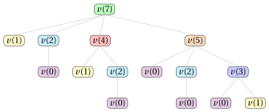

# 18.2 Un primo algoritmo di PD

**Parte 3 · Programmazione dinamica · Capitolo 18** · [:material-book-open-variant: Capitolo 18: Zaino illimitato (UKP)](index.md) · [:material-file-pdf-box: Dispensa, volume 3 (PDF)](../../pdf/dispensa-3-programmazione-dinamica.pdf) · [:material-presentation: Slide](../../pdf/slide-dp-unbounded-knapsack.pdf) · [:material-pencil: Esercizi: Zaino illimitato (UKP)](../../esercizi/dp-unbounded-knapsack.md) · [:material-gesture-tap: App: Tabelle della PD per i problemi di zaino](../../laboratorio/tabella-pd-zaino.md)

- <u>Passo 1</u>: calcolo del valore ottimo

    !!! formula ""

        Per ogni $k \in \{0,1,\dots,c\}$, sia $v(k)$ il valore ottimo della sottoistanza dell'UKP data da:

        1. uno zaino di capacità $k$,

        2. l'insieme $\{1,2,\dots,n\}$ di $n$ tipi di oggetto,

        3. per ogni tipo di oggetto $j \in \{1,2,\dots,n\}$, un profitto $p_j$ e un peso $w_j$.

        La formula ricorsiva per calcolare $v(k)$ è la seguente:

        \begin{equation*}
        \label{eq:ukp1}
        v(k)=
        \left\{
        \begin{array}{ll}
        0, & \textrm{se $k=0$,}\\[1ex]
        \displaystyle \max_{j \,:\, w_j\le k}\{p_j+v(k-w_j)\}, & \textrm{se $k\ge 1$ e $w_j\le k$ per qualche $j$,}\\[2ex]
        0, & \textrm{se $k\ge 1$ e $w_j> k$ per ogni $j$.}
        \end{array}
        \right. \tag{18.1}
        \end{equation*}

    - Il processo di decomposizione ricorsiva della formula $\eqref{eq:ukp1}$ genera al più $n$ <strong>sottoproblemi indipendenti</strong>, ciascuno corrispondente a una possibile scelta di un tipo di oggetto $j$, fra quelli con $w_j\le k$, da inserire come uno degli oggetti dello zaino di capacità $k$.

    - Il caso base è $v(0)=0$, poiché uno zaino di capacità $0$ non può contenere alcun oggetto e ha profitto $0$. Inoltre, se $w_j>k$ per ogni tipo di oggetto $j$, nessun oggetto entra nello zaino: l'unica scelta ammissibile è non inserire alcun oggetto, e quindi $v(k)=0$.

    - Il valore ottimo $v(k)$ si ottiene provando ogni tipo di oggetto $j$ con $w_j\le k$ e scegliendo quello che massimizza la somma $p_j+v(k-w_j)$ del profitto del tipo di oggetto scelto e del valore ottimo del sottoproblema residuo.

    - Poiché il tipo di oggetto $j$ è disponibile in infinite copie, può essere scelto di nuovo anche nella soluzione del sottoproblema residuo di capacità $k-w_j$.

    - Quindi una soluzione ottima per uno zaino di capacità $k$ si costruisce combinando il tipo di oggetto $j$ scelto con una soluzione ottima del sottoproblema residuo di capacità $k-w_j$.

        $\rightsquigarrow$ <strong>Sottostruttura ottima verificata!</strong>

    - Scelte diverse del primo tipo di oggetto, fatte eventualmente per valori diversi di $k$, possono portare alla stessa capacità residua; quindi lo stesso valore $v(k)$ può dover essere calcolato più volte durante la valutazione ricorsiva della formula $\eqref{eq:ukp1}$.

        $\rightsquigarrow$ <strong>Sottoproblemi sovrapposti verificati!</strong>

    - Un <strong>primo metodo</strong> per calcolare il valore ottimo $v(c)$ dell'istanza dell'UKP è l'<strong>approccio top-down</strong>.

    - Il metodo parte dalla chiamata con $k=c$ e valuta ricorsivamente la formula $\eqref{eq:ukp1}$: ogni chiamata per uno zaino di capacità $k$ genera altre chiamate per la capacità $k-w_j$, per ogni tipo di oggetto $j$ con $w_j\le k$, finché si raggiunge il caso base $v(0)$ o nessun tipo di oggetto entra nella capacità residua.

    - L'<strong>albero di ricorsione</strong> della funzione $v$ ha un nodo per ogni chiamata ricorsiva, etichettato con la chiamata che rappresenta. La radice rappresenta la chiamata iniziale. I figli di un nodo rappresentano le chiamate ricorsive fatte da quella chiamata. Le foglie rappresentano i casi base.

        

        !!! esempio "Esempio 18.2: Albero di ricorsione"

            Consideriamo l'istanza dell'UKP dell'[Esempio 18.1](index.md#box-1-texukpex1), con capacità $c=7$ e tipi di oggetto di pesi $w_1=2$, $w_2=3$, $w_3=5$, $w_4=6$. Questo è l'albero di ricorsione dell'approccio top-down per calcolare $v(7)$:

            { .fig loading=lazy  }

            La funzione $v$ viene chiamata $15$ volte e gli stessi sottoproblemi vengono risolti più volte: $v(2)$ viene chiamata $3$ volte, $v(1)$ viene chiamata $3$ volte e $v(0)$ viene chiamata $5$ volte. Tutte le altre chiamate avvengono una sola volta.

    - Il valore $v(k)$, per una capacità generica $k$, si può calcolare quando sono noti i valori $v(k')$ per tutte le capacità più piccole $k'<k$.

        

        !!! esempio "Esempio 18.3: Calcolo dei valori della funzione $v$"

            Consideriamo l'istanza dell'UKP dell'[Esempio 18.1](index.md#box-1-texukpex1), con uno zaino di capacità $c=7$ e i seguenti profitti e pesi:

            $$
            \begin{array}{l|rrrr}
            \hline  & {j=1} & {j=2} & {j=3} & {j=4} \\
            \hline {p_j} & 4 & 5 & 10 & 11 \\
            {w_j} & 2 & 3 & 5 & 6 \\
            \hline
            \end{array}
            $$

            Il valore della funzione $v$ si può calcolare partendo dal caso base $v(0)=0$ e calcolando poi in ordine i valori $v(1),v(2),\dots,v(7)$, come segue:

            - Poiché nessun tipo di oggetto ha $w_j\le 1$, abbiamo:

                $$
                v(1)=0.
                $$

            - Calcolato $v(0)$, possiamo calcolare $v(2)$ come segue:

                $$
                v(2)=p_1+v(0)=4+0=4.
                $$

            - Calcolati $v(1)$ e $v(0)$, possiamo calcolare $v(3)$ come segue:

                $$
                v(3)=\max\{p_1+v(1),p_2+v(0)\}=\max\{4+0,5+0\}=5.
                $$

            - Calcolati $v(2)$ e $v(1)$, possiamo calcolare $v(4)$ come segue:

                $$
                v(4)=\max\{p_1+v(2),p_2+v(1)\}=\max\{4+4,5+0\}=8.
                $$

            - Calcolati $v(3)$, $v(2)$ e $v(0)$, possiamo calcolare $v(5)$ come segue:

                $$
                v(5)=\max\{p_1+v(3),p_2+v(2),p_3+v(0)\}=\max\{4+5,5+4,10+0\}=10.
                $$

            - Calcolati $v(4)$, $v(3)$, $v(1)$ e $v(0)$, possiamo calcolare $v(6)$ come segue:

                \begin{align*}
                v(6)&=\max\{p_1+v(4),p_2+v(3),p_3+v(1),p_4+v(0)\}\\ &=\max\{4+8,5+5,10+0,11+0\}=12.
                \end{align*}

            - Calcolati $v(5)$, $v(4)$, $v(2)$ e $v(1)$, possiamo calcolare $v(7)$ come segue:

                \begin{align*}
                v(7)&=\max\{p_1+v(5),p_2+v(4),p_3+v(2),p_4+v(1)\}\\ &=\max\{4+10,5+8,10+4,11+0\}=14.
                \end{align*}

    - Possiamo evitare di risolvere ripetutamente gli stessi sottoproblemi memorizzando il valore di ogni sottoproblema appena calcolato. I valori sono memorizzati in una <strong>lookup table</strong>.

    - Poiché la soluzione di un sottoproblema di valore $v(k)$ dipende solo da sottoproblemi di valori $v(k')$, con $k'<k$, possiamo risolvere i sottoproblemi per valori crescenti di $k$, partendo dal caso base $v(0)=0$ fino ad arrivare a $v(c)$.

    - Questa osservazione porta in modo naturale a un <strong>metodo molto più efficiente</strong> per calcolare il valore ottimo $v(c)$ dell'istanza dell'UKP.

    - Un <strong>secondo metodo</strong> per calcolare il valore ottimo $v(c)$ dell'istanza dell'UKP è l'<strong>approccio bottom-up</strong>.

    - Il metodo parte dal caso base $v(0)=0$ e valuta la formula $\eqref{eq:ukp1}$ per capacità crescenti $k \in \{1,2,\dots,c\}$: ogni valore $v(k)$ si calcola con i valori già calcolati $v(0),v(1),\dots,v(k-1)$, fino a ottenere il valore $v(c)$ dell'istanza dell'UKP.

        Questo è lo pseudocodice dell'<strong>algoritmo di PD con l'approccio bottom-up</strong>:

        !!! algoritmo "Algoritmo: UKP\_DP1"

            

<strong>Input:</strong> Un'istanza dell'UKP data da \(n\), dai vettori \(p[1..n]\), \(w[1..n]\) e dalla capacità \(c\)

<strong>Output:</strong> Il valore ottimo dell'istanza dell'UKP

1<strong>Function</strong> UKP_DP1(\(n,p,w,c\))

2\(v := \textnormal{new array}[0..c]\)

3\(v[0] \leftarrow 0\)

4<strong>for</strong> \(k := 1\) <strong>to</strong> \(c\)  <strong>do</strong>

5\(m := 0\)

6<strong>for</strong> \(j := 1\) <strong>to</strong> \(n\)  <strong>do</strong>

7<strong>if</strong> \(w[j] \le k\)  <strong>then</strong>

8<strong>if</strong> \(p[j]+v[k-w[j]] > m\)  <strong>then</strong>

9\(m \leftarrow p[j]+v[k-w[j]]\)

10<strong>end</strong>

11<strong>end</strong>

12<strong>end</strong>

13\(v[k] \leftarrow m\)

14<strong>end</strong>

15<strong>return</strong> \(v[c]\)

        - Il vettore $v[0..c]$ è la <strong>lookup table</strong>: memorizza i valori ottimi di tutti i sottoproblemi, con il caso base $v[0]=0$.

        - Il ciclo esterno, su $k \in \{1,2,\dots,c\}$, calcola $v[k]$ in ordine crescente di capacità.

        - Il ciclo interno, su $j \in \{1,2,\dots,n\}$, esamina ogni tipo di oggetto; la condizione $w[j]\le k$ verifica se il tipo di oggetto $j$ entra nella capacità $k$, e in $m$ si tiene il valore $p[j]+v[k-w[j]]$ più grande trovato finora. Se nessun tipo di oggetto entra, $m$ resta uguale al suo valore iniziale $0$.

        - Al termine del ciclo interno, $v[k] \leftarrow m$ memorizza il valore ottimo $v[k]$.

        - Infine, l'algoritmo restituisce il valore ottimo $v[c]$ dell'istanza dell'UKP.

        

        !!! esempio "Esempio 18.4: Esecuzione dell'algoritmo di PD"

            Consideriamo l'istanza dell'UKP dell'[Esempio 18.1](index.md#box-1-texukpex1), con uno zaino di capacità $c=7$ e i seguenti profitti e pesi:

            $$
            \begin{array}{l|rrrr}
            \hline  & {j=1} & {j=2} & {j=3} & {j=4} \\
            \hline {p_j} & 4 & 5 & 10 & 11 \\
            {w_j} & 2 & 3 & 5 & 6 \\
            \hline
            \end{array}
            $$

            Per ogni passo dell'algoritmo di PD, la tabella riporta i valori di $k$ e $j$, il valore corrente di $m$ e la cella $v[k]$. La cella di $m$ è evidenziata in <mark>rosso</mark> quando viene aggiornata; la cella di $v[k]$ è evidenziata in <mark>blu</mark> quando viene assegnata.

            
<table>
            <tr>
            <th>\(k\)</th>
            <th>\(j\)</th>
            <th>\(v[k]\)</th>
            <th>\(m\)</th>
            <th>Azione</th>
            </tr>
            <tr>
            <td>\(-\)</td>
            <td>\(-\)</td>
            <td class="cella-blu">0</td>
            <td>\(-\)</td>
            <td>\(v[0]\leftarrow 0\)</td>
            </tr>
            <tr>
            <td></td>
            <td>\(-\)</td>
            <td>\(-\)</td>
            <td>0</td>
            <td>\(m := 0\)</td>
            </tr>
            <tr>
            <td>1</td>
            <td>1</td>
            <td>\(-\)</td>
            <td>0</td>
            <td>\(w[1]=2>1\): saltare</td>
            </tr>
            <tr>
            <td></td>
            <td>2</td>
            <td>\(-\)</td>
            <td>0</td>
            <td>\(w[2]=3>1\): saltare</td>
            </tr>
            <tr>
            <td></td>
            <td>3</td>
            <td>\(-\)</td>
            <td>0</td>
            <td>\(w[3]=5>1\): saltare</td>
            </tr>
            <tr>
            <td></td>
            <td>4</td>
            <td>\(-\)</td>
            <td>0</td>
            <td>\(w[4]=6>1\): saltare</td>
            </tr>
            <tr>
            <td></td>
            <td>\(-\)</td>
            <td class="cella-blu">0</td>
            <td>0</td>
            <td>\(v[1]\leftarrow m=0\)</td>
            </tr>
            <tr>
            <td></td>
            <td>\(-\)</td>
            <td>\(-\)</td>
            <td>0</td>
            <td>\(m := 0\)</td>
            </tr>
            <tr>
            <td>2</td>
            <td>1</td>
            <td>\(-\)</td>
            <td class="cella-rossa">4</td>
            <td>\(p[1]{+}v[0]=4{+}0=4>m=0\): \(m\leftarrow 4\)</td>
            </tr>
            <tr>
            <td></td>
            <td>2</td>
            <td>\(-\)</td>
            <td>4</td>
            <td>\(w[2]=3>2\): saltare</td>
            </tr>
            <tr>
            <td></td>
            <td>3</td>
            <td>\(-\)</td>
            <td>4</td>
            <td>\(w[3]=5>2\): saltare</td>
            </tr>
            <tr>
            <td></td>
            <td>4</td>
            <td>\(-\)</td>
            <td>4</td>
            <td>\(w[4]=6>2\): saltare</td>
            </tr>
            <tr>
            <td></td>
            <td>\(-\)</td>
            <td class="cella-blu">4</td>
            <td>4</td>
            <td>\(v[2]\leftarrow m=4\)</td>
            </tr>
            <tr>
            <td></td>
            <td>\(-\)</td>
            <td>\(-\)</td>
            <td>0</td>
            <td>\(m := 0\)</td>
            </tr>
            <tr>
            <td>3</td>
            <td>1</td>
            <td>\(-\)</td>
            <td class="cella-rossa">4</td>
            <td>\(p[1]{+}v[1]=4{+}0=4>m=0\): \(m\leftarrow 4\)</td>
            </tr>
            <tr>
            <td></td>
            <td>2</td>
            <td>\(-\)</td>
            <td class="cella-rossa">5</td>
            <td>\(p[2]{+}v[0]=5{+}0=5>m=4\): \(m\leftarrow 5\)</td>
            </tr>
            <tr>
            <td></td>
            <td>3</td>
            <td>\(-\)</td>
            <td>5</td>
            <td>\(w[3]=5>3\): saltare</td>
            </tr>
            <tr>
            <td></td>
            <td>4</td>
            <td>\(-\)</td>
            <td>5</td>
            <td>\(w[4]=6>3\): saltare</td>
            </tr>
            <tr>
            <td></td>
            <td>\(-\)</td>
            <td class="cella-blu">5</td>
            <td>5</td>
            <td>\(v[3]\leftarrow m=5\)</td>
            </tr>
            <tr>
            <td></td>
            <td>\(-\)</td>
            <td>\(-\)</td>
            <td>0</td>
            <td>\(m := 0\)</td>
            </tr>
            <tr>
            <td>4</td>
            <td>1</td>
            <td>\(-\)</td>
            <td class="cella-rossa">8</td>
            <td>\(p[1]{+}v[2]=4{+}4=8>m=0\): \(m\leftarrow 8\)</td>
            </tr>
            <tr>
            <td></td>
            <td>2</td>
            <td>\(-\)</td>
            <td>8</td>
            <td>\(p[2]{+}v[1]=5{+}0=5\le m=8\): nessun aggiornamento</td>
            </tr>
            <tr>
            <td></td>
            <td>3</td>
            <td>\(-\)</td>
            <td>8</td>
            <td>\(w[3]=5>4\): saltare</td>
            </tr>
            <tr>
            <td></td>
            <td>4</td>
            <td>\(-\)</td>
            <td>8</td>
            <td>\(w[4]=6>4\): saltare</td>
            </tr>
            <tr>
            <td></td>
            <td>\(-\)</td>
            <td class="cella-blu">8</td>
            <td>8</td>
            <td>\(v[4]\leftarrow m=8\)</td>
            </tr>
            <tr>
            <td></td>
            <td>\(-\)</td>
            <td>\(-\)</td>
            <td>0</td>
            <td>\(m := 0\)</td>
            </tr>
            <tr>
            <td>5</td>
            <td>1</td>
            <td>\(-\)</td>
            <td class="cella-rossa">9</td>
            <td>\(p[1]{+}v[3]=4{+}5=9>m=0\): \(m\leftarrow 9\)</td>
            </tr>
            <tr>
            <td></td>
            <td>2</td>
            <td>\(-\)</td>
            <td>9</td>
            <td>\(p[2]{+}v[2]=5{+}4=9=m\): nessun aggiornamento</td>
            </tr>
            <tr>
            <td></td>
            <td>3</td>
            <td>\(-\)</td>
            <td class="cella-rossa">10</td>
            <td>\(p[3]{+}v[0]=10{+}0=10>m=9\): \(m\leftarrow 10\)</td>
            </tr>
            <tr>
            <td></td>
            <td>4</td>
            <td>\(-\)</td>
            <td>10</td>
            <td>\(w[4]=6>5\): saltare</td>
            </tr>
            <tr>
            <td></td>
            <td>\(-\)</td>
            <td class="cella-blu">10</td>
            <td>10</td>
            <td>\(v[5]\leftarrow m=10\)</td>
            </tr>
            </table>

            
<table>
            <tr>
            <th>\(k\)</th>
            <th>\(j\)</th>
            <th>\(v[k]\)</th>
            <th>\(m\)</th>
            <th>Azione</th>
            </tr>
            <tr>
            <td></td>
            <td>\(-\)</td>
            <td>\(-\)</td>
            <td>0</td>
            <td>\(m := 0\)</td>
            </tr>
            <tr>
            <td>6</td>
            <td>1</td>
            <td>\(-\)</td>
            <td class="cella-rossa">12</td>
            <td>\(p[1]{+}v[4]=4{+}8=12>m=0\): \(m\leftarrow 12\)</td>
            </tr>
            <tr>
            <td></td>
            <td>2</td>
            <td>\(-\)</td>
            <td>12</td>
            <td>\(p[2]{+}v[3]=5{+}5=10\le m=12\): nessun aggiornamento</td>
            </tr>
            <tr>
            <td></td>
            <td>3</td>
            <td>\(-\)</td>
            <td>12</td>
            <td>\(p[3]{+}v[1]=10{+}0=10\le m=12\): nessun aggiornamento</td>
            </tr>
            <tr>
            <td></td>
            <td>4</td>
            <td>\(-\)</td>
            <td>12</td>
            <td>\(p[4]{+}v[0]=11{+}0=11\le m=12\): nessun aggiornamento</td>
            </tr>
            <tr>
            <td></td>
            <td>\(-\)</td>
            <td class="cella-blu">12</td>
            <td>12</td>
            <td>\(v[6]\leftarrow m=12\)</td>
            </tr>
            <tr>
            <td></td>
            <td>\(-\)</td>
            <td>\(-\)</td>
            <td>0</td>
            <td>\(m := 0\)</td>
            </tr>
            <tr>
            <td>7</td>
            <td>1</td>
            <td>\(-\)</td>
            <td class="cella-rossa">14</td>
            <td>\(p[1]{+}v[5]=4{+}10=14>m=0\): \(m\leftarrow 14\)</td>
            </tr>
            <tr>
            <td></td>
            <td>2</td>
            <td>\(-\)</td>
            <td>14</td>
            <td>\(p[2]{+}v[4]=5{+}8=13\le m=14\): nessun aggiornamento</td>
            </tr>
            <tr>
            <td></td>
            <td>3</td>
            <td>\(-\)</td>
            <td>14</td>
            <td>\(p[3]{+}v[2]=10{+}4=14=m\): nessun aggiornamento</td>
            </tr>
            <tr>
            <td></td>
            <td>4</td>
            <td>\(-\)</td>
            <td>14</td>
            <td>\(p[4]{+}v[1]=11{+}0=11\le m=14\): nessun aggiornamento</td>
            </tr>
            <tr>
            <td></td>
            <td>\(-\)</td>
            <td class="cella-blu">14</td>
            <td>14</td>
            <td>\(v[7]\leftarrow m=14\)</td>
            </tr>
            </table>

            Questo è il vettore $v$ dopo l'esecuzione dell'algoritmo di PD:

            $$
            \begin{array}{c|cccccccc}
            \hline  & {k=0} & {k=1} & {k=2} & {k=3} & {k=4} & {k=5} & {k=6} & {k=7} \\
            \hline {v[k]} & 0 & 0 & 4 & 5 & 8 & 10 & 12 & 14 \\
            \hline
            \end{array}
            $$

    - Dopo l'esecuzione dell'algoritmo di PD, il vettore $v$ contiene il valore ottimo $v[k]$ per ogni capacità.

- <u>Passo 2</u>: calcolo di una soluzione ottima

    - Per calcolare una soluzione ottima è necessario memorizzare alcune informazioni aggiuntive.

    - Per ogni capacità $k$, oltre al valore ottimo $v[k]$, memorizziamo $s[k]$, il tipo di oggetto selezionato come primo oggetto in una soluzione ottima per uno zaino di capacità $k$; se nessun tipo di oggetto entra nella capacità $k$, poniamo $s[k]=0$.

    - Partendo da $k=c$, il valore $s[k]$ dà il tipo del primo oggetto selezionato; la capacità residua diventa $k-w_{s[k]}$ e si può applicare di nuovo la stessa regola, e così via, finché la capacità residua arriva a $0$ o nessun tipo di oggetto vi entra ($s[k]=0$); in questo caso la capacità residua resta inutilizzata.

        Questo è lo pseudocodice dell'<strong>algoritmo di PD con l'approccio bottom-up</strong>, con la memorizzazione delle informazioni necessarie per calcolare una soluzione ottima:

        !!! algoritmo "Algoritmo: UKP\_DP1\_InfoSol"

            

<strong>Input:</strong> Un'istanza dell'UKP data da \(n\), dai vettori \(p[1..n]\), \(w[1..n]\) e dalla capacità \(c\)

<strong>Output:</strong> Il valore ottimo dell'istanza dell'UKP e il vettore delle informazioni \(s[0..c]\)

1<strong>Function</strong> UKP_DP1_InfoSol(\(n,p,w,c\))

2\(v := \textnormal{new array}[0..c]\); \(s := \textnormal{new array}[0..c]\)

3\(v[0] \leftarrow 0\); \(s[0] \leftarrow 0\)

4<strong>for</strong> \(k := 1\) <strong>to</strong> \(c\) <strong>do</strong>

5\(m := 0\); \(t := 0\)

6<strong>for</strong> \(j := 1\) <strong>to</strong> \(n\) <strong>do</strong>

7<strong>if</strong> \(w[j] \le k\) <strong>then</strong>

8<strong>if</strong> \(p[j]+v[k-w[j]] > m\) <strong>then</strong>

9\(m \leftarrow p[j]+v[k-w[j]]\); \(t \leftarrow j\)

10<strong>end</strong>

11<strong>end</strong>

12<strong>end</strong>

13\(v[k] \leftarrow m\); \(s[k] \leftarrow t\)

14<strong>end</strong>

15<strong>return</strong> \(v[c],s\)

        - L'algoritmo di PD usa la variabile temporanea aggiuntiva $t$ per registrare la decisione presa quando $m$ viene aggiornato. Se il tipo di oggetto $j$ è selezionato, $t\leftarrow j$ memorizza questa decisione; se nessun tipo di oggetto entra nella capacità $k$, $t$ mantiene il suo valore iniziale $0$.

        - Al termine del ciclo interno, $s[k]\leftarrow t$ memorizza il tipo di oggetto selezionato, insieme al valore ottimo $v[k]\leftarrow m$.

        

        !!! esempio "Esempio 18.5: Calcolo delle informazioni aggiuntive"

            Consideriamo l'istanza dell'UKP dell'[Esempio 18.1](index.md#box-1-texukpex1), con uno zaino di capacità $c=7$ e i seguenti profitti e pesi:

            $$
            \begin{array}{l|rrrr}
            \hline  & {j=1} & {j=2} & {j=3} & {j=4} \\
            \hline {p_j} & 4 & 5 & 10 & 11 \\
            {w_j} & 2 & 3 & 5 & 6 \\
            \hline
            \end{array}
            $$

            Per ogni passo dell'algoritmo di PD, la tabella riporta i valori di $k$ e $j$, la cella $s[k]$, il valore corrente di $m$ e il valore corrente di $t$. La cella di $m$ è evidenziata in <mark>rosso</mark> quando viene aggiornata; la cella di $t$ e la cella di $s[k]$ sono evidenziate in <mark>blu</mark> quando vengono aggiornate.

            
<table>
            <tr>
            <th>\(k\)</th>
            <th>\(j\)</th>
            <th>\(s[k]\)</th>
            <th>\(m\)</th>
            <th>\(t\)</th>
            <th>Azione</th>
            </tr>
            <tr>
            <td>\(-\)</td>
            <td>\(-\)</td>
            <td>\(-\)</td>
            <td>\(-\)</td>
            <td>\(-\)</td>
            <td>Stato iniziale: \(v[0]\leftarrow 0\), \(s[0]\leftarrow 0\)</td>
            </tr>
            <tr>
            <td></td>
            <td>\(-\)</td>
            <td>\(-\)</td>
            <td>0</td>
            <td>0</td>
            <td>\(m := 0\), \(t := 0\)</td>
            </tr>
            <tr>
            <td>1</td>
            <td>1</td>
            <td>\(-\)</td>
            <td>0</td>
            <td>0</td>
            <td>\(w[1]=2>1\): saltare</td>
            </tr>
            <tr>
            <td></td>
            <td>2</td>
            <td>\(-\)</td>
            <td>0</td>
            <td>0</td>
            <td>\(w[2]=3>1\): saltare</td>
            </tr>
            <tr>
            <td></td>
            <td>3</td>
            <td>\(-\)</td>
            <td>0</td>
            <td>0</td>
            <td>\(w[3]=5>1\): saltare</td>
            </tr>
            <tr>
            <td></td>
            <td>4</td>
            <td>\(-\)</td>
            <td>0</td>
            <td>0</td>
            <td>\(w[4]=6>1\): saltare</td>
            </tr>
            <tr>
            <td></td>
            <td>\(-\)</td>
            <td class="cella-blu">0</td>
            <td>0</td>
            <td>0</td>
            <td>\(v[1]\leftarrow m=0\), \(s[1]\leftarrow t=0\)</td>
            </tr>
            <tr>
            <td></td>
            <td>\(-\)</td>
            <td>\(-\)</td>
            <td>0</td>
            <td>0</td>
            <td>\(m := 0\), \(t := 0\)</td>
            </tr>
            <tr>
            <td>2</td>
            <td>1</td>
            <td>\(-\)</td>
            <td class="cella-rossa">4</td>
            <td class="cella-blu">1</td>
            <td>\(4{+}0=4>m=0\): \(m\leftarrow 4\), \(t\leftarrow 1\)</td>
            </tr>
            <tr>
            <td></td>
            <td>2</td>
            <td>\(-\)</td>
            <td>4</td>
            <td>1</td>
            <td>\(w[2]=3>2\): saltare</td>
            </tr>
            <tr>
            <td></td>
            <td>3</td>
            <td>\(-\)</td>
            <td>4</td>
            <td>1</td>
            <td>\(w[3]=5>2\): saltare</td>
            </tr>
            <tr>
            <td></td>
            <td>4</td>
            <td>\(-\)</td>
            <td>4</td>
            <td>1</td>
            <td>\(w[4]=6>2\): saltare</td>
            </tr>
            <tr>
            <td></td>
            <td>\(-\)</td>
            <td class="cella-blu">1</td>
            <td>4</td>
            <td>1</td>
            <td>\(v[2]\leftarrow m=4\), \(s[2]\leftarrow t=1\)</td>
            </tr>
            <tr>
            <td></td>
            <td>\(-\)</td>
            <td>\(-\)</td>
            <td>0</td>
            <td>0</td>
            <td>\(m := 0\), \(t := 0\)</td>
            </tr>
            <tr>
            <td>3</td>
            <td>1</td>
            <td>\(-\)</td>
            <td class="cella-rossa">4</td>
            <td class="cella-blu">1</td>
            <td>\(4{+}0=4>m=0\): \(m\leftarrow 4\), \(t\leftarrow 1\)</td>
            </tr>
            <tr>
            <td></td>
            <td>2</td>
            <td>\(-\)</td>
            <td class="cella-rossa">5</td>
            <td class="cella-blu">2</td>
            <td>\(5{+}0=5>m=4\): \(m\leftarrow 5\), \(t\leftarrow 2\)</td>
            </tr>
            <tr>
            <td></td>
            <td>3</td>
            <td>\(-\)</td>
            <td>5</td>
            <td>2</td>
            <td>\(w[3]=5>3\): saltare</td>
            </tr>
            <tr>
            <td></td>
            <td>4</td>
            <td>\(-\)</td>
            <td>5</td>
            <td>2</td>
            <td>\(w[4]=6>3\): saltare</td>
            </tr>
            <tr>
            <td></td>
            <td>\(-\)</td>
            <td class="cella-blu">2</td>
            <td>5</td>
            <td>2</td>
            <td>\(v[3]\leftarrow m=5\), \(s[3]\leftarrow t=2\)</td>
            </tr>
            <tr>
            <td></td>
            <td>\(-\)</td>
            <td>\(-\)</td>
            <td>0</td>
            <td>0</td>
            <td>\(m := 0\), \(t := 0\)</td>
            </tr>
            <tr>
            <td>4</td>
            <td>1</td>
            <td>\(-\)</td>
            <td class="cella-rossa">8</td>
            <td class="cella-blu">1</td>
            <td>\(4{+}4=8>m=0\): \(m\leftarrow 8\), \(t\leftarrow 1\)</td>
            </tr>
            <tr>
            <td></td>
            <td>2</td>
            <td>\(-\)</td>
            <td>8</td>
            <td>1</td>
            <td>\(5{+}0=5\le m=8\): nessun aggiornamento</td>
            </tr>
            <tr>
            <td></td>
            <td>3</td>
            <td>\(-\)</td>
            <td>8</td>
            <td>1</td>
            <td>\(w[3]=5>4\): saltare</td>
            </tr>
            <tr>
            <td></td>
            <td>4</td>
            <td>\(-\)</td>
            <td>8</td>
            <td>1</td>
            <td>\(w[4]=6>4\): saltare</td>
            </tr>
            <tr>
            <td></td>
            <td>\(-\)</td>
            <td class="cella-blu">1</td>
            <td>8</td>
            <td>1</td>
            <td>\(v[4]\leftarrow m=8\), \(s[4]\leftarrow t=1\)</td>
            </tr>
            <tr>
            <td></td>
            <td>\(-\)</td>
            <td>\(-\)</td>
            <td>0</td>
            <td>0</td>
            <td>\(m := 0\), \(t := 0\)</td>
            </tr>
            <tr>
            <td>5</td>
            <td>1</td>
            <td>\(-\)</td>
            <td class="cella-rossa">9</td>
            <td class="cella-blu">1</td>
            <td>\(4{+}5=9>m=0\): \(m\leftarrow 9\), \(t\leftarrow 1\)</td>
            </tr>
            <tr>
            <td></td>
            <td>2</td>
            <td>\(-\)</td>
            <td>9</td>
            <td>1</td>
            <td>\(5{+}4=9=m\): nessun aggiornamento</td>
            </tr>
            <tr>
            <td></td>
            <td>3</td>
            <td>\(-\)</td>
            <td class="cella-rossa">10</td>
            <td class="cella-blu">3</td>
            <td>\(10{+}0=10>m=9\): \(m\leftarrow 10\), \(t\leftarrow 3\)</td>
            </tr>
            <tr>
            <td></td>
            <td>4</td>
            <td>\(-\)</td>
            <td>10</td>
            <td>3</td>
            <td>\(w[4]=6>5\): saltare</td>
            </tr>
            <tr>
            <td></td>
            <td>\(-\)</td>
            <td class="cella-blu">3</td>
            <td>10</td>
            <td>3</td>
            <td>\(v[5]\leftarrow m=10\), \(s[5]\leftarrow t=3\)</td>
            </tr>
            </table>

            
<table>
            <tr>
            <th>\(k\)</th>
            <th>\(j\)</th>
            <th>\(s[k]\)</th>
            <th>\(m\)</th>
            <th>\(t\)</th>
            <th>Azione</th>
            </tr>
            <tr>
            <td></td>
            <td>\(-\)</td>
            <td>\(-\)</td>
            <td>0</td>
            <td>0</td>
            <td>\(m := 0\), \(t := 0\)</td>
            </tr>
            <tr>
            <td>6</td>
            <td>1</td>
            <td>\(-\)</td>
            <td class="cella-rossa">12</td>
            <td class="cella-blu">1</td>
            <td>\(4{+}8=12>m=0\): \(m\leftarrow 12\), \(t\leftarrow 1\)</td>
            </tr>
            <tr>
            <td></td>
            <td>2</td>
            <td>\(-\)</td>
            <td>12</td>
            <td>1</td>
            <td>\(5{+}5=10\le m=12\): nessun aggiornamento</td>
            </tr>
            <tr>
            <td></td>
            <td>3</td>
            <td>\(-\)</td>
            <td>12</td>
            <td>1</td>
            <td>\(10{+}0=10\le m=12\): nessun aggiornamento</td>
            </tr>
            <tr>
            <td></td>
            <td>4</td>
            <td>\(-\)</td>
            <td>12</td>
            <td>1</td>
            <td>\(11{+}0=11\le m=12\): nessun aggiornamento</td>
            </tr>
            <tr>
            <td></td>
            <td>\(-\)</td>
            <td class="cella-blu">1</td>
            <td>12</td>
            <td>1</td>
            <td>\(v[6]\leftarrow m=12\), \(s[6]\leftarrow t=1\)</td>
            </tr>
            <tr>
            <td></td>
            <td>\(-\)</td>
            <td>\(-\)</td>
            <td>0</td>
            <td>0</td>
            <td>\(m := 0\), \(t := 0\)</td>
            </tr>
            <tr>
            <td>7</td>
            <td>1</td>
            <td>\(-\)</td>
            <td class="cella-rossa">14</td>
            <td class="cella-blu">1</td>
            <td>\(4{+}10=14>m=0\): \(m\leftarrow 14\), \(t\leftarrow 1\)</td>
            </tr>
            <tr>
            <td></td>
            <td>2</td>
            <td>\(-\)</td>
            <td>14</td>
            <td>1</td>
            <td>\(5{+}8=13\le m=14\): nessun aggiornamento</td>
            </tr>
            <tr>
            <td></td>
            <td>3</td>
            <td>\(-\)</td>
            <td>14</td>
            <td>1</td>
            <td>\(10{+}4=14=m\): nessun aggiornamento</td>
            </tr>
            <tr>
            <td></td>
            <td>4</td>
            <td>\(-\)</td>
            <td>14</td>
            <td>1</td>
            <td>\(11{+}0=11\le m=14\): nessun aggiornamento</td>
            </tr>
            <tr>
            <td></td>
            <td>\(-\)</td>
            <td class="cella-blu">1</td>
            <td>14</td>
            <td>1</td>
            <td>\(v[7]\leftarrow m=14\), \(s[7]\leftarrow t=1\)</td>
            </tr>
            </table>

            Questo è il vettore $s$ dopo l'esecuzione dell'algoritmo di PD:

            $$
            \begin{array}{c|cccccccc}
            \hline  & {k=0} & {k=1} & {k=2} & {k=3} & {k=4} & {k=5} & {k=6} & {k=7} \\
            \hline {s[k]} & 0 & 0 & 1 & 2 & 1 & 3 & 1 & 1 \\
            \hline
            \end{array}
            $$

    - Calcolato il vettore $s$, si può calcolare una soluzione ottima dell'istanza dell'UKP applicando ripetutamente la seguente regola, partendo da $k=c$ e da $x_j=0$ per ogni $j \in \{1,2,\dots,n\}$:

        $$
        x_{s[k]} \leftarrow x_{s[k]}+1,
        \qquad
        k \leftarrow k-w_{s[k]},
        $$

        finché $k=0$ o $s[k]=0$. Il secondo caso si verifica quando nessun tipo di oggetto entra nella capacità residua $k$, che resta quindi inutilizzata. Si ottiene così il vettore $(x_1,x_2,\dots,x_n)$, dove ogni componente $x_j$ è il numero di copie del tipo di oggetto $j$ in una soluzione ottima.

    - Il seguente pseudocodice realizza il calcolo di una soluzione ottima, dato il vettore $s$.

        !!! algoritmo "Algoritmo: UKP\_DP1\_SolComputation"

            

<strong>Input:</strong> Il numero \(n\) di tipi di oggetto, la capacità \(c\), il vettore \(w[1..n]\) e il vettore \(s[0..c]\)

<strong>Output:</strong> Una soluzione ottima dell'istanza dell'UKP

1<strong>Function</strong> UKP_DP1_SolComputation(\(n,w,c,s\))

2\(x := \textnormal{new array}[1..n]\)

3<strong>for</strong> \(j := 1\) <strong>to</strong> \(n\) <strong>do</strong>

4\(x[j] \leftarrow 0\)

5<strong>end</strong>

6\(k := c\)

7<strong>while</strong> \(k > 0\) <strong>e</strong> \(s[k] > 0\) <strong>do</strong>

8\(x[s[k]] \leftarrow x[s[k]]+1\)

9\(k \leftarrow k - w[s[k]]\)

10<strong>end</strong>

11<strong>return</strong> \(x\)

        

        !!! esempio "Esempio 18.6: Calcolo di una soluzione ottima"

            Dopo l'esecuzione dell'algoritmo di PD sull'istanza dell'[Esempio 18.1](index.md#box-1-texukpex1), abbiamo il seguente vettore $s$:

            $$
            \begin{array}{c|cccccccc}
            \hline  & {k=0} & {k=1} & {k=2} & {k=3} & {k=4} & {k=5} & {k=6} & {k=7} \\
            \hline {s[k]} & 0 & 0 & 1 & 2 & 1 & 3 & 1 & 1 \\
            \hline
            \end{array}
            $$

            Possiamo calcolare una soluzione ottima per uno zaino di capacità $c=7$ come segue:

            
<table>
            <tr>
            <th>Iterazione</th>
            <th>\(k\)</th>
            <th>\(s[k]\)</th>
            <th>\(x[1]\)</th>
            <th>\(x[2]\)</th>
            <th>\(x[3]\)</th>
            <th>\(x[4]\)</th>
            <th>\(k \leftarrow k-w_{s[k]}\)</th>
            </tr>
            <tr>
            <td>\(-\)</td>
            <td>\(-\)</td>
            <td>\(-\)</td>
            <td>0</td>
            <td>0</td>
            <td>0</td>
            <td>0</td>
            <td>\(k=7\)</td>
            </tr>
            <tr>
            <td>\(1\)</td>
            <td>\(7\)</td>
            <td>\(1\)</td>
            <td class="cella-blu">1</td>
            <td>0</td>
            <td>0</td>
            <td>0</td>
            <td>\(k=7-2=5\)</td>
            </tr>
            <tr>
            <td>\(2\)</td>
            <td>\(5\)</td>
            <td>\(3\)</td>
            <td>1</td>
            <td>0</td>
            <td class="cella-blu">1</td>
            <td>0</td>
            <td>\(k=5-5=0\)</td>
            </tr>
            </table>

            Una soluzione ottima è il vettore:

            $$
            (1,0,1,0)
            $$

            Il suo peso totale è $w_1+w_3=2+5=7=c$ e il suo profitto totale è $p_1+p_3=4+10=14$, che coincide con il valore ottimo $v(7)=14$.

## 18.2.1 Numero di passi

- Indichiamo con $S(n,c)$ il numero di passi eseguiti da <code>UKP\_DP1</code> nel caso peggiore, dove $n$ è il numero di tipi di oggetto e $c$ è la capacità dello zaino. Calcoliamo $S(n,c)$ contando quante volte vengono eseguite le righe dello pseudocodice di <code>UKP\_DP1</code>.

- Nel caso peggiore, le condizioni delle righe [7](#box-9-ukpbu1-f) e [8](#box-10-ukpbu1-g) sono vere a ogni iterazione del ciclo interno, e quindi la riga [9](#box-11-ukpbu1-h) viene eseguita tante volte quanto la riga [8](#box-10-ukpbu1-g). Il numero di esecuzioni delle righe rilevanti è:

    - La Riga [2](#box-4-ukpbu1-a) viene eseguita $1$ volta.

    - La Riga [3](#box-5-ukpbu1-b) viene eseguita $1$ volta.

    - La Riga [4](#box-6-ukpbu1-c) viene eseguita $c$ volte.

    - La Riga [5](#box-7-ukpbu1-d) viene eseguita $c$ volte.

    - La Riga [6](#box-8-ukpbu1-e) viene eseguita $cn$ volte.

    - La Riga [7](#box-9-ukpbu1-f) viene eseguita $cn$ volte.

    - La Riga [8](#box-10-ukpbu1-g) viene eseguita $cn$ volte.

    - La Riga [9](#box-11-ukpbu1-h) viene eseguita $cn$ volte.

    - La Riga [13](#box-12-ukpbu1-i) viene eseguita $c$ volte.

    - La Riga [15](#box-13-ukpbu1-j) viene eseguita $1$ volta.

    Pertanto, il numero totale di passi nel caso peggiore è

    $$
    1+1+c+c+cn+cn+cn+cn+c+1.
    $$

    Quindi

    $$
    S(n,c)=3+3c+4cn.
    $$

    Dunque

    $$
    S(n,c)=\Theta(nc).
    $$

    Infatti

    $$
    \lim_{n,c\to\infty}
    \frac{4cn+3c+3}{nc}
    =
    \lim_{n,c\to\infty}
    \left(4+\frac{3}{n}+\frac{3}{nc}\right)
    =
    4\in\mathbb{R}_{>0}.
    $$

    !!! chiave ""

        L'algoritmo di PD esegue

        $$
        S(n,c)=\Theta(nc)
        $$

        passi nel caso peggiore.

- La versione <code>UKP\_DP1\_InfoSol</code> memorizza il vettore aggiuntivo $s$ ed esegue solo un numero costante di operazioni in più dentro gli stessi cicli. Pertanto, il suo numero di passi resta $\Theta(nc)$.

---

**Avanti:** [18.3 Un secondo algoritmo di PD](un-secondo-algoritmo-di-pd.md)
