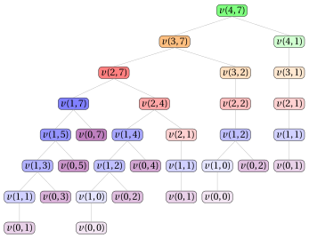

# 18.3 Un secondo algoritmo di PD

**Parte 3 · Programmazione dinamica · Capitolo 18** · [:material-book-open-variant: Capitolo 18: Zaino illimitato (UKP)](index.md) · [:material-file-pdf-box: Dispensa, volume 3 (PDF)](../../pdf/dispensa-3-programmazione-dinamica.pdf) · [:material-presentation: Slide](../../pdf/slide-dp-unbounded-knapsack.pdf) · [:material-pencil: Esercizi: Zaino illimitato (UKP)](../../esercizi/dp-unbounded-knapsack.md) · [:material-gesture-tap: App: Tabelle della PD per i problemi di zaino](../../laboratorio/tabella-pd-zaino.md)

- <u>Passo 1</u>: calcolo del valore ottimo

    !!! formula ""

        Per ogni $j \in \{0,1,\dots,n\}$ e $k \in \{0,1,\dots,c\}$, sia $v(j,k)$ il valore ottimo della sottoistanza dell'UKP data da:

        1. uno zaino di capacità $k$,

        2. l'insieme $\{1,2,\dots,j\}$ di $j$ tipi di oggetto,

        3. per ogni tipo di oggetto $h \in \{1,2,\dots,j\}$, un profitto $p_h$ e un peso $w_h$.

        La formula ricorsiva per calcolare $v(j,k)$ è la seguente:

        \begin{equation*}
        \label{eq:ukp2}
        v(j,k)= \left\{ \begin{array}{ll}
        0, & \textrm{se $j=0$,}\\[1ex]
        v(j-1,k), & \textrm{se $j\ge 1$ e $k<w_j$,}\\[1ex]
        \max\{v(j-1,k),\ p_j+v(j,k-w_j)\}, & \textrm{se $j\ge 1$ e $k\ge w_j$.}
        \end{array} \right. \tag{18.2}
        \end{equation*}

    - Il processo di decomposizione ricorsiva della formula $\eqref{eq:ukp2}$ genera al più $2$ <strong>sottoproblemi indipendenti</strong>, corrispondenti alla scelta di inserire o no una copia del tipo di oggetto $j$ in uno zaino di capacità $k$, usando solo i tipi di oggetto $1,2,\dots,j$.

    - Se $w_j>k$, il tipo di oggetto $j$ non può essere inserito e quindi l'unica opzione ammissibile è non usarlo.

    - Il caso base è $v(0,k)=0$ per ogni $k$, poiché senza tipi di oggetto disponibili l'unica scelta ammissibile è non inserire alcun oggetto, che ha sempre profitto $0$.

    - Se $j\ge 1$ e $k\ge w_j$, il valore ottimo $v(j,k)$ si ottiene provando le due opzioni possibili, non inserire il tipo di oggetto $j$ oppure inserirne un'ulteriore copia, e scegliendo quella che massimizza il profitto. I valori corrispondenti sono, rispettivamente, $v(j-1,k)$ e $p_j+v(j,k-w_j)$.

    - Se $j\ge 1$ e $k<w_j$, il tipo di oggetto $j$ non può essere usato e quindi $v(j,k)=v(j-1,k)$.

    - Il termine $p_j+v(j,k-w_j)$ si riferisce alla stessa riga $j$ perché, dopo aver inserito una copia del tipo di oggetto $j$, sono ancora disponibili altre copie dello stesso tipo.

    - Quindi una soluzione ottima per uno zaino di capacità $k$ che usa solo i tipi di oggetto $1,2,\dots,j$ si costruisce combinando la decisione scelta sul tipo di oggetto $j$ con una soluzione ottima del corrispondente sottoproblema residuo.

        $\rightsquigarrow$ <strong>Sottostruttura ottima verificata!</strong>

    - Sequenze diverse di decisioni sui tipi di oggetto, prese eventualmente per valori diversi di $j$ e $k$, possono portare allo stesso sottoproblema; quindi lo stesso valore $v(j,k)$ può dover essere calcolato più volte durante la valutazione ricorsiva della formula $\eqref{eq:ukp2}$.

        $\rightsquigarrow$ <strong>Sottoproblemi sovrapposti verificati!</strong>

    - Un <strong>primo metodo</strong> per calcolare il valore ottimo $v(n,c)$ dell'istanza dell'UKP è l'<strong>approccio top-down</strong>.

    - Il metodo parte dalla chiamata con $(j,k)=(n,c)$ e valuta ricorsivamente la formula $\eqref{eq:ukp2}$: ogni chiamata per la capacità $k$ con i soli tipi di oggetto $1,2,\dots,j$ genera altre chiamate, corrispondenti alle decisioni ammissibili sul tipo di oggetto $j$, finché si raggiunge uno dei casi base $v(0,k)$.

    - L'<strong>albero di ricorsione</strong> della funzione $v$ ha un nodo per ogni chiamata ricorsiva, etichettato con la chiamata che rappresenta. La radice rappresenta la chiamata iniziale. I figli di un nodo rappresentano le chiamate ricorsive fatte da quella chiamata. Le foglie rappresentano i casi base.

        

        !!! esempio "Esempio 18.7: Albero di ricorsione"

            Consideriamo l'istanza dell'UKP dell'[Esempio 18.1](index.md#box-1-texukpex1), con capacità $c=7$ e tipi di oggetto di pesi $w_1=2$, $w_2=3$, $w_3=5$, $w_4=6$. Questo è l'albero di ricorsione dell'approccio top-down per calcolare $v(4,7)$:

            { .fig loading=lazy  }

            La funzione $v$ viene chiamata $32$ volte e gli stessi sottoproblemi vengono risolti più volte: $v(1,1)$ viene chiamata $3$ volte, $v(0,1)$ $3$ volte, $v(1,2)$ $2$ volte, $v(0,2)$ $2$ volte, $v(1,0)$ $2$ volte, $v(0,0)$ $2$ volte e $v(2,1)$ $2$ volte. Tutte le altre chiamate avvengono una sola volta.

    - Il valore $v(j,k)$ si può calcolare quando è noto $v(j-1,k)$ e, se $k\ge w_j$, è noto anche $v(j,k-w_j)$. Pertanto, per un valore fissato di $j$, tutti i valori $v(j,k)$ si possono calcolare considerando i valori di $k$ in ordine crescente.

    - Partendo dal caso base $v(0,k)=0$ per ogni $k$, i valori della funzione $v$ si possono calcolare riga per riga, passando al valore successivo di $j$ solo dopo aver calcolato tutti i valori $v(j,k)$ per il valore corrente di $j$.

        

        !!! esempio "Esempio 18.8: Calcolo dei valori della funzione $v$"

            Consideriamo l'istanza dell'UKP dell'[Esempio 18.1](index.md#box-1-texukpex1), con uno zaino di capacità $c=7$ e i seguenti profitti e pesi:

            $$
            \begin{array}{l|rrrr}
            \hline  & {j=1} & {j=2} & {j=3} & {j=4} \\
            \hline {p_j} & 4 & 5 & 10 & 11 \\
            {w_j} & 2 & 3 & 5 & 6 \\
            \hline
            \end{array}
            $$

            I valori della funzione $v$ si calcolano come segue:

            - Per $j=1$ è disponibile solo il tipo di oggetto $1$ ($w_1=2$). Pertanto:

                $$
                v(1,0)=0,\qquad v(1,1)=v(0,1)=0,
                $$

                $$
                v(1,2)=\max\{v(0,2),p_1+v(1,0)\}=\max\{0,4+0\}=4,
                $$

                $$
                v(1,3)=\max\{v(0,3),p_1+v(1,1)\}=\max\{0,4+0\}=4,
                $$

                $$
                v(1,4)=\max\{v(0,4),p_1+v(1,2)\}=\max\{0,4+4\}=8,
                $$

                $$
                v(1,5)=\max\{v(0,5),p_1+v(1,3)\}=\max\{0,4+4\}=8,
                $$

                $$
                v(1,6)=\max\{v(0,6),p_1+v(1,4)\}=\max\{0,4+8\}=12,
                $$

                $$
                v(1,7)=\max\{v(0,7),p_1+v(1,5)\}=\max\{0,4+8\}=12.
                $$

            - Per $j=2$ sono disponibili i tipi di oggetto $1$ e $2$. Otteniamo:

                $$
                v(2,0)=0,\qquad v(2,1)=v(1,1)=0,\qquad v(2,2)=v(1,2)=4,
                $$

                $$
                v(2,3)=\max\{v(1,3),p_2+v(2,0)\}=\max\{4,5+0\}=5,
                $$

                $$
                v(2,4)=\max\{v(1,4),p_2+v(2,1)\}=\max\{8,5+0\}=8,
                $$

                $$
                v(2,5)=\max\{v(1,5),p_2+v(2,2)\}=\max\{8,5+4\}=9,
                $$

                $$
                v(2,6)=\max\{v(1,6),p_2+v(2,3)\}=\max\{12,5+5\}=12,
                $$

                $$
                v(2,7)=\max\{v(1,7),p_2+v(2,4)\}=\max\{12,5+8\}=13.
                $$

            - Per $j=3$ sono disponibili i tipi di oggetto $1$, $2$ e $3$. Otteniamo:

                $$
                v(3,0)=0,\qquad v(3,1)=v(2,1)=0,\qquad v(3,2)=v(2,2)=4,
                $$

                $$
                v(3,3)=v(2,3)=5,\qquad v(3,4)=v(2,4)=8,
                $$

                $$
                v(3,5)=\max\{v(2,5),p_3+v(3,0)\}=\max\{9,10+0\}=10,
                $$

                $$
                v(3,6)=\max\{v(2,6),p_3+v(3,1)\}=\max\{12,10+0\}=12,
                $$

                $$
                v(3,7)=\max\{v(2,7),p_3+v(3,2)\}=\max\{13,10+4\}=14.
                $$

            - Per $j=4$ sono disponibili tutti i tipi di oggetto. Otteniamo:

                $$
                v(4,0)=0,\quad v(4,1)=v(3,1)=0,\quad v(4,2)=v(3,2)=4,
                $$

                $$
                v(4,3)=v(3,3)=5,\quad v(4,4)=v(3,4)=8,\quad v(4,5)=v(3,5)=10,
                $$

                $$
                v(4,6)=\max\{v(3,6),p_4+v(4,0)\}=\max\{12,11+0\}=12,
                $$

                $$
                v(4,7)=\max\{v(3,7),p_4+v(4,1)\}=\max\{14,11+0\}=14.
                $$

    - Possiamo evitare di risolvere ripetutamente gli stessi sottoproblemi memorizzando il valore di ogni sottoproblema appena calcolato. I valori sono memorizzati in una <strong>lookup table</strong>.

    - Poiché la soluzione di ogni sottoproblema dipende solo da sottoproblemi con un valore di $j$ più piccolo, oppure con lo stesso valore di $j$ e una capacità più piccola, possiamo risolvere i sottoproblemi in ordine crescente di $j$ e, per ogni valore fissato di $j$, in ordine crescente di capacità, partendo dai casi base $v(0,k)=0$ per ogni $k \in \{0,1,\dots,c\}$ fino ad arrivare a $v(n,c)$.

    - Questa osservazione porta in modo naturale a un <strong>metodo molto più efficiente</strong> per calcolare il valore ottimo $v(n,c)$ dell'istanza dell'UKP.

    - Un <strong>secondo metodo</strong> per calcolare il valore ottimo $v(n,c)$ dell'istanza dell'UKP è l'<strong>approccio bottom-up</strong>.

    - Il metodo parte dai casi base $v(0,k)=0$ per ogni $k \in \{0,1,\dots,c\}$ e valuta la formula $\eqref{eq:ukp2}$ per valori crescenti di $j \in \{1,2,\dots,n\}$ e $k \in \{0,1,\dots,c\}$: ogni valore $v(j,k)$ si calcola con valori già calcolati, fino a ottenere il valore $v(n,c)$ dell'istanza dell'UKP.

        Questo è lo pseudocodice dell'<strong>algoritmo di PD con l'approccio bottom-up</strong>:

        !!! algoritmo "Algoritmo: UKP\_DP2"

            

<strong>Input:</strong> Un'istanza dell'UKP data da \(n\), dai vettori \(p[1..n]\), \(w[1..n]\) e dalla capacità \(c\)

<strong>Output:</strong> Il valore ottimo dell'istanza dell'UKP

1<strong>Function</strong> UKP_DP2(\(n,p,w,c\))

2\(v := \textnormal{new array}[0..n][0..c]\)

3<strong>for</strong> \(k := 0\) <strong>to</strong> \(c\)  <strong>do</strong>

4\(v[0][k] \leftarrow 0\)

5<strong>end</strong>

6<strong>for</strong> \(j := 1\) <strong>to</strong> \(n\)  <strong>do</strong>

7<strong>for</strong> \(k := 0\) <strong>to</strong> \(c\)  <strong>do</strong>

8<strong>if</strong> \(k < w[j]\)  <strong>then</strong>

9\(v[j][k] \leftarrow v[j-1][k]\)

10<strong>else</strong>

11<strong>if</strong> \(p[j]+v[j][k-w[j]] > v[j-1][k]\)  <strong>then</strong>

12\(v[j][k] \leftarrow p[j]+v[j][k-w[j]]\)

13<strong>else</strong>

14\(v[j][k] \leftarrow v[j-1][k]\)

15<strong>end</strong>

16<strong>end</strong>

17<strong>end</strong>

18<strong>end</strong>

19<strong>return</strong> \(v[n][c]\)

        - La matrice $v[0..n][0..c]$ è la <strong>lookup table</strong>: memorizza i valori ottimi di tutti i sottoproblemi.

        - L'inizializzazione pone $v[0][k]=0$ per ogni capacità $k \in \{0,1,\dots,c\}$, poiché non selezionare alcun oggetto è sempre ammissibile, con profitto $0$.

        - Il ciclo esterno, su $j \in \{1,2,\dots,n\}$, considera i tipi di oggetto disponibili in ordine crescente.

        - Il ciclo interno, su $k \in \{0,1,\dots,c\}$, calcola il valore migliore per ogni capacità usando solo i tipi di oggetto $1,2,\dots,j$.

        - Se $k<w[j]$, il tipo di oggetto $j$ non può essere usato e quindi $v[j][k] \leftarrow v[j-1][k]$.

        - Altrimenti, l'algoritmo di PD confronta il valore ottenuto senza usare il tipo di oggetto $j$, cioè $v[j-1][k]$, con il valore ottenuto inserendo un'ulteriore copia del tipo di oggetto $j$, cioè $p[j]+v[j][k-w[j]]$.

        - Infine, l'algoritmo restituisce il valore ottimo dell'istanza dell'UKP, $v[n][c]$.

        

        !!! esempio "Esempio 18.9: Esecuzione dell'algoritmo di PD"

            Consideriamo l'istanza dell'UKP dell'[Esempio 18.1](index.md#box-1-texukpex1), con uno zaino di capacità $c=7$ e i seguenti profitti e pesi:

            $$
            \begin{array}{l|rrrr}
            \hline  & {j=1} & {j=2} & {j=3} & {j=4} \\
            \hline {p_j} & 4 & 5 & 10 & 11 \\
            {w_j} & 2 & 3 & 5 & 6 \\
            \hline
            \end{array}
            $$

            Per ogni passo dell'algoritmo di PD, la tabella riporta i valori di $j$ e $k$, la cella $v[j][k]$ e l'operazione eseguita.

            
<table>
            <tr>
            <th>\(j\)</th>
            <th>\(k\)</th>
            <th>\(v[j][k]\)</th>
            <th>Azione</th>
            </tr>
            <tr>
            <td>\(0\)</td>
            <td>\(0\)</td>
            <td>0</td>
            <td>\(v[0][0]\leftarrow 0\)</td>
            </tr>
            <tr>
            <td>\(0\)</td>
            <td>\(1\)</td>
            <td>0</td>
            <td>\(v[0][1]\leftarrow 0\)</td>
            </tr>
            <tr>
            <td>\(0\)</td>
            <td>\(2\)</td>
            <td>0</td>
            <td>\(v[0][2]\leftarrow 0\)</td>
            </tr>
            <tr>
            <td>\(0\)</td>
            <td>\(3\)</td>
            <td>0</td>
            <td>\(v[0][3]\leftarrow 0\)</td>
            </tr>
            <tr>
            <td>\(0\)</td>
            <td>\(4\)</td>
            <td>0</td>
            <td>\(v[0][4]\leftarrow 0\)</td>
            </tr>
            <tr>
            <td>\(0\)</td>
            <td>\(5\)</td>
            <td>0</td>
            <td>\(v[0][5]\leftarrow 0\)</td>
            </tr>
            <tr>
            <td>\(0\)</td>
            <td>\(6\)</td>
            <td>0</td>
            <td>\(v[0][6]\leftarrow 0\)</td>
            </tr>
            <tr>
            <td>\(0\)</td>
            <td>\(7\)</td>
            <td>0</td>
            <td>\(v[0][7]\leftarrow 0\)</td>
            </tr>
            <tr>
            <td>\(1\)</td>
            <td>\(0\)</td>
            <td>0</td>
            <td>\(k=0<w[1]=2\): \(v[1][0]\leftarrow v[0][0]=0\)</td>
            </tr>
            <tr>
            <td>\(1\)</td>
            <td>\(1\)</td>
            <td>0</td>
            <td>\(k=1<w[1]=2\): \(v[1][1]\leftarrow v[0][1]=0\)</td>
            </tr>
            <tr>
            <td>\(1\)</td>
            <td>\(2\)</td>
            <td>4</td>
            <td>\(\max\{v[0][2],p[1]+v[1][0]\}=\max\{0,4+0\}=4\)</td>
            </tr>
            <tr>
            <td>\(1\)</td>
            <td>\(3\)</td>
            <td>4</td>
            <td>\(\max\{v[0][3],p[1]+v[1][1]\}=\max\{0,4+0\}=4\)</td>
            </tr>
            <tr>
            <td>\(1\)</td>
            <td>\(4\)</td>
            <td>8</td>
            <td>\(\max\{v[0][4],p[1]+v[1][2]\}=\max\{0,4+4\}=8\)</td>
            </tr>
            <tr>
            <td>\(1\)</td>
            <td>\(5\)</td>
            <td>8</td>
            <td>\(\max\{v[0][5],p[1]+v[1][3]\}=\max\{0,4+4\}=8\)</td>
            </tr>
            <tr>
            <td>\(1\)</td>
            <td>\(6\)</td>
            <td>12</td>
            <td>\(\max\{v[0][6],p[1]+v[1][4]\}=\max\{0,4+8\}=12\)</td>
            </tr>
            <tr>
            <td>\(1\)</td>
            <td>\(7\)</td>
            <td>12</td>
            <td>\(\max\{v[0][7],p[1]+v[1][5]\}=\max\{0,4+8\}=12\)</td>
            </tr>
            <tr>
            <td>\(2\)</td>
            <td>\(0\)</td>
            <td>0</td>
            <td>\(k=0<w[2]=3\): \(v[2][0]\leftarrow v[1][0]=0\)</td>
            </tr>
            <tr>
            <td>\(2\)</td>
            <td>\(1\)</td>
            <td>0</td>
            <td>\(k=1<w[2]=3\): \(v[2][1]\leftarrow v[1][1]=0\)</td>
            </tr>
            <tr>
            <td>\(2\)</td>
            <td>\(2\)</td>
            <td>4</td>
            <td>\(k=2<w[2]=3\): \(v[2][2]\leftarrow v[1][2]=4\)</td>
            </tr>
            <tr>
            <td>\(2\)</td>
            <td>\(3\)</td>
            <td>5</td>
            <td>\(\max\{v[1][3],p[2]+v[2][0]\}=\max\{4,5+0\}=5\)</td>
            </tr>
            <tr>
            <td>\(2\)</td>
            <td>\(4\)</td>
            <td>8</td>
            <td>\(\max\{v[1][4],p[2]+v[2][1]\}=\max\{8,5+0\}=8\)</td>
            </tr>
            <tr>
            <td>\(2\)</td>
            <td>\(5\)</td>
            <td>9</td>
            <td>\(\max\{v[1][5],p[2]+v[2][2]\}=\max\{8,5+4\}=9\)</td>
            </tr>
            <tr>
            <td>\(2\)</td>
            <td>\(6\)</td>
            <td>12</td>
            <td>\(\max\{v[1][6],p[2]+v[2][3]\}=\max\{12,5+5\}=12\)</td>
            </tr>
            <tr>
            <td>\(2\)</td>
            <td>\(7\)</td>
            <td>13</td>
            <td>\(\max\{v[1][7],p[2]+v[2][4]\}=\max\{12,5+8\}=13\)</td>
            </tr>
            </table>

            
<table>
            <tr>
            <th>\(j\)</th>
            <th>\(k\)</th>
            <th>\(v[j][k]\)</th>
            <th>Azione</th>
            </tr>
            <tr>
            <td>\(3\)</td>
            <td>\(0\)</td>
            <td>0</td>
            <td>\(k=0<w[3]=5\): \(v[3][0]\leftarrow v[2][0]=0\)</td>
            </tr>
            <tr>
            <td>\(3\)</td>
            <td>\(1\)</td>
            <td>0</td>
            <td>\(k=1<w[3]=5\): \(v[3][1]\leftarrow v[2][1]=0\)</td>
            </tr>
            <tr>
            <td>\(3\)</td>
            <td>\(2\)</td>
            <td>4</td>
            <td>\(k=2<w[3]=5\): \(v[3][2]\leftarrow v[2][2]=4\)</td>
            </tr>
            <tr>
            <td>\(3\)</td>
            <td>\(3\)</td>
            <td>5</td>
            <td>\(k=3<w[3]=5\): \(v[3][3]\leftarrow v[2][3]=5\)</td>
            </tr>
            <tr>
            <td>\(3\)</td>
            <td>\(4\)</td>
            <td>8</td>
            <td>\(k=4<w[3]=5\): \(v[3][4]\leftarrow v[2][4]=8\)</td>
            </tr>
            <tr>
            <td>\(3\)</td>
            <td>\(5\)</td>
            <td>10</td>
            <td>\(\max\{v[2][5],p[3]+v[3][0]\}=\max\{9,10+0\}=10\)</td>
            </tr>
            <tr>
            <td>\(3\)</td>
            <td>\(6\)</td>
            <td>12</td>
            <td>\(\max\{v[2][6],p[3]+v[3][1]\}=\max\{12,10+0\}=12\)</td>
            </tr>
            <tr>
            <td>\(3\)</td>
            <td>\(7\)</td>
            <td>14</td>
            <td>\(\max\{v[2][7],p[3]+v[3][2]\}=\max\{13,10+4\}=14\)</td>
            </tr>
            <tr>
            <td>\(4\)</td>
            <td>\(0\)</td>
            <td>0</td>
            <td>\(k=0<w[4]=6\): \(v[4][0]\leftarrow v[3][0]=0\)</td>
            </tr>
            <tr>
            <td>\(4\)</td>
            <td>\(1\)</td>
            <td>0</td>
            <td>\(k=1<w[4]=6\): \(v[4][1]\leftarrow v[3][1]=0\)</td>
            </tr>
            <tr>
            <td>\(4\)</td>
            <td>\(2\)</td>
            <td>4</td>
            <td>\(k=2<w[4]=6\): \(v[4][2]\leftarrow v[3][2]=4\)</td>
            </tr>
            <tr>
            <td>\(4\)</td>
            <td>\(3\)</td>
            <td>5</td>
            <td>\(k=3<w[4]=6\): \(v[4][3]\leftarrow v[3][3]=5\)</td>
            </tr>
            <tr>
            <td>\(4\)</td>
            <td>\(4\)</td>
            <td>8</td>
            <td>\(k=4<w[4]=6\): \(v[4][4]\leftarrow v[3][4]=8\)</td>
            </tr>
            <tr>
            <td>\(4\)</td>
            <td>\(5\)</td>
            <td>10</td>
            <td>\(k=5<w[4]=6\): \(v[4][5]\leftarrow v[3][5]=10\)</td>
            </tr>
            <tr>
            <td>\(4\)</td>
            <td>\(6\)</td>
            <td>12</td>
            <td>\(\max\{v[3][6],p[4]+v[4][0]\}=\max\{12,11+0\}=12\)</td>
            </tr>
            <tr>
            <td>\(4\)</td>
            <td>\(7\)</td>
            <td>14</td>
            <td>\(\max\{v[3][7],p[4]+v[4][1]\}=\max\{14,11+0\}=14\)</td>
            </tr>
            </table>

            Questa è la matrice $v$ dopo l'esecuzione dell'algoritmo di PD:

            $$
            \begin{array}{l|rrrrrrrr}
            \hline {v[j][k]} & {k=0} & {k=1} & {k=2} & {k=3} & {k=4} & {k=5} & {k=6} & {k=7} \\
            \hline {j=0} & 0 & 0 & 0 & 0 & 0 & 0 & 0 & 0 \\
            {j=1} & 0 & 0 & 4 & 4 & 8 & 8 & 12 & 12 \\
            {j=2} & 0 & 0 & 4 & 5 & 8 & 9 & 12 & 13 \\
            {j=3} & 0 & 0 & 4 & 5 & 8 & 10 & 12 & 14 \\
            {j=4} & 0 & 0 & 4 & 5 & 8 & 10 & 12 & 14 \\
            \hline
            \end{array}
            $$

    - Dopo l'esecuzione dell'algoritmo di PD, la matrice $v$ contiene il valore ottimo $v[j][k]$ per ogni sottoproblema $(j,k)$.

- <u>Passo 2</u>: calcolo di una soluzione ottima

    - Per calcolare una soluzione ottima è necessario memorizzare alcune informazioni aggiuntive.

    - Per ogni tipo di oggetto $j$ e ogni capacità $k$, oltre al valore ottimo $v[j][k]$, memorizziamo $s[j][k]$, che è uguale a $1$ se si usa una copia del tipo di oggetto $j$ nel calcolo di $v[j][k]$, e a $0$ altrimenti.

    - Partendo da $j=n$ e $k=c$, se $s[j][k]=0$ il tipo di oggetto $j$ non viene usato e $j$ diminuisce di $1$. Se $s[j][k]=1$, si usa una copia del tipo di oggetto $j$ e la capacità residua diventa $k-w_j$. La procedura si ferma quando la capacità residua arriva a $0$ o quando $j=0$; in questo secondo caso la capacità residua resta inutilizzata.

        Questo è lo pseudocodice dell'<strong>algoritmo di PD con l'approccio bottom-up</strong>, con la memorizzazione delle informazioni necessarie per calcolare una soluzione ottima:

        !!! algoritmo "Algoritmo: UKP\_DP2\_InfoSol"

            

<strong>Input:</strong> Un'istanza dell'UKP data da \(n\), dai vettori \(p[1..n]\), \(w[1..n]\) e dalla capacità \(c\)

<strong>Output:</strong> Il valore ottimo dell'istanza dell'UKP e la matrice delle informazioni binarie \(s[0..n][0..c]\)

1<strong>Function</strong> UKP_DP2_InfoSol(\(n,p,w,c\))

2\(v := \textnormal{new array}[0..n][0..c]\); \(s := \textnormal{new array}[0..n][0..c]\)

3<strong>for</strong> \(k := 0\) <strong>to</strong> \(c\) <strong>do</strong>

4\(v[0][k] \leftarrow 0\); \(s[0][k] \leftarrow 0\)

5<strong>end</strong>

6<strong>for</strong> \(j := 1\) <strong>to</strong> \(n\) <strong>do</strong>

7<strong>for</strong> \(k := 0\) <strong>to</strong> \(c\) <strong>do</strong>

8<strong>if</strong> \(k < w[j]\) <strong>then</strong>

9\(v[j][k] \leftarrow v[j-1][k]\); \(s[j][k] \leftarrow 0\)

10<strong>else</strong>

11<strong>if</strong> \(p[j]+v[j][k-w[j]] > v[j-1][k]\) <strong>then</strong>

12\(v[j][k] \leftarrow p[j]+v[j][k-w[j]]\); \(s[j][k] \leftarrow 1\)

13<strong>else</strong>

14\(v[j][k] \leftarrow v[j-1][k]\); \(s[j][k] \leftarrow 0\)

15<strong>end</strong>

16<strong>end</strong>

17<strong>end</strong>

18<strong>end</strong>

19<strong>return</strong> \(v[n][c],s\)

        - L'algoritmo di PD usa la matrice aggiuntiva $s$, che registra la decisione presa quando si calcola $v[j][k]$. Se viene selezionata una copia del tipo di oggetto $j$, $s[j][k]\leftarrow 1$ memorizza questa decisione; altrimenti, $s[j][k]\leftarrow 0$ memorizza che il tipo di oggetto $j$ non viene usato.

        

        !!! esempio "Esempio 18.10: Calcolo delle informazioni aggiuntive"

            Consideriamo l'istanza dell'UKP dell'[Esempio 18.1](index.md#box-1-texukpex1), con uno zaino di capacità $c=7$ e i seguenti profitti e pesi:

            $$
            \begin{array}{l|rrrr}
            \hline  & {j=1} & {j=2} & {j=3} & {j=4} \\
            \hline {p_j} & 4 & 5 & 10 & 11 \\
            {w_j} & 2 & 3 & 5 & 6 \\
            \hline
            \end{array}
            $$

            Per ogni passo dell'algoritmo di PD, la tabella riporta i valori di $j$ e $k$, la cella $s[j][k]$ e l'operazione eseguita.

            
<table>
            <tr>
            <th>\(j\)</th>
            <th>\(k\)</th>
            <th>\(s[j][k]\)</th>
            <th>Azione</th>
            </tr>
            <tr>
            <td>\(0\)</td>
            <td>\(0\)</td>
            <td>0</td>
            <td>\(s[0][0]\leftarrow 0\)</td>
            </tr>
            <tr>
            <td>\(0\)</td>
            <td>\(1\)</td>
            <td>0</td>
            <td>\(s[0][1]\leftarrow 0\)</td>
            </tr>
            <tr>
            <td>\(0\)</td>
            <td>\(2\)</td>
            <td>0</td>
            <td>\(s[0][2]\leftarrow 0\)</td>
            </tr>
            <tr>
            <td>\(0\)</td>
            <td>\(3\)</td>
            <td>0</td>
            <td>\(s[0][3]\leftarrow 0\)</td>
            </tr>
            <tr>
            <td>\(0\)</td>
            <td>\(4\)</td>
            <td>0</td>
            <td>\(s[0][4]\leftarrow 0\)</td>
            </tr>
            <tr>
            <td>\(0\)</td>
            <td>\(5\)</td>
            <td>0</td>
            <td>\(s[0][5]\leftarrow 0\)</td>
            </tr>
            <tr>
            <td>\(0\)</td>
            <td>\(6\)</td>
            <td>0</td>
            <td>\(s[0][6]\leftarrow 0\)</td>
            </tr>
            <tr>
            <td>\(0\)</td>
            <td>\(7\)</td>
            <td>0</td>
            <td>\(s[0][7]\leftarrow 0\)</td>
            </tr>
            <tr>
            <td>\(1\)</td>
            <td>\(0\)</td>
            <td>0</td>
            <td>\(k<w[1]\): \(s[1][0]\leftarrow 0\)</td>
            </tr>
            <tr>
            <td>\(1\)</td>
            <td>\(1\)</td>
            <td>0</td>
            <td>\(k<w[1]\): \(s[1][1]\leftarrow 0\)</td>
            </tr>
            <tr>
            <td>\(1\)</td>
            <td>\(2\)</td>
            <td>1</td>
            <td>\(p[1]+v[1][0]=4+0>v[0][2]=0\): \(s[1][2]\leftarrow 1\)</td>
            </tr>
            <tr>
            <td>\(1\)</td>
            <td>\(3\)</td>
            <td>1</td>
            <td>\(p[1]+v[1][1]=4+0>v[0][3]=0\): \(s[1][3]\leftarrow 1\)</td>
            </tr>
            <tr>
            <td>\(1\)</td>
            <td>\(4\)</td>
            <td>1</td>
            <td>\(p[1]+v[1][2]=4+4>v[0][4]=0\): \(s[1][4]\leftarrow 1\)</td>
            </tr>
            <tr>
            <td>\(1\)</td>
            <td>\(5\)</td>
            <td>1</td>
            <td>\(p[1]+v[1][3]=4+4>v[0][5]=0\): \(s[1][5]\leftarrow 1\)</td>
            </tr>
            <tr>
            <td>\(1\)</td>
            <td>\(6\)</td>
            <td>1</td>
            <td>\(p[1]+v[1][4]=4+8>v[0][6]=0\): \(s[1][6]\leftarrow 1\)</td>
            </tr>
            <tr>
            <td>\(1\)</td>
            <td>\(7\)</td>
            <td>1</td>
            <td>\(p[1]+v[1][5]=4+8>v[0][7]=0\): \(s[1][7]\leftarrow 1\)</td>
            </tr>
            <tr>
            <td>\(2\)</td>
            <td>\(0\)</td>
            <td>0</td>
            <td>\(k<w[2]\): \(s[2][0]\leftarrow 0\)</td>
            </tr>
            <tr>
            <td>\(2\)</td>
            <td>\(1\)</td>
            <td>0</td>
            <td>\(k<w[2]\): \(s[2][1]\leftarrow 0\)</td>
            </tr>
            <tr>
            <td>\(2\)</td>
            <td>\(2\)</td>
            <td>0</td>
            <td>\(k<w[2]\): \(s[2][2]\leftarrow 0\)</td>
            </tr>
            <tr>
            <td>\(2\)</td>
            <td>\(3\)</td>
            <td>1</td>
            <td>\(p[2]+v[2][0]=5+0>v[1][3]=4\): \(s[2][3]\leftarrow 1\)</td>
            </tr>
            <tr>
            <td>\(2\)</td>
            <td>\(4\)</td>
            <td>0</td>
            <td>\(p[2]+v[2][1]=5+0\le v[1][4]=8\): \(s[2][4]\leftarrow 0\)</td>
            </tr>
            <tr>
            <td>\(2\)</td>
            <td>\(5\)</td>
            <td>1</td>
            <td>\(p[2]+v[2][2]=5+4>v[1][5]=8\): \(s[2][5]\leftarrow 1\)</td>
            </tr>
            <tr>
            <td>\(2\)</td>
            <td>\(6\)</td>
            <td>0</td>
            <td>\(p[2]+v[2][3]=5+5\le v[1][6]=12\): \(s[2][6]\leftarrow 0\)</td>
            </tr>
            <tr>
            <td>\(2\)</td>
            <td>\(7\)</td>
            <td>1</td>
            <td>\(p[2]+v[2][4]=5+8>v[1][7]=12\): \(s[2][7]\leftarrow 1\)</td>
            </tr>
            </table>

            
<table>
            <tr>
            <th>\(j\)</th>
            <th>\(k\)</th>
            <th>\(s[j][k]\)</th>
            <th>Azione</th>
            </tr>
            <tr>
            <td>\(3\)</td>
            <td>\(0\)</td>
            <td>0</td>
            <td>\(k<w[3]\): \(s[3][0]\leftarrow 0\)</td>
            </tr>
            <tr>
            <td>\(3\)</td>
            <td>\(1\)</td>
            <td>0</td>
            <td>\(k<w[3]\): \(s[3][1]\leftarrow 0\)</td>
            </tr>
            <tr>
            <td>\(3\)</td>
            <td>\(2\)</td>
            <td>0</td>
            <td>\(k<w[3]\): \(s[3][2]\leftarrow 0\)</td>
            </tr>
            <tr>
            <td>\(3\)</td>
            <td>\(3\)</td>
            <td>0</td>
            <td>\(k<w[3]\): \(s[3][3]\leftarrow 0\)</td>
            </tr>
            <tr>
            <td>\(3\)</td>
            <td>\(4\)</td>
            <td>0</td>
            <td>\(k<w[3]\): \(s[3][4]\leftarrow 0\)</td>
            </tr>
            <tr>
            <td>\(3\)</td>
            <td>\(5\)</td>
            <td>1</td>
            <td>\(p[3]+v[3][0]=10+0>v[2][5]=9\): \(s[3][5]\leftarrow 1\)</td>
            </tr>
            <tr>
            <td>\(3\)</td>
            <td>\(6\)</td>
            <td>0</td>
            <td>\(p[3]+v[3][1]=10+0\le v[2][6]=12\): \(s[3][6]\leftarrow 0\)</td>
            </tr>
            <tr>
            <td>\(3\)</td>
            <td>\(7\)</td>
            <td>1</td>
            <td>\(p[3]+v[3][2]=10+4>v[2][7]=13\): \(s[3][7]\leftarrow 1\)</td>
            </tr>
            <tr>
            <td>\(4\)</td>
            <td>\(0\)</td>
            <td>0</td>
            <td>\(k<w[4]\): \(s[4][0]\leftarrow 0\)</td>
            </tr>
            <tr>
            <td>\(4\)</td>
            <td>\(1\)</td>
            <td>0</td>
            <td>\(k<w[4]\): \(s[4][1]\leftarrow 0\)</td>
            </tr>
            <tr>
            <td>\(4\)</td>
            <td>\(2\)</td>
            <td>0</td>
            <td>\(k<w[4]\): \(s[4][2]\leftarrow 0\)</td>
            </tr>
            <tr>
            <td>\(4\)</td>
            <td>\(3\)</td>
            <td>0</td>
            <td>\(k<w[4]\): \(s[4][3]\leftarrow 0\)</td>
            </tr>
            <tr>
            <td>\(4\)</td>
            <td>\(4\)</td>
            <td>0</td>
            <td>\(k<w[4]\): \(s[4][4]\leftarrow 0\)</td>
            </tr>
            <tr>
            <td>\(4\)</td>
            <td>\(5\)</td>
            <td>0</td>
            <td>\(k<w[4]\): \(s[4][5]\leftarrow 0\)</td>
            </tr>
            <tr>
            <td>\(4\)</td>
            <td>\(6\)</td>
            <td>0</td>
            <td>\(p[4]+v[4][0]=11+0\le v[3][6]=12\): \(s[4][6]\leftarrow 0\)</td>
            </tr>
            <tr>
            <td>\(4\)</td>
            <td>\(7\)</td>
            <td>0</td>
            <td>\(p[4]+v[4][1]=11+0\le v[3][7]=14\): \(s[4][7]\leftarrow 0\)</td>
            </tr>
            </table>

            Questa è la matrice $s$ dopo l'esecuzione dell'algoritmo di PD:

            $$
            \begin{array}{l|rrrrrrrr}
            \hline {s[j][k]} & {k=0} & {k=1} & {k=2} & {k=3} & {k=4} & {k=5} & {k=6} & {k=7} \\
            \hline {j=0} & 0 & 0 & 0 & 0 & 0 & 0 & 0 & 0 \\
            {j=1} & 0 & 0 & 1 & 1 & 1 & 1 & 1 & 1 \\
            {j=2} & 0 & 0 & 0 & 1 & 0 & 1 & 0 & 1 \\
            {j=3} & 0 & 0 & 0 & 0 & 0 & 1 & 0 & 1 \\
            {j=4} & 0 & 0 & 0 & 0 & 0 & 0 & 0 & 0 \\
            \hline
            \end{array}
            $$

    - Calcolata la matrice $s$, si può calcolare una soluzione ottima per uno zaino di capacità $c$ applicando ripetutamente la seguente regola, partendo da $(j,k)=(n,c)$ e da $x_h=0$ per ogni $h \in \{1,2,\dots,n\}$:

        $$
        \begin{array}{ll}
        j \leftarrow j-1 & \textrm{se $s[j][k]=0$,}\\[1ex]
        x_j \leftarrow x_j+1,\quad k \leftarrow k-w_j & \textrm{se $s[j][k]=1$.}
        \end{array}
        $$

        La procedura si ferma quando $k=0$ o $j=0$; il secondo caso si verifica quando la capacità residua resta inutilizzata. Si ottiene così il vettore $(x_1,x_2,\dots,x_n)$, dove ogni componente $x_h$ è il numero di copie del tipo di oggetto $h$ in una soluzione ottima.

    - Il seguente pseudocodice realizza il calcolo di una soluzione ottima, data la matrice $s$.

        !!! algoritmo "Algoritmo: UKP\_DP2\_SolComputation"

            

<strong>Input:</strong> Il numero di tipi di oggetto \(n\), il vettore \(w[1..n]\), la capacità \(c\) e la matrice \(s[0..n][0..c]\)

<strong>Output:</strong> Una soluzione ottima dell'istanza dell'UKP

1<strong>Function</strong> UKP_DP2_SolComputation(\(n,w,c,s\))

2\(x := \textnormal{new array}[1..n]\)

3<strong>for</strong> \(h := 1\) <strong>to</strong> \(n\) <strong>do</strong>

4\(x[h] \leftarrow 0\)

5<strong>end</strong>

6\(j := n\)

7\(k := c\)

8<strong>while</strong> \(k > 0\) <strong>e</strong> \(j > 0\) <strong>do</strong>

9<strong>if</strong> \(s[j][k] = 0\) <strong>then</strong>

10\(j \leftarrow j-1\)

11<strong>else</strong>

12\(x[j] \leftarrow x[j]+1\)

13\(k \leftarrow k-w[j]\)

14<strong>end</strong>

15<strong>end</strong>

16<strong>return</strong> \(x\)

        

        !!! esempio "Esempio 18.11: Calcolo di una soluzione ottima"

            Dopo l'esecuzione dell'algoritmo di PD sull'istanza dell'[Esempio 18.1](index.md#box-1-texukpex1), abbiamo la seguente matrice $s$:

            $$
            \begin{array}{l|rrrrrrrr}
            \hline {s[j][k]} & {k=0} & {k=1} & {k=2} & {k=3} & {k=4} & {k=5} & {k=6} & {k=7} \\
            \hline {j=0} & 0 & 0 & 0 & 0 & 0 & 0 & 0 & 0 \\
            {j=1} & 0 & 0 & 1 & 1 & 1 & 1 & 1 & 1 \\
            {j=2} & 0 & 0 & 0 & 1 & 0 & 1 & 0 & 1 \\
            {j=3} & 0 & 0 & 0 & 0 & 0 & 1 & 0 & 1 \\
            {j=4} & 0 & 0 & 0 & 0 & 0 & 0 & 0 & 0 \\
            \hline
            \end{array}
            $$

            Possiamo calcolare una soluzione ottima per uno zaino di capacità $c=7$ come segue:

            
<table>
            <tr>
            <th>Iterazione</th>
            <th>\(j\)</th>
            <th>\(k\)</th>
            <th>\(s[j][k]\)</th>
            <th>\(x[1]\)</th>
            <th>\(x[2]\)</th>
            <th>\(x[3]\)</th>
            <th>\(x[4]\)</th>
            <th>Azione</th>
            </tr>
            <tr>
            <td>\(1\)</td>
            <td>\(4\)</td>
            <td>\(7\)</td>
            <td>\(0\)</td>
            <td>0</td>
            <td>0</td>
            <td>0</td>
            <td>0</td>
            <td>\(j\leftarrow 3\)</td>
            </tr>
            <tr>
            <td>\(2\)</td>
            <td>\(3\)</td>
            <td>\(7\)</td>
            <td>\(1\)</td>
            <td>0</td>
            <td>0</td>
            <td class="cella-blu">1</td>
            <td>0</td>
            <td>\(x[3]\leftarrow 1\), \(k\leftarrow 7-5=2\)</td>
            </tr>
            <tr>
            <td>\(3\)</td>
            <td>\(3\)</td>
            <td>\(2\)</td>
            <td>\(0\)</td>
            <td>0</td>
            <td>0</td>
            <td>1</td>
            <td>0</td>
            <td>\(j\leftarrow 2\)</td>
            </tr>
            <tr>
            <td>\(4\)</td>
            <td>\(2\)</td>
            <td>\(2\)</td>
            <td>\(0\)</td>
            <td>0</td>
            <td>0</td>
            <td>1</td>
            <td>0</td>
            <td>\(j\leftarrow 1\)</td>
            </tr>
            <tr>
            <td>\(5\)</td>
            <td>\(1\)</td>
            <td>\(2\)</td>
            <td>\(1\)</td>
            <td class="cella-blu">1</td>
            <td>0</td>
            <td>1</td>
            <td>0</td>
            <td>\(x[1]\leftarrow 1\), \(k\leftarrow 2-2=0\)</td>
            </tr>
            </table>

            Una soluzione ottima è il vettore:

            $$
            (1,0,1,0)
            $$

            Il suo peso totale è $w_1+w_3=2+5=7=c$ e il suo profitto totale è $p_1+p_3=4+10=14$, che coincide con il valore ottimo $v(4,7)=14$.

## 18.3.1 Numero di passi

- Indichiamo con $S(n,c)$ il numero di passi eseguiti da <code>UKP\_DP2</code> nel caso peggiore, dove $n$ è il numero di tipi di oggetto e $c$ è la capacità dello zaino. Calcoliamo $S(n,c)$ contando quante volte vengono eseguite le righe dello pseudocodice di <code>UKP\_DP2</code>.

- Nel caso peggiore, la riga [11](#box-26-ukpbu2-h) viene verificata ogni volta che il tipo di oggetto entra nello zaino. Poiché i pesi degli oggetti sono interi positivi, questo accade al più $nc$ volte. Il numero di esecuzioni delle righe rilevanti è:

    - La Riga [2](#box-19-ukpbu2-a) viene eseguita $1$ volta.

    - La Riga [3](#box-20-ukpbu2-b) viene eseguita $c+1$ volte.

    - La Riga [4](#box-21-ukpbu2-c) viene eseguita $c+1$ volte.

    - La Riga [6](#box-22-ukpbu2-d) viene eseguita $n$ volte.

    - La Riga [7](#box-23-ukpbu2-e) viene eseguita $n(c+1)$ volte.

    - La Riga [8](#box-24-ukpbu2-f) viene eseguita $n(c+1)$ volte.

    - La Riga [11](#box-26-ukpbu2-h) viene eseguita al più $nc$ volte.

    - una fra la Riga [9](#box-25-ukpbu2-g), la Riga [12](#box-27-ukpbu2-i) e la Riga [14](#box-28-ukpbu2-j) viene eseguita per ogni coppia $(j,k)$, e quindi queste righe di assegnamento vengono eseguite in tutto $n(c+1)$ volte.

    - La Riga [19](#box-29-ukpbu2-k) viene eseguita $1$ volta.

    Pertanto, il numero totale di passi nel caso peggiore è

    $$
    1+(c+1)+(c+1)+n+n(c+1)+n(c+1)+nc+n(c+1)+1.
    $$

    Quindi

    $$
    S(n,c)=4nc+4n+2c+4.
    $$

    Dunque

    $$
    S(n,c)=\Theta(nc).
    $$

    Infatti

    $$
    \lim_{n,c\to\infty}
    \frac{4nc+4n+2c+4}{nc}
    =
    \lim_{n,c\to\infty}
    \left(4+\frac{4}{c}+\frac{2}{n}+\frac{4}{nc}\right)
    =
    4\in\mathbb{R}_{>0}.
    $$

    !!! chiave ""

        L'algoritmo di PD esegue

        $$
        S(n,c)=\Theta(nc)
        $$

        passi nel caso peggiore.

- La versione <code>UKP\_DP2\_InfoSol</code> memorizza la matrice aggiuntiva $s$ ed esegue solo un numero costante di operazioni in più dentro gli stessi cicli. Pertanto, il suo numero di passi resta $\Theta(nc)$.

---

**Avanti:** [Errori tipici · In sintesi](errori-tipici.md)
